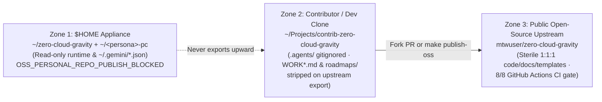

# Contributing to ZeroCloudGravity

Thank you for contributing to **ZeroCloudGravity (`zero-cloud-gravity`)** — the sovereign Zero-Cloud Human-AI governance engine, Ubuntu 26.04 LTS workstation control tower, and epistemic knowledge mesh for **Google Antigravity 2.0**.

> **Navigable Architecture & Maintainer Corpus**: Before modifying engine modules, Stow configurations, templates, or the MCP server, review **[`docs/README.md`](docs/README.md)**, the six normative specifications under **`docs/architecture/01..06`**, and the maintainer reference at **[`docs/reference/02_cli_mcp_and_security_reference.md`](docs/reference/02_cli_mcp_and_security_reference.md)**.

---

## 1. Foundational Architecture & Safety Invariants

Every contribution is verified deterministically against eight repository gates (`./scripts/verify-repo.sh`):

| Invariant | Mandatory Requirement |
| :--- | :--- |
| **Pure Python 3.14 Stdlib Runtime** | `pyproject.toml` runtime `dependencies` must remain empty (`[]`); rely exclusively on C-backed Python 3.14 standard library primitives (`hashlib.file_digest`, `stat.S_IWUSR`, `Path.is_relative_to`). |
| **Zero Secret & Identity Leakage** | Personal identities, SSH/GPG keys, OAuth credentials (`~/.gemini/*.json`), and host-local paths must never be committed. Use ISO-neutral examples (`corp-iso-root`, `squad-iso`, `gov-iso`, `alex-pc`). |
| **GNU Stow Tree Unfolding (`~/.gemini/config/`)** | `~/.gemini/`, `~/.gemini/config/`, and `~/.gemini/config/skills/` must remain real directories on disk so GNU Stow creates granular symlinks for `AGENTS.md`, `hooks.json`, `scripts/`, and global skills without touching local credentials. |
| **Antigravity 2.0 Token Budget** | `antigravity/.gemini/config/AGENTS.md` must stay strictly **`<= 18,000` bytes** so global rules are 100% inline-injected within Antigravity's `20,000`-token rule budget; detailed workflows belong in on-demand `SKILL.md` files. |
| **Module Size & Package Purity** | Source modules in `src/zcg/**.py` must stay **`<= 384` lines**; docs, tests, and `SKILL.md` files must stay **`<= 464` lines** (`0` `#####` headings); all `{src,tests}/**/__init__.py` files must be **`0 bytes`**. |
| **Strict Typing, Linting & Hexagonal Boundaries** | Zero `ruff check`, `ruff format --check`, `mypy --strict`, or `zcg lint-arch` violations (`src/zcg/web/` and `src/zcg/platform/` enforce `0` imports from `cockpit|governance|topology|mcp|cli`). |
| **`1:1:1` Symbiosis & `100.00%` Isolated Coverage** | Every `src/zcg/<pkg>/<mod>.py` declares `Specification: docs/architecture/0X_*.md`, maps `1:1` to `tests/unit/zcg/<pkg>/test_<mod>.py` inside the spec table, and passes at **`100.00%` statement and branch coverage in single-file isolation** (`make test-unit-isolated`). |

---

## 2. Three-Zone Security Isolation & Contribution Workflows

### 2.1. Three-Zone Privacy & Isolation Architecture

Every contribution path enforces three physical isolation zones so personal credentials, `$HOME` shell profiles, and internal organizational roadmaps never leak into public commits:



The table below details the security boundary enforced at each zone:

| Security Zone | Local Path Pattern | What Lives Here | Outbound Isolation Guarantee |
| :--- | :--- | :--- | :--- |
| **Zone 1 — `$HOME` Runtime & Personal `Root 0`** | `~/zero-cloud-gravity` & `~/<persona>-pc` | Daily stowed `~/.gemini/config/` runtime, personal `bash/` & `git/` profiles, and local OAuth/SSH state. | Hard-blocked from public export (`entity_kind != "open-source"` triggers `OSS_PERSONAL_REPO_PUBLISH_BLOCKED`). |
| **Zone 2 — Isolated Contributor / `dev` Workspace** | `~/Projects/contrib-zero-cloud-gravity` or `ZCG_DEV_REPO_DIR` | Active `feat/*` or `fix/*` branches with `science-base` + `software-engineering` projected in `.agents/rules/`. | `.agents/*` (`SESSION.md`, local telemetry) is gitignored; `make publish-oss` exports via `git archive HEAD` and strips `WORK*.md`, `BACKLOG.md`, and `roadmaps/`. |
| **Zone 3 — Public Open-Source Repository** | `github.com/mtwuser/zero-cloud-gravity` | Pure Python 3.14 engine, `16` templates, `17` skills, and `1:1:1` docs/tests. | Protected `master` branch enforcing linear history, Pull Request review for external contributors, and `8/8` GitHub Actions verification ([`.github/workflows/ci.yml`](.github/workflows/ci.yml)). |

### 2.2. Path A — Standard Community Contributor (GitHub Fork -> Branch -> Pull Request)

External contributors work directly from a standard GitHub fork of `zero-cloud-gravity` (which is already free of private trackers):

```bash
# 1. Fork https://github.com/mtwuser/zero-cloud-gravity on GitHub, then clone into ~/Projects/:
git clone git@github.com:<your-github-user>/zero-cloud-gravity.git ~/Projects/contrib-zero-cloud-gravity
cd ~/Projects/contrib-zero-cloud-gravity

# 2. Provision the isolated .venv toolchain (including ruff, mypy, pytest & shellcheck) and create a branch:
make setup-dev
git checkout -b feat/short-descriptive-slug

# 3. Implement Spec -> AAA Tests -> Code, record user-facing notes under ## [Unreleased] in CHANGELOG.md, and verify 8/8 gates:
make verify

# 4. Push to your fork and open a Pull Request against mtwuser/zero-cloud-gravity (master):
git push -u origin feat/short-descriptive-slug
```

Once opened using [`.github/PULL_REQUEST_TEMPLATE.md`](.github/PULL_REQUEST_TEMPLATE.md), GitHub Actions runs the deterministic `8/8` verification suite and approved Pull Requests are squash-merged onto `master` as a single linear commit.

### 2.3. Path B — Sovereign `Root 0` / Enterprise Anonymized Promotion (`CREATE_PR=1`)

Organizations operating a private contributor clone (`dev-zero-cloud-gravity`) that contains internal trackers (`WORKTASK.md`, `WORKROAD.md`, `BACKLOG.md`, `roadmaps/`) can export a sterile, tracker-free branch directly to **their own GitHub fork** before opening a Pull Request:

```bash
# Strips WORK*.md, BACKLOG.md, and roadmaps/ in an ephemeral directory and pushes a clean 1-commit branch to your fork:
make publish-oss CREATE_PR=1 \
  CONTRIB_BRANCH=contrib/short-topic-slug \
  OSS_REMOTE_URL=git@github.com:<your-org-or-user>/zero-cloud-gravity.git
```

Contributors may remain `Anonymous Organization (default)` or request named attribution in [`.github/PULL_REQUEST_TEMPLATE.md`](.github/PULL_REQUEST_TEMPLATE.md).

### 2.4. Path C — Core Maintainer Sovereign Release Flow (`Private CI -> Public Snapshot`)

Strictly inside private `dev-<repo>` clones (`visibility_scope: "private:open-source:dev"`, enforced by `[OSS_DEV_ONLY_BLOCKED]` so `$HOME` appliances, forks, and organizational nodes are never affected), maintainers operate flexibly: either **directly on `master`** for agile refinements (`git push origin master` triggers private GitHub Actions CI, followed by `zcg-sync --sync`), or via **opt-in branch pre-validation** (`make push-branch` to validate a `feature/*` or `fix/*` branch on private CI without touching `master` $\rightarrow$ `make promote-master` to fast-forward `master`, delete the temporary branch, and sync `$HOME`). When cutting a SemVer release (`/release`), `make publish-oss RELEASE_VERSION=X.Y.Z` exports a single tracker-free snapshot commit and annotated `vX.Y.Z` tag onto public `master`.

---

## 3. Extending Components Across the Architecture

1. **Engine Subpackages (`src/zcg/{core,platform,web,topology,governance,cockpit,cli,capsules,ephemeral,mcp}/`)**:
   - Follow **`1. Specification (`docs/architecture/01..06`) -> 2. Isolated `AAA` Unit/Imp/E2E Tests -> 3. Implementation`**.
   - Every test method must include a 1-line docstring and explicit `# Arrange`, `# Act`, and `# Assert` comments covering nominal flows, `N` vs. `N ± 1` cut-points, and bipolar error guards (`0` `# pragma: no cover`).
2. **Antigravity Skills (`antigravity/.gemini/config/skills/` & `templates/*-stack/*/skills/`)**:
   - Keep `name:` in `SKILL.md` YAML frontmatter `kebab-case` and `1:1` identical to its parent directory name, `< 465` lines total (`8` global skills + `9` stack skills = `17` verified skills).
3. **`plugin-stack` Reference Dashboards & Sovereign Brand Assets (`templates/plugin-stack/*`)**:
   - Extend `plugin_shell.html` (operational cockpits) or `base.html` (brand portals), scaffold typed Hexagonal capability modules via `zcg scaffold-plugin-module <plugin-id> <module-name>`, and customize node emblems without engine edits by placing `surfaces/web/static/img/logo.svg` (overriding the built-in `/static/img/logo.svg`).
4. **Ubuntu 26.04 External Package Recipes (`templates/plugin-stack/workstation-control-tower/assets/external/`)**:
   - Place declarative DEB822 `apt-repo/*.sh`, `deb-url/*.sh`, or `script/*.sh` recipes under `assets/external/` and verify clean `shellcheck` compliance via `make verify`.

---

## 4. Commit & Release Conventions

- **Conventional Commits**: Use atomic [Conventional Commits](https://www.conventionalcommits.org/) (`feat:`, `fix:`, `refactor:`, `test:`, `docs:`, `chore:`, `build:`).
- **Changelog & SemVer Discipline**: Record iterative changes under `## [Unreleased]` in [`CHANGELOG.md`](CHANGELOG.md) without bumping [`VERSION`](VERSION) during feature commits; promote `## [Unreleased]` and synchronize `VERSION`, `pyproject.toml`, and `README.md` in lockstep exclusively when cutting a verified SemVer release (`/release`).
- **Security Vulnerabilities**: Never open public issues for path-containment, capsule-HMAC, or sandbox vulnerabilities; follow [`SECURITY.md`](SECURITY.md) to report privately via GitHub Security Advisories.
