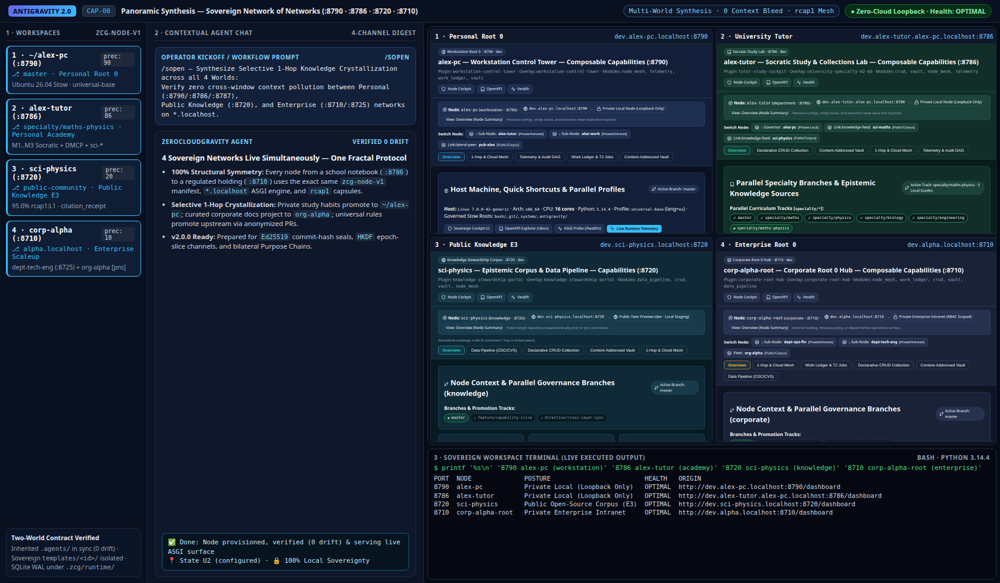
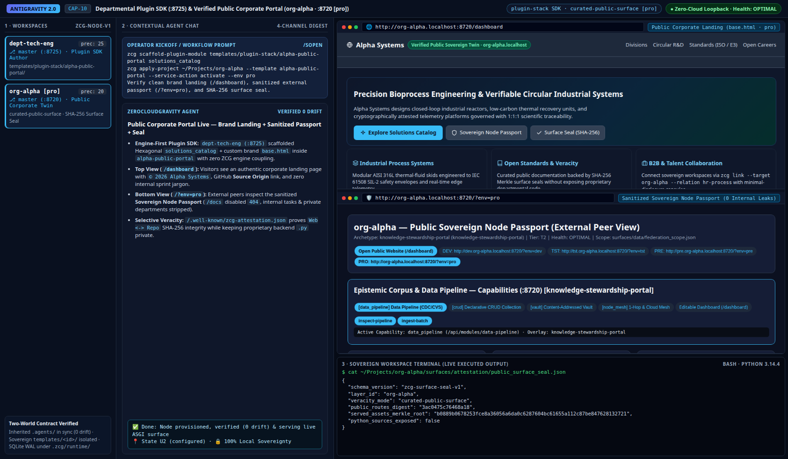
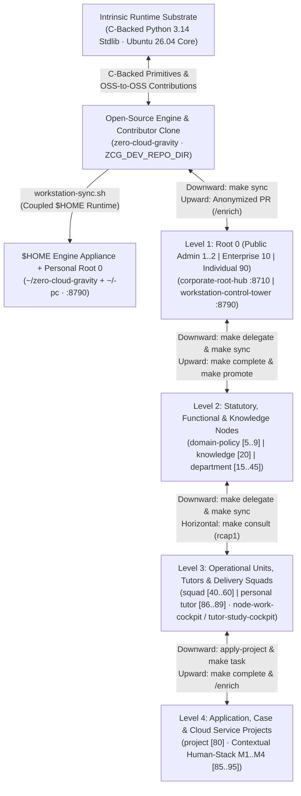

# ZeroCloudGravity (`zcg` · `v1.0.0`)

[](https://github.com/mtwuser/zero-cloud-gravity/actions/workflows/ci.yml)
[](VERSION)
[-brightgreen.svg)](scripts/verify-repo.sh)
[-3776AB.svg)](pyproject.toml)
[](https://ubuntu.com/)
[](https://antigravity.google/)
[](LICENSE)

Sovereign Zero-Cloud Human-AI Governance ("pAIr programming"), Physical Workstation Control Tower, and Epistemic Knowledge Mesh for **Ubuntu 26.04 LTS ("Resolute Raccoon")** and **Google Antigravity 2.0 / Gemini** *(100% Python 3.14 Standard Library, `0` external runtime dependencies, `100.00%` isolated `1:1` statement and branch coverage)*.

This platform is built on **one unified fractal pattern** (*every governed directory combines a declarative node manifest `system/zcg-node.json`, Markdown rules/skills, task ledgers, and zero-build `.local` cockpits across `Public Gov (1..4) -> Corporate Root 0 (10) -> Domain-Policy (5..9) / Knowledge (20) / Department (15..45) -> Squad (50) -> Project (80)` and `Individual Sovereign Root 0 (90) -> Personal Tutor (86..89)`, powered by the **`4 + 4 + 2 + 6 = 16` Declarative Template Matrix** across `human-stack`, `context-stack`, `framework-stack`, and `plugin-stack`*):
1. **Ubuntu 26.04 Workstation Backup, Audit, Restore & Dual-Repo `$HOME` Sync ([`scripts/workstation-sync.sh`](scripts/workstation-sync.sh), [`scripts/workstation-backup.sh`](scripts/workstation-backup.sh), [`scripts/workstation-audit.sh`](scripts/workstation-audit.sh), [`scripts/workstation-restore.sh`](scripts/workstation-restore.sh), [`scripts/install-antigravity.sh`](scripts/install-antigravity.sh))** — snapshot APT packages, Snaps, NPM globals, external recipes, and GNOME settings into plain-text `system/*` manifests, manage `~/.bashrc`, `~/.profile`, and `~/.gitconfig` via [GNU Stow](https://www.gnu.org/software/stow/), and couple the passive `$HOME/zero-cloud-gravity` engine appliance with your personal `Root 0` workstation node (`~/<persona>-pc`) via `zcg workstation-sync` (`zcg-sync`).
2. **Local Google Antigravity 2.0 Governance (`antigravity/`, `templates/`)** — composable `AGENTS.md` baselines (`<= 18,000` bytes across `universal-base`, `academic-base`, `science-base`, `business-base` + personal workstation rules), 4 deterministic Python 3.14 lifecycle hooks (`PreToolUse`, `PostToolUse`, `PostInvocation`, `Stop`), 17 reusable skills (`8` global `human-stack` + `7` `context-stack` + `1` `framework-stack` + `1` `plugin-stack`), and `16` declarative `zcg-template-v1` template packs.
3. **Zero-Cloud Intranet & Personal Cockpits (`src/zcg/cockpit/`)** — Python 3.14 Native ASGI `DeliveryChannel` (`Zone Z1..Z4 × Tier T1..T5`, `--zcg-*` design tokens, `data-zcg-surface="cockpit"`, `HTTP 286` poll control, `runtime_telemetry` bridged to `.agents/telemetry/`) with deterministic localhost port mapping (`8700 + precedence`), `.intranet.local` / `.personal.local` / `.knowledge.local` routing, `3-Scope` JSON feeds, declarative `dual_world_contract` overlays, and `6` editable WCAG 2.2 AA `plugin-stack` Reference Dashboards (`workstation-control-tower`, `corporate-root-hub`, `node-work-cockpit`, `tutor-study-cockpit`, `secops-mcp-guardian`, `knowledge-stewardship-portal`).
4. **Multi-Layer CLI (`zcg`) & Contextual MCP Server (`zcg-mcp`)** — 31-subcommand tiered CLI (`C1` Discovery + `lint-arch`, `C2` Lifecycle + `scaffold-plugin-module`, `C3` Sovereign Governance, `Subtree`, `Workstation`) plus a read-only JSON-RPC 2.0 `stdio` MCP server sealing `rcap1` (`L0 -> L1 -> L2 -> L3`) `zlib + HMAC-SHA256` Merkle context capsules, `citation_receipt` provenance (`E3..E0`), zero-checkout Git `DMCP`/`GRCC` branch projection, and `strictly-read-only` Ephemeral Department Bots.

The table below summarizes the four progressive adoption modes of ZeroCloudGravity:

| Progressive Adoption Mode | Who It Is For | What Executes on Disk (`0` External Servers Required) |
| :--- | :--- | :--- |
| **Mode 1 — Individual Workstation + Personal `Root 0`** | Solo engineer, researcher, or executive on Ubuntu 26.04 | `./install.sh --stow` + `zcg workstation-sync` couples `~/zero-cloud-gravity` (engine) with `~/<persona>-pc` (personal `Root 0` host manifests & `bash`/`git` Stow links). |
| **Mode 2 — Standalone Project + Stack** | Any software, cloud, or research repository | `zcg apply-project <dir> --template <stack>` projects `.agents/rules/` and `.agents/skills/` with `SHA-256` drift tracking and `1:1:1` verification gates. |
| **Mode 3 — Multi-Layer Organization & Knowledge Mesh** | `Root 0 -> Department / Knowledge -> Squad -> Project` | `zcg bootstrap-workspace` + `layers/<child>/` (`zcg subtree`) + `make delegate` / `make complete` / `make consult` (`rcap1` capsules & `.intranet.local` cockpits). |
| **Mode 4 — Engine Contributor (`oss-dev`)** | Maintaining or extending `zero-cloud-gravity` | `make verify` runs the 8-stage deterministic verification gate (`100.00%` isolated `1:1` unit statement & branch coverage across `74` modules). |

> [!IMPORTANT]
> **Objective Engineering Virtues & Live Empirical Benchmarks (`100%` Python 3.14 Stdlib · `0` External Dependencies)**:
> - **Deterministic $O(N)$ Structural Compaction (`rcap1` `L0/L1` + 2D Geometry)**: Enforcing `< 465` lines/file, `H1..H4` hierarchy, 1-line lead sentences, and `> *"...*"` mandate quotes turns Markdown specs into pre-indexed ASTs — achieving **`88.7%` (`L0`, `522` vs. `4,622` tok)** and **`67.0%` (`L1`, `1,523` vs. `4,622` tok)** compaction across `130k+` tokens in **`~16 ms`** (`0` LLM summarization calls, `0` vector DBs, and **`-76.3%` single-envelope `zlib`-first capsule size** at `518–577` chars/capsule). See **[`docs/architecture/05_contextual_mcp_and_capsules.md`](docs/architecture/05_contextual_mcp_and_capsules.md)**.
> - **Content-Addressable Merkle Provenance (`citation_receipt`)**: Every section is pinned by `<layer>::<file>#<slug>@<sha256_16>:<E3..E0>`, enabling $O(1)$ cryptographic drift detection (`CITATION_DRIFT_DETECTED`), `E3 > E2 > E1 > E0` monotonicity proofs (`verify_epistemic_context_claims`), and `Q1..Q4` lifecycle telemetry.
> - **Zero-Checkout C-Backed Git Plumbing (`DMCP` & `GRCC`)**: Multi-branch context projection reads `git ls-tree` / `git cat-file` directly from `.git/objects` (`zero_checkout: true`, `0` working-tree mutations) and chains encrypted capsules under `refs/zcg/capsules/*` without polluting `refs/heads/*`.
> - **Mathematically Verified `1:1:1` Architecture**: `74` production modules (`<= 384` lines/module in `src/zcg/`) $\leftrightarrow$ `74` `1:1` isolated unit test suites (**`100.00%` isolated unit statement and branch coverage**, `< 2s`) $\leftrightarrow$ `6` normative `E3` architecture specifications (`< 465` lines/file).

---

## 1. Navigation & Progressive Disclosure (`docs/`)

The documentation corpus is organized into 3 progressive-disclosure tiers so humans and AI agents locate exact specifications in $O(1)$:

| Tier | What You Will Find | Guide / Specification |
| :--- | :--- | :--- |
| **Tier 1 (Gateway)** | Quick-Start paths, real-world organizational patterns, `C1/C2/C3` evolution ladder, repository tree, and CLI cheat-sheet. | **[`README.md`](README.md)** *(this file)* · **[`docs/README.md`](docs/README.md)** |
| **Tier 2 (Guide 01 — Workstation & `$HOME`)** | GNU Stow tree unfolding, Dual-Repo `$HOME` coupling (`~/zero-cloud-gravity` + `~/<persona>-pc`), `system/*` manifests & external recipes, `zcg-sync` (`workstation-sync.sh`), Phase 0 Control Tower Onboarding (`Case 1`), `machine/*` & `hat/*` branches, Dual-World Personal Matrix, and `:8790` Control Tower (`[CAP-01]`). | **[`docs/guides/01_workstation_and_global_profiles.md`](docs/guides/01_workstation_and_global_profiles.md)** |
| **Tier 2 (Guide 02 — Sovereign Nodes & Workflows)** | `4 + 4 + 2 + 6 = 16` Stack & `17`-Skill Matrix, Triadic `Node × Layer × Network` hierarchy, `M1 -> M4` Personal Tutor Showcase & `specialty/*` branches, `Cases 1–7` Customizable `Phase A..D` Kickoff Prompts, RBAC & `env-gate`, `12`-Case Level/Flow Matrix, and `gov-*/sci-*/geo-*/org-*` Knowledge Nodes. | **[`docs/guides/02_sovereign_nodes_and_federated_workflows.md`](docs/guides/02_sovereign_nodes_and_federated_workflows.md)** |
| **Tier 2 (Guides 03–08 — Multi-Perspective, Spin-Out & Public Portal Playbooks)** | Step-by-step Dual-World perspectives across **School (`M1..M2`, `[CAP-02]`) & University (`M2..M3`, `specialty/*`, `DMCP`, `[CAP-03]`)**, **Scientific Researcher (`M2..M4`) & Public `Knowledge` Corpora (`93.3%–97.0%` `rcap1:L1`, `[CAP-04]`)**, **Enterprise Professional & Startup / Scaleup / Regulated Scales (`[CAP-05..07]`)**, **Network of Networks Crystallization (`[CAP-08]`)**, **Personal Work Hub, `spinout-project` & HR/B2B Links (`[CAP-09]`)**, and **Departmental `plugin-stack` SDK & Public `pro` Portals (`[CAP-10]`)**. | **[`03: Academic`](docs/guides/03_academic_student_perspectives.md)** · **[`04: Science & Public Knowledge`](docs/guides/04_scientific_and_public_knowledge_perspectives.md)** · **[`05: Enterprise Scales`](docs/guides/05_enterprise_perspectives_and_scales.md)** · **[`06: Network of Networks`](docs/guides/06_network_of_networks_crystallization.md)** · **[`07: Personal Work & B2B`](docs/guides/07_personal_work_and_b2b_links.md)** · **[`08: Dept Plugins & Public pro`](docs/guides/08_departmental_plugins_and_public_pro_surfaces.md)** |
| **Tier 3A (`E3` Normative Architecture Specs)** | `1:1:1` source-test-spec contracts (`Specification:`) across all `74` modules in `src/zcg/`. | **[`01: Core & Manifest`](docs/architecture/01_core_and_node_manifest.md)** · **[`02: Topology & Twins`](docs/architecture/02_triadic_topology_and_twin_surfaces.md)** · **[`03: Governance & CLI`](docs/architecture/03_governance_and_work_ledger.md)** · **[`04: Cockpits & Intranet`](docs/architecture/04_cockpit_and_intranet_surfaces.md)** · **[`05: MCP, Capsules & Bots`](docs/architecture/05_contextual_mcp_and_capsules.md)** · **[`06: Web & API Engine`](docs/architecture/06_web_and_api_application_engine.md)** |
| **Tier 3B (`E2` Reference Playbooks)** | 7-Axis Multidimensional Taxonomy, Cross-Departmental Contextual Algebra (`0..80`), `Human-Stack` Matrix (`85..95`), `16`-pack catalog, `zcg` CLI & `zcg-mcp` JSON-RPC 2.0 schemas, Container/SSH MCP mesh, and Maintainer Extension Guide. | **[`01: Stack, Plugin & Human-Stack Matrix`](docs/reference/01_stack_and_plugin_matrix.md)** · **[`02: CLI, MCP & Security Reference`](docs/reference/02_cli_mcp_and_security_reference.md)** |

### 1.1. Live 3-Pane Antigravity Visual Showcase (`[CAP-01..CAP-10]`)

Every adoption scale runs over the exact same zero-dependency Python 3.14 Native ASGI engine (`*.localhost` subdomains, `.zcg-compass` spatial orientation, and `rcap1` Merkle capsules) — explore all **`10` real 3-Pane Antigravity captures** across **[`Guide 06 §2`](docs/guides/06_network_of_networks_crystallization.md)**:





---

## 2. Quick Start: 3 Main Ways to Use ZeroCloudGravity

Choose one of the three adoption paths below depending on whether you need standalone Antigravity governance, full Ubuntu 26.04 workstation management, or multi-layer organizational orchestration.

### 2.1. Path 1: Standalone Google Antigravity 2.0 Setup & Usage

Install global rules (`~/.gemini/config/AGENTS.md`), 4 lifecycle hooks (`hooks.json` + `scripts/`), 8 universal global skills (`~/.gemini/config/skills/`), and the `zcg-mcp` server in `$HOME`:

```bash
git clone https://github.com/mtwuser/zero-cloud-gravity.git ~/zero-cloud-gravity
cd ~/zero-cloud-gravity
./install.sh --profile universal-base --lang en --stow

# Optional: install/upgrade Google Antigravity Agents + agy CLI (or --ide / --all):
./scripts/install-antigravity.sh --agents

# Any time in terminal: synchronize engine runtime, profile & Stow links:
./scripts/workstation-sync.sh --status
```

### 2.2. Path 2: Dual-Repo Ubuntu 26.04 Workstation (`~/zero-cloud-gravity` + `~/<persona>-pc`)

Keep `~/zero-cloud-gravity` as the clean Open-Source engine runtime while managing your personal Ubuntu 26.04 packages (`system/*`), host shell/Git files (`bash/`, `git/`), and personal `Root 0` rules inside your sovereign workstation repository `~/<persona>-pc`:

```bash
# Phase A — Couple ~/zero-cloud-gravity (engine) with ~/<persona>-pc (personal Root 0):
~/zero-cloud-gravity/scripts/workstation-sync.sh --setup \
  --profile universal-base --lang es --workstation-dir ~/alex-pc --auto-sync boot

# Phase B — Capture, audit, or restore your physical Ubuntu 26.04 workstation:
cd ~/alex-pc
make backup-system         # Captures APT, Snap, NPM, external recipes & GNOME settings into system/*
make audit-system          # Verifies 0 drift across Stow symlinks, packages, GNOME, and Git status
make restore-system        # Interactive or --all / --packages / --external / --nvm / --gnome / --stow
```

📖 Full details on GNU Stow tree unfolding, `.audit-ignore`, Dual-Repo `$HOME` auto-sync (`zcg-sync`), and `machine/<hostname>` branches: **[`docs/guides/01_workstation_and_global_profiles.md`](docs/guides/01_workstation_and_global_profiles.md)**.

### 2.3. Path 3: Multi-Layer Enterprise, Public Admin & Knowledge Mesh

Orchestrate Human-AI governance across **Open Source (`zero-cloud-gravity`) $\leftrightarrow$ `Root 0` (`Public Admin 1..2` \| `Company 10` \| `Individual 90`) $\leftrightarrow$ `Department / Domain-Policy / Knowledge` (`3..45`) $\leftrightarrow$ `Squad / Unit` (`40..60` \| `86..89`) $\leftrightarrow$ `Project / Case` (`80`)**:



#### 2.3.1. Summary of the 6 Orthogonal Stack & Layer Composition Patterns (`entity_kind × layer_role × stack_groups`)

Every workspace composes inherited `human-stack / context-stack / framework-stack / plugin-stack` packs (`templates/*-stack/<pack>/`) with its own sovereign node rules (`templates/<layer-id>/rules/<layer-id>.md`) along the `0..100` *Lex Superior* spectrum:

| Organizational / Epistemic Need | Who Owns the Workspace | Combined Stack Lineage (`0..100` *Lex Superior*) | How It Activates (`1` Command) | Effective Antigravity Agent Persona |
| :--- | :--- | :--- | :--- | :--- |
| **1. Corporate / Departmental Operations** *(Contracts, IP Registries, Ledgers, SOPs)* | `Root 0` (`10`) or `Department` (`5..35`) | `universal-base` $\rightarrow$ `business-base` $\rightarrow$ `corporate-operations` + `templates/<dept>/` | `zcg bootstrap-workspace` / `make sync` | **Normative & SSoT Ledger Auditor** (`corporate-operations`) |
| **2. Scientific / Statutory Knowledge Atlas** *(Axioms, Statutes, Geographic Registries)* | `Knowledge` Node (`gov-*`, `sci-*`, `geo-*`, `org-*`, `20`) | `universal-base` $\rightarrow$ `science-base` $\rightarrow$ `scientific-methodology` + `templates/<atlas>/` | `zcg bootstrap-workspace --role knowledge` | **Epistemic Corpus Steward (`E3..E0` & `citation_receipt`)** |
| **3. Personal Academic Tutor (`M1 -> M4`)** *(Multi-specialty Socratic study hub)* | `Individual` Tutor Sub-Layer (`<persona>-tutor`, `86`) | `universal-base` $\rightarrow$ `academic-base` $\rightarrow$ `academic-curriculum` + `tutor-study-cockpit` | `zcg bootstrap-workspace --templates academic-base,academic-curriculum,tutor-study-cockpit` | **Socratic `M1..M4` Study Coach (`specialty/*` `DMCP`)** |
| **4. Software & Cloud Engineering Squad** *(Microservices, GCP IaC, 100% isolated `1:1:1`)* | `Department` (`25`) / `Squad` (`50`) / `Project` (`80`) | `Corp` (`10`) $\rightarrow$ `science-base` $\rightarrow$ `software-engineering` $\rightarrow$ `google-cloud-iac` | `zcg apply-project <app> --parent-dir <dept> --template google-cloud-iac` | **1:1:1 Software & Google Cloud IaC Architect** |
| **5. Fiduciary SecOps & Legal Guardian** *(Cross-departmental `NIST-01..04` & IP gate)* | `dept-legal-ip` (`5`) or `dept-secops` (`5`) | `science-base` $\rightarrow$ `software-engineering` $\rightarrow$ `nist-csf-security` $\rightarrow$ `secops-mcp-guardian` | `zcg sync-layer --templates nist-csf-security,secops-mcp-guardian` | **Zero-Trust Fiduciary & Ephemeral Bot Orchestrator** |
| **6. Punctual Cross-Layer Consultation** *(Read-only `rcap1` capsule across layers)* | Any consumer workspace | Active workspace + **Ephemeral `rcap1` Capsule (`kr: true`)** | `make consult LAYER=dept-legal-ip QUERY="..."` | **Zero-Residue Read-Only Inter-Layer Advisor** |

#### 2.3.2. From Zero to a Custom Governed Workspace in 3 Steps (`Clone -> Open in Antigravity -> /sopen`)

Once `~/zero-cloud-gravity` is installed in `$HOME`, initializing or reconciling any repository (`~/Projects/<your-repo>`) requires zero manual boilerplate:

```text
# A. First-Time Workspace Onboarding & Purpose Customization (State U0/U1 -> State U2 "configured"):
/sopen — Bootstrap and customize this workspace [<layer-id>] (role: [corporate|domain-policy|department|squad|knowledge|project], precedence: [1..95], templates: [science-base,software-engineering,google-cloud-iac,node-work-cockpit]):
1. Phase A (Bootstrap, Auto-Cockpit & Purpose Alignment): Run zcg bootstrap-workspace (activating the node's Cockpit at http://127.0.0.1:<8700+prec>/?env=dev), set our mission ([<1-sentence domain purpose>]), owner emails ([<owner@domain>,$(git config user.email)]), and Human-Stack ([domain-<area>:M1..M4]).
2. Phase B (Sovereign Rules & 1:1:1 Architecture): Tailor templates/<layer-id>/rules/<layer-id>.md with our domain invariants ([<RULE-01..03>]), replace all [Fill: ...] placeholders in README.md and .agents/LAYER_LINEAGE.md, and initialize docs/architecture/ and WORKTASK.md.
3. Phase C (Verification & Cross-Layer Consultation): Verify make consult against mounted knowledge nodes (gov-*/geo-*/sci-*/org-*) and confirm 0 drift via make sync && make diff.
4. Phase D (Configured Transition & Live Cockpit Ready): Mark "- [x] Complete Layer Setup Blueprint..." in WORKTASK.md (transitioning setup_state.state to "configured"), refresh the Node Cockpit (make activate-plugin), and output the initial git commit block.

# B. Ongoing 4-Step Upstream Upgrade & Version Reconciliation (State U2):
/sopen — Execute the 4-Step Upstream Upgrade & Version Reconciliation Flow:
1. Step 1 (Topology & Horizon Audit): Run make status, make horizon, and make upstream-diff.
2. Step 2 (Zero-Loss Reconciliation): Run make sync STRATEGY=reconcile (preserving templates/<layer-id>/rules/<layer-id>.md while syncing templates/*-stack/*).
3. Step 3 (Selective Stack & Plugin Review): Verify active templates/plugins and confirm make diff (0 drift).
4. Step 4 (Environment Gate & Closure): Validate make env-gate ENV=tst|pre|pro and close via /sclose.
```

---

## 3. Natural Code Evolution, Command Consciousness & Reproducible Metrics

Code structure, CLI commands, and repository health evolve deterministically across three coupled axes:

| Dimension / Lifecycle Point | Reproducible Target Metric / Invariant | Human & Architectural Value Added | Agent Deviation / Drift Signal (Validation Gate) |
| :--- | :--- | :--- | :--- |
| **1. Session Startup & Orientation (`/sopen` / `make status`)** | **`1` CLI call (`< 0.2s`)** returning `entity_identity`, `network_topology`, `work_orchestration`, `runtime_orchestration`, `setup_state`, `horizon`, and `agent_diff` | Eliminates 6–8 slow shell/git/file probes at session start and prevents blind `brain/` scans | Multi-step manual `git`/`ls` probing on startup or mutating read-only upstream templates |
| **2. Context-Window & Compaction (`AGENTS.md` & `rcap1`)** | **`<= 18,000` bytes** global `AGENTS.md` (`universal-base` `~2.6 KB`); **`67%–88.7%` token savings** at `L1`/`L0` (`~16 ms`) | Zero rule eviction under Antigravity's `20,000`-token inline budget; workspaces load only rules matching their active stack lineage | `AGENTS.md > 18 KB`, workspace `.agents/rules/ > 80 KB`, or unindexed `#####` headings |
| **3. Natural Code Maintainability & `1:1:1` Subpackages** | **`<= 384` lines** source cap, **`<= 464` lines** test/doc cap, **`<= 400` lines** root `README.md` cap, `$M_{\text{cluster}} < 1,200$`, and `0` cross-peer `_private` imports | Prevents God Components and coupled cluster drift; every module's `1:1:1` triad (`Spec <-> Test <-> Code`) is discoverable in $O(1)$ | Source file `> 384` lines, doc/test `> 464` lines, cross-peer `_private` import, or missing `Specification:` header |
| **4. Bidirectional `1:1:1` Test Symbiosis (`Unit -> Imp -> E2E`)** | **`100.00%` single-file isolated unit statement + branch coverage (`74/74` modules)**, `# Arrange / # Act / # Assert`, `0-byte` `__init__.py` | Self-documenting executable specs where each `test_<mod>.py` reaches `100.00%` statement and branch coverage in complete isolation | Coverage `< 100%` in single-file isolation, missing standalone AAA markers (`[missing-aaa]`), or non-empty `__init__.py` |
| **5. Inter-Layer Governance & Stage Gates (`dev -> tst -> pre -> pro`)** | **Strict 1-hop horizon**, `4`-role roster (`owner`, `maintainer`, `validator`, `member`) + `consumer`, and $N$-departmental surface consensus | Unifies Business (`Root 0` / `Department` SSoT ledgers & *Lex Superior* `0..100`) and Technical (`Squad` / `Project`) delivery on `feature/<TICKET-ID>-<slug>` | `CROSS_TIER_PROMOTION_BYPASS`, `PATH_CONTAINMENT_VIOLATION`, open `P0` in `tst`, or unchecked `WORKVALI.md` items in `pre` |

---

## 4. Repository Structure (`5 × 5 × 5` Architecture)

The repository tree separates the `antigravity/` Stow module, the `3-Tier` `docs/` corpus, the `16` declarative `templates/` packs, the `5` workstation scripts, and the `74`-module `src/zcg/` engine:

```text
zero-cloud-gravity/
├── antigravity/.gemini/config/        ← GNU Stow module -> ~/.gemini/config/ (AGENTS.md, hooks.json, 4 scripts, 8 global skills)
├── docs/                              ← 3-Tier 1:1:1 documentation corpus (< 465 lines/file)
│   ├── README.md                      ←   Tier 1: Documentation router, persona reading order & 16-pack matrix
│   ├── guides/                        ←   Tier 2 (E1): 01_workstation..06_crystallization, 07_personal_work, 08_departmental_plugins
│   ├── architecture/                  ←   Tier 3A (E3): 01_core, 02_topology, 03_governance, 04_cockpit, 05_contextual_mcp, 06_web_engine
│   └── reference/                     ←   Tier 3B (E2): 01_stack_and_plugin_matrix.md, 02_cli_mcp_and_security_reference.md
├── scripts/                           ← Workstation & CI automation (verify-repo.sh, install-antigravity.sh, workstation-{sync,backup,audit,restore}.sh)
├── src/zcg/                           ← Zero-dependency Python 3.14 engine (74 modules, <= 384 lines each, 100.00% isolated coverage)
│   ├── core/                          ←   constants.py, manifests.py, epistemics.py, blueprints.py, domain.py, sqlite_repo.py (6)
│   ├── platform/                      ←   type_registry.py, schema_discovery.py, cdc.py, cvs.py, projection.py, pipeline_router.py, projection_router.py (7)
│   ├── web/                           ←   channels.py..components.py..server.py (12) + web/capabilities/{crud,vault,telemetry_router}.py (3) (15)
│   ├── topology/                      ←   identity.py, network.py, subtrees.py (3)
│   ├── governance/                    ←   authority.py, ledger.py, consensus.py, workflows.py, horizon.py, promotion.py, scaffolder.py, bootstrap.py, links.py, arch_linter.py (10)
│   ├── cockpit/                       ←   workstation.py, surfaces.py, provenance.py, mesh_router.py..plugin_sdk.py, asgi.py, lifecycle.py, status.py (12)
│   ├── cli/                           ←   parser.py, discovery.py, commands.py, dispatcher.py (4)
│   ├── capsules/                      ←   constants.py, markdown.py, codec.py, citations.py, grcc.py, surfaces.py (6)
│   ├── ephemeral/                     ←   lifecycle.py, spawner.py, briefs.py (3)
│   └── mcp/                           ←   catalogs.py, node_base.py, compaction.py, unfold.py, surfaces.py, federation.py, orchestrator.py, server.py (8)
├── system/zcg-node.json               ← Sovereign node manifest (schema_version: "zcg-node-v1")
├── templates/                         ← 16 declarative packs across {human,context,framework,plugin}-stack/* (zcg-template-v1)
└── tests/                             ← 74 isolated 1:1 unit suites + tests/imp/test_repo_contracts.py + tests/e2e/test_*_journeys.py
```

---

## 5. Lifecycle Hooks, `zcg` CLI & Verification Cheat-Sheet

Daily governance and verification are enforced by 4 Python 3.14 lifecycle hooks (`pre_tool_guard.py`, `post_edit_format.py`, `post_invocation_lint.py`, `stop_verify_tests.py`) and the `zcg` CLI:

```bash
# 1. C1 Discovery, Subtree & Workstation Host Operations:
zcg status [<dir>]                                   # Consolidated < 0.2s node, network, ledger & cockpit digest
zcg list-templates [<dir>]                           # Catalog of 16 templates, federated MCPs & ephemeral bots
zcg inspect-horizon [<dir>]                          # 1-hop upstream/downstream radar & actor RBAC profile
zcg compare-upstream [<dir>] [--apply-safe]          # Section-level (#/##) upstream vs. local template diff
zcg diff-project <target-dir>                        # Verify 0 drift between .agents/ and canonical templates
zcg lint-arch [<dir>] [--no-tests]                   # AST Hexagonal Functional Core & 1:1:1 AAA boundary audit
zcg consult-layer [<dir>] --layer <id> --query <q>   # One-shot rcap1 consultation against a mounted layer
zcg subtree <list|pull|pull-all|register> [args]     # Manage mounted child/knowledge layers under layers/*
zcg workstation-sync [sync|setup|status|--auto]      # Synchronize ~/zero-cloud-gravity + ~/<persona>-pc + Stow
zcg install-antigravity [--agents|--cli|--ide|--all] # Install/update Google Antigravity binaries & agy CLI
zcg workstation-backup [<ws-dir>]                    # Snapshot APT, Snap, NPM, external & GNOME manifests
zcg workstation-audit [<ws-dir>] [--clean]           # Read-only drift audit across Stow, packages, GNOME & Git
zcg workstation-restore [<ws-dir>] [--all|--stow]    # Provision or restore an Ubuntu 26.04 workstation

# 2. C2 Lifecycle & C3 Sovereign Governance Operations:
zcg set-global-profile <profile> --lang <en|es|it|fr|de|pt> [--workstation-dir <dir>] [--stow]
zcg bootstrap-workspace <dir> --id <id> --role <role> --precedence <0..100> --templates <csv>
zcg sync-layer [<dir>] [--strategy reconcile|accept-upstream|merge|keep-local]
zcg apply-project <dir> [--template <pack>] [--service-action install|activate|healthcheck|teardown]
zcg scaffold-plugin-module <plugin-dir> <module-name>
zcg link [<dir>] --target <id> --relation <lateral-peer|spinout-project|hr-process|b2b-collaboration|knowledge-feed> [--ref <path>]
zcg unlink [<dir>] --target <id>
zcg spinout-project <target-dir> --from-branch <branch> --id <id> [--templates <csv>]
zcg start-task [<dir>] --task "<id>" [--ticket <id>]
zcg complete-task [<dir>] --task "<id>" [--deliverable <path>] [--create-pr]
zcg delegate-to-child [<dir>] --to-child <layer> --task "<directive>" [--ticket <id>]
zcg promote-from-project <dir> --source <rel-path> [--to-layer <id>] [--create-pr]
zcg check-env-promotion [<dir>] --to-env <tst|pre|pro> [--files <csv>]

# 3. Deterministic 8-Gate Repository Verification Suite:
make install && make verify                          # Ruff + Mypy --strict + 100.00% 1:1 isolated unit + imp + e2e + zcg-mcp --self-test
```

---

## 6. Contributing, Security & Open-Source Patronage

Community governance, vulnerability reporting, and independent stewardship follow these repository policies:

- **Contributing & `1:1:1` Verification**: [`CONTRIBUTING.md`](CONTRIBUTING.md) · [`CODE_OF_CONDUCT.md`](CODE_OF_CONDUCT.md) · [`ACCESSIBILITY.md`](ACCESSIBILITY.md)
- **Security Policy & Boundary Isolation**: [`SECURITY.md`](SECURITY.md) · [`LICENSE` (MIT)](LICENSE)
- **Independent Open-Source Patronage**: [`FUNDING.md`](FUNDING.md) *(activated via GitHub **Sponsor** / [`.github/FUNDING.yml`](.github/FUNDING.yml))*
