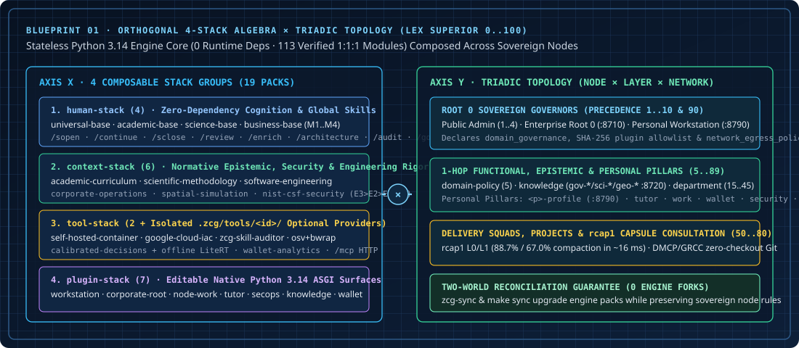
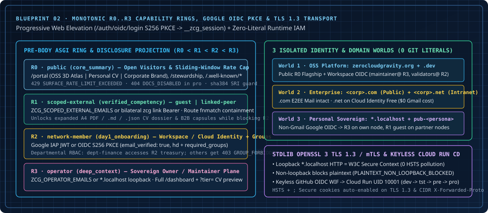
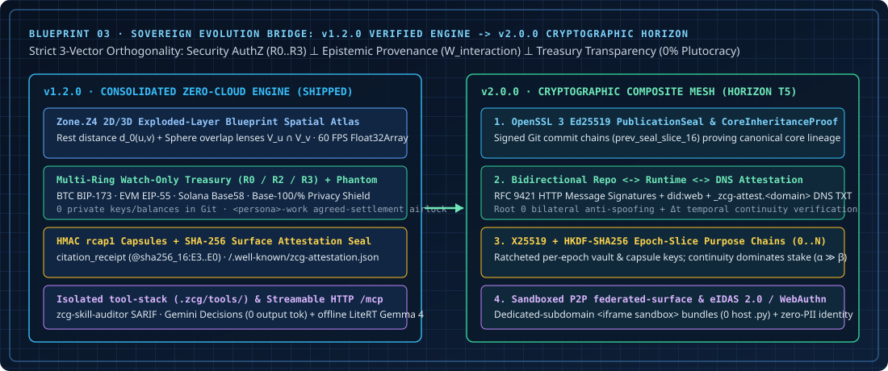

# Systems Whitepaper — `ZeroCloudGravity`: Sovereign Zero-Cloud Human–AI Governance, Epistemic Provenance & Cryptographic Composite Node Mesh

> **Systems Architecture & Mathematical Foundations (`v1.2.0` Verified Baseline $\rightarrow$ `v2.0.0` Cryptographic Horizon)**
>
> `ZeroCloudGravity` (`zcg`) is a zero-dependency Python 3.14 Standard Library operating substrate (`0` third-party runtime packages, `143` `1:1:1` verified production modules at `100.00%` isolated statement and branch coverage) uniting physical Ubuntu 26.04 LTS workstations, Google Antigravity 2.0 / Gemini cognitive workflows, deterministic `rcap1` Merkle context compaction, 3-origin `SQLite FTS5` knowledge spaces, hierarchical `mandatory | optional | forbidden` modular capabilities, `Zone.Z4` 2D/3D spatial topology, non-custodial multi-ring stewardship, and monotonic `R0..R3` web capability surfaces without mandatory SaaS telemetry or framework lock-in. For operational onboarding, see **[`README.md`](../README.md)** and **[`docs/README.md`](README.md)**.

---

## 1. Problem Statement & Core Architectural Axioms

Modern AI-assisted engineering, scientific research, and organizational governance suffer from three compounding failure modes: **(1) Context Dilution & Rule Eviction** as unindexed prompts and monolithic markdown files overflow agent context windows; **(2) SaaS Telemetry & Dependency Fragility** where local agentic tools phone home or break across transitive package trees; and **(3) Conflation of Authority, Reputation & Capital** when collaborative networks mix access control with financial weight.

`ZeroCloudGravity` resolves all three through four non-negotiable systems axioms:

| Axiom | Formal Invariant | Concrete Engine Realization |
| :--- | :--- | :--- |
| **1. Stateless Appliance Core vs. Two-World Customization** | `dependencies == []` (`0` Engine Forks) | `~/zero-cloud-gravity` updates cleanly via `zcg-sync`; individuals and organizations customize exclusively declarative `system/zcg-node.json` manifests, `templates/<layer>/rules/`, and `surfaces/web/` overrides. |
| **2. Mathematical `1:1:1` Symbiosis** | $\forall m \in \text{src/zcg}: \text{Spec}(m) \leftrightarrow \text{Unit}(m) \leftrightarrow \text{Code}(m)$ | Every production module (`<= 384` lines) declares `Specification: docs/architecture/<spec>.md` and passes an isolated `1:1` unit suite at **`100.00%` statement and branch coverage** (`< 2s` total). |
| **3.Deterministic $O(N)$ Epistemic Provenance** | `E3` (Statutory Law) $>$ `E2` (Standard/Theorem) $>$ `E1` (Guide) $>$ `E0` (Draft) | `rcap1` compacts `130k+` tokens by **`88.7%` (`L0`) / `67.0%` (`L1`) in `~16 ms`** (`0` LLM calls, `0` vector DBs) while pinning every section via `<layer>::<file>#<slug>@<sha256_16>:<E3..E0>` (`CITATION_DRIFT_DETECTED`). |
| **4. Strict 3-Vector Independence (`0%` Plutocracy)** | $\text{AuthZ} \perp W_{\text{interaction}} \perp S_{\text{treasury}}$ | Security capability rings (`R0..R3`), cultivated epistemic/technical interaction weight ($W_{\text{interaction}}$), and verified watch-only treasury transparency ($S_{\text{treasury}}$) never collapse into a purchasable privilege scalar. |

---

## 2. Orthogonal `4`-Stack Algebra $\times$ Triadic `Node × Layer × Network` Topology

Every governed workspace is an instance of **one fractal node contract** (`system/zcg-node.json`) composing four orthogonal template stack groups along the `0..100` *Lex Superior* authority lattice (`Public Gov 1..4 -> Corporate Root 0 10 -> Domain-Policy 5..9 / Knowledge 20 / Department 15..45 -> Squad 50 -> Project 80` and `Personal Workstation Root 0 90 -> Personal Pillars 86..89`), as illustrated in Blueprint 01:

### 2.1. Information-Theoretic Compaction (`rcap1`) & Zero-Checkout Git Plumbing (`DMCP` / `GRCC`)

Rather than indexing prose in external vector databases, `ZeroCloudGravity` enforces 2D structural Markdown geometry (`< 465` lines/file, `H1..H4` hierarchy, 1-line lead sentences, and `> *"...*"` mandate quotes) and seals content-addressed `zlib + HMAC-SHA256` envelopes ([`Architecture 05`](architecture/05_contextual_mcp_and_capsules.md)):

1. **Multi-Resolution Gradient (`L0 -> L1 -> L2 -> L3`)**: Consumers pull structural headers (`L0`, `88.7%` token savings) or normative mandates (`L1`, `67.0%` savings) first, unfolding `l3_targets` to verbatim `L3` clauses strictly on demand (`zcg-mcp` over `stdio` or `Streamable HTTP` `/mcp`).
2. **Zero-Checkout Multi-Branch Projection (`DMCP` & `GRCC`)**: Academic `specialty/*`, workstation `machine/*`, and departmental `env/*` branches are read directly from `.git/objects` (`git ls-tree` / `git cat-file`, `zero_checkout: true`, `< 5 ms`) while encrypted consultation capsules chain under `refs/zcg/capsules/*` without touching the working tree.
3. **Isolated `tool-stack` Execution (`.zcg/tools/<id>/`)**: Sovereign and optional verifiers (3-tier `zcg-skill-auditor` emitting SARIF `2.1.0` `0..100` trust scores + 1-Verb Jaccard deduplication + A/B `Skill Lift`, `osv-scanner` + Linux `bwrap` read-only sandboxes, `0`-output-token calibrated `Gemini Decisions API` `gemini-decision-1` paired with offline local `LiteRT` `gemma-4-26b-a4b-it`, and `wallet-analytics`) run inside isolated `.zcg/tools/<id>/` environments (`0` mutations to engine `pyproject.toml`).

---

## 3. Monotonic `R0..R3` Capability Rings, Progressive Google OIDC `PKCE` & End-to-End TLS 1.3

Every node's Native Python 3.14 ASGI web engine ([`src/zcg/web/`](architecture/06_web_and_api_application_engine.md)) enforces pre-body authorization across four monotonic capability rings (`R0 < R1 < R2 < R3`) while projecting data fields through `RolePayloadProjector` (`core_summary <= verified_competency <= day1_onboarding <= deep_context`), as depicted in Blueprint 02:

### 3.1. Four-Archetype Public `R0` Web Portals & Progressive Identity Elevation

A single public URL (`zerocloudgravity.org`, `<corp>.com`, `<persona>` `Root 0` hub, or `work.<persona>` / `pub-<persona>`) serves anonymous visitors at `R0` (`portal_shell.html` over `base.html`) and progressively unlocks ring-scoped capabilities upon signing in via `/auth/oidc/login` (vendor-neutral RFC 7636 `S256` PKCE $\rightarrow$ HMAC-signed `HttpOnly; SameSite=Lax; Secure` `__zcg_session`):

| Entity Kind & Portal Archetype | Public `R0` Experience (`core_summary`) | Progressive Elevation (`R1` $\rightarrow$ `R2` $\rightarrow$ `R3`) | Domain & Identity Isolation Pattern |
| :--- | :--- | :--- | :--- |
| **1. Open-Source Platform** (`oss-flagship-portal`) | Interactive `Zone.Z4` 3D Spatial Atlas, verifiable zero-phone-home engine metrics, `/portal/stewardship` public reserve, and `/.well-known/zcg-attestation.json`. | `validators@` / `contributors@` (`R2`) unlock QA diagnostics; `maintainer@` (`R3`) unlocks full `/dashboard` workbench. | `zerocloudgravity.org` (`canonical_domain`) + `zerocloudgravity.dev` (`developer_domain` + controlled `contact@` alias). |
| **2. Enterprise Venture** (`corporate-brand-portal`) | Institutional `.com` brand portal with fiduciary surface seal (`0` internal topology or sprint titles leaked). | **Google Cloud Identity Free** on `.net` (`$0` Gmail cost) + `required_groups` (`dept-finance` unlocks `R2` treasury; other departments receive `403 SURFACE_GROUP_FORBIDDEN`). | `<corp>.com` (`canonical_domain` + E2EE mail intact) cleanly separated from `<corp>.net` (`intranet_zone`). |
| **3. Personal `Root 0` Hub** (`personal-constellation-hub`) | Apex personal domain summary delegating strictly to publicly exposed child pillar subdomains (`work`, `tutor`, `game`, `wallet` stewardship — `0` `security` exposure). | `R3` owner previews disabled/staging surfaces locally and governs per-pillar `public_exposure` (`online \| inbox-only \| members-only \| disabled`). | Apex `<domain>` delegates cleanly to purpose-scoped `<pillar>.<domain>` child surfaces. |
| **4. Personal Career & CV** (`personal-portfolio-cv`) | `<persona>-work` / `pub-<persona>` portfolio & **`Download CV`** (`@media print` A4 PDF `/portal/cv/print`, `.md`, `.json`) grounded in live workspace metadata. | Invited `ZCG_SCOPED_EXTERNAL_EMAILS` (`R1 guest`) unlock `verified_competency` CV dossiers; owner (`R3`) previews any `?tier=` while private pillars stay `100%` local. | Non-Gmail Google Account (`hd == ""`) authorized via runtime env allowlists (`0` real emails in Git). |

### 3.2. Transport Confidentiality Across All 4 Topologies (`zcg.web.auth.tls`)

`TLSTransportConfig` keeps `http://*.localhost` unpolluted by `HSTS` (honoring W3C *Secure Contexts* for local `WebCrypto`, `Wallet Standard`, and `WebAuthn`), blocks accidental non-loopback plaintext listeners (`PLAINTEXT_NON_LOOPBACK_BLOCKED`), supports native stdlib OpenSSL 3 TLS 1.3 and `CERT_REQUIRED` mTLS (`--tls-certfile`, `--tls-keyfile`, `--tls-client-ca`), and activates `Strict-Transport-Security` + `; Secure` cookies automatically on CIDR-verified Cloud Run `X-Forwarded-Proto: https` edges.

### 3.3. Why Pure Python 3.14 Zero-Build Hypermedia Over Multi-Framework Sprawl

Rather than coupling sovereign workspaces to fragile multi-framework stacks (`npm`/bundler pipelines, third-party SPA DTO layers, or arbitrary-expression template engines), `ZeroCloudGravity` leverages **Python 3.14 native primitives** (`PEP 703` Free-Threading, `PEP 649/695`, and `PEP 750` `string.templatelib` `html_t(t"...") -> SafeHTML` alongside `< 380`L regex-free `TemplateCatalog` ASTs), **Native ASGI 3.0**, and `< 310`L audited **ES2024 Islands** (`zcg-swap.js` + `ZCGHydrator`, `node --check`, `0` `'unsafe-inline'` CSP). This single-language hypermedia architecture delivers live zero-build Two-World customization (`<ws>/surfaces/web/` overlays backed by `OVERLAY_BOOT_QUARANTINED` safety), `0`-CVE supply-chain longevity (`dependencies == []`), and single-boundary `R0..R3` authorization truth without client-server drift ([`Architecture 06 §1.1`](architecture/06_web_and_api_application_engine.md)).

---

## 4. `Zone.Z4` Spatial Topology & Non-Custodial Multi-Ring Stewardship

### 4.1. Analytical `Zone.Z4` 2D/3D Exploded-Layer Spatial Atlas (`spatial_layout.py`, `spatial_atlas.py`)

Rather than bundling heavyweight WebGL frameworks, `zcg.web` computes deterministic collision-free 3D coordinates on the Functional Core and streams pre-allocated `Float32Array` wireframe buffers to a `< 350`-line `60 FPS` Non-Photorealistic Blueprint Canvas paired with full `WCAG 2.2 AA` keyboard/tabular parity:

$$d_0(u, v) = d_{\min} + (d_{\max} - d_{\min})\bigl(1 - W_{\text{rel}}(u, v)\bigr), \qquad V_u \cap V_v = \frac{\pi (r_u + r_v - d)^2 \bigl(d^2 + 2d(r_u + r_v) - 3(r_u - r_v)^2\bigr)}{12\,d}$$

Here, the `[0.0 .. 1.0]` radial explosion slider separates `Root 0 -> Layers -> Nodes -> Rings`, monotonic Euclidean rest distance $d_0(u, v)$ distinguishes the **Consciously Connected Core** ($r \le R_{\text{core}}$) from the **Discoverable Blueprint Horizon** ($r > R_{\text{core}}$ ranked by Jaccard capability affinity), and exact two-sphere intersection volume $V_u \cap V_v$ renders translucent membrane overlap lenses proportional to shared stack packs.

### 4.2. Zero-Custody Multi-Ring Treasury & Privacy Airlock (`wallet_ledger.py`, `settlement_airlock.py`)

`sovereign-wallet-cockpit` unifies three strictly isolated financial postures without ever touching private keys or committing balances to Git (`422 PRIVATE_SECRET_REJECTED` on WIF, `xprv`, PEM, hex keys, or mnemonics):
1. **`R0` Public Stewardship (`/portal/stewardship`)**: Publishes watch-only `BTC BIP-173`, `EVM EIP-55`, and `Solana Base58` (`CAIP-10`) reserve addresses alongside verifiable `CAIP-122` / on-chain `Memo` patronage receipts.
2. **`R2` Corporate Treasury (`<corp>-finance-supply`)**: Tracks departmental *Profit First* `cashflow_buckets` and multisig watch accounts (`Safe {Wallet}`, `Squads`) gated by `required_groups: ("dept-finance",)`.
3. **`R3` Personal Sovereign Wallet (`<persona>-wallet` `:8788`)**: Enforces `WALLET_EXTERNAL_LINK_BLOCKED` (`loopback-only` + read-only `sci-economic` `E2` & `gov-*` `E3` statutory feeds), provides a **`Base-100 / %` Privacy Shield**, binds `Phantom` / `Ledger` / `Trezor` watch addresses via `Wallet Standard + EIP-6963`, and reconciles opt-in B2B milestones unidirectionally through the `<persona>-work` settlement airlock.

---

## 5. Horizon `v2.0.0`: Cryptographic Composite Node Networks (`T5`)

The consolidated `v1.2.0` architecture establishes the exact structural seams required for `ZeroCloudGravity v2.0.0` ([`Architecture 02`](architecture/02_triadic_topology_and_twin_surfaces.md)), where SHA-256 surface seals and HMAC `rcap1` capsules graduate to asymmetric cryptographic proofs delegated to isolated system **OpenSSL 3 (`libcrypto`) / `cryptography`** (`0` custom elliptic-curve arithmetic in pure Python), as shown in Blueprint 03:

1. **`Ed25519` `PublicationSeal` & `CoreInheritanceProof`**: Public commits carry hash-chained `Ed25519` seals (`prev_seal_slice_16` with continuity-segment recovery) and zero-disclosure Merkle proofs certifying un-forked `zero-cloud-gravity` engine lineage while keeping sovereign overlays private.
2. **Bidirectional `Repo <-> Runtime <-> DNS` Attestation**: Cross-pins `/.well-known/zcg-attestation.json`, `RFC 9421` HTTP Message Signatures, `did:web` documents, and `_zcg-attest.<domain>` Cloud DNS `TXT` records under $\Delta t$ anti-spoofing windows.
3. **`X25519 + HKDF-SHA256` Epoch-Slice Purpose Chains (`0..N`)**: Ratchets per-epoch encryption keys (`K_epoch = HKDF-SHA256(ikm, salt=block_slice_16, info=chain_id||purpose||ring)`) across sovereign vaults and multi-party purpose chains where cultivated continuity dominates stake ($\alpha \gg \beta$).
4. **Sandboxed P2P `federated-surface` Bundles & Zero-PII Human Identity**: Executes cross-node collaborative workspaces inside dedicated-subdomain `<iframe sandbox>` origins (`0` external host `.py` execution) paired with optional `WebAuthn` / `eIDAS 2.0` human attestation without centralizing PII.
