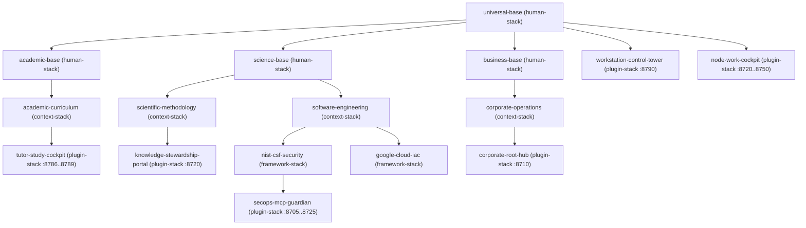

# Architecture 01 — Core Contracts, Hexagonal Domain & Data Platform (`src/zcg/{core,platform}/`)

> **Normative Specification — Subsystem 1 (`src/zcg/core/{constants,manifests,epistemics,blueprints,domain,sqlite_repo}.py` & `src/zcg/platform/{type_registry,schema_discovery,cdc,cvs,projection,pipeline_router,projection_router}.py`)**
>
> This specification defines the foundational nominal constants, `system/zcg-node.json` (`zcg-node-v1`) and `template.json` (`zcg-template-v1`) contracts, `E3 > E2 > E1 > E0` epistemic resolution, `M1..M4` cognitive adaptation, role-scoped `Makefile` synthesis, `setup_state` (`U0 -> U1 -> U2`) state machines, immutable `PEP 703` Hexagonal `DomainEntity` / `RepositoryPort` primitives, zero-dependency SQLite WAL persistence in `src/zcg/core/`, and the opt-in `Level B` Data Platform engine (`CanonicalTypeRegistry`, `SchemaDiscovery`, `ChangeDataCapture`, `ContinuousValidationScorer`, `SchemaDriftDetector`, `RolePayloadProjector`, `AdaptiveThresholdPromoter`, stateful `DataPipelineRuntime` / `create_data_pipeline_router`, and `create_role_projection_router`) in `src/zcg/platform/`.

---

## 1. `1:1:1` Source $\leftrightarrow$ Unit Test $\leftrightarrow$ Specification Traceability Matrix (`src/zcg/{core,platform}/`)

All thirteen modules across `src/zcg/core/` (`6`) and `src/zcg/platform/` (`7`) are pure Python 3.14 stdlib components with zero upward imports into `topology`, `governance`, `cockpit`, `cli`, `capsules`, `ephemeral`, or `mcp`:

| Implementation Module | Isolated `1:1` Unit Suite | Primary Symbols & Normative Scope |
| :--- | :--- | :--- |
| [src/zcg/core/constants.py](../../src/zcg/core/constants.py) | [tests/unit/zcg/core/test_constants.py](../../tests/unit/zcg/core/test_constants.py) | `NODE_MANIFEST_CONTRACT_REV` (`"zcg-node-v1"`), `TEMPLATE_MANIFEST_CONTRACT_REV` (`"zcg-template-v1"`), `AGENTS_MD_MAX_BYTES` (`18,000`), `VALID_LAYER_ROLES`, `VALID_NODE_LINK_RELATIONS`, `TOPOLOGICAL_ROLE_CLASSES`, `ROLE_DEFAULT_PRECEDENCE`, `CANONICAL_STARTER_TEMPLATES` (`16`), `CANONICAL_SCIENCE_TRUNKS` (`6`), `DEFAULT_PUBLIC_KNOWLEDGE_REGISTRY` (`6`), `MAKEFILE_DOMAIN_TAXONOMY`, `LAYER_ROLE_MAKEFILE_TARGETS`, `LAYER_MAKEFILE_RECIPES` (`link` / `unlink`), and `COMMAND_CONSCIOUSNESS_TIERS` (`C1/C2/C3`). |
| [src/zcg/core/manifests.py](../../src/zcg/core/manifests.py) | [tests/unit/zcg/core/test_manifests.py](../../tests/unit/zcg/core/test_manifests.py) | `read_version`, `file_sha256_hex`, `load_node_manifest` (with automatic `zcg-node-v1`, `governing_root_id`, and `dev..pro` environment backfill), `discover_templates_catalog` (`zcg-template-v1`), `resolve_template_dir`, `parse_skill_frontmatter`, and `resolve_interaction_language`. |
| [src/zcg/core/epistemics.py](../../src/zcg/core/epistemics.py) | [tests/unit/zcg/core/test_epistemics.py](../../tests/unit/zcg/core/test_epistemics.py) | `resolve_science_trunk` (`6` UNESCO/Frascati trunks), `classify_knowledge_domain` (`gov-*`, `sci-*`, `geo-*`, `org-*`, `pub-*`), `parse_human_stack_string`, and `resolve_effective_human_stack` (`M1..M4` + `domain-*`, `bridge-*`, `soft-*`, `hat-*` across 4 scopes). |
| [src/zcg/core/blueprints.py](../../src/zcg/core/blueprints.py) | [tests/unit/zcg/core/test_blueprints.py](../../tests/unit/zcg/core/test_blueprints.py) | `resolve_template_lineage_chain` (recursive `"extends"` DAG traversal), `resolve_default_cockpit_plugin`, `render_layer_makefile`, `render_layer_onboarding_readme`, `render_project_onboarding_blueprint`, and `resolve_workspace_setup_state` (`U0 -> U1 -> U2`). |
| [src/zcg/core/domain.py](../../src/zcg/core/domain.py) | [tests/unit/zcg/core/test_domain.py](../../tests/unit/zcg/core/test_domain.py) | `L1..L2` Functional Core semantic primitives (`Identifier`, `NaturalText`, `LongText`, `Slug`, `Temporal`, `generate_identifier`, `ensure_tz_aware`), `frozen=True` `DomainEntity`, and `PEP 695` `RepositoryPort[EntityT, IdT]` (`0` I/O imports). |
| [src/zcg/core/sqlite_repo.py](../../src/zcg/core/sqlite_repo.py) | [tests/unit/zcg/core/test_sqlite_repo.py](../../tests/unit/zcg/core/test_sqlite_repo.py) | `L4` Infrastructure `SQLiteRepositoryAdapter[EntityT, IdT]` implementing `RepositoryPort` over SQLite WAL (`PRAGMA journal_mode=WAL`, parameterized `?` SQL, `ensure_contained_path`, and deterministic connection closing). |
| [src/zcg/platform/type_registry.py](../../src/zcg/platform/type_registry.py) | [tests/unit/zcg/platform/test_type_registry.py](../../tests/unit/zcg/platform/test_type_registry.py) | `WireType`, `StructuralPattern`, `SemanticType`, `FieldAnalysis`, `StructureAnalysisResult`, `TypeMappingRule`, `CanonicalTypeRegistry`, and `SemanticMapper` (`HIGH_CARDINALITY_THRESHOLD = 0.80`, `LOW_CARDINALITY_THRESHOLD = 0.10`, `MIN_MAPPING_CONFIDENCE_THRESHOLD = 0.30`). |
| [src/zcg/platform/schema_discovery.py](../../src/zcg/platform/schema_discovery.py) | [tests/unit/zcg/platform/test_schema_discovery.py](../../tests/unit/zcg/platform/test_schema_discovery.py) | `SchemaStatus`, `ValidationAction`, `TypeSignature`, `FieldProposal`, `SchemaProposal`, `StructureAnalyzer`, `SchemaProposer`, `SchemaValidationGate`, and `SchemaDiscovery` (`0` I/O, deterministic `itertools.islice` sampling, Shannon entropy & positional anchors). |
| [src/zcg/platform/cdc.py](../../src/zcg/platform/cdc.py) | [tests/unit/zcg/platform/test_cdc.py](../../tests/unit/zcg/platform/test_cdc.py) | `ChangeType` (`INSERT`, `UPDATE`, `DELETE`), `ChangeEvent`, `CDCPipelineConfig`, `DataConnectorPort` (`Protocol`), `InMemoryDataConnector`, `DeltaDetector` (canonical JSON SHA-256 diffing + `changed_fields`), and `ChangeDataCapture` chunked poll-detect-acknowledge pipeline. |
| [src/zcg/platform/cvs.py](../../src/zcg/platform/cvs.py) | [tests/unit/zcg/platform/test_cvs.py](../../tests/unit/zcg/platform/test_cvs.py) | `FieldValidationMetric`, `DatasetValidationSnapshot`, `ValidationScoreResult`, `ContinuousValidationScorer` (`4`-weight composite health score), `DriftSeverity`, and `SchemaDriftDetector` (`compare_scores` & `detect_schema_changes`). |
| [src/zcg/platform/projection.py](../../src/zcg/platform/projection.py) | [tests/unit/zcg/platform/test_projection.py](../../tests/unit/zcg/platform/test_projection.py) | `DisclosureTier`, `ExchangeStage`, `PayloadFieldSegment`, `ProjectedRoleCapsule`, `RolePayloadProjector` (`DisclosureTier × ExchangeStage` HR selection vs. Day-1 onboarding vs. B2B projection), and `AdaptiveThresholdPromoter` (`min_cycles` hysteresis promotion). |
| [src/zcg/platform/pipeline_router.py](../../src/zcg/platform/pipeline_router.py) | [tests/unit/zcg/platform/test_pipeline_router.py](../../tests/unit/zcg/platform/test_pipeline_router.py) | Stateful `DataPipelineRuntime` and composable `create_data_pipeline_router` (`APIRouter` under `/api/platform/pipeline`) tracking multi-batch `SchemaDiscovery`, `ChangeDataCapture` (`INSERT/UPDATE`), `ContinuousValidationScorer`, and `SchemaDriftDetector` (`0` hardcoded demo records, `0` governance coupling). |
| [src/zcg/platform/projection_router.py](../../src/zcg/platform/projection_router.py) | [tests/unit/zcg/platform/test_projection_router.py](../../tests/unit/zcg/platform/test_projection_router.py) | `parse_payload_segments` and composable `create_role_projection_router` (`APIRouter` under `/api/platform/projection`) projecting caller-configured or dynamic `PayloadFieldSegment` sequences across `DisclosureTier × ExchangeStage` (`0` hardcoded profile literals). |

---

## 2. Declarative Schema Contracts (`zcg-node-v1` & `zcg-template-v1`)

Every sovereign Zero-Cloud Node persists its machine-readable identity and governance bindings at `system/zcg-node.json`, while every template pack under `templates/<stack_group>/<id>/` ships a `template.json` manifest.

### 2.1. `system/zcg-node.json` (`zcg-node-v1`) Schema Invariants

The table below defines the normative fields and backfill rules enforced by `load_node_manifest`:

| Field | Type / Domain | Normative Contract & Automatic Backfill Rule |
| :--- | :--- | :--- |
| `schema_version` | `"zcg-node-v1"` | Validated via `NODE_MANIFEST_CONTRACT_REV`; missing or older revisions are upgraded deterministically in memory and persisted on `zcg sync-layer`. |
| `layer_id` | `kebab-case` (`KEBAB_ID_RE`) | Sovereign identifier matching `^[a-z0-9]+(-[a-z0-9]+)*$` (defaults to directory name when omitted). |
| `layer_role` | `VALID_LAYER_ROLES` | One of `corporate`, `department`, `domain-policy`, `project`, `squad`, `knowledge`, `workstation`, `service-node`, `environment-cluster`, or `ephemeral-bot`. |
| `precedence` | `int` (`0..100`) | *Lex Superior* rank (`1..2` Public Admin `Root 0`, `3..4` Public Dept, `5..9` Fiduciary `domain-policy`, `10` Corporate `Root 0` / OSS `workstation`, `15` `ephemeral-bot`, `15..45` Functional `department`, `20` `knowledge`, `50` `squad`, `60` `service-node`, `70` `environment-cluster`, `80` `project`, `85..95` `individual` / `Human-Stack`). |
| `entity_kind` | `VALID_ENTITY_KINDS` | Orthogonal sovereignty axis: `public-government`, `enterprise`, `individual`, or `open-source`. |
| `visibility` | `VALID_VISIBILITY_MODES` | `"private"` or `"public"`; combined with `entity_kind` and `layer_role` to compute `visibility_scope`. |
| `governing_root_id` | `str` | Sovereign `Root 0` identifier; auto-backfilled from `layer_id` when `layer_role == "corporate"` or `precedence >= 85`, or inherited from `upstream_layer.layer_id`. |
| `interaction_language` | `VALID_INTERACTION_LANGUAGES` | Dual-Plane conversational language (`en`, `es`, `it`, `fr`, `de`, `pt`); repository artifacts remain 100% English (`artifact_language: "en"`). |
| `default_stack_templates` | `list[str]` | Ordered list of template pack IDs expanded transitively via `resolve_template_lineage_chain`. |
| `mounted_layers` | `list[dict]` | Mounted child or `knowledge` subtrees under `layers/<name>/` (`name`, `repository`, `branch`, `relative_path`). |
| `linked_nodes` | `list[dict]` | Declarative zero-copy Personal/Peer Cloud links (`node_id`, `relation` in `VALID_NODE_LINK_RELATIONS`, `target_ref`, `cockpit_url`, `shared_packs`) managed via `zcg link` / `zcg unlink`. |
| `surface_bindings` | `list[dict]` | File-surface governance bindings (`binding_id`, `mode`, `target_globs`, `architectural_planes`, `scopes`, `traits`, `rule_files`, `default_resolution`). |
| `environments` | `dict[str, dict]` | Canonical 4-stage environment policy map (`dev`, `tst`, `pre`, `pro`) with `branch_pattern`, `mcp_access_mode`, and `promotion_gate`. |

### 2.2. `template.json` (`zcg-template-v1`) & Structural Lineage Graph (`resolve_template_lineage_chain`)

Instead of hardcoded template case switches (`Mandate 1` & `Software Engineering §2`), `resolve_template_lineage_chain` resolves template dependencies by traversing the `"extends"` directed acyclic graph (DAG) across `templates/{human,context,framework,plugin}-stack/*/`:

1. **Implicit Kind Parent Fallback**: Any `context-stack` pack without an explicit `"extends"` field defaults to `"business-base"`; any `framework-stack` or `plugin-stack` pack without an explicit `"extends"` field defaults to `"software-engineering"`.
2. **Sovereign Self-Exclusion (`skip_id = layer_id`)**: During upstream template synchronization (`zcg sync-layer`), `skip_id = layer_id` ensures a node's own sovereign rule pack (`templates/<layer_id>/rules/<layer_id>.md`) is never overwritten by an upstream parent.

---

## 3. Epistemic Credibility (`E3..E0`), Science Trunks (`6`) & `Human-Stack` (`M1..M4`)

`src/zcg/core/epistemics.py` separates **objective epistemological truth (`E3..E0` & `gov-*/sci-*/geo-*/org-*/pub-*`)** from **subjective operator pairing (`Human-Stack` `M1..M4`)**.

### 3.1. Epistemic Credibility Scale (`VALID_EPISTEMIC_GRADES`) & 6 UNESCO/Frascati Science Trunks

Every knowledge domain prefix and Markdown section maps to a deterministic credibility rank (`EPISTEMIC_GRADE_RANK`):

| Grade / Domain Prefix | Rank / Default Grade | Meaning & Canonical Trunk Resolution (`resolve_science_trunk`) |
| :--- | :---: | :--- |
| **`E3` (`inviolable-axiom-or-law`)** | `3` | Physical conservation laws, mathematical proofs, statutory mandates (`gov-*`), empirical territorial data (`geo-*`), and `docs/architecture/*.md` specs. |
| **`E2` (`canonical-contract-or-standard`)** | `2` | Peer-reviewed scientific protocols (`sci-*`), institutional standards (`org-*`), and `docs/reference/*.md` catalogs. |
| **`E1` (`contextual-guideline-or-theory`)** | `1` | Step-by-step pedagogical guides (`docs/guides/*.md`), personal sovereign public twins (`pub-*`), `M1..M2` Socratic lessons, and operational heuristics. |
| **`E0` (`provisional-hypothesis-or-draft`)** | `0` | Exploratory roadmaps (`roadmaps/*.md`), unverified hypotheses, and `BACKLOG.md` proposals. |
| **`sci-<trunk-or-branch>`** | `E2` / `E3` | Mapped across the **6 Canonical Science Trunks (`CANONICAL_SCIENCE_TRUNKS`)**: `formal` (`maths`, `logic`, `statistics`), `nature` (`physics`, `chemistry`, `biology`, `earth`), `health`, `engineering` (`software`, `security`, `industrial`, `mechanical`), `social`, and `humanities`. |

### 3.2. Four-Scope `Human-Stack` Resolution (`resolve_effective_human_stack`)

`resolve_effective_human_stack(workspace_dir)` inspects `.agents/SESSION.md` (`Scope 2` — workspace-local), `README.md` / `.agents/LAYER_LINEAGE.md` (`Scope 3` — layer default), and `system/zcg-node.json` (`Scope 4` — node manifest), parsing `domain-<area>:M1..M4`, `bridge-*`, `soft-*`, and `hat-*` facets without mutating `0..80` deontic laws.

---

## 4. Role-Scoped `Makefile` Synthesis & `setup_state` (`U0 -> U1 -> U2`)

`src/zcg/core/blueprints.py` synthesizes deterministic workspace files and evaluates onboarding completion:
1. **Role-Scoped `Makefile` (`render_layer_makefile`)**: Emits `# Zero-Cloud Node Makefile (<layer_id> · role=<layer_role>)` with the exact targets in `LAYER_ROLE_MAKEFILE_TARGETS[layer_role]` (adding `install-antigravity`, `workstation-sync`, `backup-system`, `audit-system`, and `restore-system` exclusively for `layer_role == "workstation"`) while preserving any user-authored tail below `# --- Custom Targets ---`.
2. **Three-Stage Setup State (`resolve_workspace_setup_state`)**:
   - **`State U0 ("uninitialized")`**: Neither `system/zcg-node.json` nor `.agents/LAYER_LINEAGE.md` exists; `/sopen` launches the interactive bootstrap wizard.
   - **`State U1 ("pending_customization")`**: Workspace contains `[Fill:` placeholders in `README.md` or `.agents/LAYER_LINEAGE.md` or an unchecked `- [ ] **T1 [SETUP-001]**` task in `WORKTASK.md`; `/sopen` prints the pre-adapted `Phase A..D` Kickoff Prompt.
   - **`State U2 ("configured")`**: All `[Fill:` placeholders are replaced and `SETUP-001` is marked `[x]`; `/sopen` runs fast `< 0.2s` status orientation.

---

## 5. Hexagonal Functional Core Primitives & SQLite WAL Repository Adapter (`domain.py`, `sqlite_repo.py`)

`ZeroCloudGravity` provides zero-dependency Hexagonal building blocks separating `L1..L2` *Functional Core* domain models from `L4` SQLite WAL persistence:

| Layer & Module | Exported Contract | Exact Boundary & Security Invariants |
| :--- | :--- | :--- |
| **`L1` Semantic Primitives (`domain.py`)** | `validate_identifier`, `validate_natural_text` (`<= 500`), `validate_long_text` (`<= 50,000`), `validate_slug` (`<= 128`, `KEBAB_ID_RE`), `validate_temporal`, `ensure_tz_aware` | Rejects malformed UUIDs, blank or oversized text, non-kebab slugs, and timezone-naive `datetime` instances at construction (`0` external validation libraries). |
| **`L1..L2` Functional Core (`domain.py`)** | `@dataclass(frozen=True, kw_only=True) class DomainEntity` & `@runtime_checkable class RepositoryPort[EntityT, IdT]` (`Protocol`) | Immutable (`PEP 703` free-threading safe) entities carrying validated `id`, `created_at`, and `updated_at` fields, paired with a generic `PEP 695` CRUD port (`0` `sqlite3`/network/OS I/O imports). |
| **`L4` Persistence Adapter (`sqlite_repo.py`)** | `SQLiteRepositoryAdapter[EntityT, IdT]` (`ABC`, `to_record` / `from_record`) | Enforces `ensure_contained_path` when `workspace_root` is bound, validates namespace identifiers (`^[a-zA-Z_][a-zA-Z0-9_]*$`), binds all values via parameterized `?` queries on `domain_entity_records` under `PRAGMA journal_mode=WAL`, and closes connections deterministically (`0` `ResourceWarning`). |

---

## 6. Opt-In `Level B` Data Platform Engine (`src/zcg/platform/`)

`src/zcg/platform/` provides three pure `L1..L2` *Functional Core* engines (`0` I/O, `0` external runtime dependencies, `0` biological/evolutionary metaphors) powering schema inference, deterministic delta tracking, and role-scoped payload projection across Knowledge (`:8720`) and Personal Career/HR (`:8787` $\leftrightarrow$ `org-*`) surfaces:

| Engine Module | Exported Components | Exact Thresholds, Cut-Points & Security Invariants |
| :--- | :--- | :--- |
| **1. Schema Discovery (`type_registry.py`, `schema_discovery.py`)** | `CanonicalTypeRegistry`, `StructureAnalyzer`, `SemanticMapper`, `SchemaProposer`, `SchemaValidationGate`, `SchemaDiscovery` | Deterministic `itertools.islice` sampling (`DEFAULT_MAX_SAMPLE_SIZE = 10,000`), majority wire-type & regex pattern detection (`> 0.50` ratio, Unix epoch `946,684,800..4,102,444,800`), cardinality cut-points (`>= 0.80` high, `< 0.10` low), confidence floor (`>= 0.30`, else `UNKNOWN`), Shannon entropy signatures, and `PENDING_PROPOSAL -> VALIDATED -> ACTIVE \| REJECTED` validation gate. |
| **2. Change Data Capture (`cdc.py`)** | `DataConnectorPort` (`Protocol`), `InMemoryDataConnector`, `DeltaDetector`, `ChangeDataCapture` | Tracks canonical JSON SHA-256 record state by `key_field`, emitting immutable `ChangeEvent` records (`INSERT`, `UPDATE`, `DELETE`) with sorted `changed_fields` and chunked `batch_size` acknowledgement (`0` raw slices). |
| **3. Continuous Validation & Role Projection (`cvs.py`, `projection.py`)** | `ContinuousValidationScorer`, `SchemaDriftDetector`, `RolePayloadProjector`, `AdaptiveThresholdPromoter` | Weighted validation score (`0.25` completeness + `0.30` consistency + `0.25` null health + `0.20` normalized Shannon entropy), drift severity cut-points (`0.05` `LOW`, `0.10` `MEDIUM`, `0.20` `HIGH`, `0.35` `CRITICAL`), `DisclosureTier × ExchangeStage` capsule projection (`PUBLIC_OVERVIEW`, `CANDIDATE_APPLICATION`, `B2B_PROPOSAL`, `DAY1_ONBOARDING`) withholding `DAY1_ONBOARDING` PII until acceptance while preserving `citation_receipt` proofs, and `min_cycles` hysteresis threshold promotion. |
| **4. Composable Platform Routers (`pipeline_router.py`, `projection_router.py`)** | `DataPipelineRuntime`, `create_data_pipeline_router`, `parse_payload_segments`, `create_role_projection_router` | Reusable `APIRouter` adapters (`GET/POST /api/platform/pipeline` tracking stateful `CDC` + `SchemaDriftDetector` across batches, and `GET/POST /api/platform/projection` projecting arbitrary `PayloadFieldSegment` payloads across `ExchangeStage`) with `0` hardcoded vertical fixtures. |
