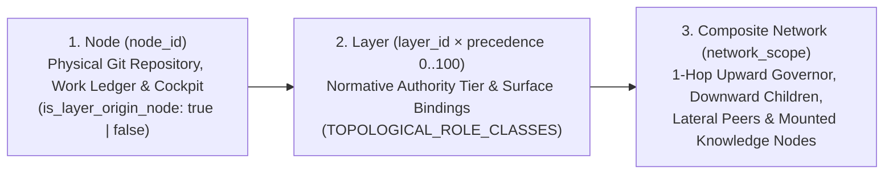

# Architecture 02 — Triadic Topology, Subtrees & Private-Public Twin Surfaces (`src/zcg/topology/`)

> **Normative Specification — Subsystem 2 (`src/zcg/topology/{identity,network,subtrees}.py`)**
>
> This specification defines filesystem path containment (`PATH_CONTAINMENT_VIOLATION`), the triadic **`Node × Layer × Network`** topological model, `1-hop` upward/downward/lateral connection discovery, `Private <-> Public` twin attestation (`root_0_public_approved`), 3-stage `knowledge` stewardship with strict sibling isolation, and `layers/*` subtree synchronization in `src/zcg/topology/`.

---

## 1. `1:1:1` Source $\leftrightarrow$ Unit Test $\leftrightarrow$ Responsibility Matrix (`src/zcg/topology/`)

All three modules in `src/zcg/topology/` depend exclusively on `src/zcg/core/` and enforce strict workspace path containment:

| Implementation Module | Isolated `1:1` Unit Suite | Primary Symbols & Normative Scope |
| :--- | :--- | :--- |
| [src/zcg/topology/identity.py](../../src/zcg/topology/identity.py) | [tests/unit/zcg/topology/test_identity.py](../../tests/unit/zcg/topology/test_identity.py) | `ensure_contained_path` (`PATH_CONTAINMENT_VIOLATION`), `resolve_layer_entity_identity` (`operating_state`, `mcp_operating_mode`, `visibility_scope`, `private_public_twin`, `can_expose_to_oss`), `classify_inter_layer_relationship` (`5` MCP communication modes), and `resolve_knowledge_mount_endpoints` (`3`-tier resolution cascade). |
| [src/zcg/topology/network.py](../../src/zcg/topology/network.py) | [tests/unit/zcg/topology/test_network.py](../../tests/unit/zcg/topology/test_network.py) | `discover_network_topology` (`own_network_*`, `root_composite_*`, `upward_governor`, `downward_governed_nodes`, `lateral_peers`, `knowledge_nodes`, `linked_nodes`, and strict `public-community` sibling isolation). |
| [src/zcg/topology/subtrees.py](../../src/zcg/topology/subtrees.py) | [tests/unit/zcg/topology/test_subtrees.py](../../tests/unit/zcg/topology/test_subtrees.py) | `inspect_mounted_children_drifts`, `sync_mounted_children_into_parent` (`layers/<name>/` rollup & `[x]` task completion reconciliation). |

---

## 2. Triadic `Node × Layer × Network` Disambiguation & Path Containment

ZeroCloudGravity separates physical repository identity from normative authority and composite organizational scope:

1. **Cryptographic Path Containment (`ensure_contained_path`)**: Every file lookup across `topology`, `governance`, `cockpit`, `capsules`, and `mcp` resolves `candidate.resolve()` and verifies `resolved.is_relative_to(workspace_root.resolve())`. Any traversal (`../`), symlink escape, or out-of-tree target raises `ValueError("PATH_CONTAINMENT_VIOLATION: ...")`.
2. **Bounded `operating_state × mcp_operating_mode` Matrix (`resolve_layer_entity_identity`)**:
   - **`oss-readonly-appliance` (`workstation-baseline-provider`)**: Clean Open-Source runtime clone (`~/zero-cloud-gravity`).
   - **`oss-dev` (`self-test-and-dev-only`)**: Engine contributor clone (`~/Projects/dev-zero-cloud-gravity`).
   - **`individual-root` (`personal-root-hub`)**: Personal Sovereign `Root 0` workstation (`~/<persona>-pc`, `entity_kind: "individual"`, `precedence: 90`, `.personal.local`).
   - **`corporate-root` (`enterprise-governance-hub`)**: Enterprise (`10`) or Public-Government (`1..2`) `Root 0` hub (`.intranet.local`).
   - **`domain-policy` / `department` (`departmental-policy-hub`)**: Fiduciary (`5..9`), functional (`15..45`), or personal sovereign tutor/work (`86..89`) department node.
   - **`squad` (`squad-execution-hub`)**: Operational unit or delivery squad (`40..60`).
   - **`knowledge` (`knowledge-corpus-provider`)**: Curated epistemic corpus or sovereign public twin (`gov-*`, `sci-*`, `geo-*`, `org-*`, `pub-*` at `precedence: 20` or explicit node precedence, `.knowledge.local`).
   - **`project` (`project-consumer-only`)**: Consumer application or case workspace (`80`).

---

## 3. Universal `Private Root 0 <-> Public Sovereign Twin` Attestation & Subordinate Outward Gate

Every sovereign entity across `VALID_ENTITY_KINDS` (`public-government`, `enterprise`, `individual`, `open-source`) separates its **internal private `Root 0` hierarchy** (host configurations, private keys, internal contracts, work ledgers) from its **curated Public Sovereign Twin (`gov-<id>`, `geo-<id>`, `sci-<id>`, `org-<id>`, `pub-<persona>`)** under an identical, non-preferential cryptographic contract:

| Boundary Condition | `resolve_node_entity_identity` Contract | Security, Privacy & Anti-Spoofing Guarantee |
| :--- | :--- | :--- |
| **Corporate / Institutional `Root 0` (`corporate` / `1..2`)** | `can_expose_to_oss: True`, `exposure_boundary: "root-0-gateway"` | Governs internal departments (`private`) and attests (`governing_root_id`) its paired public twin (`org-*`, `gov-*`, `geo-*`, `sci-*`). |
| **Individual `Root 0` (`~/<persona>-pc`, `workstation`, `90`)** | `operating_state: "individual-root"`, `visibility: "private"`, `can_expose_to_oss: True` | Keeps host packages, shell/git config, private keys, `<persona>-tutor`, and `<persona>-work` 100% private while governing optional personal public twin **`pub-<persona>`** (`default_entity_kind: "individual"`). |
| **Subordinate Internal Layer (`department`, `domain-policy`, `squad`) without `Root 0` Attestation** | `visibility_scope: "private:<entity_kind>:<scope>"`, `can_expose_to_oss: False` | Even if `visibility: "public"` is set in a subordinate department's manifest, outward public/OSS exposure remains blocked unless `root_0_public_approved: True` is explicitly attested. |
| **Public Sovereign Twin (`layer_role: "knowledge"`, `visibility: "public"`)** | `visibility_scope: "public:knowledge:<domain>"`, `bridge_mode: "private-to-public-twin"` (when `governing_root_id != layer_id`) | Exposes only curated public surfaces (`pro` = `public-remote-live`), `rcap1` (`L0..L3`), and `citation_receipt`. Protocol parity is strictly symmetric across `gov-*`, `sci-*`, `org-*`, and `pub-*`: relational affinity or priority between an individual (`pub-*` / `<persona>-work`) and an institution/enterprise (`gov-*` / `org-*`) requires bilateral attestation (`linked_nodes` / `roster`), preventing unilateral weight spoofing. |

---

## 4. Three-Stage `knowledge` Stewardship, 3-Tier Endpoint Cascade & Sibling Isolation

Public, organizational, and personal `knowledge` twins (`gov-*`, `sci-*`, `geo-*`, `org-*`, `pub-*`) progress through three deterministic stewardship stages (`VALID_KNOWLEDGE_STEWARDSHIP_STAGES`):

| Stewardship Stage | Endpoint Resolution Cascade (`resolve_knowledge_mount_endpoints`) | Sibling Isolation & Network Discovery Contract (`discover_network_topology`) |
| :--- | :--- | :--- |
| **`1. private-incubation`** | `local-mcp-clone` (`layers/<id>/` or sibling clone) $\rightarrow$ `private-mirror-remote` | Internal organizational corpus (e.g., `org-acme` under `governing_root_id: "acme"`); discovered as part of the governing `Root 0`'s composite network (`root_composite_nodes_count`). |
| **`2. public-community`** | `local-mcp-clone` $\rightarrow$ `private-mirror-remote` $\rightarrow$ `public-canonical-remote` (`https://github.com/mtwuser/<id>.git`) | Community-stewarded open corpus (`DEFAULT_PUBLIC_KNOWLEDGE_REGISTRY`: `gov-es`, `geo-es`, `sci-maths`, `sci-physics`, `sci-biology`, `sci-engineering`). **Strictly isolated from sibling `public-community` clones in `~/Projects/`**: `discover_network_topology` never auto-links sibling `public-community` repositories (`own_network_nodes_count: 1`, `lateral_peers: []`) unless explicitly declared in `mounted_layers`. |
| **`3. sovereign-authority`** | `local-mcp-clone` $\rightarrow$ `canonical_authority_url` (official ministry / standards body) | Official statutory or scientific consortium repository (`canonical_authority_verified: True`). |

---

## 5. Five Inter-Layer Communication Modes & `layers/*` Subtree Rollup

`classify_inter_layer_relationship(source_dir, target_dir)` classifies every node-to-node interaction into one of 5 deterministic modes:
1. **`internal-1hop-hierarchical`**: Vertical 1-hop delegation (`make delegate`) and promotion (`make promote`) within the same `governing_root_id`.
2. **`knowledge-rcap1-and-citation`**: Read-only `rcap1` capsule consultation and `citation_receipt` verification against a mounted `knowledge` node (`layers/<id>/`).
3. **`external-root0-to-oss-sanitized`**: Anonymized template/rule promotion from a `Root 0` (`can_expose_to_oss: True`) to Open Source (`zero-cloud-gravity`).
4. **`external-peer-root0-pr-and-readonly-mcp`**: Horizontal collaboration between two sovereign `Root 0` entities via `.agents/proposals/from-peer-root-<id>/`.
5. **`blocked-must-route-via-governing-root0`**: Blocks direct external promotion from subordinate internal tiers (`CROSS_TIER_PROMOTION_BYPASS`).
