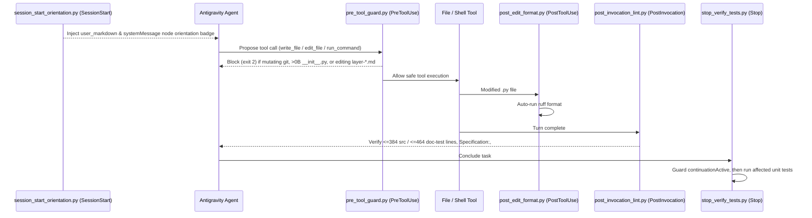

# Architecture 03 — Governance, Work Ledger, Lifecycle Hooks & Tiered CLI (`src/zcg/governance/`, `src/zcg/cli/` & `antigravity/`)

> **Normative Specification — Subsystem 3 (`src/zcg/governance/*`, `src/zcg/cli/*` & `antigravity/.gemini/config/scripts/*`)**
>
> This specification defines the 5 deterministic Python 3.14 Antigravity lifecycle hooks (`SessionStart`, `PreToolUse`, `PostToolUse`, `PostInvocation`, `Stop` with `continuationActive` loop guard), sovereign node bootstrapping (`--purpose` & `--from-parent`), native Antigravity 2.0 plugin bundle (`plugin.json` + `.agents/plugins.json`) and project-level permission compilation (`.agents/antigravity-permissions.json`), declarative node linking (`zcg link --from` / `zcg unlink` + epistemic `R3` wallet airlock), branch-to-project graduation (`zcg spinout-project`), read-only community overlay & custom plugin module scaffolding (`zcg scaffold-plugin-module`), standalone/networked custom `zcg.web` project scaffolding (`zcg scaffold-web-app`), executable AST hexagonal boundary linting (`zcg lint-arch`), unified `Node × Layer × Network` capability gating & `< 50 ms` skill static scanning (`zcg lint-skills`), deterministic bidirectional contract alignment (`zcg check-handoff`), isolated OSS engine contribution workflows (`zcg oss` / root `Makefile` `oss-*` recipes), 4-mode upstream template reconciliation, RBAC authority gates, $N$-departmental surface consensus, the *Node Work & Sprint Ledger*, `1-hop` directive/promotion workflows, and the 39-subcommand `zcg` console dispatcher (`43` dispatcher tokens with shorthand aliases).

---

## 1. `1:1:1` Source $\leftrightarrow$ Unit Test $\leftrightarrow$ Responsibility Matrix (`governance/` & `cli/`)

Thirty governance modules across four pure acyclic subpackages (`policy/` [8], `work/` [8], `runtime/` [5], and `workspace/` [9], `0` flat `.py` files, topological DAG `policy -> {work, runtime} -> workspace`, depending exclusively on `core/` and `topology/` with `0` `web`/`cockpit` imports) and four CLI modules implement all `C1`/`C2`/`C3`/`Subtree`/`Workstation`/`OSS` node lifecycle operations (`100.00%` isolated unit statement and branch coverage):

| Implementation Module | Isolated `1:1` Unit Suite | Primary Symbols & Normative Scope |
| :--- | :--- | :--- |
| [src/zcg/governance/policy/authority.py](../../src/zcg/governance/policy/authority.py) | [tests/unit/zcg/governance/policy/test_authority.py](../../tests/unit/zcg/governance/policy/test_authority.py) | `resolve_git_user_email`, `configure_layer_authority`, `resolve_actor_role_profile` (`owner`, `maintainer`, `validator`, `member`, `consumer` + `UPSTREAM_HIERARCHICAL_AUTHORITY`), `verify_layer_operation_authority`, `verify_single_hop_upstream` (`CROSS_TIER_PROMOTION_BYPASS`), and `scan_open_source_agnosticism`. |
| [src/zcg/governance/policy/egress.py](../../src/zcg/governance/policy/egress.py) | [tests/unit/zcg/governance/policy/test_egress.py](../../tests/unit/zcg/governance/policy/test_egress.py) | `ArtifactMirrorConfig` (`container_registry`, `pypi_index_url`, `apt_mirror_url`, `require_private_mirrors`, `to_env_vars`), `EffectiveEgressPolicy`, `is_egress_host_allowed`, `extract_http_url_spans`, `find_unauthorized_egress_hosts` (RFC 3986 `urllib.parse.urlsplit` egress validation rejecting `user@host` spoofing), and `resolve_effective_egress_policy` (*Lex Superior* `Root 0 -> Layer -> Node` intersection across `allowed_domains`/`allowed_hosts`, `https://cdn.<canonical_domain>` `cdn_origins`, private Artifact Registry / PyPI / APT mirrors, and `<persona>-wallet` `R3` `loopback-only` isolation). |
| [src/zcg/governance/policy/capabilities.py](../../src/zcg/governance/policy/capabilities.py) | [tests/unit/zcg/governance/policy/test_capabilities.py](../../tests/unit/zcg/governance/policy/test_capabilities.py) | `compute_template_pack_sha256` (C-backed `SHA-256` pack Merkle digest), `resolve_effective_capability_ceiling` (*Lex Superior* `Root 0 -> Layer -> Node` intersection including `allowed_plugin_digests`), `evaluate_capability_gate`, `enforce_capability_gate` (`Actor Role ∩ Lex Superior Ceiling` across `install/uninstall`, `activate/deactivate`, `deploy`, `link/unlink`, and `promote`), `lint_single_skill_file`, and `lint_skills_security` (`zcg lint-skills` using regex-free Unicode/pipe-to-shell/egress URL scanning). |
| [src/zcg/governance/policy/module_registry.py](../../src/zcg/governance/policy/module_registry.py) | [tests/unit/zcg/governance/policy/test_module_registry.py](../../tests/unit/zcg/governance/policy/test_module_registry.py) | Hierarchical Capability Module Registry (`Node Archetype` $\perp$ `Capability Module` $\perp$ `Provider/Tool`, `0` `web`/`cockpit` imports): `CapabilityModuleSpec`, `TOGGLEABLE_CAPABILITY_CATALOG` (`9` modular capabilities with `slots` `admin \| workspace \| public` and `provider_backing`), `resolve_node_capability_matrix` (computing `mandatory \| optional \| forbidden` across `Parent -> Node` `capability_policy` + `<persona>-wallet` `R3` airlock), `resolve_effective_workspace_modules`, `set_node_capability_enabled`, and `reset_node_capabilities_default` (persisting `enabled_modules` in `system/zcg-node.json`). |
| [src/zcg/governance/policy/handoff.py](../../src/zcg/governance/policy/handoff.py) | [tests/unit/zcg/governance/policy/test_handoff.py](../../tests/unit/zcg/governance/policy/test_handoff.py) | `DEFAULT_CANONICAL_AXIS_GLOSSARY`, `load_merged_canonical_glossary` (`GLOSSARY_DEFINITION_CONFLICT`), and `check_handoff_symmetry` (`zcg check-handoff`: `INFORMAL_ALIAS_REBOUND`, `MULTI_AXIS_CONFLATION_REBOUND`, `MISSING_REQUIRED_HANDOFF_SECTION`, and `UNSTANDARDIZED_ASYMMETRY_PROPOSAL`). |
| [src/zcg/governance/policy/arch_linter.py](../../src/zcg/governance/policy/arch_linter.py) | [tests/unit/zcg/governance/policy/test_arch_linter.py](../../tests/unit/zcg/governance/policy/test_arch_linter.py) | `MAX_PACKAGE_MODULE_FANOUT` (`10`), `ALLOWED_REGEX_MODULES` (`frozenset()`), `BoundaryViolation`, `check_domain_module`, `check_test_suite`, and `lint_architecture` (`zcg lint-arch`) enforcing `0` infrastructure/I/O imports in `domain/` (`models.py`, `entities.py`, `service.py`), `0`-byte `__init__.py`, `excluded_contexts`, `cyclic-package-dependency` (`graphlib.TopologicalSorter`), `retired-stack-directory`, `single-file-root-sprawl`, `flat-package-fanout` (`<= 10` `.py` modules/package directory), `mixed-package-depth` (Pure Leaf-or-Branch Package Law), `model-currency-policy-drift` / `model-currency-audit-missing`, `allowed-regex-modules` (`0` `import re` across `100%` of `src/zcg/`), `HTMLParser`-backed `fragment-inline-script` (`0` regexes), and `1:1:1` `AAA` test contracts. |
| [src/zcg/governance/policy/model_currency.py](../../src/zcg/governance/policy/model_currency.py) | [tests/unit/zcg/governance/policy/test_model_currency.py](../../tests/unit/zcg/governance/policy/test_model_currency.py) | `MODEL_CURRENCY_CONTRACT_REV` (`zcg-model-currency-v1`), `REQUIRED_MANDATE_12_MARKERS`, `REQUIRED_AUDIT_CURRENCY_MARKER`, `resolve_node_agent_guidance` (orthogonal 5-profile Set-and-Forget base model & automatic Swarm classifier), and `check_model_currency_policy` (`model-currency-policy-drift` & `model-currency-audit-missing` enforcement in `zcg lint-arch`). |
| [src/zcg/governance/policy/mesh_relations.py](../../src/zcg/governance/policy/mesh_relations.py) | [tests/unit/zcg/governance/policy/test_mesh_relations.py](../../tests/unit/zcg/governance/policy/test_mesh_relations.py) | `Root 0` Mesh Role Governance & Inheritable Relation Grants (`0` `web`/`cockpit` imports, `0` `import re`): `LateralChannelRule`, `MeshGovernancePolicy`, `NodeRelationGrant`, `normalize_workspace_scope` (`all \| node \| network \| corpora`), `is_airlocked_wallet_node`, `resolve_mesh_governance_policy`, `configure_mesh_governance_policy`, `resolve_node_relation_grants`, `evaluate_node_exchange_grant`, and `resolve_exchange_target_dir` across `full-mesh \| hierarchical-only \| curated-matrix` topologies and `4` capability verbs (`consult_context \| propose_work \| delegate_work \| validate_gate`). |
| [src/zcg/governance/work/ledger.py](../../src/zcg/governance/work/ledger.py) | [tests/unit/zcg/governance/work/test_ledger.py](../../tests/unit/zcg/governance/work/test_ledger.py) | `summarize_work_orchestration_ledger` (`own_node_ledger` vs. `inter_layer_exchange`), `manage_layer_roster` (`.github/CODEOWNERS` sync), `configure_git_governance_policy`, and `record_governance_decision` (`logs/governance_audit.jsonl`). |
| [src/zcg/governance/work/consensus.py](../../src/zcg/governance/work/consensus.py) | [tests/unit/zcg/governance/work/test_consensus.py](../../tests/unit/zcg/governance/work/test_consensus.py) | `match_authoritative_surface_bindings`, `evaluate_multilayer_surface_consensus` (`RECONCILED_FLOW`, `ITERATION_REQUIRED`, `ESCALATE_TO_ROOT`, `ESCALATE_INTER_ENTITY_ROOTS`), and `evaluate_environment_promotion` (`dev -> tst -> pre -> pro` with automatic `resolve_git_user_email` default fallback when `actor_email` is omitted). |
| [src/zcg/governance/work/workflows.py](../../src/zcg/governance/work/workflows.py) | [tests/unit/zcg/governance/work/test_workflows.py](../../tests/unit/zcg/governance/work/test_workflows.py) | `start_task_workflow` (`feature/<TICKET-ID>-<slug>` + `.agents/SESSION.md`), `complete_task_workflow` (intra-node or `parent_dir` `Outbound Delegations` rollup), and `delegate_directive_to_child` (`1-hop` downward delivery + non-destructive `.agents/proposals/from-<parent>/` staging). |
| [src/zcg/governance/work/work_inbox.py](../../src/zcg/governance/work/work_inbox.py) | [tests/unit/zcg/governance/work/test_work_inbox.py](../../tests/unit/zcg/governance/work/test_work_inbox.py) | Sovereign Kanban Metadata, Backlog Promotion & Cross-Node `Work Inbox` Engine (`0` `web`/`cockpit` imports, `0` `import re`): `classify_task_metadata` (`priority` `P0..P3`, `scope` `own \| parent \| cross-node`, `track`), `filter_kanban_items` (including `node \| network` workspace scope filtering), `promote_backlog_item_to_todo` (`BACKLOG.md -> WORKTASK.md`), and gitignored `.zcg/runtime/ledger/work_inbox.jsonl` coordination (`enqueue_work_inbox_request`, `inspect_work_inbox`, `triage_work_inbox_request` across `accept-todo \| accept-backlog \| decline` keeping `.agents/proposals/` dedicated strictly to template sync). |
| [src/zcg/governance/work/work_trackers.py](../../src/zcg/governance/work/work_trackers.py) | [tests/unit/zcg/governance/work/test_work_trackers.py](../../tests/unit/zcg/governance/work/test_work_trackers.py) | Headless `WORKROAD.md` / `roadmaps/*.md` & `WORKVALI.md` Section Inspectors & Checkbox Mutator (`0` `web`/`cockpit` imports, `0` `import re`): `parse_sectioned_checkboxes` (`zcg.core.markdown_scan`), `inspect_roadmap_tracker`, `inspect_validation_tracker`, and `toggle_tracker_checkbox` (`WORKVALI.md \| WORKROAD.md \| ROADMAP.md` state transitions). |
| [src/zcg/governance/work/work_metrics.py](../../src/zcg/governance/work/work_metrics.py) | [tests/unit/zcg/governance/work/test_work_metrics.py](../../tests/unit/zcg/governance/work/test_work_metrics.py) | Headless Cross-Node Work, Knowledge, Vault & Git Metrics Engine (`0` `web`/`cockpit` imports, `0` `import re`, `0` subprocess calls): `METRICS_CONTRACT_REV`, `VALID_METRICS_SCOPES` (`all \| node \| network \| corpora`), and `collect_workspace_metrics` aggregating delivery velocity, `R3/R2/R0` document visibility, attachment vault usage, and Git sync hygiene with `mesh_relations` sibling filtering while respecting `<persona>-wallet` `R3` airlock isolation. |
| [src/zcg/governance/work/horizon.py](../../src/zcg/governance/work/horizon.py) | [tests/unit/zcg/governance/work/test_horizon.py](../../tests/unit/zcg/governance/work/test_horizon.py) | `diff_project_against_layers` (`SHA-256` drift audit), `compare_upstream_templates` (`#`/`##` section diff), and `inspect_layer_horizon` (`inbound_from_upstream`, `inbound_from_downstream`, `local_workspace_changes`). |
| [src/zcg/governance/work/oss_contrib.py](../../src/zcg/governance/work/oss_contrib.py) | [tests/unit/zcg/governance/work/test_oss_contrib.py](../../tests/unit/zcg/governance/work/test_oss_contrib.py) | `should_expose_oss_targets` and `run_oss_action` (`zcg oss <push-branch\|promote-master\|publish>` backing root `Makefile` `oss-*` targets with `[OSS_DEV_ONLY_BLOCKED]`, `[OSS_DEV_ORIGIN_MISMATCH]`, `[OSS_BRANCH_REQUIRED]`, and sterile `git archive` snapshot export stripping `WORK*.md`, `BACKLOG.md`, `roadmaps/`, and `.github/dependabot.yml`). |
| [src/zcg/governance/runtime/tool_catalog.py](../../src/zcg/governance/runtime/tool_catalog.py) | [tests/unit/zcg/governance/runtime/test_tool_catalog.py](../../tests/unit/zcg/governance/runtime/test_tool_catalog.py) | Headless `tool-stack` & external MCP connector catalog: `IsolatedToolDescriptor` (`cli_command`), `DEFAULT_ISOLATED_TOOL_CATALOG` (`zcg-skill-auditor`, `secops-guardian`, `container-edge-ops`, `google-cloud-ops`, `gemini-decisions`, `duckdb-analytics`, `wallet-analytics`), `resolve_tool_node_relevance` (role/stack-contextual tool recommendation), `OfficialMCPConnectorSpec`, and `DEFAULT_EXTERNAL_MCP_CONNECTORS` (`remote-streamable-http`, `github-official`, `google-cloud-gcloud`, `google-cloud-run-remote`). |
| [src/zcg/governance/runtime/skill_auditor.py](../../src/zcg/governance/runtime/skill_auditor.py) | [tests/unit/zcg/governance/runtime/test_skill_auditor.py](../../tests/unit/zcg/governance/runtime/test_skill_auditor.py) | Sovereign 3-tier `zcg-skill-auditor` (`0` third-party auditor branding, `0` `import re`): `SkillLiftBenchmarkCase`, `audit_skill_taxonomy_and_overlap` (`Tier 2` `1 Skill = 1 Verb` frontmatter + token-set Jaccard overlap deduplication), `evaluate_skill_lift_cases` (`Tier 3` sandboxed A/B `Skill Lift` regression detection), and `audit_skills_sovereign_profile` (`Tier 1` static/OSV/rubric findings $\rightarrow$ `0..100` `trust_score` + SARIF `2.1.0`). |
| [src/zcg/governance/runtime/tool_isolation.py](../../src/zcg/governance/runtime/tool_isolation.py) | [tests/unit/zcg/governance/runtime/test_tool_isolation.py](../../tests/unit/zcg/governance/runtime/test_tool_isolation.py) | Headless vendor-neutral tool isolation engine (`0` `zcg.web` imports): `provision_isolated_tool_manifest` & `deprovision_isolated_tool_manifest` (`.zcg/tools/<id>/`), `run_isolated_tool_inspection` (live read-only diagnostics), `build_bwrap_readonly_command`, `audit_skills_sovereign_profile` re-export, and `evaluate_calibrated_decisions` (`0`-output-token calibrated `Yes/No \| Choice \| Rubric` batches up to `1,000` items via `gemini-decision-1` transport or 100% offline `LiteRT` `gemma-4-26b-a4b-it`). |
| [src/zcg/governance/runtime/mcp_connectors.py](../../src/zcg/governance/runtime/mcp_connectors.py) | [tests/unit/zcg/governance/runtime/test_mcp_connectors.py](../../tests/unit/zcg/governance/runtime/test_mcp_connectors.py) | Vendor-neutral MCP connector & sidecar governance engine: `resolve_governed_mcp_connectors` (`read_only: True` default, `curated-allowlist` + `lint-skills` + egress verification, `WALLET_EXTERNAL_LINK_BLOCKED` on `<persona>-wallet`), and `compile_antigravity_sidecar_manifest` (`.agents/sidecar.json` daemon supervision). |
| [src/zcg/governance/runtime/node_updates.py](../../src/zcg/governance/runtime/node_updates.py) | [tests/unit/zcg/governance/runtime/test_node_updates.py](../../tests/unit/zcg/governance/runtime/test_node_updates.py) | Declarative `1-Hop` Node Update & Guided Reconciliation Engine (`0` `web`/`cockpit`/`providers` imports, `0` `import re`): `NODE_UPDATES_CONTRACT_REV` (`zcg-node-updates-v1`), `UPGRADE_NOTES_CONTRACT_REV` (`zcg-upgrade-notes-v1`), `UPGRADE_NOTES_REL_PATH` (`system/upgrade-notes.json`), `parse_version_tuple`, `read_engine_version`, `load_upgrade_notes`, `build_reconciliation_prompt`, and `inspect_node_update_plan` enforcing the `1-Hop` Upgrade Law (`Root 0 <- OSS` vs. `Subordinate <- Governing Parent` with `parent_update_required_first` warning). |
| [src/zcg/governance/workspace/bootstrap.py](../../src/zcg/governance/workspace/bootstrap.py) | [tests/unit/zcg/governance/workspace/test_bootstrap.py](../../tests/unit/zcg/governance/workspace/test_bootstrap.py) | `register_mounted_subtree`, `bootstrap_node_workspace` (`--purpose` archetype synthesis, `--from-parent` shallow `1-hop` inheritance, `.zcg/`-aware `.gitignore`, composable `Makefile` / non-invasive `.agents/zcg.mk`, optional `service_activator` callback, + Antigravity IDE workspace registration), and `sync_node_workspace` (isolating `OSS_ENGINE_PROFILE` on `open-source` engine self-sync while preserving all `19` starter packs in `default_stack_templates`). |
| [src/zcg/governance/workspace/antigravity_sync.py](../../src/zcg/governance/workspace/antigravity_sync.py) | [tests/unit/zcg/governance/workspace/test_antigravity_sync.py](../../tests/unit/zcg/governance/workspace/test_antigravity_sync.py) | `register_antigravity_workspace` (`~/.gemini/antigravity/workspaces.json`), `summarize_runtime_orchestration` (`.agents/runtime/` with live `os.kill(pid, 0)` daemon PID normalization), `build_plugin_bundle_manifest` (official Antigravity 2.0 `plugin.json` allowlist), `sync_antigravity_plugins` (`.agents/plugins/<pack>/{plugin.json,rules,skills,agents,assets}` + `.agents/plugins.json`), `compile_antigravity_permissions` (`.agents/antigravity-permissions.json`), and `sync_workspace_antigravity_surfaces` (`.agents/sidecar.json`). |
| [src/zcg/governance/workspace/scaffolder.py](../../src/zcg/governance/workspace/scaffolder.py) | [tests/unit/zcg/governance/workspace/test_scaffolder.py](../../tests/unit/zcg/governance/workspace/test_scaffolder.py) | `configure_node_manifest`, `scaffold_template_pack`, and `apply_templates_to_project` (materializing `.agents/rules/layer-<NN>-<id>.md`, `.agents/skills/`, filtered `.agents/skills.json`, `.agents/zcg.mk` on `project` workspaces, `.agents/LAYER_LINEAGE.md`, idempotent `.zcg/` `.gitignore` hygiene, `$HOME`-aware baseline fallback reconciliation, and pruning deselected plugins). |
| [src/zcg/governance/workspace/baseline_fallback.py](../../src/zcg/governance/workspace/baseline_fallback.py) | [tests/unit/zcg/governance/workspace/test_baseline_fallback.py](../../tests/unit/zcg/governance/workspace/test_baseline_fallback.py) | Autonomous standalone workspace fallback & deduplication (`0` `$HOME` writes from project commands): `has_global_zcg_baseline`, `resolve_fallback_base_skills` (`BASE_SKILL_TAXONOMY`), and `reconcile_workspace_global_baseline` (materializing `universal-base.md` + global base skills locally inside `<ws>/.agents/{rules,skills}/` when `$HOME` lacks ZCG Stow, and safely deduplicating unmodified fallback copies when `$HOME` is configured). |
| [src/zcg/governance/workspace/links.py](../../src/zcg/governance/workspace/links.py) | [tests/unit/zcg/governance/workspace/test_links.py](../../tests/unit/zcg/governance/workspace/test_links.py) | `resolve_linked_node_dir`, `link_node` (`zcg link` with `--from <url\|path>`, unified capability gate, and epistemic `R3` `wallet` airlock allowing read-only `knowledge-feed` to `knowledge` corpora while blocking peer/settlement links), `unlink_node` (`zcg unlink`), and `spinout_branch_to_project` (`zcg spinout-project --from-branch`). |
| [src/zcg/governance/workspace/promotion.py](../../src/zcg/governance/workspace/promotion.py) | [tests/unit/zcg/governance/workspace/test_promotion.py](../../tests/unit/zcg/governance/workspace/test_promotion.py) | `reconcile_template_pack_sync` (`reconcile`, `accept-upstream`, `merge`, `keep-local`), `promote_project_asset_to_layer` (`1-hop` upward PR + OSS anonymization), and `consult_layer_ephemeral` (`make consult`). |
| [src/zcg/governance/workspace/surface_mutations.py](../../src/zcg/governance/workspace/surface_mutations.py) | [tests/unit/zcg/governance/workspace/test_surface_mutations.py](../../tests/unit/zcg/governance/workspace/test_surface_mutations.py) | Transactional web-surface mutations (`0` `zcg.web`/`zcg.cockpit` imports): clean-worktree-guarded `switch_workspace_context_branch` (`WORKTREE_DIRTY` + automatic `sync_node_workspace` skill projection), 3-Origin `inspect_workspace_skills_studio` (`node \| parent \| engine`), `delete_node_skill` (`SKILL_NOT_NODE_OWNED`), & `save_node_skill_verified` (`STALE_SKILL_REVISION` optimistic `SHA-256` lock + 3-tier `zcg-skill-auditor` pre-save gate + atomic `templates/<layer_id>/skills/` & `.agents/skills/` `0`-drift write), path-scoped `commit_scoped_workspace_paths` (`INDEX_HAS_STAGED_FILES` guard + Conventional Commit prefix validation across `WORK*.md`, `system/zcg-node.json`, `surfaces/web/static/brand/*`, and `docs/**/*.md`), and `is_workspace_path_dirty` (Git porcelain check driving contextual uncommitted-file commit banners). |
| [src/zcg/governance/workspace/knowledge_space.py](../../src/zcg/governance/workspace/knowledge_space.py) | [tests/unit/zcg/governance/workspace/test_knowledge_space.py](../../tests/unit/zcg/governance/workspace/test_knowledge_space.py) | Sovereign 3-Origin Knowledge Space, Ephemeral `SQLite FTS5` Indexer & Guided `.md` Authoring Engine (`0` `zcg.web`/`zcg.cockpit` imports, `0` `import re`): `DOC_TEMPLATES` (`guide`, `adr`, `note`), `extract_doc_visibility` (`internal-r3 \| network-r2 \| public-r0`), `resolve_knowledge_space_sources` (`node \| network \| corpus` across `self`, `governing_root_id`/parent, `1-hop` child pillars excluding `wallet`, `mesh_relations`-filtered lateral siblings, `layers/*`, peer `linked_nodes`, `mounted_layers`, and `knowledge-feed` links while filtering `internal-r3` files on `network` reads and excluding `WORK*.md`), `search_knowledge_space` (`.zcg/runtime/docs_fts.sqlite3` `FTS5` WAL full-text search), and path-contained `save_knowledge_document` (`docs/**/*.md`, `<= 464`-line budget). |
| [src/zcg/governance/workspace/onboarding_studio.py](../../src/zcg/governance/workspace/onboarding_studio.py) | [tests/unit/zcg/governance/workspace/test_onboarding_studio.py](../../tests/unit/zcg/governance/workspace/test_onboarding_studio.py) | Headless Day-0 Onboarding, Markdown Draft Store & Terminal Guide Engine (`0` `zcg.web`/`zcg.cockpit` imports, `0` `import re`): `canonical_workspace_root_url`, `inspect_onboarding_studio_state`, `save_onboarding_draft` & `reset_onboarding_draft` (persisting cross-browser kickoff drafts inside gitignored `.zcg/runtime/onboarding_draft.json` with `0` dirty Git files), generic Markdown draft persistence (`load_markdown_draft`, `save_markdown_draft`, `discard_markdown_draft` under gitignored `.zcg/runtime/md_drafts/`), and `format_bootstrap_tty_guide` (3-step Browser-First Day-0 CLI instructions). |
| [src/zcg/cli/parser.py](../../src/zcg/cli/parser.py) | [tests/unit/zcg/cli/test_parser.py](../../tests/unit/zcg/cli/test_parser.py) | Deterministic flag parsing (`parse_cli_options`, `parse_pos_and_options`), `CLIUsageError` (exit `1`), and `CLIAuthorityBlockedError` (exit `2`). |
| [src/zcg/cli/discovery.py](../../src/zcg/cli/discovery.py) | [tests/unit/zcg/cli/test_discovery.py](../../tests/unit/zcg/cli/test_discovery.py) | `dispatch_c1` (`11` read-only discovery commands including `inspect-remote`, `lint-arch`, `lint-skills`, and `check-handoff`), `dispatch_subtree` (`subtree <list\|pull\|pull-all\|register>`), `dispatch_workstation`, and `dispatch_oss` (`zcg oss`). |
| [src/zcg/cli/commands.py](../../src/zcg/cli/commands.py) | [tests/unit/zcg/cli/test_commands.py](../../tests/unit/zcg/cli/test_commands.py) | `dispatch_c2` (`14` lifecycle tokens including `bootstrap-workspace --purpose --from-parent`, `link --from`, `unlink`, `spinout-project`, `scaffold-plugin-module --overlay`, `scaffold-web-app --standalone --parent-dir`, and `set-global-profile --workstation-dir`) and `dispatch_c3` (`8` RBAC-gated governance commands). |
| [src/zcg/cli/dispatcher.py](../../src/zcg/cli/dispatcher.py) | [tests/unit/zcg/cli/test_dispatcher.py](../../tests/unit/zcg/cli/test_dispatcher.py) | `dispatch_zcg_cli` and `main` console entrypoint (`zcg`). |

---

## 2. Deterministic Python 3.14 Antigravity Lifecycle Hooks (`antigravity/.gemini/config/`)

All five lifecycle hooks execute in `< 50 ms` using 100% Python 3.14 Standard Library (`hooks.json`):

1. **`session_start_orientation.py` (`SessionStart`)**: Reads `system/zcg-node.json` from active `workspacePaths`, computes an immutable `< 5 ms` zero-subprocess session pin `(git_commit_sha, rules_merkle_digest, model_id)` persisted to `.zcg/runtime/session_pin.json` (`zcg-session-pin-v1`), and emits `injectSteps` (`systemMessage` + `metadata.user_markdown` + `metadata.session_pin`) orienting the agent and operator on `layer_id`, `layer_role`, `precedence`, `interaction_language`, `:8700 + precedence` port, and active context digest so mid-session `make sync` runs never silently drift pinned context.
2. **`pre_tool_guard.py` (`PreToolUse`)**: Regex-free (`0` `import re`) guard using `PurePosixPath` segment normalization, `shlex` + recursive `$(...)`/backtick command-substitution scanning, and `ast.parse` inline `python -c` inspection to block automated mutating `git` commands (`add`, `commit`, `push`, `reset`, `clean`, `subtree`), writes (`> 0 bytes`) to `{src,tests}/**/__init__.py`, and direct edits to inherited `.agents/rules/layer-*.md`.
3. **`post_edit_format.py` (`PostToolUse`)**: Automatically formats modified `.py` files with `ruff format`.
4. **`post_invocation_lint.py` (`PostInvocation`)**: Regex-free (`0` `import re`) structural gate enforcing `<= 384` lines on `src/**/*.py`, `<= 400` lines on root `README.md`, `<= 464` lines on `docs/**/*.md` and `tests/**/*.py`, `Specification: docs/architecture/*.md` headers, standalone `# Arrange`, `# Act`, and `# Assert` comments in every `def test_*`, `ruff check`, and `AGENTS.md <= 18,000` bytes (`force_continue: True` on violations).
5. **`stop_verify_tests.py` (`Stop`)**: Short-circuits immediately when `continuationActive` is `True` (preventing infinite continuation loops) and executes affected unit test suites before concluding a task turn.

---

## 3. *Node Work & Sprint Ledger*, 4-Mode Reconciliation & $N$-Departmental Consensus

`src/zcg/governance/` enforces three core state machines across every governed repository:

### 3.1. Dual-Plane *Node Work & Sprint Ledger* (`summarize_work_orchestration_ledger`)

Every node's work ledger (`WORKROAD.md`, `WORKTASK.md`, `WORKVALI.md`, `BACKLOG.md`) enforces **4 canonical `1:1` tracker prefixes** (`[TASK-NNN]` in `WORKTASK.md`, `[BKL-NNN]` in `BACKLOG.md`, `[ROAD-NNN]` in `WORKROAD.md`, `[VAL-NNN]` in `WORKVALI.md`) and separates **intra-node execution** from **inter-layer governance exchange**:
- **`own_node_ledger`**: Counts `pending_count` (`[ ]`), `in_progress_count` (`[/]`), and `completed_count` (`[x]`) across `WORKROAD.md` (`[ROAD-NNN]`), `WORKTASK.md` (`[TASK-NNN]`), `WORKVALI.md` (`[VAL-NNN]`), and `BACKLOG.md` (`[BKL-NNN]`), extracting active task IDs and sprint progress percentage.
- **`inter_layer_exchange`**: Tracks `outbound_delegations` (`- [/] **[<TICKET> -> <child> (stage: delegated)]**` under `## Outbound Delegations` in `WORKTASK.md`), `inbound_proposals` (`.agents/proposals/from-*`), and `outbound_proposals` (`.agents/proposals/to-*`).

### 3.2. Four-Mode Upstream Template Reconciliation (`reconcile_template_pack_sync`)

When `zcg sync-layer` updates inherited templates from a parent layer or `zero-cloud-gravity`, `--strategy` controls conflict resolution while always skipping the node's own sovereign pack (`skip_id = layer_id`):
1. **`reconcile` (Default — Zero-Loss)**: Adopts clean upstream updates and stages any locally diverged inherited rule file non-destructively under `.agents/proposals/from-upstream/<pack>/<file>`.
2. **`accept-upstream`**: Overwrites inherited template packs with the canonical upstream version.
3. **`merge`**: Preserves local-only `# / ## / ###` Markdown sections while updating shared upstream sections.
4. **`keep-local`**: Keeps existing local template files untouched while adding only newly introduced upstream files.

### 3.3. Progressive `env-gate` (`dev -> tst -> pre -> pro`) & 4-State $N$-Departmental Consensus

`evaluate_environment_promotion` and `evaluate_multilayer_surface_consensus` enforce progressive quality and authority gates on `promotion_pipeline: "staged"` (or public-exposed) nodes (`direct` private personal nodes operate directly without exposing staged `Gate [DEV..PRO]` UI pills). When `actor_email is None`, `evaluate_environment_promotion` resolves the local Git actor automatically via `resolve_git_user_email(ws)` (preserving explicit `actor_email=""` as `<unset>`) before evaluating `effective_role`:

| Target Environment | Required Ledger & Git State | Required RBAC Role (`effective_role`) | Multi-Department Surface Consensus (`--files`) |
| :--- | :--- | :--- | :--- |
| **`tst`** | `0` open `[P0]` blockers in `WORKTASK.md` | `member`, `validator`, `maintainer`, or `owner` | Evaluates matching `surface_bindings` across mounted layers. |
| **`pre`** | `tst` gates + `0` unchecked `[ ]` items in `WORKVALI.md` | `validator`, `maintainer`, or `owner` | Requires `RECONCILED_FLOW` (no unresolved `REJECTED`/`DEFERRED` co-owners). |
| **`pro`** | `pre` gates + non-empty `CHANGELOG.md` | `owner` (or internal parent `Root 0` `owner` via `UPSTREAM_HIERARCHICAL_AUTHORITY`) | Halts on `ESCALATE_TO_ROOT` (internal deadlock) or `ESCALATE_INTER_ENTITY_ROOTS` (external `public-government` statutory block). |

---

## 4. Executable AST Hexagonal Boundary Enforcer (`arch_linter.py` / `zcg lint-arch`)

`lint_architecture` (`zcg lint-arch [<dir>] [--no-tests]`) statically parses Python ASTs across source and test trees (`exit 0` when `violation_count == 0`, `exit 1` otherwise) while ignoring static-only `if TYPE_CHECKING:` blocks:

| Rule Identifier | Target Surface | Normative AST / Structural Condition |
| :--- | :--- | :--- |
| `domain-imports-infrastructure` | `domain/**`, `models.py`, `entities.py`, `service.py` | Rejects runtime imports from `infrastructure`, `adapters`, `router`, `repository`, `sqlite_repo`, `asgi`, `server`, or `dependencies`. |
| `domain-imports-io-package` | `domain/**`, `models.py`, `entities.py`, `service.py` | Rejects runtime I/O, network, process, or DB imports (`sqlite3`, `subprocess`, `socket`, `http`, `urllib`, `asyncio`, `sqlalchemy`, `httpx`, etc.). |
| `non-empty-init-file` | `{src,tests}/**/__init__.py` | Enforces `0`-byte / empty package initializers across source and test packages. |
| `excluded-context-import` / `cyclic-package-dependency` / `flat-package-fanout` / `mixed-package-depth` | `src/**/<context>/**/*.py` | Rejects sibling cross-context imports forbidden by `excluded_contexts` in `system/zcg-node.json`, verifies global package DAG acyclicity (`0` cycles across all `src/` packages) via stdlib `graphlib.TopologicalSorter`, caps flat leaf directories at `<= 10` modules (`MAX_PACKAGE_MODULE_FANOUT = 10`), and enforces Pure Leaf-or-Branch packages (`0` flat `.py` modules mixed alongside subpackages). |
| `fragment-inline-script` / `allowed-regex-modules` | `src/**/*.py`, `templates/**/web/templates/**/*.html`, `surfaces/web/templates/**/*.html` | Rejects executable inline `` blocks (missing both `src=` and `type="application/json"`) and rejects `import re` across `100%` of `src/zcg/` (`ALLOWED_REGEX_MODULES == frozenset()`). |
| `model-currency-policy-drift` / `model-currency-audit-missing` | `antigravity/.gemini/config/AGENTS.md`, `templates/human-stack/universal-base/rules/universal-base.md`, `antigravity/.gemini/config/skills/audit/SKILL.md` | Verifies Mandate `#12` (`Set-and-Forget`, `disjoint file ownership`, ``0` worker Git commits``, `Model-Currency`) and `/audit` `Model-Currency` markers on engine workspaces via `check_model_currency_policy`. |
| `flat-test-file` / `orphan-test-file` | `tests/**/*.py` | Requires `test_*.py` under `tests/{unit,imp,e2e}/` and `1:1` matching `src/` modules for every `tests/unit/**/test_<mod>.py`. |
| `one-test-class-per-file` / `db-fixture-in-unit-test` / `missing-aaa-comments` | `tests/**/*.py` | Requires exactly `1` top-level `Test*` class per file, `0` DB session/engine fixtures in `tests/unit/`, and `# Act` + `# Assert` markers in every `test_*`. |

---

## 5. Unified `Node × Layer × Network` Capability Gate, `lint-skills` & Bidirectional `check-handoff`

`capabilities.py` and `handoff.py` enforce deterministic local capability boundaries and cross-layer lexical alignment using 100% Python 3.14 Standard Library:

| Subsystem Contract | Enforcing Function & CLI | Normative Behavior & Deterministic Outcome |
| :--- | :--- | :--- |
| **`Actor Role ∩ Lex Superior Ceiling`** | `enforce_capability_gate` (`install`, `uninstall`, `activate`, `deactivate`, `deploy`, `link`, `unlink`, `promote`) | Intersects `verify_layer_operation_authority` with inherited `capability_policy` (`curated-allowlist` `allowed_plugins` + optional `allowed_plugin_digests` `SHA-256` Merkle verification raising `CAPABILITY_CEILING_PLUGIN_DIGEST_MISMATCH`, `allowed_link_targets`, and additive `blocked_operations`); refines `<persona>-wallet` `R3` airlock so read-only `knowledge-feed` links to `knowledge` corpora (`sci-economic`, `gov-*`, `cockpit_url == ""`) pass while peer/settlement links raise `WALLET_EXTERNAL_LINK_BLOCKED`. |
| **`< 50 ms` Static Skill & Config Scanner** | `lint_skills_security` (`zcg lint-skills [<dir>] [--parent-dir <dir>]`) | Scans `SKILL.md`, `hooks.json`, and `mcp_config.json` for hidden/bidi Unicode (`BIDI_OR_ZERO_WIDTH_UNICODE`), `curl\|wget \| sh` (`PIPE_TO_SHELL_EXECUTION`), unauthorized egress hosts under `network_egress_policy` (`UNAUTHORIZED_EGRESS_URL`), and `..` path escapes (`CONFIG_PATH_ESCAPES_WORKSPACE`). |
| **Bidirectional Symmetry Rebound** | `check_handoff_symmetry` (`zcg check-handoff [<dir>] (--text <txt>\|--source <f>) [--target-dir <d>] [--single-axis] [--stage-proposal]`) | Rebounds informal aliases (`"front, bk, db"` $\rightarrow$ `"frontend, backend, database"`), multi-axis conflation, missing `required_sections`, or `GLOSSARY_DEFINITION_CONFLICT` (`exit 1`), and emits/stages `UNSTANDARDIZED_ASYMMETRY_PROPOSAL` (`exit 0`) when sender-vs-receiver templates diverge without a *Lex Superior* rule. |
| **Inherited `network_egress_policy`, CDN & Private Mirrors** | `resolve_effective_egress_policy` (`governance/policy/egress.py`) | Intersects `allowed_domains`/`allowed_hosts` across `Root 0 -> Layer -> Node`, preserves `'self'` as default CSP source while validating `https://cdn.<canonical_domain>` (`UNAUTHORIZED_CDN_EGRESS_ORIGIN`) and private Artifact Registry / PyPI / APT mirrors (`UNAUTHORIZED_ARTIFACT_MIRROR`), and enforces `loopback-only` on `<persona>-wallet`. |
| **Isolated `.zcg/tools/<id>/` Ecosystem, `zcg-skill-auditor` & `Gemini Decisions + LiteRT`** | `provision_isolated_tool_manifest`, `audit_skills_sovereign_profile`, `evaluate_calibrated_decisions` (`governance/runtime/{skill_auditor,tool_isolation}.py`) | Isolates third-party runtimes headless under `.zcg/tools/<id>/` (`bwrap` read-only sandboxes, `osv-scanner`, 3-tier sovereign `zcg-skill-auditor` `0..100` trust score + SARIF `2.1.0` + Jaccard overlap + A/B `Skill Lift`, and `0`-output-token calibrated `Yes/No \| Choice \| Rubric` batches up to `1,000` items with offline `LiteRT` `Gemma 4` fallback; web routes mount separately via `cockpit/routing/tool_router.py`). |
| **Governed Official MCP Connectors & `sidecar.json` Supervision** | `resolve_governed_mcp_connectors`, `compile_antigravity_sidecar_manifest` (`governance/runtime/mcp_connectors.py`) | Enforces opt-in `read_only: True` defaults, `curated-allowlist` + `lint-skills` + egress checks, and `WALLET_EXTERNAL_LINK_BLOCKED` on `<persona>-wallet` for official GitHub & Google Cloud MCP connectors, while synthesizing `.agents/sidecar.json` (`zcg-sidecar-v1`) daemon supervision. |
