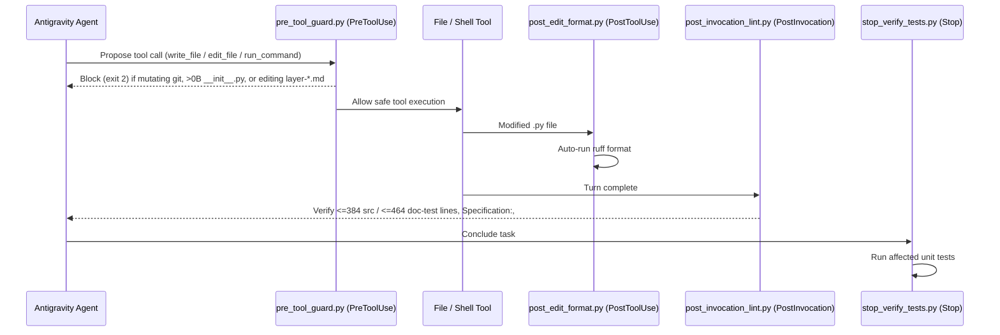

# Architecture 03 — Governance, Work Ledger, Lifecycle Hooks & Tiered CLI (`src/zcg/governance/`, `src/zcg/cli/` & `antigravity/`)

> **Normative Specification — Subsystem 3 (`src/zcg/governance/*`, `src/zcg/cli/*` & `antigravity/.gemini/config/scripts/*`)**
>
> This specification defines the 4 deterministic Python 3.14 Antigravity lifecycle hooks, sovereign node bootstrapping, declarative node linking (`zcg link` / `zcg unlink`), branch-to-project graduation (`zcg spinout-project`), plugin module scaffolding (`zcg scaffold-plugin-module`), executable AST hexagonal boundary linting (`zcg lint-arch`), 4-mode upstream template reconciliation, RBAC authority gates, $N$-departmental surface consensus, the *Node Work & Sprint Ledger*, `1-hop` directive/promotion workflows, and the 31-subcommand `zcg` console dispatcher.

---

## 1. `1:1:1` Source $\leftrightarrow$ Unit Test $\leftrightarrow$ Responsibility Matrix (`governance/` & `cli/`)

Ten governance modules and four CLI modules implement all `C1`/`C2`/`C3`/`Subtree`/`Workstation` node lifecycle operations (`100.00%` isolated unit statement and branch coverage):

| Implementation Module | Isolated `1:1` Unit Suite | Primary Symbols & Normative Scope |
| :--- | :--- | :--- |
| [src/zcg/governance/authority.py](../../src/zcg/governance/authority.py) | [tests/unit/zcg/governance/test_authority.py](../../tests/unit/zcg/governance/test_authority.py) | `resolve_git_user_email`, `configure_layer_authority`, `resolve_actor_role_profile` (`owner`, `maintainer`, `validator`, `member`, `consumer` + `UPSTREAM_HIERARCHICAL_AUTHORITY`), `verify_layer_operation_authority`, `verify_single_hop_upstream` (`CROSS_TIER_PROMOTION_BYPASS`), and `scan_open_source_agnosticism`. |
| [src/zcg/governance/ledger.py](../../src/zcg/governance/ledger.py) | [tests/unit/zcg/governance/test_ledger.py](../../tests/unit/zcg/governance/test_ledger.py) | `summarize_work_orchestration_ledger` (`own_node_ledger` vs. `inter_layer_exchange`), `manage_layer_roster` (`.github/CODEOWNERS` sync), `configure_git_governance_policy`, and `record_governance_decision` (`logs/governance_audit.jsonl`). |
| [src/zcg/governance/consensus.py](../../src/zcg/governance/consensus.py) | [tests/unit/zcg/governance/test_consensus.py](../../tests/unit/zcg/governance/test_consensus.py) | `collect_layer_effective_bindings`, `match_authoritative_surface_bindings`, `evaluate_multilayer_surface_consensus` (`RECONCILED_FLOW`, `ITERATION_REQUIRED`, `ESCALATE_TO_ROOT`, `ESCALATE_INTER_ENTITY_ROOTS`), and `evaluate_environment_promotion` (`dev -> tst -> pre -> pro`). |
| [src/zcg/governance/workflows.py](../../src/zcg/governance/workflows.py) | [tests/unit/zcg/governance/test_workflows.py](../../tests/unit/zcg/governance/test_workflows.py) | `start_task_workflow` (`feature/<TICKET-ID>-<slug>` + `.agents/SESSION.md`), `complete_task_workflow` (intra-node or `parent_dir` `Outbound Delegations` rollup), and `delegate_directive_to_child` (`1-hop` downward delivery + non-destructive `.agents/proposals/from-<parent>/` staging). |
| [src/zcg/governance/horizon.py](../../src/zcg/governance/horizon.py) | [tests/unit/zcg/governance/test_horizon.py](../../tests/unit/zcg/governance/test_horizon.py) | `diff_project_against_layers` (`SHA-256` drift audit), `compare_upstream_templates` (`#`/`##` section diff), and `inspect_layer_horizon` (`inbound_from_upstream`, `inbound_from_downstream`, `local_workspace_changes`). |
| [src/zcg/governance/promotion.py](../../src/zcg/governance/promotion.py) | [tests/unit/zcg/governance/test_promotion.py](../../tests/unit/zcg/governance/test_promotion.py) | `reconcile_template_pack_sync` (`reconcile`, `accept-upstream`, `merge`, `keep-local`), `promote_project_asset_to_layer` (`1-hop` upward PR + OSS anonymization), and `consult_layer_ephemeral` (`make consult`). |
| [src/zcg/governance/scaffolder.py](../../src/zcg/governance/scaffolder.py) | [tests/unit/zcg/governance/test_scaffolder.py](../../tests/unit/zcg/governance/test_scaffolder.py) | `configure_node_manifest`, `scaffold_template_pack`, and `apply_templates_to_project` (materializing `.agents/rules/layer-<NN>-<id>.md`, `.agents/skills/`, `.agents/LAYER_LINEAGE.md`, and pruning deselected plugins). |
| [src/zcg/governance/bootstrap.py](../../src/zcg/governance/bootstrap.py) | [tests/unit/zcg/governance/test_bootstrap.py](../../tests/unit/zcg/governance/test_bootstrap.py) | `register_mounted_subtree`, `bootstrap_node_workspace` (auto-installing & activating default Cockpit + Antigravity IDE workspace registration), and `sync_node_workspace`. |
| [src/zcg/governance/links.py](../../src/zcg/governance/links.py) | [tests/unit/zcg/governance/test_links.py](../../tests/unit/zcg/governance/test_links.py) | `resolve_linked_node_dir`, `link_node` (`zcg link`), `unlink_node` (`zcg unlink`), and `spinout_branch_to_project` (`zcg spinout-project --from-branch` with bidirectional `spinout-project` links). |
| [src/zcg/governance/arch_linter.py](../../src/zcg/governance/arch_linter.py) | [tests/unit/zcg/governance/test_arch_linter.py](../../tests/unit/zcg/governance/test_arch_linter.py) | `BoundaryViolation`, `check_domain_module`, `check_test_suite`, and `lint_architecture` (`zcg lint-arch`) enforcing `0` infrastructure/I/O imports in `domain/` (`models.py`, `entities.py`, `service.py`), `0`-byte `__init__.py`, `excluded_contexts`, and `1:1:1` `AAA` test contracts. |
| [src/zcg/cli/parser.py](../../src/zcg/cli/parser.py) | [tests/unit/zcg/cli/test_parser.py](../../tests/unit/zcg/cli/test_parser.py) | Deterministic flag parsing (`parse_cli_options`, `parse_pos_and_options`), `CLIUsageError` (exit `1`), and `CLIAuthorityBlockedError` (exit `2`). |
| [src/zcg/cli/discovery.py](../../src/zcg/cli/discovery.py) | [tests/unit/zcg/cli/test_discovery.py](../../tests/unit/zcg/cli/test_discovery.py) | `dispatch_c1` (`8` read-only discovery commands including `lint-arch`), `dispatch_subtree` (`subtree <list\|pull\|pull-all\|register>`), and `dispatch_workstation` (`install-antigravity`, `workstation-sync`, `workstation-backup`, `workstation-audit`, `workstation-restore`). |
| [src/zcg/cli/commands.py](../../src/zcg/cli/commands.py) | [tests/unit/zcg/cli/test_commands.py](../../tests/unit/zcg/cli/test_commands.py) | `dispatch_c2` (`13` lifecycle commands including `link`, `unlink`, `spinout-project`, `scaffold-plugin-module`, and `set-global-profile --workstation-dir`) and `dispatch_c3` (`8` RBAC-gated governance commands). |
| [src/zcg/cli/dispatcher.py](../../src/zcg/cli/dispatcher.py) | [tests/unit/zcg/cli/test_dispatcher.py](../../tests/unit/zcg/cli/test_dispatcher.py) | `dispatch_zcg_cli` and `main` console entrypoint (`zcg`). |

---

## 2. Deterministic Python 3.14 Antigravity Lifecycle Hooks (`antigravity/.gemini/config/`)

All four lifecycle hooks execute in `< 50 ms` using 100% Python 3.14 Standard Library (`hooks.json`):

1. **`pre_tool_guard.py` (`PreToolUse`)**: Blocks automated mutating `git` commands (`add`, `commit`, `push`, `reset`, `rebase`, `checkout`, `merge`, `clean`, `subtree`), writes (`> 0 bytes`) to `{src,tests}/**/__init__.py`, and direct edits to inherited `.agents/rules/layer-*.md` across both file tools and shell redirections (`heredoc`, `tee`, `sed -i`, `python -c`).
2. **`post_edit_format.py` (`PostToolUse`)**: Automatically formats modified `.py` files with `ruff format`.
3. **`post_invocation_lint.py` (`PostInvocation`)**: Enforces `<= 384` lines on `src/**/*.py`, `<= 400` lines on root `README.md`, `<= 464` lines on `docs/**/*.md` and `tests/**/*.py`, `Specification: docs/architecture/*.md` headers, standalone `# Arrange`, `# Act`, and `# Assert` comments in every `def test_*`, `ruff check`, and `AGENTS.md <= 18,000` bytes (`force_continue: True` on violations).
4. **`stop_verify_tests.py` (`Stop`)**: Executes affected unit test suites before concluding a task turn.

---

## 3. *Node Work & Sprint Ledger*, 4-Mode Reconciliation & $N$-Departmental Consensus

`src/zcg/governance/` enforces three core state machines across every governed repository:

### 3.1. Dual-Plane *Node Work & Sprint Ledger* (`summarize_work_orchestration_ledger`)

Every node's work ledger (`WORKROAD.md`, `WORKTASK.md`, `WORKVALI.md`, `BACKLOG.md`) separates **intra-node execution** from **inter-layer governance exchange**:
- **`own_node_ledger`**: Counts `pending_count` (`[ ]`), `in_progress_count` (`[/]`), and `completed_count` (`[x]`) across `WORKROAD.md`, `WORKTASK.md`, `WORKVALI.md`, and `BACKLOG.md`, extracting active task IDs and sprint progress percentage.
- **`inter_layer_exchange`**: Tracks `outbound_delegations` (`- [/] **[<TICKET> -> <child> (stage: delegated)]**` under `## Outbound Delegations` in `WORKTASK.md`), `inbound_proposals` (`.agents/proposals/from-*`), and `outbound_proposals` (`.agents/proposals/to-*`).

### 3.2. Four-Mode Upstream Template Reconciliation (`reconcile_template_pack_sync`)

When `zcg sync-layer` updates inherited templates from a parent layer or `zero-cloud-gravity`, `--strategy` controls conflict resolution while always skipping the node's own sovereign pack (`skip_id = layer_id`):
1. **`reconcile` (Default — Zero-Loss)**: Adopts clean upstream updates and stages any locally diverged inherited rule file non-destructively under `.agents/proposals/from-upstream/<pack>/<file>`.
2. **`accept-upstream`**: Overwrites inherited template packs with the canonical upstream version.
3. **`merge`**: Preserves local-only `# / ## / ###` Markdown sections while updating shared upstream sections.
4. **`keep-local`**: Keeps existing local template files untouched while adding only newly introduced upstream files.

### 3.3. Progressive `env-gate` (`dev -> tst -> pre -> pro`) & 4-State $N$-Departmental Consensus

`evaluate_environment_promotion` and `evaluate_multilayer_surface_consensus` enforce progressive quality and authority gates:

| Target Environment | Required Ledger & Git State | Required RBAC Role (`effective_role`) | Multi-Department Surface Consensus (`--files`) |
| :--- | :--- | :--- | :--- |
| **`tst`** | `0` open `[P0]` blockers in `WORKTASK.md` | `member`, `validator`, `maintainer`, or `owner` | Evaluates matching `surface_bindings` across mounted layers. |
| **`pre`** | `tst` gates + `0` unchecked `[ ]` items in `WORKVALI.md` | `validator`, `maintainer`, or `owner` | Requires `RECONCILED_FLOW` (no unresolved `REJECTED`/`DEFERRED` co-owners). |
| **`pro`** | `pre` gates + non-empty `CHANGELOG.md` | `owner` (or internal parent `Root 0` `owner` via `UPSTREAM_HIERARCHICAL_AUTHORITY`) | Halts on `ESCALATE_TO_ROOT` (internal deadlock) or `ESCALATE_INTER_ENTITY_ROOTS` (external `public-government` statutory block). |

---

## 4. Executable AST Hexagonal Boundary Enforcer (`arch_linter.py` / `zcg lint-arch`)

`lint_architecture` (`zcg lint-arch [<dir>] [--no-tests]`) statically parses Python ASTs across source and test trees (`exit 0` when `violation_count == 0`, `exit 1` otherwise) while ignoring static-only `if TYPE_CHECKING:` blocks:

| Rule Identifier | Target Surface | Normative AST / Structural Condition |
| :--- | :--- | :--- |
| `domain-imports-infrastructure` | `domain/**`, `models.py`, `entities.py`, `service.py` | Rejects runtime imports from `infrastructure`, `adapters`, `router`, `repository`, `sqlite_repo`, `asgi`, `server`, or `dependencies`. |
| `domain-imports-io-package` | `domain/**`, `models.py`, `entities.py`, `service.py` | Rejects runtime I/O, network, process, or DB imports (`sqlite3`, `subprocess`, `socket`, `http`, `urllib`, `asyncio`, `sqlalchemy`, `httpx`, etc.). |
| `non-empty-init-file` | `{src,tests}/**/__init__.py` | Enforces `0`-byte / empty package initializers across source and test packages. |
| `excluded-context-import` | `src/<context>/**/*.py` | Rejects cross-context imports forbidden by `excluded_contexts` in `system/zcg-node.json`. |
| `flat-test-file` / `orphan-test-file` | `tests/**/*.py` | Requires `test_*.py` under `tests/{unit,imp,e2e}/` and `1:1` matching `src/` modules for every `tests/unit/**/test_<mod>.py`. |
| `one-test-class-per-file` / `db-fixture-in-unit-test` / `missing-aaa-comments` | `tests/**/*.py` | Requires exactly `1` top-level `Test*` class per file, `0` DB session/engine fixtures in `tests/unit/`, and `# Act` + `# Assert` markers in every `test_*`. |
