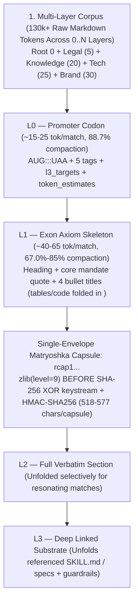

# Architecture 05 — Contextual MCP, `rcap1` Compaction, Citations & Ephemeral Bots (`src/zcg/{capsules,ephemeral,mcp}/`)

> **Normative Specification — Subsystem 5 (`src/zcg/capsules/*`, `src/zcg/ephemeral/*` & `src/zcg/mcp/*`)**
>
> This specification defines Resonant Chained Context Compaction (`rcap1`: `L0 -> L1 -> L2 -> L3`), `citation_receipt` cryptographic provenance (`CITATION_DRIFT_DETECTED`) and `Q1..Q4` obsolescence telemetry, zero-checkout `DMCP`/`GRCC` Git plumbing, `strictly-read-only` Ephemeral Department Bots, and the `ZeroCloudMCPServer` (`zcg-mcp`) JSON-RPC 2.0 protocol.

---

## 1. `1:1:1` Source $\leftrightarrow$ Unit Test $\leftrightarrow$ Responsibility Matrix (`capsules/`, `ephemeral/`, `mcp/`)

Seventeen modules across `src/zcg/capsules/` (`6`), `src/zcg/ephemeral/` (`3`), and `src/zcg/mcp/` (`8`) implement the zero-dependency contextual intelligence plane (`100.00%` isolated unit statement and branch coverage):

| Implementation Module | Isolated `1:1` Unit Suite | Primary Symbols & Normative Scope |
| :--- | :--- | :--- |
| [src/zcg/capsules/constants.py](../../src/zcg/capsules/constants.py) | [tests/unit/zcg/capsules/test_constants.py](../../tests/unit/zcg/capsules/test_constants.py) | JSON-RPC error codes, `CAPSULE_MAGIC_PREFIX` (`"rcap1"`), `VALID_CAPSULE_LEVELS` (`L0..L3`), `CITATION_LIFECYCLE_QUADRANTS` (`Q1..Q4`), `ALLOWED_ROOT_FILES` (including `SYLLABUS.md` & `WORK*`), and `ALLOWED_READ_PREFIXES`. |
| [src/zcg/capsules/markdown.py](../../src/zcg/capsules/markdown.py) | [tests/unit/zcg/capsules/test_markdown.py](../../tests/unit/zcg/capsules/test_markdown.py) | `iter_markdown_sections`, `extract_axiom_skeleton` (`L1` Exon extraction), `resolve_section_hierarchy`, `extract_l3_links`, and `infer_epistemic_grade` (`E3..E0`). |
| [src/zcg/capsules/codec.py](../../src/zcg/capsules/codec.py) | [tests/unit/zcg/capsules/test_codec.py](../../tests/unit/zcg/capsules/test_codec.py) | `CapsuleError`, `seal_single_capsule`, `parse_capsule_envelope`, `build_section_capsule` (`zlib` + `XOR` SHA-256 keystream + `HMAC-SHA256`), `seal_ephemeral_digest_capsule`, and `unseal_ephemeral_digest_capsule`. |
| [src/zcg/capsules/citations.py](../../src/zcg/capsules/citations.py) | [tests/unit/zcg/capsules/test_citations.py](../../tests/unit/zcg/capsules/test_citations.py) | `build_citation_receipt` (`<layer>::<file>#<slug>@<digest16>:<E3..E0>`), `verify_epistemic_context_claims` (`PRIMARY_SOURCE_HASH_MISMATCH`, `EPISTEMIC_PRECEDENCE_VIOLATION`, `CUT_POINT_BOUNDARY_VIOLATION`, `CITATION_DRIFT_DETECTED`), and `Q1..Q4` telemetry radar. |
| [src/zcg/capsules/grcc.py](../../src/zcg/capsules/grcc.py) | [tests/unit/zcg/capsules/test_grcc.py](../../tests/unit/zcg/capsules/test_grcc.py) | Zero-checkout Git `DMCP` (`read_git_branch_markdown_corpus` via `git ls-tree`/`cat-file`) and `refs/zcg/capsules/<scope>` `GRCC` Merkle object storage (`store_grcc_capsule_ref`, `load_grcc_capsule_ref`, `prune_grcc_capsule_ref`). |
| [src/zcg/capsules/surfaces.py](../../src/zcg/capsules/surfaces.py) | [tests/unit/zcg/capsules/test_surfaces.py](../../tests/unit/zcg/capsules/test_surfaces.py) | `infer_plane_from_path`, `infer_scope_from_path`, `binding_matches_surface`, `compute_binding_specificity` (*Lex Specialis*), and `resolve_surface_bindings_for_path` (*Lex Superior* `0..100`). |
| [src/zcg/ephemeral/lifecycle.py](../../src/zcg/ephemeral/lifecycle.py) | [tests/unit/zcg/ephemeral/test_lifecycle.py](../../tests/unit/zcg/ephemeral/test_lifecycle.py) | `inspect_ephemeral_forks`, `reap_ephemeral_fork`, `garbage_collect_expired_forks`, and crypto-shredding of expired leases under `.agents/ephemeral/`. |
| [src/zcg/ephemeral/spawner.py](../../src/zcg/ephemeral/spawner.py) | [tests/unit/zcg/ephemeral/test_spawner.py](../../tests/unit/zcg/ephemeral/test_spawner.py) | `spawn_ephemeral_fork` (`strictly-read-only` `chmod 0o555`/`0o444` sandboxes, `session_resonance_key` generation, and RBAC scope checks). |
| [src/zcg/ephemeral/briefs.py](../../src/zcg/ephemeral/briefs.py) | [tests/unit/zcg/ephemeral/test_briefs.py](../../tests/unit/zcg/ephemeral/test_briefs.py) | `build_subagent_invocation_brief` (`4-Channel Digest` prompt synthesis for `flash_lite`/`flash`/`inherit`/`pro` subagents). |
| [src/zcg/mcp/catalogs.py](../../src/zcg/mcp/catalogs.py) | [tests/unit/zcg/mcp/test_catalogs.py](../../tests/unit/zcg/mcp/test_catalogs.py) | `MCP_RESOURCES_CATALOG` (`9`), `MCP_TOOLS_CATALOG` (`9`), `MCP_PROMPTS_CATALOG` (`3`), `MCP_PERMISSION_RINGS` (`R0..W`), and `BOT_ARCHETYPE_CATALOG` (`5` bot families). |
| [src/zcg/mcp/node_base.py](../../src/zcg/mcp/node_base.py) | [tests/unit/zcg/mcp/test_node_base.py](../../tests/unit/zcg/mcp/test_node_base.py) | `MCPNodeBase` (`resolve_safe_path` `PATH_CONTAINMENT_VIOLATION`, `resolve_workspace_override`, `9` `zcg://*` resources, and `3` orientation prompts). |
| [src/zcg/mcp/compaction.py](../../src/zcg/mcp/compaction.py) | [tests/unit/zcg/mcp/test_compaction.py](../../tests/unit/zcg/mcp/test_compaction.py) | `CompactionMixin` (`tool_query_governance_rules` across `L0`, `L1`, `L2`, `E3..E0` grading, `consumer_viewpoint` `M1..M4` sorting, and `branch_ref` `DMCP`). |
| [src/zcg/mcp/unfold.py](../../src/zcg/mcp/unfold.py) | [tests/unit/zcg/mcp/test_unfold.py](../../tests/unit/zcg/mcp/test_unfold.py) | `UnfoldMixin` (`tool_unfold_context_capsule` `L0 -> L1 -> L2 -> L3`, TOCTOU line-drift relocation, and `verify_epistemic_claims`). |
| [src/zcg/mcp/surfaces.py](../../src/zcg/mcp/surfaces.py) | [tests/unit/zcg/mcp/test_surfaces.py](../../tests/unit/zcg/mcp/test_surfaces.py) | `SurfaceGovernanceMixin` (`tool_resolve_surface_governance` `0..N` layer weaver and `tool_compare_layer_patterns`). |
| [src/zcg/mcp/federation.py](../../src/zcg/mcp/federation.py) | [tests/unit/zcg/mcp/test_federation.py](../../tests/unit/zcg/mcp/test_federation.py) | `FederationMixin` (`tool_get_layer_overview` 4-Channel Digest, `tool_audit_node_drift` + `workstation-audit.sh`, `tool_read_layer_document`, `tool_discover_federated_mcps`). |
| [src/zcg/mcp/orchestrator.py](../../src/zcg/mcp/orchestrator.py) | [tests/unit/zcg/mcp/test_orchestrator.py](../../tests/unit/zcg/mcp/test_orchestrator.py) | `EphemeralOrchestrationMixin` (`tool_orchestrate_ephemeral_fork` across `spawn`, `inspect`, `reap`, `catalog`, `seal-return`, `verify-return`, `grcc-*`, `dmcp-project`). |
| [src/zcg/mcp/server.py](../../src/zcg/mcp/server.py) | [tests/unit/zcg/mcp/test_server.py](../../tests/unit/zcg/mcp/test_server.py) | `ZeroCloudMCPServer` JSON-RPC 2.0 dispatcher, `stdio` loop (`Content-Length` + JSONL), and `zcg-mcp --self-test`. |

---

## 2. Resonant Chained Context Compaction (`rcap1`: `L0 -> L1 -> L2 -> L3`)

When an AI agent searches across a multi-layer context graph (`Root 0` + mounted `layers/*` subtrees + `dev/tst/pre/pro` environments), returning full Markdown sections (`L2`) for every match wastes context tokens on non-resonating sections. `src/zcg/capsules/` solves this in 100% Python 3.14 stdlib (`zlib`, `hashlib`, `hmac`, `base64`):

### 2.1. Information-Theoretic Foundations & Live Empirical Benchmarks (`130k`-Token Corpus)

`rcap1` achieves its compaction and latency profile through four deterministic mechanisms (`0` LLM calls, `0` vector DBs):
1. **Compile-Time 2D Document Geometry (`Mandate 10`)**: Enforcing `< 465` lines/file, `H1..H4` hierarchy (`0` `#####`), 1-line lead sentences, and `> *"...*"` mandate quotes turns every Markdown file into a pre-indexed AST, allowing `extract_axiom_skeleton` to extract `L0`/`L1` in $O(N)$ linear time (`~16 ms`).
2. **`zlib`-Before-Stream-Cipher Single-Envelope Sealing**: Compressing the JSON interior (`ph`, `f`, `s`, `e`, `h1`, `hd`) with `zlib.compress(level=9)` *before* applying `_xor_keystream` and Base64 encoding shrinks each `capsule_token` to **`518–577` chars (`-76.3%`)**.
3. **Capability & Environment Depth Gating**: `agent_tier="flash"` is restricted to `L0`/`L1` (`CAPSULE_CAPABILITY_INSUFFICIENT` on `L2`/`L3`); `agent_tier="inherit"` unfolds `L1..L3` in `dev/tst/pre`; unfolding `L3` in `"pro"` requires `agent_tier="pro"`.
4. **TOCTOU Line-Drift Relocation**: If lines are inserted earlier in a file after a capsule is minted, `tool_unfold_context_capsule` relocates the section by heading slug and verifies `h1..h3` without false-positive failures.

The table below reports live empirical benchmarks across a `130k`-token corpus:

| Resolution & Mode (`13` Matches Across `130k`-Token Corpus) | Section Content Tokens | Capsule Overhead Tokens | Net Tokens (vs. `4,622` `L2` Baseline) | Content Compaction (`savings_pct`) | End-to-End Latency (`stdio`) |
| :--- | :---: | :---: | :---: | :---: | :---: |
| **`L0` (`include_capsules=false` — Discovery Scan)** | **`522` tok** | `0` tok | **`522` tok (`-88.7%` net)** | **`88.7%`** | `17.7 ms` |
| **`L0` (`include_capsules=true` — Hop-Ready)** | **`522` tok** | `1,858` tok (`577` chars/cap) | **`2,380` tok (`-48.5%` net)** | **`88.7%`** | `16.7 ms` |
| **`L1` (`include_capsules=false` — Exon Skeleton)** | **`1,523` tok** | `0` tok | **`1,523` tok (`-67.0%` net)** | **`67.0%`** | `17.1 ms` |
| **`L1` (`include_capsules=true` — Hop-Ready)** | **`1,523` tok** | `1,865` tok (`578` chars/cap) | **`3,388` tok (`-26.7%` net)** | **`67.0%`** | `16.2 ms` |
| **`L2` (`include_capsules=false` — Full Verbatim)** | `4,622` tok | `0` tok | `4,622` tok *(baseline)* | `0.0%` | `15.5 ms` |

---

## 3. Canonical Citation Receipts (`citation_receipt`), `Q1..Q4` Radar & `DMCP`/`GRCC`

1. **Cryptographic Provenance (`build_citation_receipt` & `verify_epistemic_context_claims`)**: Every section capsule carries `<layer_id>::<rel_file>#<section_slug>@<h2_digest16>:<E3..E0>`. Verifying claims checks:
   - `PRIMARY_SOURCE_HASH_MISMATCH` (source file SHA-256 prefix verification),
   - `EPISTEMIC_PRECEDENCE_VIOLATION` (`E0/E1` cannot override `E2/E3`),
   - `CUT_POINT_BOUNDARY_VIOLATION` (`N` vs. `N ± 1` quantitative threshold checks), and
   - `CITATION_DRIFT_DETECTED` (`@<h2_digest16>` mismatch when an upstream statute or law advances).
2. **Adaptive `consumer_viewpoint` (`M1..M2` vs. `M3..M4`)**: When the active workspace `Human-Stack` carries `domain-*:M1`, `domain-*:M2`, or `soft-socratic-coach`, `query_governance_rules` sets `consumer_viewpoint = "academic-tutor-m1-m2"` and prioritizes `docs/guides/` (`E1` Socratic lessons) before raw `docs/reference/` (`E3/E2`) treaties; for `M3/M4`, it sets `"professional-scientific-m3-m4"` and sorts strictly by `E3 -> E2 -> E1 -> E0`.
3. **Four-Quadrant `Age × Empirical Usage` Radar (`Q1..Q4`)**: `.agents/telemetry/citation_stats.json` classifies sections in `audit_node_drift` into `Q1_HOT_CORE` (`>= 3` citations, `0` drift $\rightarrow$ pre-seal in `GRCC`), `Q2_HIGH_FRICTION` (drift/friction > 0 $\rightarrow$ prioritize sync), `Q3_EMERGING_NICHE` (`<= 180d`, `< 3` citations), and `Q4_NORMATIVE_OBSOLESCENCE` (`> 180d`, `0` citations $\rightarrow$ review for consolidation).
4. **Zero-Checkout `DMCP` & `GRCC` (`refs/zcg/capsules/*`)**: `read_git_branch_markdown_corpus` reads branch trees (`specialty/*`, `hat/*`, `env/*`) directly from `.git/objects` via `git ls-tree` and `git cat-file` (`zero_checkout: True`, `0` working-tree mutations), while `GRCC` stores pre-sealed `rcap1` bundles under `refs/zcg/capsules/<scope>` outside `refs/heads/*`.

---

## 4. OOP Capability Rings (`R0..W`) & `strictly-read-only` Ephemeral Department Bots

`src/zcg/ephemeral/` and `src/zcg/mcp/orchestrator.py` materialize time-bounded (`ttl_seconds`) Ephemeral Department Bots under `.agents/ephemeral/<fork_id>/`:
- **Strict Read-Only Sandbox (`chmod 0o555` / `0o444`)**: Projected rule and skill files in an ephemeral fork are locked with `0o444` (`0o555` directories) and `sandbox_mode: "strictly-read-only"`.
- **Return Digest Membrane (`seal-return` / `verify-return`)**: Ephemeral bots return findings to the parent workspace exclusively through an HMAC-sealed `rcap1` return digest (`seal_ephemeral_digest_capsule`), verified against the fork's `session_resonance_key` and `surface_globs` (`SURFACE_BOUNDARY_VIOLATION` / `EPHEMERAL_LEASE_EXPIRED_OR_SHREDDED`).
