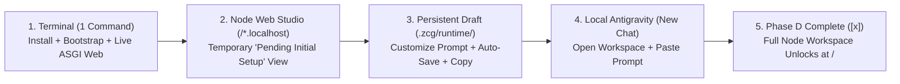
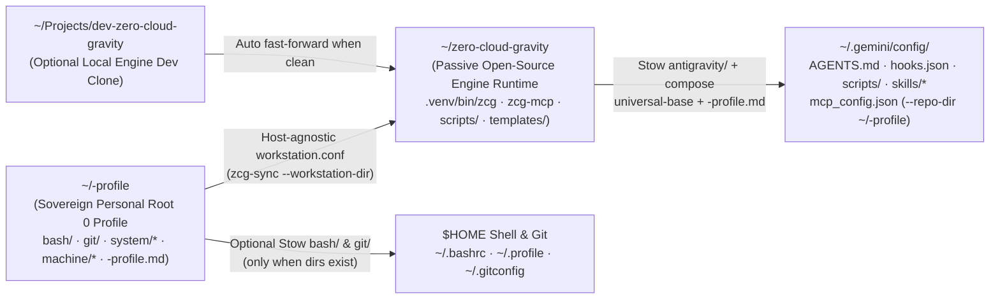
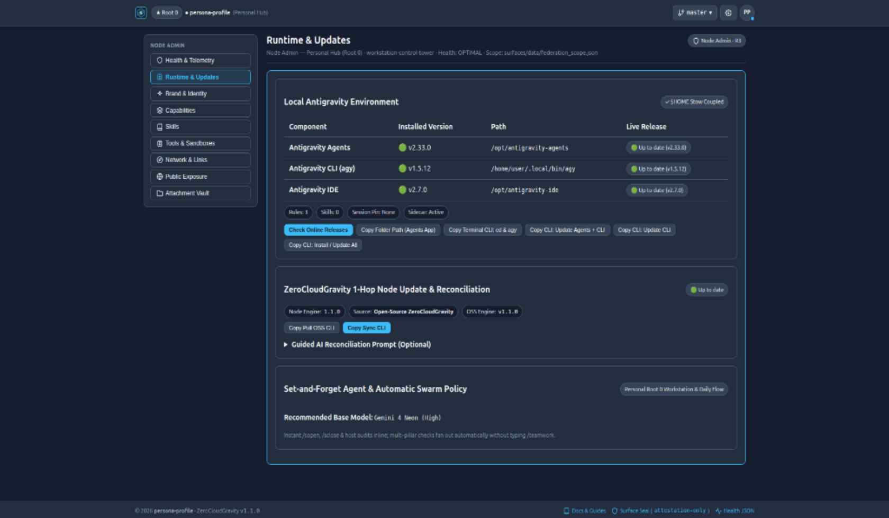
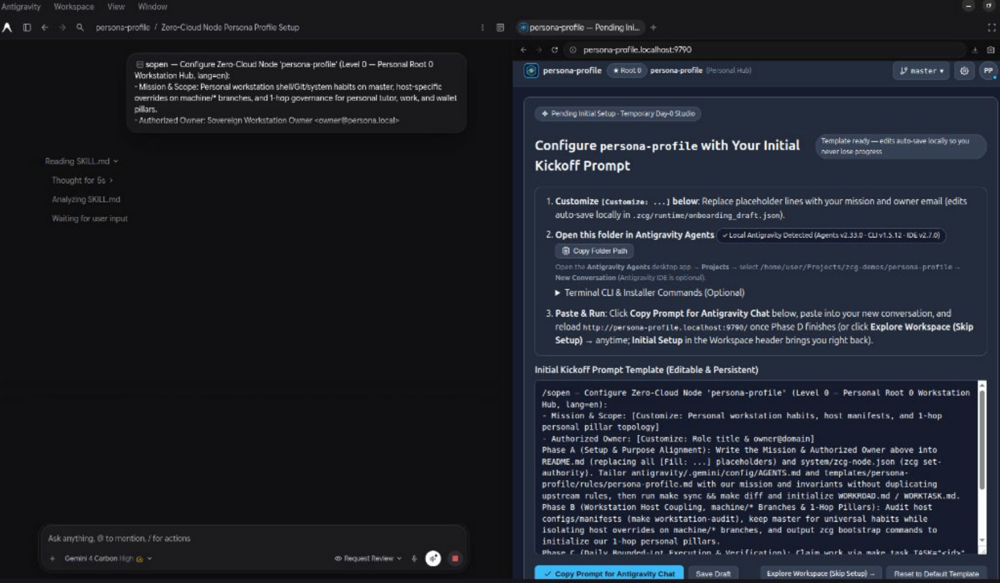
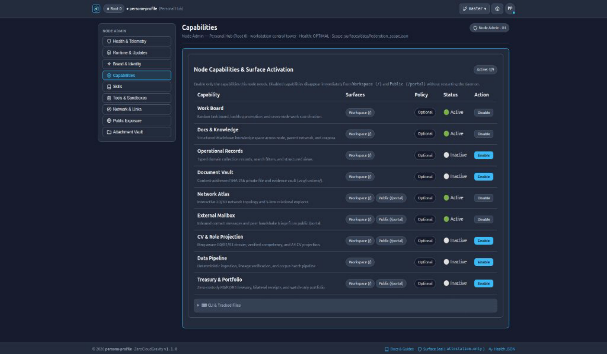
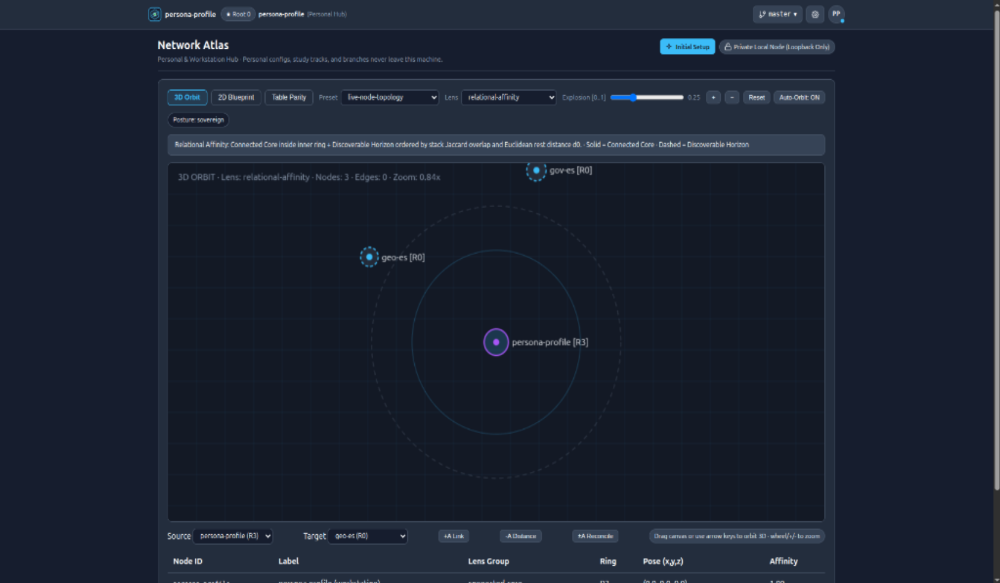

# Guide 01 — Act I (Step 1): Engine Install, Personal `Root 0` (`~/<persona>-profile`), Host-Agnostic `$HOME` & Day-0 Setup

> **Human Operator Manual — Compositional Journey Step 1 of 8 (Tier 2 Progressive Disclosure)**
>
> Begin your ZeroCloudGravity journey on a single Ubuntu 26.04 LTS (or WSL2) machine by installing the passive engine (`~/zero-cloud-gravity`), bootstrapping your identity-centric sovereign **Personal `Root 0` (`~/<persona>-profile`, `:8790`)**, completing its **Browser-First Day-0 Setup Studio**, and governing host symlinks and packages via GNU Stow and host-agnostic `zcg-sync`. Next step in your personal constellation: **[`Guide 02` Personal Tutor (`:8786`)](02_personal_tutor_and_academic_progression.md)**. For engine contracts, see **[`Architecture 04`](../architecture/04_cockpit_and_intranet_surfaces.md)**; for the gateway overview, return to **[`README.md`](../../README.md)**.

---

## 1. Zero-Friction Browser-First Day-0 Onboarding (`1 Command -> Node Web Studio -> Local Antigravity Chat -> Configured Node`)

Every ZeroCloudGravity node follows the same **inverted Browser-First Day-0 setup rhythm** so you never face an empty chat window or manually hunt for `[Fill: ...]` placeholders in Markdown files:



Run this single sequence to install the engine in `$HOME` and bring your Personal `Root 0` Profile (`~/<persona>-profile`) live on `http://<persona>-profile.localhost:8790/`:

```bash
git clone https://github.com/mtwuser/zero-cloud-gravity.git ~/zero-cloud-gravity
cd ~/zero-cloud-gravity
./install.sh --profile universal-base --lang es --stow
zcg bootstrap-workspace ~/<persona>-profile --id <persona>-profile --purpose individual-sovereign
```

Immediately after `zcg bootstrap-workspace` finishes, follow the compact 1-2-3 guide printed in your terminal (with plain-language command descriptions):
1. **Open `http://<persona>-profile.localhost:8790/` in your browser first**: While `setup_state != "configured"`, `GET /` serves an exclusive **Compact 3-Step Day-0 Setup Studio** pre-loaded with a self-contained 4-Phase Kickoff Prompt. Edits auto-save to `<workspace>/.zcg/runtime/onboarding_draft.json` (gitignored, shared across browsers) + `localStorage`, with a `beforeunload` reload guard and confirmed **`Reset to Default Template`** button. Clicking **`Explore Workspace (Skip Setup) →`** lets you inspect the live Workspace (`/?view=*` / `?tab=*` persists across navigation), and a **`✨ Initial Setup`** (`/?setup=studio`) recovery pill remains in the Workspace header until setup is completed.
2. **Pure-Local Antigravity Detection (Step 2 in the Studio)**: The Day-0 studio inspects local Antigravity binaries automatically (`Agents`, `CLI agy`, `IDE`) with `0` remote browser dependencies — highlighting **Antigravity Agents** desktop app first (*Projects $\rightarrow$ select `~/<persona>-profile` $\rightarrow$ New Conversation*, IDE optional) alongside the accurate terminal TUI CLI alternative (`cd ~/<persona>-profile && agy`), or a 1-click **`Copy Install CLI`** command (`./scripts/install-antigravity.sh --agents`) if not yet installed.
3. **Open `~/<persona>-profile` in Antigravity Agents (or `cd ~/<persona>-profile && agy`) & Paste in a New Conversation**: Click **`Copy Prompt for Antigravity Chat`** in the browser studio and paste it into a **New Conversation** in **Antigravity Agents** (or run `cd ~/<persona>-profile && agy` in your terminal). Once the chat starts, open the **integrated right-hand browser** at `http://<persona>-profile.localhost:8790/` — as soon as Phase D marks setup `[x]` in `WORKTASK.md`, reloading `/` unlocks your full `Workstation Control Tower` Workspace! Whenever a local `1-hop` sibling or child node is stopped (`⚪ Offline`), wake it with 1 click via **`Start Workspace`** inside **`Node Admin > Network & Links`**.

Once your node is configured, editing `.md` documents or node-owned `SKILL.md` files in the browser auto-saves private drafts inside gitignored `.zcg/runtime/md_drafts/` with `0` dirty Git state until applied.

---

## 2. Orthogonal `<persona>-profile` Identity, Host-Agnostic `$HOME` Coupling & GNU Stow

ZeroCloudGravity separates **person-centric identity (`~/<persona>-profile`)** from **physical host hardware (`machine/<hostname>` branches)** and **host-agnostic `$HOME` coupling (`workstation.conf` / `zcg-sync --workstation-dir <dir>`)**:
- **Identity-Centric Personal `Root 0` (`~/<persona>-profile`)**: Your personal constellation spans six uniform singular pillars (`PERSONAL_CONSTELLATION_PILLARS = ("profile", "tutor", "work", "wallet", "security", "game")`). Every child pillar depends on the *person* (`governing_root_id: "<persona>-profile"`), never on a disposable computer name, while laptop/desktop hardware drivers and packages live cleanly on `machine/<hostname>` branches inside `~/<persona>-profile`.
- **Host-Agnostic `$HOME` Coupling Across 3 Cases**: The passive engine (`~/zero-cloud-gravity`) couples to whichever governing node fits the machine:
  1. **Personal `~/<persona>-profile`**: Couples `~/.gemini/config/` + `bash/` + `git/` + `system/*` + `:8790` auto-start (`zcg-workstation.service`).
  2. **Enterprise `Root 0` or `Department` (`~/Work/<corp>-root` or `~/Work/dept-*`)**: On a managed corporate machine, `zcg-sync --setup --workstation-dir ~/Work/<corp>-root` couples `~/.gemini/config/` + `zcg-mcp` without touching `~/.bashrc` or `~/.gitconfig` unless `bash/` or `git/` directories exist in that node.
  3. **`$HOME`-Free Standalone Workspace**: Skipping `$HOME` setup materializes `universal-base.md` and base skills strictly inside `<ws>/.agents/` (`0` `$HOME` writes).

The diagram below illustrates Case 1 (coupling the passive engine with `~/<persona>-profile` in `$HOME`):



### 2.1. Why `~/.gemini/config/` Uses GNU Stow Tree Unfolding (Individual Symlinks)

Unlike `~/.bashrc` (a single file symlink), `~/.gemini/config/` and `~/.gemini/config/skills/` are **real directories** that mix tracked governance files with machine-local runtime files:
- **Tracked via Stow (`~/zero-cloud-gravity/antigravity/`)**: `AGENTS.md` (composed from your selected global profile + your governing `~/<persona>-profile/templates/<persona>-profile/rules/<persona>-profile.md` or enterprise node rule), `hooks.json`, `scripts/`, the 8 universal global skills inside `skills/<name>/`, and desktop launchers in `.local/share/applications/antigravity-{agents,ide}.desktop`.
- **Machine-local (untracked)**: `config.json`, `mcp_config.json` (linked to `~/.gemini/antigravity/mcp_config.json` with `zcg-mcp` targeting `--repo-dir ~/<persona>-profile` or the coupled corporate node), `plugins/`, `projects/`, `sidecars/`, and locally installed extension/cloud skills inside `skills/`.

Because `~/.gemini/config/` and `~/.gemini/config/skills/` exist as real directories, GNU Stow automatically performs **tree unfolding**: creating individual symlinks for each tracked item without touching local credentials, OAuth tokens, or third-party skills, while backing up any pre-existing regular `AGENTS.md` or `hooks.json` as `.backup.<YYYYMMDD>`.

### 2.2. Workstation Login Auto-Start (`:8790` Default On) & Standalone `$HOME`-Free Fallback

ZeroCloudGravity separates machine-wide personal hub availability from corporate and standalone workspace autonomy:
- **Personal `workstation` (`~/<persona>-profile`, `:8790`) — Default Auto-Start on OS Login**: Coupling `$HOME` (`./install.sh --stow` or `workstation-sync.sh --setup`) automatically registers and enables `~/.config/systemd/user/zcg-workstation.service` (`127.0.0.1:8790`, `Restart=on-failure`, with automatic daemon fallback in `zcg-sync --auto` on non-`systemd` WSL/containers) so your personal hub is always ready on login. Other `Root 0` nodes (`corporate`, `knowledge`) start **on demand** (`/sopen` or `make activate-plugin`) and support explicit opt-in via `zcg apply-project <dir> --service-action enable-autostart` (`disable-autostart` to remove).
- **Standalone Workspaces Without `$HOME` Setup (`0` `$HOME` Writes)**: If an operator skips `$HOME` setup and bootstraps a dedicated workspace directly (`zcg bootstrap-workspace ~/Work/solo-app ...`), ZeroCloudGravity materializes `universal-base.md` and the base lifecycle skills (`sopen`, `continue`, `sclose`, `review`, `enrich`) strictly inside `<workspace>/.agents/{rules,skills}/` (`0` `$HOME` writes, `0` `zcg diff-project` drift), and automatically deduplicates unmodified fallback copies if `$HOME` is configured later followed by `make sync`.

### 2.3. Directory & Path Conventions (`$HOME`, Engine, Profile & Workspaces)

The table below defines which workstation paths are managed by GNU Stow and which remain independent repositories or binary directories:

| Path | Managed by Stow? | Role & Scripts / Processes That Use It |
| :--- | :---: | :--- |
| `~/zero-cloud-gravity/` | Engine Source | Passive Open-Source engine runtime (`ZCG_RUNTIME_DIR`). Provides `.venv/bin/zcg`, `.venv/bin/zcg-mcp`, `scripts/*.sh`, `templates/*`, and the `antigravity/` Stow module. |
| `~/<persona>-profile/` *(e.g. `~/persona-profile`)* | Host Source | Personal Sovereign `Root 0` Profile Hub (`ZCG_WORKSTATION_DIR`, `entity_kind: "individual"`, `precedence: 90`). Tracks `bash/`, `git/`, `system/*.txt` package manifests (`machine/<hostname>` branches), `WORK*` ledgers (`[TASK-NNN]` in `WORKTASK.md` · `[BKL-NNN]` in `BACKLOG.md` · `[ROAD-NNN]` in `WORKROAD.md` · `[VAL-NNN]` in `WORKVALI.md`), and `templates/<persona>-profile/rules/<persona>-profile.md`. |
| `~/.config/zero-cloud-gravity/workstation.conf` | ❌ (Untracked) | Host-agnostic declarative per-device coupling config written by [`install.sh`](../../install.sh) and [`scripts/workstation-sync.sh`](../../scripts/workstation-sync.sh) (`ZCG_RUNTIME_DIR`, `ZCG_WORKSTATION_DIR` targeting `~/<persona>-profile` or corporate `Root 0`/`Department`, `ZCG_DEV_REPO_DIR`, `ZCG_GLOBAL_PROFILE`, `ZCG_INTERACTION_LANG`, `ZCG_AUTO_SYNC`, `ZCG_NO_BROWSER`). |
| `~/.gemini/config/` | ✅ (Tree-unfolded) | Shared across **Google Antigravity 2.0 (`antigravity-agents` desktop) and Antigravity CLI (`agy`)**. Stow links `AGENTS.md`, `hooks.json`, `scripts/`, and `skills/<name>/` while preserving untracked `config.json`, `mcp_config.json`, `plugins/`, and `sidecars/`. |
| `~/.bashrc`, `~/.profile`, `~/.gitconfig` | ✅ (When present) | Symlinked from `~/<persona>-profile/{bash,git}/` strictly when those directories exist (untouched on corporate nodes without `bash/`/`git/`). Automatically source untracked machine-local overrides (`~/.bashrc.local` and `~/.gitconfig.local`), add `zcg` to `PATH`, alias `zcg-sync`, and run once-per-boot `--auto` sync. |
| `~/Projects/<workspace>/` & `~/Work/<org>/` | ❌ (Never stowed) | Standard locations for personal child pillars (`<persona>-tutor`, `<persona>-work`, `<persona>-security`, `<persona>-wallet`, `<persona>-game`), knowledge corpora (`gov-*`, `sci-*`, `geo-*`, `org-*`), and isolated enterprise repositories. |
| `/opt/antigravity-agents/`, `~/.local/bin/agy`, `/opt/antigravity-ide/` | ❌ | Target binary paths populated by [`scripts/install-antigravity.sh`](../../scripts/install-antigravity.sh). |

---

## 3. System Manifests & Daily Workstation Operations (`system/`, `zcg-sync`, Backup, Audit & Restore)

Inside `~/<persona>-profile/system/`, plain-text manifests record installed Ubuntu 26.04 software and desktop settings consumed by [`scripts/workstation-restore.sh`](../../scripts/workstation-restore.sh), verified by [`scripts/workstation-audit.sh`](../../scripts/workstation-audit.sh), and updated by [`scripts/workstation-backup.sh`](../../scripts/workstation-backup.sh):

| Purpose & Tracked State | File / Directory |
| :--- | :--- |
| Sovereign node identity (`zcg-node-v1`), `precedence`, `global_profile`, `interaction_language`, and `workstation-control-tower` binding. | [`system/zcg-node.json`](../../system/zcg-node.json) |
| Manually installed Ubuntu 26.04 APT packages (3-stage filtered: excludes base OS, dependencies, external recipe packages, and `.audit-ignore`). | `system/packages-manual.txt` |
| Installed Snap applications, global NPM packages, NVM default major, and enabled external recipes. | `system/snaps.txt`, `system/npm-globals.txt`, `system/nvm-default.txt`, `system/external.txt` |
| Declarative recipe catalog for third-party software (Docker, Chrome, GCloud CLI, Antigravity Agents/IDE). Starter recipes ship in [`templates/plugin-stack/workstation-control-tower/assets/external/`](../../templates/plugin-stack/workstation-control-tower/assets/external/README.md). | `system/external/{apt-repo,deb-url,script}/` |
| Installed GNOME Shell extension UUIDs and declarative `dconf` settings. | `system/gnome-extensions.txt`, `system/gnome-settings.dconf` |

### 3.1. Unified Synchronization (`zcg-sync`), Antigravity Installer & Backup/Audit Modes

Couple `~/zero-cloud-gravity` with `~/<persona>-profile` (or any governing corporate `Root 0` / `Department` directory), manage Antigravity binaries, and audit host parity with deterministic commands:

```bash
# 1. Couple engine + personal Root 0 profile (or corporate Root 0) & run daily sync:
~/zero-cloud-gravity/scripts/workstation-sync.sh --setup \
  --profile universal-base --lang es --workstation-dir ~/<persona>-profile --auto-sync boot
zcg-sync                                    # Daily manual sync (also runs once per boot via ~/.bashrc)
zcg workstation-sync --status               # JSON status of runtime, governing dir, profile & boot stamp

# 2. Install or upgrade Google Antigravity Agents, CLI, or optional IDE:
./scripts/install-antigravity.sh --agents
./scripts/install-antigravity.sh --agents --from-archive <file>
```

The table below lists the host backup, audit, and restore commands for Ubuntu 26.04 workstations:

| Command / `Makefile` Target | Action |
| :--- | :--- |
| `make workstation-backup` (`zcg workstation-backup`) | Snapshots manual APT packages, Snaps, NPM globals, external recipes, and GNOME settings into `system/*`. |
| `make workstation-audit` (`zcg workstation-audit`) | Read-only 9-section drift check across Stow symlinks, APT, Snap, NPM, External recipes, GNOME, residual backups, Git tree, and Git identity. |
| `zcg workstation-audit --git-repos` | Scans ZCG-governed repositories to verify effective `user.email`, scope (`local` vs. `global/includeIf`), and `GH007` GitHub noreply posture. |
| `zcg workstation-restore <ws-dir> --all` | Full unattended provision (or `--packages \| --external \| --nvm \| --gnome \| --stow \| --antigravity`, `--dry-run` supported). |

List machine-specific hardware drivers (e.g., `nvidia-driver-595-open`) in `.audit-ignore` inside `~/<persona>-profile` to suppress host-specific drift warnings.

### 3.2. Multi-World Git Identity (`[includeIf]`) & Ongoing Upgrade Reconciliation (`State U2`)

Keep your GitHub noreply address as the global `[user]` default in `~/<persona>-profile/git/.gitconfig` (`Keep my email addresses private` + `Block command line pushes` enabled on GitHub) while scoping corporate directories via `[includeIf]`:

```ini
# ~/<persona>-profile/git/.gitconfig (stowed to ~/.gitconfig)
[user]
    name = Persona Sovereign
    email = mtwuser@users.noreply.github.com

[include]
    path = ~/.gitconfig.local

[includeIf "gitdir:~/Work/corp-alpha/"]
    path = ~/.gitconfig-corp-alpha
```

Whenever `zero-cloud-gravity` or a governing parent layer advances, open **`Node Admin > Runtime & Updates` (`/admin?tab=runtime`)** to inspect installed local Antigravity versions (`Agents`, `CLI agy`, `IDE`), check online Antigravity releases (`make workstation-update-agy`), verify `1-Hop` ZeroCloudGravity version lineage (`Root 0 <- OSS` vs. `Subordinate <- Governing Parent`, updating your parent node first before subordinate nodes), and copy the Guided Reconciliation Prompt — or run `zcg-sync` in `$HOME` and paste the 4-step reconciliation prompt in any configured (`State U2`) workspace:

```text
/sopen — Execute the 4-Step Upstream Upgrade & Version Reconciliation Flow:
1. Step 1 (Topology & Horizon Audit): Run make status, make horizon, and make upstream-diff.
2. Step 2 (Zero-Loss Reconciliation): Run make sync STRATEGY=reconcile (preserving templates/<layer-id>/rules/<layer-id>.md while upgrading inherited stacks).
3. Step 3 (Selective Stack & Plugin Review): Verify active templates/plugins and confirm make diff (0 drift).
4. Step 4 (Environment Gate & Closure): Validate make env-gate ENV=pro (or ENV=tst|pre|pro on staged enterprise nodes) and close via /sclose.
```



---

## 4. Perspective `1.1` — Sovereign Workstation Virtues, Dual-World Matrix & Live `:8790` Surface (`[CAP-01]`)

Governing your workstation as `Root 0` (`precedence: 90`) on `universal-base` prevents domain rules from bleeding across parallel Antigravity windows while separating community engine upgrades (`World 1`) from your private host state (`World 2`):

| Plane | World 1 — Common Community Base (`~/zero-cloud-gravity`) | World 2 — Sovereign Personal Customization (`~/<persona>-profile`) | Reconciliation & Surface |
| :--- | :--- | :--- | :--- |
| **1. Rules & Global `AGENTS.md`** | `universal-base.md` (`13` universal mandates + commit discipline, `<= 18 KB`). | `templates/<persona>-profile/rules/<persona>-profile.md` (`--lang`, shell/Git invariants, `1-hop` pillar delegation). | `zcg-sync` $\rightarrow$ `~/.gemini/config/AGENTS.md` |
| **2. Host System & Branches** | Installers, audit scripts, and `5` starter external recipes (`promotion_pipeline: "direct"`). | `bash/`, `git/`, `system/*.txt`, `machine/<hostname>` & `hat/*` branches, untracked `.local` files. | `make workstation-backup` / `workstation-audit` |
| **3. Three-Plane Web Surface (`:8790`)** | `workstation-control-tower` (`Workspace /` Kanban, `Docs & Knowledge`, `Metrics` & dedicated `GET /atlas`, `Node Admin /admin` 9-tab studio including `Runtime & Updates` `?tab=runtime`, top-bar `⚙` `User Settings (/settings)` icon, and Avatar dropdown ordered as header `Network Atlas` icon button $\rightarrow$ `Workspace (/)` & `Node Surfaces` first $\rightarrow$ `1-Hop Nodes` below). | Personal constellation liveness tree (`tutor :8786`, `work :8787`, `security :8785`, `wallet :8788`, `game :8789`) & local `.zcg/runtime/` state. | `http://<persona>-profile.localhost:8790/` |



> [!NOTE]
> **Split-Screen Antigravity Agents + Browser Visual Capture — `[CAP-01]` (`Individual Root 0 Workstation Control Tower`)**
> - **Left Pane (Antigravity Agents)**: `persona-profile` opened directly in Antigravity Agents (`v2.33.0`) executing the `Level 0 — Personal Root 0 Workstation Hub` `/sopen` Kickoff Prompt on `master`.
> - **Right Pane (Built-In Browser View)**: Live `http://persona-profile.localhost:9790/` Browser-First Day-0 Studio auto-detecting local Antigravity (`Agents v2.33.0 · CLI v1.5.12 · IDE v2.7.0`), `Copy Folder Path`, persistent draft auto-save, and `Explore Workspace (Skip Setup) ->` recovery (`✨ Initial Setup`).

### 4.1. Modular `Node Admin > Capabilities` & Dedicated `/atlas` (`3D Orbit`) Plane

Every node lets you toggle optional capabilities on or off without restarting the ASGI daemon (`Node Admin > Capabilities`) and explore `1-Hop` + epistemic `gov-*/geo-*/sci-*` topology on the dedicated `/atlas` plane (`✨ Initial Setup` stays accessible in the header until Phase D completes):





---

## 5. Official Zero-Collateral Windows Onboarding (`WSL2 + Ubuntu 26.04 LTS`)

Windows operators run ZeroCloudGravity with `100%` POSIX, GNU Stow, and Native Python 3.14 ASGI parity via **WSL2 (`Ubuntu 26.04 LTS`)**, keeping `src/zcg/` free of `win32` conditionals:
1. Run `wsl --install -d Ubuntu-26.04` and store all repositories inside native Linux `ext4` (`/home/<user>/`), **never** under `/mnt/c/`.
2. Launch Antigravity connected to WSL2; loopback ports (`8700..8799` and showcase `9700..9799`) forward automatically so `http://<node>.localhost:<port>/` resolves natively in your host browser (skipping `--gnome` flags on headless WSL2).
