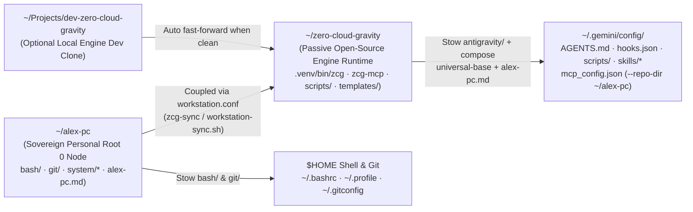
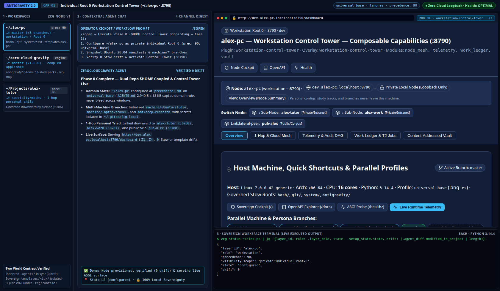

# Guide 01 — Ubuntu 26.04 Workstation, Dual-Repo `$HOME` Coupling & Global Profiles

> **Human Operator Manual (Tier 2 Progressive Disclosure)**
>
> Complete operational guide for managing Ubuntu 26.04 LTS packages, GNU Stow host symlinks, Dual-Repo `$HOME` coupling (`~/zero-cloud-gravity` engine appliance + `~/<persona>-pc` personal `Root 0` workstation), Google Antigravity binary installation, multi-machine `machine/<hostname>` branches, drift audits, and uninstallation. For internal engine contracts, see **[`docs/architecture/04_cockpit_and_intranet_surfaces.md`](../architecture/04_cockpit_and_intranet_surfaces.md)**; for the executive overview, return to **[`README.md`](../../README.md)**.

---

## 1. Dual-Repo `$HOME` Architecture & GNU Stow Tree Unfolding

ZeroCloudGravity cleanly decouples the **passive Open-Source Engine Appliance (`~/zero-cloud-gravity`)** from your **sovereign personal `Root 0` Workstation Node (`~/<persona>-pc`, e.g., `~/alex-pc`)** while uniting both into `$HOME` via `~/.config/zero-cloud-gravity/workstation.conf` and GNU Stow:



### 1.1. Why `~/.gemini/config/` Uses GNU Stow Tree Unfolding (Individual Symlinks)

Unlike `~/.bashrc` (a single file symlink), `~/.gemini/config/` and `~/.gemini/config/skills/` are **real directories** that mix tracked governance files with machine-local runtime files:
- **Tracked via Stow (`~/zero-cloud-gravity/antigravity/`)**: `AGENTS.md` (composed from your selected global profile + your personal `~/<persona>-pc/templates/<persona>-pc/rules/<persona>-pc.md`), `hooks.json`, `scripts/`, the 8 universal global skills inside `skills/<name>/`, and desktop launchers in `.local/share/applications/antigravity-{agents,ide}.desktop`.
- **Machine-local (untracked)**: `config.json`, `mcp_config.json` (linked to `~/.gemini/antigravity/mcp_config.json` with `zcg-mcp` targeting `--repo-dir ~/<persona>-pc`), `plugins/`, `projects/`, `sidecars/`, and locally installed extension/cloud skills inside `skills/`.

Because `~/.gemini/config/` and `~/.gemini/config/skills/` exist as real directories, GNU Stow automatically performs **tree unfolding**: it creates individual symlinks for each tracked item (`AGENTS.md`, `hooks.json`, `scripts/`, and each shared skill folder `skills/<name>`) without touching local credentials, OAuth tokens, or third-party skills.

### 1.2. Directory & Path Conventions (`$HOME`, Engine, Workstation & Workspaces)

The table below defines which workstation paths are managed by GNU Stow and which remain independent repositories or binary directories:

| Path | Managed by Stow? | Role & Scripts / Processes That Use It |
| :--- | :---: | :--- |
| `~/zero-cloud-gravity/` | Engine Source | Passive Open-Source engine runtime (`ZCG_RUNTIME_DIR`). Provides `.venv/bin/zcg`, `.venv/bin/zcg-mcp`, `scripts/*.sh`, `templates/*`, and the `antigravity/` Stow module. |
| `~/<persona>-pc/` *(e.g. `~/alex-pc`)* | Host Source | Personal Sovereign `Root 0` Workstation Hub (`ZCG_WORKSTATION_DIR`, `entity_kind: "individual"`, `precedence: 90`). Tracks `bash/`, `git/`, `system/*.txt` package manifests, `WORK*` ledgers, and `templates/<persona>-pc/rules/<persona>-pc.md`. |
| `~/.config/zero-cloud-gravity/workstation.conf` | ❌ (Untracked) | Declarative per-device coupling config written by [`install.sh`](../../install.sh) and [`scripts/workstation-sync.sh`](../../scripts/workstation-sync.sh) (`ZCG_RUNTIME_DIR`, `ZCG_WORKSTATION_DIR`, `ZCG_DEV_REPO_DIR`, `ZCG_GLOBAL_PROFILE`, `ZCG_INTERACTION_LANG`, `ZCG_AUTO_SYNC`, `ZCG_NO_BROWSER`). |
| `~/.gemini/config/` | ✅ (Tree-unfolded) | Shared across **Google Antigravity 2.0 (`antigravity-agents` desktop) and Antigravity CLI (`agy`)**. Stow links `AGENTS.md`, `hooks.json`, `scripts/`, and `skills/<name>/` while preserving untracked `config.json`, `mcp_config.json`, `plugins/`, and `sidecars/`. |
| `~/.bashrc`, `~/.profile`, `~/.gitconfig` | ✅ | Symlinked from `~/<persona>-pc/{bash,git}/`. Automatically source untracked machine-local overrides (`~/.bashrc.local` and `~/.gitconfig.local`), add `zcg` to `PATH`, alias `zcg-sync`, and run once-per-boot `--auto` sync. |
| `~/Projects/<workspace>/` | ❌ (Never stowed) | Standard location for user, academic tutor (`~/Projects/<persona>-tutor`), knowledge (`gov-*`, `sci-*`, `geo-*`, `org-*`), and enterprise repositories. |
| `/opt/antigravity-agents/`, `~/.local/bin/agy`, `/opt/antigravity-ide/` | ❌ | Target binary paths populated by [`scripts/install-antigravity.sh`](../../scripts/install-antigravity.sh). |

---

## 2. System Manifests & External Recipe Catalog (`system/`)

Inside a personal workstation node (`~/<persona>-pc/system/`), plain-text manifests record installed Ubuntu 26.04 software and desktop settings, consumed by [`scripts/workstation-restore.sh`](../../scripts/workstation-restore.sh), verified by [`scripts/workstation-audit.sh`](../../scripts/workstation-audit.sh), and updated by [`scripts/workstation-backup.sh`](../../scripts/workstation-backup.sh):

| Purpose & Tracked State | File / Directory |
| :--- | :--- |
| Sovereign node identity (`zcg-node-v1`), `precedence`, `global_profile`, `interaction_language`, and `workstation-control-tower` binding. | [`system/zcg-node.json`](../../system/zcg-node.json) |
| Manually installed Ubuntu 26.04 APT packages (3-stage filtered: excludes base OS, dependencies, external recipe packages, and `.audit-ignore`). | `system/packages-manual.txt` |
| Installed Snap applications (excludes `core*`, `bare`, `gnome-*`, and `mesa-*` runtime snaps). | `system/snaps.txt` |
| Global NPM packages under the active Node.js version & default NVM major version. | `system/npm-globals.txt`, `system/nvm-default.txt` |
| Enabled external third-party recipes auto-detected during `make backup-system`. | `system/external.txt` |
| Declarative recipe catalog for third-party software (Docker, Chrome, GCloud CLI, Antigravity Agents/IDE, etc.). Starter recipes ship in [`templates/plugin-stack/workstation-control-tower/assets/external/`](../../templates/plugin-stack/workstation-control-tower/assets/external/README.md). | `system/external/{apt-repo,deb-url,script}/` |
| Installed GNOME Shell extension UUIDs and declarative `dconf` settings (keybindings, interface, touchpad, dock, tiling). | `system/gnome-extensions.txt`, `system/gnome-settings.dconf` |

---

## 3. Daily Workstation Operations (`zcg-sync`, Backup, Audit, Restore & Antigravity Installer)

All physical workstation operations can be invoked via `zcg <subcommand>`, `make <target>` inside `~/<persona>-pc`, or the shell scripts in `~/zero-cloud-gravity/scripts/`.

### 3.1. Unified Workstation & Engine Synchronization (`zcg-sync` / `scripts/workstation-sync.sh`)

Running `zcg-sync` (or `zcg workstation-sync` / `make workstation-sync`) executes a deterministic 3-stage cascade without manual Git plumbing:
1. **Engine Runtime Fast-Forward (`~/zero-cloud-gravity`)**: Resets localized `antigravity/.gemini/config/AGENTS.md` before Git operations; if a clean committed local development clone (`~/Projects/dev-zero-cloud-gravity`) exists on the machine and its `HEAD` has advanced, automatically fast-forwards `~/zero-cloud-gravity` from `dev-zero-cloud-gravity` (otherwise pulls `--ff-only` from `origin`).
2. **Personal `Root 0` Workstation Sync (`~/<persona>-pc`)**: Runs `zcg sync-layer` on `~/<persona>-pc` (when clean) and stows `bash` and `git` into `$HOME`.
3. **Global Profile, Personal Rule Composition & `zcg-mcp` Binding**: Runs `zcg set-global-profile <profile> --lang <lang> --workstation-dir ~/<persona>-pc --stow`, composing `universal-base` + `<persona>-pc.md` into `~/.gemini/config/AGENTS.md` (`<= 18,000` bytes) and binding `zcg-mcp` in `~/.gemini/antigravity/mcp_config.json` to `--repo-dir ~/<persona>-pc`.

```bash
# One-time setup (persists ~/.config/zero-cloud-gravity/workstation.conf & runs initial sync):
~/zero-cloud-gravity/scripts/workstation-sync.sh --setup \
  --profile universal-base --lang es --workstation-dir ~/alex-pc --auto-sync boot

# Daily manual sync (also runs automatically once per boot via ~/.bashrc):
zcg-sync                                    # or: zcg workstation-sync
zcg workstation-sync --status               # JSON status of runtime, workstation, profile & boot stamp
```

### 3.2. Installing or Upgrading Google Antigravity (`scripts/install-antigravity.sh`)

The [`scripts/install-antigravity.sh`](../../scripts/install-antigravity.sh) utility (`make install-antigravity` or `zcg install-antigravity`) manages the three Google Antigravity binary components on Ubuntu 26.04 (`linux-x64`):

```bash
cd ~/zero-cloud-gravity
./scripts/install-antigravity.sh --agents   # (Recommended) Download & install Antigravity Agents (/opt/antigravity-agents) + agy CLI (~/.local/bin/agy)
./scripts/install-antigravity.sh --cli      # Install/update agy CLI only (~/.local/bin/agy)
./scripts/install-antigravity.sh --ide      # (Optional) Download & install Antigravity IDE (/opt/antigravity-ide)
./scripts/install-antigravity.sh --all      # Install/update Agents, agy CLI, and optional IDE
./scripts/install-antigravity.sh --agents --dry-run
```

### 3.3. Workstation Backup, Drift Audit & Restore Modes

Each workstation script supports targeted flags and `--dry-run` previews:

| Command / `Makefile` Target | Action |
| :--- | :--- |
| `make backup-system` (`zcg workstation-backup`) | Snapshots manual APT packages, Snaps, NPM globals, enabled external recipes, and GNOME extensions/settings into `system/*`. |
| `make audit-system` (`zcg workstation-audit`) | Read-only 8-section drift check across Stow symlinks (`antigravity`, `bash`, `git`), APT, Snap, NPM, External recipes, GNOME extensions, residual `*.backup.*` files, and Git status (treating localized/composed `AGENTS.md` as clean). |
| `make audit-system CLEAN=1` (`workstation-audit --clean`) | Interactive cleanup of residual `~/.backup.*` files in `$HOME`. |
| `make restore-system` (`zcg workstation-restore`) | Interactive restoration prompt across all workstation subsystems. |
| `zcg workstation-restore <ws-dir> --all` | Unattended full provision: APT/Snap/NPM packages, external recipes, NVM/Node.js, GNOME settings, and Stow symlinks. |
| `zcg workstation-restore <ws-dir> --packages \| --external \| --nvm \| --gnome \| --stow \| --antigravity` | Granular subsystem restoration (`--dry-run` supported on all modes). |

To suppress drift warnings for machine-specific hardware drivers (e.g., GPU drivers), list them in `.audit-ignore` inside `~/<persona>-pc`:

```text
# .audit-ignore — hardware-specific packages on this machine
nvidia-driver-595-open
```

---

## 4. Golden Rule for Parallel Workspaces, Phase 0 Onboarding & Upgrade Reconciliation

When operating multiple machines (`machine/<hostname>`) alongside multiple parallel Antigravity windows (an enterprise repo, a personal academic tutor, and a knowledge corpus), follow this **3-Tier Personal Hierarchy**:

| Personal Tier & Purpose | Recommended Base, `master` vs. Context Branches (`promotion_pipeline: direct`) | How It Reconciles & Updates Without Losing Your Changes |
| :--- | :--- | :--- |
| **1. `$HOME` Personal `Root 0` Hub (`~/<persona>-pc`, `precedence: 90`)** | **`master` = Common Personal Baseline (`universal-base`)** shared across all machines and contexts. Context branches: **`machine/<hostname>`** (per-PC `system/*.txt` manifests) and **`hat/<context>`** (global workstation hats). **Zero `env/tst` or `env/pre` branches.** | **`zcg-sync` (`make workstation-sync`)**: Syncs `~/zero-cloud-gravity` and `~/<persona>-pc` automatically while preserving your `system/zcg-node.json` identity (`precedence: 90`), personal rules (`<persona>-pc.md`), private trackers (`WORKTASK.md`), and `.local` overrides. |
| **2. Unified Personal Academy / Tutor Hub (`~/Projects/<persona>-tutor`, `precedence: 86`)** | **`master` = Common Tutor Pedagogical DNA (`academic-base,academic-curriculum,tutor-study-cockpit`)** defining how the tutor adapts to you across *all* subjects (`templates/<persona>-tutor/rules/<persona>-tutor.md`). Context branches: **`specialty/<track>`** (e.g., `specialty/maths`, `specialty/physics`, `specialty/maths-physics`, `specialty/software-eng`). | **Two-Level Personal Reconciliation**: (a) **Intra-Tutor (`specialty/* -> master`)**: Pedagogical improvements common to how you learn any discipline reconcile into `<persona>-tutor:master` and flow to all `specialty/*` branches via `git merge master`; (b) **Inter-Layer (`<persona>-tutor:master -> ~/<persona>-pc:master`)**: Universal personal workflow rules promote 1-hop upward to `~/<persona>-pc` via `make promote`. |
| **3. Parallel Study / Project Workspaces (`~/Projects/<workspace>`, `precedence: 80..95`)** | Run `zcg apply-project` pointing to your `<persona>-tutor` (or corporate parent layer) and set your per-window `Human-Stack` (`domain-<subject>:M1..M4 \| soft-socratic-coach`) in `.agents/SESSION.md`. | **`make sync` + `/enrich` $\rightarrow$ `make promote`**: Refreshes inherited `.agents/` rules downward without touching `.agents/SESSION.md`, and promotes reusable discoveries upward. |

### 4.1. Phase 0 Linear Post-Install Onboarding (`Case 1`): `$HOME` Control Tower (`~/<persona>-pc`)

Paste this prompt into Antigravity when onboarding a fresh `$HOME` personal `Root 0` workstation (`Case 1`, before creating `~/Projects/<persona>-tutor` in `Case 2`):

```text
/sopen — Execute Phase 0 ($HOME Control Tower Onboarding — Case 1, starting from zero with ~/<persona>-pc before ~/Projects/<persona>-tutor):
1. Phase A (Workspace Purpose & Identity Alignment): Configure our $HOME workstation repository as a sovereign private individual Root 0 hub (layer_id: "<persona>-pc", entity_kind: "individual", layer_role: "workstation", precedence: 90, --profile universal-base, --lang [en|es|it|fr|de|pt]) coupled with ~/zero-cloud-gravity via workstation-sync.sh --setup. Keep $HOME strictly on universal-base so domain rules never pollute parallel ~/Projects/* windows.
2. Phase B (Universal Personal Preferences & Multi-Machine Branches): Capture current workstation packages via make backup-system, verify ~/.gitconfig.local and ~/.bashrc.local isolation, and document our machine/<hostname> branch conventions in README.md and WORKTASK.md.
3. Phase C (Daily Multi-Machine Execution & Audit): Run make audit-system and make diff to confirm zero Stow or manifest drift across bash, git, and antigravity (with Workstation Control Tower active on :8790).
4. Phase D (Open-Source Reconciliation & Parallel Workspace Handoff): Verify zcg-sync (make workstation-sync) and output the exact zcg bootstrap-workspace commands to launch ~/Projects/<persona>-tutor (--parent-dir ~/<persona>-pc) and isolated domain/company workspaces inside ~/Projects/* (Cases 2-7 in Guide 02).
```

### 4.2. Ongoing 4-Step Upstream Upgrade & Version Reconciliation Prompt (`State U2`)

Whenever `zero-cloud-gravity` or a governing parent layer advances in rules, stacks, or schema contracts, run `zcg-sync` in `$HOME` and paste this prompt in any downstream workspace:

```text
/sopen — Execute the 4-Step Upstream Upgrade & Version Reconciliation Flow:
1. Step 1 (Topology & Horizon Audit): Run make status (inspect sync_topology 4-stage DAG: Stage 1 Workstation -> Stage 2 Parent -> Stage 3 Current Workspace -> Stage 4 Mounted Subtrees & Knowledge Twins), make horizon, and make upstream-diff.
2. Step 2 (Zero-Loss Layer & Schema Reconciliation): Run make sync STRATEGY=reconcile (or STRATEGY=merge) to upgrade Makefile, system/zcg-node.json (zcg-node-v1 + canonical dev/tst/pre/pro environments), and inherited templates/*-stack/* while keeping our sovereign rules in templates/<layer-id>/rules/<layer-id>.md intact.
3. Step 3 (Selective Stack & Cockpit Plugin Review): Evaluate active context-stack, framework-stack, and plugin-stack packs, refresh the node's Cockpit surface, and verify make diff (0 drift).
4. Step 4 (Multi-Environment Gate & Closure): Validate make env-gate ENV=tst|pre|pro (plus zcg subtree pull-all if mounting child/knowledge layers) and close via /sclose.
```

---

## 5. Cross-Machine Portability Matrix & Secret Isolation

The portability matrix below summarizes which workstation artifacts travel via Git/Stow and which remain machine-local:

| Data | Portable? | Mechanism | Recovery on New Machine |
| :--- | :---: | :--- | :--- |
| Host shell & Git config (`bash/`, `git/`) | ✅ | `~/<persona>-pc` Stow modules | `zcg workstation-sync` or `zcg workstation-restore --stow` |
| Global agent config (`AGENTS.md`, `hooks.json`, `8` global skills) | ✅ | `~/zero-cloud-gravity/antigravity/` Stow module | `./install.sh --stow` or `zcg-sync` |
| Ubuntu system packages (APT, Snaps, NPM, external recipes) | ✅ | `~/<persona>-pc/system/*.txt` manifests | `zcg workstation-restore --packages --external --nvm` |
| GNOME settings & extensions | ✅ | `~/<persona>-pc/system/gnome-*` | `zcg workstation-restore --gnome` |
| Declarative template packs (`16` packs in `templates/`) | ✅ | `~/zero-cloud-gravity/templates/` | `git clone` |
| Workspace rules, ledgers & session state (`.agents/`, `WORK*`) | ✅ | Workspace Git repository | `git clone` + `/sopen` |
| Antigravity binaries (`Agents`, `agy` CLI, optional `IDE`) | 🔧 | [`scripts/install-antigravity.sh`](../../scripts/install-antigravity.sh) | `./scripts/install-antigravity.sh --agents` |
| Personal Git identity & shell secrets (`~/.gitconfig.local`, `~/.bashrc.local`) | ❌ | Machine-local untracked files | Never committed to Git; see [`SECURITY.md`](../../SECURITY.md) |
| Conversation scratchpads (`brain/`) & OAuth tokens | ❌ | Local `~/.gemini/antigravity/brain/` | Auto-healed by `/sopen` from `.agents/SESSION.md` + `git log` |

---

## 6. Perspective `1.1` — Individual Sovereign Governance, Dual-World Customization & Live `:8790` Control Tower

Every ZeroCloudGravity deployment begins at the operator's personal `Root 0` workstation (`~/<persona>-pc`, `entity_kind: "individual"`, `layer_role: "workstation"`, `precedence: 90`), establishing deterministic host sovereignty before creating academic, scientific, or enterprise workspaces.

### 6.1. Why Govern Your Personal Workstation as `Root 0` (`precedence: 90`) & Its Core Virtues

The table below explains why personal governance is isolated into `~/<persona>-pc` on `universal-base` and what operational guarantees this architecture provides:

| Architectural Choice | Operational Virtue & Problem Solved | Concrete Implication on Your Machine |
| :--- | :--- | :--- |
| **`$HOME` Strictly on `universal-base`** | **Context-Pollution Immunity**: Prevents software, legal, or academic domain rules from bleeding across parallel Antigravity windows. | `~/.gemini/config/AGENTS.md` (`<= 18,000` bytes) loads only universal cognitive discipline (`universal-base`) plus your personal workstation rules (`<persona>-pc.md`). Domain packs load only inside `~/Projects/<workspace>/.agents/`. |
| **Dual-Repo Decoupling (`~/zero-cloud-gravity` + `~/<persona>-pc`)** | **Zero-Loss Engine Upgrades**: Separates the public Open-Source runtime from your private Ubuntu manifests and personal preferences. | Running `zcg-sync` fast-forwards `~/zero-cloud-gravity` and reconciles inherited templates while leaving `system/*.txt`, `bash/`, `git/`, and `WORKTASK.md` untouched. |
| **Direct Personal Branching (`machine/*` & `hat/*`)** | **Multi-PC Parity Without Bureaucracy**: Eliminates synthetic `tst`/`pre` staging branches (`promotion_pipeline: "direct"`, `dev -> pro`). | `master` holds cross-machine personal defaults; `machine/<hostname>` isolates GPU/hardware packages (`.audit-ignore`); `hat/<focus>` isolates temporary workstation focus modes. |
| **`1-Hop` Personal Governance Anchor (`precedence: 90`)** | **Clean Personal Lineage**: Serves as `governing_root_id` for `~/Projects/<persona>-tutor` (`86`) and personal apps (`80..95`). | Universal personal habits discovered in `<persona>-tutor` promote `1-hop` upward (`make promote`) to `~/<persona>-pc` without leaking private notes to Open Source. |

### 6.2. Dual-World Reconciliation Matrix (`Common Engine Base` vs. `Personal Customization`)

The matrix below separates the upstream community baseline (`World 1`) from your sovereign personal layer (`World 2`):

| Plane | World 1 — Common Community Base (`~/zero-cloud-gravity`) | World 2 — Sovereign Personal Customization (`~/alex-pc`) | Reconciliation Command & Surface Pointer |
| :--- | :--- | :--- | :--- |
| **1. Rules & Global `AGENTS.md`** | `templates/human-stack/universal-base/rules/universal-base.md` (`13` universal mandates + commit discipline). | `templates/alex-pc/rules/alex-pc.md` (`--lang`, personal shell/Git invariants, `1-hop` tutor delegation). | `zcg-sync` (`zcg set-global-profile`) $\rightarrow$ `~/.gemini/config/AGENTS.md` |
| **2. Skills & Lifecycle Hooks** | `8` universal skills (`/sopen`, `/continue`, `/sclose`, `/review`, `/enrich`, `/architecture`, `/audit`, `/governance`) + `4` hooks. | Optional personal skill `templates/alex-pc/skills/alex-pc-guide/SKILL.md` + custom `Makefile` targets below `# --- Custom Targets ---`. | `zcg sync-layer ~/alex-pc` $\rightarrow$ [`scripts/workstation-sync.sh`](../../scripts/workstation-sync.sh) |
| **3. Host System & Secrets** | Generic installers & audit scripts (`install.sh`, `scripts/workstation-{backup,audit,restore}.sh`, `5` starter external recipes). | `bash/`, `git/`, `system/{packages-manual,snaps,npm-globals,external,gnome-*}.txt`, `.audit-ignore`, plus untracked `~/.bashrc.local` & `~/.gitconfig.local`. | `make backup-system` / `make audit-system` $\rightarrow$ `~/alex-pc/system/` |
| **4. Cockpit Web Surface (`:8790`)** | `workstation-control-tower` plugin (`python314-native-asgi` `DeliveryChannel`, `Z1..Z4`, `--zcg-*` tokens, `HTTP 286` poll control). | Node-specific `surfaces/data/{node,network,federation}_scope.json` (`alex-pc.personal.local`, active `WORKTASK.md` items, local fleet inventory). | `make activate-plugin` $\rightarrow$ [`docs/architecture/04_cockpit_and_intranet_surfaces.md`](../architecture/04_cockpit_and_intranet_surfaces.md) |

### 6.3. Dedicated Web View (`Workstation Control Tower :8790` · `Z1..Z4`) & Live Capture (`[CAP-01]`)

When provisioned on `~/<persona>-pc`, `workstation-control-tower` renders an editable `plugin_shell.html` dashboard on `http://dev.<persona>-pc.localhost:8790/dashboard` (`https://dev.<persona>-pc.personal.local`) alongside its `Z1..Z4` sovereign cockpit (`/`):

| Cockpit Zone (`data-zone`) | What the Individual Operator Sees in `Workstation Control Tower (:8790)` | Backing Data Scope & Telemetry Contract |
| :--- | :--- | :--- |
| **`Z1` — Identity & `DEV/PRO` Header** | `alex-pc (workstation-control-tower · workstation-control-tower · T1 · Health:OPTIMAL)` plus interactive `DEV` (`node_scope.json`) and `PRO` (`federation_scope.json`) pills (`0` `TST`/`PRE` clutter). | `representation_context.delivery_channel` (`T1 <= 200 ms`, `HTTP 286`) & `intranet_topology` |
| **`Z2` — `1-Hop` Node Relationship Summary** | Displays `[Root 0 Sovereign]` status alongside any `1-hop` downward personal nodes (such as `alex-tutor` `:8786`, `alex-work` `:8787`, and `pub-alex` `:8788`). | `surfaces/data/network_scope.json` (`network_representation_links`) |
| **`Z3` — Personal Work Ledger & Fleet Inventory** | Host kernel/CPU/Stow summary, `machine/*` & `hat/*` branches, active `WORKTASK.md` items, and live `fleet_plugin_inventory` across personal workspaces. | `surfaces/data/node_scope.json` & `surfaces/data/federation_scope.json` |
| **`Z4` — Adaptive Runtime Telemetry & Companion** | `Health:OPTIMAL` (`health_score: 1.0` bridged to `.agents/telemetry` & `WORKTASK.md`), Source-Origin footer, and companion commands (`/sopen`, `make status`). | `surfaces/web/healthz` & `representation_context.runtime_telemetry` |



> [!NOTE]
> **3-Pane Antigravity Visual Capture — `[CAP-01]` (`Individual Root 0 Workstation Control Tower :8790`)**
> - **Left Pane (Workspaces)**: `~/alex-pc` (active `Root 0` workstation on `master` + `machine/*` / `hat/*`) alongside coupled `~/zero-cloud-gravity` and child `~/Projects/alex-tutor`.
> - **Center Pane (Contextual Chat)**: `/sopen` Phase 0 Control Tower onboarding confirming `0` Stow/package drift and `universal-base` (`<= 18 KB`) profile isolation.
> - **Right Pane (Web View + Terminal)**: Live `http://dev.alex-pc.localhost:8790/dashboard` (`Private Local Node`, `Switch Node` personal triad, Host Machine & Parallel Profiles spotlight) paired with `zcg status ~/alex-pc` (`state: "configured"`, `drift: 0`).
