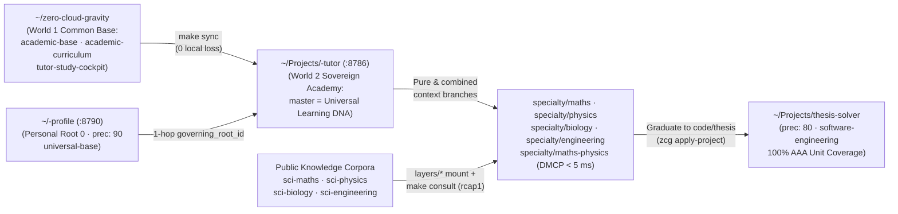
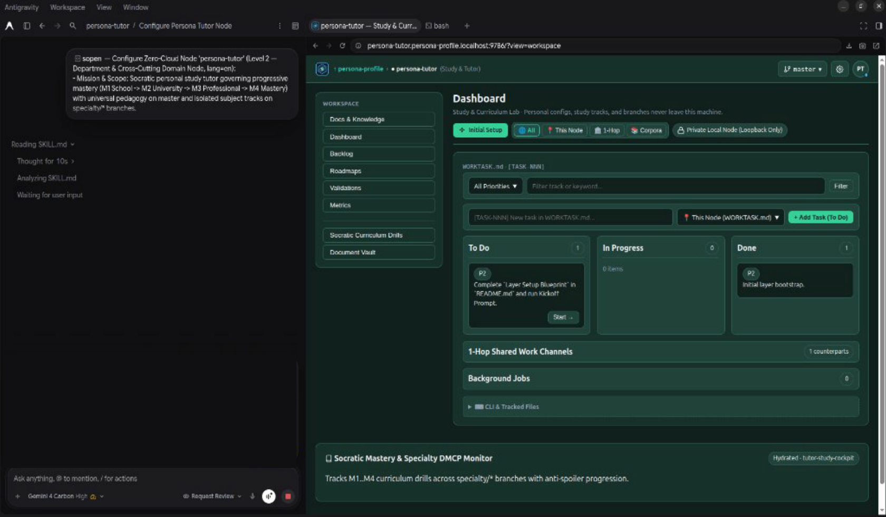
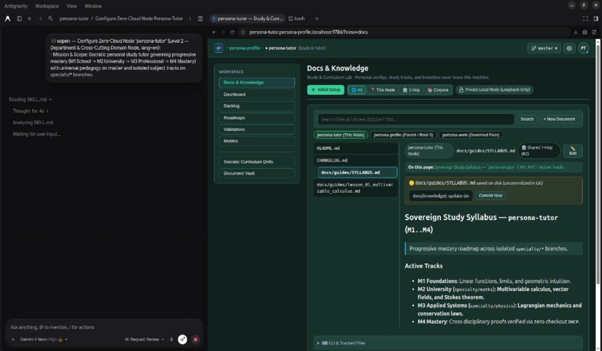
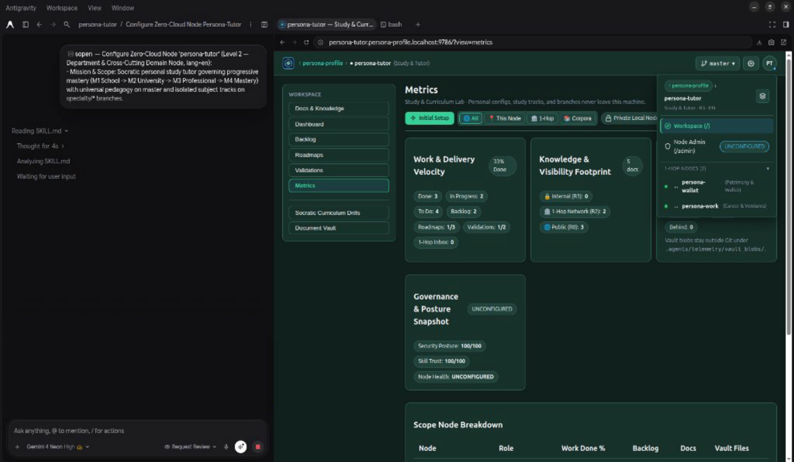
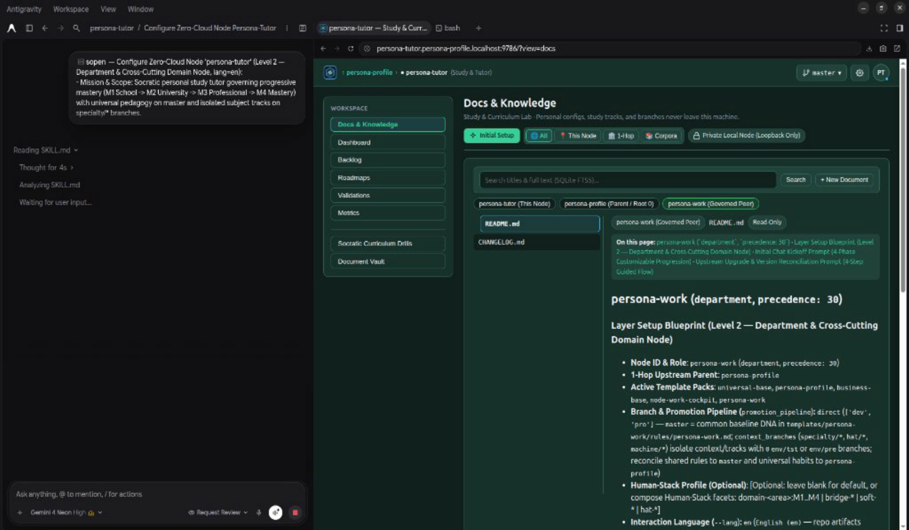

# Guide 02 — Act I (Step 2): Adding Your Personal Academy (`<persona>-tutor`, `M1 -> M4` & `specialty/*` Branches)

> **Student & Lifelong Learner Manual — Compositional Journey Step 2 of 8 (Tier 2 Progressive Disclosure)**
>
> Extend your personal constellation (`~/<persona>-profile` `:8790` from **[`Guide 01`](01_personal_workstation_and_day0_setup.md)**) with its first `1-hop` child node: a sovereign **Personal Academy (`~/Projects/<persona>-tutor`, `precedence: 86`, `:8786`)** that adapts across **School levels (`M1 -> early M2`)** and **University specialties (`M2 -> M3`, `specialty/*` zero-checkout `DMCP`, and `sci-*` corpora)**. Next step in your personal constellation: **[`Guide 03` Career (`work`), Security & Treasury Airlock](03_personal_work_security_and_airlock_pillars.md)**. For `rcap1` and `DMCP` internals, see **[`Architecture 05`](../architecture/05_contextual_mcp_and_capsules.md)**.

---

## 1. Day-0 Bootstrap & Why Isolate Learning in `<persona>-tutor` (`:8786`)

Instead of scattering study prompts across ephemeral chats or polluting `$HOME` with subject rules, initialize `~/Projects/<persona>-tutor` as a `1-hop` child governed by `~/<persona>-profile`:

```bash
zcg bootstrap-workspace ~/Projects/<persona>-tutor \
  --id <persona>-tutor --purpose academic-tutor --from-parent ~/<persona>-profile --lang es
```

Follow the same **Browser-First Day-0 Setup**:
1. Open **`http://<persona>-tutor.localhost:8786/`** in your browser to customize and copy your pre-filled Socratic Tutor Kickoff Prompt (auto-saved in `.zcg/runtime/onboarding_draft.json`).
2. Open `~/Projects/<persona>-tutor` in **Antigravity Agents** (*Projects $\rightarrow$ select `~/Projects/<persona>-tutor` $\rightarrow$ New Conversation*, IDE optional; or run `cd ~/Projects/<persona>-tutor && agy` in your terminal TUI), paste the prompt, and open the right-hand integrated browser at `http://<persona>-tutor.localhost:8786/`.
3. Once Phase D marks setup `[x]`, reload `/` to see `↑ Root / Parent: <persona>-profile` in the top breadcrumb and your live `Study & Curriculum Lab` (`Work Board`, `Docs & Knowledge`, `Socratic Curriculum Drills`, `Document Vault`, and `Network Atlas`)!



### 1.1. Dual-World Contract (`Common Pedagogical Base` vs. `Sovereign Student Customization`)

The table below defines how community pedagogical upgrades (`World 1`) coexist with lifelong personal curricula (`World 2`) without overwriting student notes or progress:

| Architectural Plane | World 1 — Common Community Base (`zero-cloud-gravity`) | World 2 — Sovereign Student Customization (`~/Projects/<persona>-tutor`) | Reconciliation Mechanism & Spec Pointer |
| :--- | :--- | :--- | :--- |
| **1. Pedagogical Rules & Cognitive Tone** | [`academic-base`](../../templates/human-stack/academic-base/README.md) (`M1..M4` Socratic scaffolding, anti-shortcut rigor) + [`academic-curriculum`](../../templates/context-stack/academic-curriculum/README.md). | `templates/<persona>-tutor/rules/<persona>-tutor.md` on `master` (personal learning pace, preferred notation, `--lang`) + `.agents/SESSION.md` (`domain-<topic>:M1..M3 \| soft-socratic-coach`). | `make sync` refreshes inherited packs while preserving `templates/<persona>-tutor/*` and `.agents/SESSION.md`. |
| **2. Curriculum, Drills & Mastery Gates** | `academic-tutor` skill (`syllabus`, `next-lesson`, `practice-drill`, `verify-mastery`) + `make task` / `make complete` ledger hooks. | Branch-scoped `SYLLABUS.md`, `WORKROAD.md`, `WORKTASK.md` (active lesson/drill), and `WORKVALI.md` (recorded mastery proofs & error logs). | Student-owned Markdown ledgers are never overwritten by `zcg sync-layer`. |
| **3. Subject Isolation & `E3` Sources** | Zero-checkout `DMCP` (`read_layer_document` with `branch_ref`) + `rcap1` (`L0..L3`) capsule consultation (`make consult`). | Pure branches (`specialty/maths`, `specialty/physics`, `specialty/biology`, `specialty/engineering`) & merged interdisciplinary tracks (`specialty/maths-physics`) mounting `layers/sci-*`. | `git merge master` propagates common study habits from `master` into every `specialty/*` branch; universal habits promote `1-hop` to `~/<persona>-profile`. |
| **4. Study Cockpit Surface (`:8786`)** | [`tutor-study-cockpit`](../../templates/plugin-stack/tutor-study-cockpit/README.md) (`Workspace /`, `Node Admin /admin`, `User Settings /settings`). | Declarative `use_case_overlay`: `"school-student-m1-m2"` (`academic_stage: "school"`) or `"university-specialty-m2-m3"` (default university mode). | `make activate-plugin` $\rightarrow$ [`Architecture 04`](../architecture/04_cockpit_and_intranet_surfaces.md) |

---

## 2. Perspective `1.2` — School Student Across Levels (`Primary`, `Lower Secondary`, `High School` · `M1 -> early M2`, `[CAP-02]`)

For school learners, the primary risk of general AI chat is **passive answer copying**. Configuring `<persona>-tutor` with `"academic_stage": "school"` and `soft-socratic-coach` enforces step-by-step Socratic guidance:

| School Stage & `Human-Stack` | Cognitive & Pedagogical Behavior Enforced by `academic-base` | How Homework, Drills & Validation Work (`WORKTASK.md` & `WORKVALI.md`) |
| :--- | :--- | :--- |
| **Primary School** (`domain-<subject>:M1 \| soft-socratic-coach`) | Uses concrete everyday analogies, visual step decomposition, short sentences in `--lang`, and zero unintroduced symbolic jargon. | **Zero Answer Dumping**: Asks a guiding first-step question, runs a `3`-item `practice-drill`, and logs mastery in `WORKVALI.md`. |
| **Lower Secondary (`ESO` / Middle School)** (`domain-<subject>:M1` $\rightarrow$ `M2` bridge) | Connects intuitive physical/biological models to initial algebraic notation, proportional reasoning, SI units, and structured summaries. | Organizes term units in `SYLLABUS.md`, claims 1 topic at a time (`make task`), and tracks recurring mistakes in `WORKVALI.md`. |
| **Upper Secondary / High School (`Baccalaureate`)** (`domain-<subject>:M2 \| soft-socratic-coach`) | Introduces formal definitions, multi-step derivations (calculus, mechanics, stoichiometry), exam time-boxing, and structured justification. | Prepares entrance assessments on dedicated `specialty/*` branches with explicit `N` vs. `N ± 1` boundary checks. |

```bash
# Deterministic 4-step Socratic study loop inside ~/Projects/<persona>-tutor:
make status                                                          # 1. Inspect active syllabus unit (< 0.2s)
make task TITLE="Unit 03: Equivalent Fractions & Ratios (M1)"        # 2. Claim active unit on Work Board
# 3. In Antigravity Chat: next-lesson -> practice-drill -> record proof in WORKVALI.md
make complete                                                        # 4. Close unit once verify-mastery passes
```



> [!NOTE]
> **Split-Screen Antigravity Agents + Study Workspace Capture — `[CAP-02]` (`Personal Study & Tutor Cockpit`)**
> - **Left Pane (Antigravity Agents)**: `persona-tutor` executing the Socratic `M1 -> M4` `/sopen` setup flow (`universal-base` + `academic-base` + `tutor-study-cockpit`) governed `1-hop` by `persona-profile`.
> - **Right Pane (Built-In Browser View)**: Live `http://persona-tutor.persona-profile.localhost:9786/?view=workspace` showing the `↑ persona-profile > persona-tutor` lineage breadcrumb, `✨ Initial Setup` recovery button, `All · This Node · 1-Hop · Corpora` scope bar, `WORKTASK.md` Kanban board, `1-Hop Shared Work Channels (1 counterparts)`, and hydrated `Socratic Mastery & Specialty DMCP Monitor`.

---

## 3. Perspective `1.3` — University Specialties (`M2 -> M3`), Zero-Checkout `DMCP` & Thesis Graduation (`[CAP-03]`)

At university level, a student juggles pure foundational courses, interdisciplinary syntheses, and executable thesis code inside one coherent branch topology:

| University Mechanism | Architectural Design in `<persona>-tutor` | Concrete Academic Advantage Over Flat Folders or Cloud RAG |
| :--- | :--- | :--- |
| **`master` Branch (`Universal DNA`)** | Holds universal personal study rules (`<persona>-tutor.md`) and master `SYLLABUS.md`. | Note-taking and proof improvements merge once into `master` and propagate via `git merge master` to every `specialty/*` branch. |
| **Pure & Combined `specialty/*` Branches** | `specialty/maths`, `specialty/physics`, `specialty/biology`, `specialty/engineering`, plus merged `specialty/maths-physics`. | Keeps `.agents/rules/` focused strictly on the active discipline(s) while grounding formulas in mounted `sci-*` corpora (`citation_receipt`, **[`Guide 04`](04_scientific_and_public_knowledge_corpora.md)**). |
| **Zero-Checkout `DMCP` (`< 5 ms`)** | `zcg-mcp` reads files/capsules on any `specialty/*` branch directly from `.git/objects` (`zero_checkout: true`). | While on `specialty/physics`, consult a theorem proved on `specialty/maths` via `read_layer_document(rel_path="SYLLABUS.md", branch_ref="specialty/maths")` with `0` working-tree mutations. |

When a capstone or Master's thesis (`M3`) requires production simulation code, spawn a dedicated `project` repository (`precedence: 80`) inheriting scientific and software engineering rigor:

```bash
cd ~/Projects/<persona>-tutor
git checkout specialty/maths-physics
make consult LAYER=sci-physics QUERY="Fourier heat conduction"

# Graduate computational code into an independent 1:1:1 project repo:
zcg apply-project ~/Projects/thesis-heat-solver \
  --template science-base,scientific-methodology,software-engineering \
  --parent-dir ~/Projects/<persona>-tutor
```



> [!NOTE]
> **Split-Screen Antigravity Agents + Study Docs Capture — `[CAP-03]` (`University Specialty Studio & Shared 1-Hop Knowledge`)**
> - **Left Pane (Antigravity Agents)**: `persona-tutor` running the `M1..M4` Socratic setup prompt (`specialty/*` tracks).
> - **Right Pane (Browser View)**: Live `http://persona-tutor.persona-profile.localhost:9786/?view=docs` showing `SQLite FTS5` full-text search, `persona-tutor (This Node) · persona-profile (Parent / Root 0) · persona-work (Governed Peer)` tabs, `docs/guides/SYLLABUS.md` rendered with `Shared 1-Hop (R2)` badge, and contextual `Commit Now` banner.

### 3.1. Cross-Node `Metrics`, `1-Hop` Constellation Menu & Read-Only Peer Docs

Inspect velocity, visibility footprint (`R3/R2/R0`), and live `1-Hop` sibling liveness in `Metrics`, and browse governed sibling documentation (`persona-work`) in read-only mode without duplicating files:




