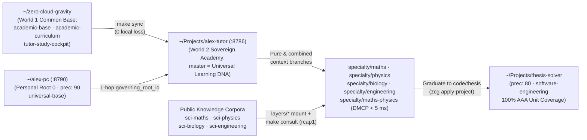
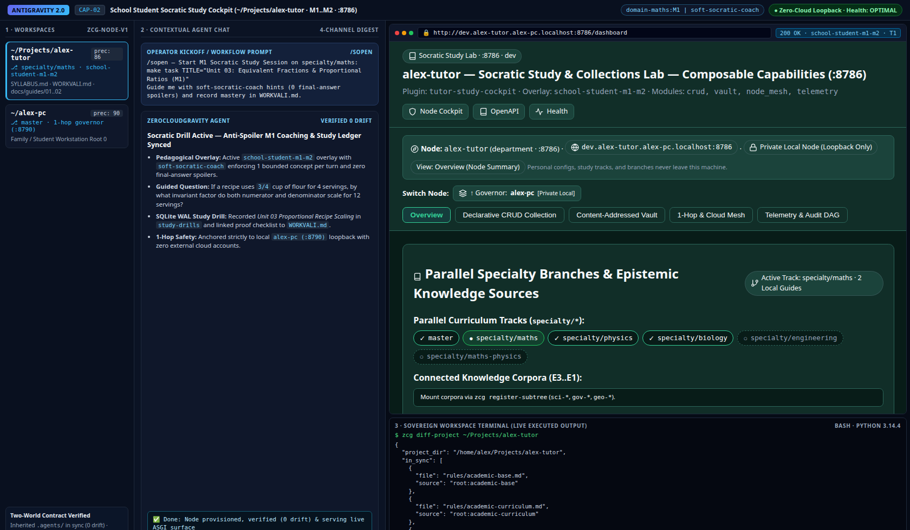
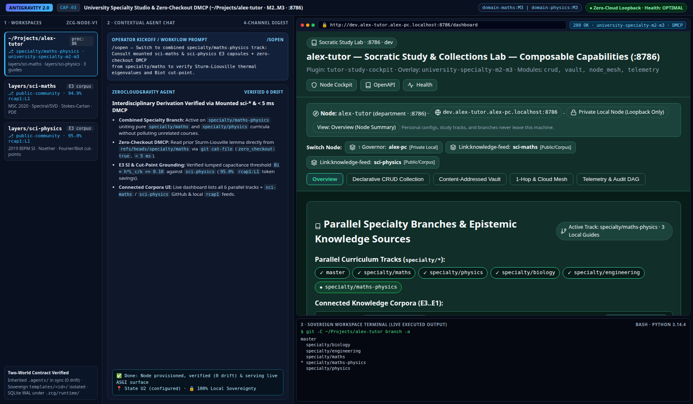

# Guide 03 — Academic Student Perspectives: School (`M1..M2`) & University Specialties (`M2..M3`)

> **Student & Educator Operator Manual (Tier 2 Progressive Disclosure)**
>
> Step-by-step perspective guide explaining how a single sovereign Personal Academy node (`~/Projects/<persona>-tutor`, `precedence: 86`, `:8786`) adapts across **School levels (`Primary`, `Lower Secondary`, `Upper Secondary / High School` · `M1 -> early M2`)** and **University levels & specialties (`Undergraduate`, `Master's` · `M2 -> M3`, pure & combined `specialty/*` branches, zero-checkout `DMCP`, and `sci-*` corpora)**. For `$HOME` workstation prerequisites, see **[`Guide 01`](01_workstation_and_global_profiles.md)**; for `rcap1` and `DMCP` engine internals, see **[`docs/architecture/05_contextual_mcp_and_capsules.md`](../architecture/05_contextual_mcp_and_capsules.md)**.

---

## 1. Why a Sovereign Personal Academy Node (`~/Projects/<persona>-tutor`, `precedence: 86`)

Instead of scattering ephemeral study prompts across disconnected chat threads or polluting `$HOME` with subject-specific rules, ZeroCloudGravity provisions a dedicated **`1-hop` child node under `~/<persona>-pc` (`~/Projects/<persona>-tutor`, e.g., `~/Projects/alex-tutor`, `precedence: 86`)** that grows with the learner from primary school (`M1`) to university (`M2..M3`) and doctoral research (`M4`):



### 1.1. Dual-World Contract: Common Pedagogical Base (`World 1`) vs. Sovereign Student Customization (`World 2`)

The table below defines how community pedagogical upgrades (`World 1`) coexist with lifelong personal curricula (`World 2`) without overwriting student notes or progress:

| Architectural Plane | World 1 — Common Community Base (`zero-cloud-gravity`) | World 2 — Sovereign Student Customization (`~/Projects/alex-tutor`) | Reconciliation Mechanism & Spec Pointer |
| :--- | :--- | :--- | :--- |
| **1. Pedagogical Rules & Cognitive Tone** | [`academic-base`](../../templates/human-stack/academic-base/README.md) (`M1..M4` Socratic scaffolding, anti-shortcut rigor) + [`academic-curriculum`](../../templates/context-stack/academic-curriculum/README.md). | `templates/alex-tutor/rules/alex-tutor.md` on `master` (personal learning pace, preferred notation, `--lang`) + `.agents/SESSION.md` (`domain-<topic>:M1..M3 \| soft-socratic-coach`). | `make sync` refreshes inherited packs while preserving `templates/alex-tutor/*` and `.agents/SESSION.md`. |
| **2. Curriculum, Drills & Mastery Gates** | `academic-tutor` skill (`syllabus`, `next-lesson`, `practice-drill`, `verify-mastery`) + `make task` / `make complete` ledger hooks. | Branch-scoped `SYLLABUS.md`, `WORKROAD.md`, `WORKTASK.md` (active lesson/drill), and `WORKVALI.md` (recorded mastery proofs & error logs). | Student-owned Markdown ledgers are never overwritten by `zcg sync-layer`. |
| **3. Subject Isolation & `E3` Sources** | Zero-checkout `DMCP` (`read_layer_document` with `branch_ref`) + `rcap1` (`L0..L3`) capsule consultation (`make consult`). | Pure branches (`specialty/maths`, `specialty/physics`, `specialty/biology`, `specialty/engineering`) & merged interdisciplinary tracks (`specialty/maths-physics`) mounting `layers/sci-*`. | `git merge master` propagates common study habits from `master` into every `specialty/*` branch. |
| **4. Study Cockpit Surface (`:8786`)** | [`tutor-study-cockpit`](../../templates/plugin-stack/tutor-study-cockpit/README.md) (`Z1..Z4` layout, `--zcg-*` design tokens, `T1` `<= 200 ms`, `HTTP 286`). | Declarative `use_case_overlay`: `"school-student-m1-m2"` (`academic_stage: "school"`) or `"university-specialty-m2-m3"` (default university mode). | `make activate-plugin` $\rightarrow$ [`docs/architecture/04_cockpit_and_intranet_surfaces.md`](../architecture/04_cockpit_and_intranet_surfaces.md) |

---

## 2. Perspective `1.2` — School Student Across Levels (`Primary`, `Lower Secondary`, `Upper Secondary / High School` · `M1 -> early M2`)

For school learners, the primary risk of general-purpose AI chat is **passive answer copying**, which short-circuits cognitive retention. Configuring `<persona>-tutor` with `"academic_stage": "school"` and `soft-socratic-coach` turns Antigravity into a patient, structured Socratic tutor.

### 2.1. Pedagogical Virtues & Stage-by-Stage Implications Across School Levels

The matrix below details how the same `<persona>-tutor` node adapts across the three school stages via `.agents/SESSION.md` (`Human-Stack` `precedence: 85..95`):

| School Stage & `Human-Stack` | Cognitive & Pedagogical Behavior Enforced by `academic-base` | How Homework, Drills & Validation Work (`WORKTASK.md` & `WORKVALI.md`) |
| :--- | :--- | :--- |
| **Primary School** (`domain-<subject>:M1 \| soft-socratic-coach`) | Uses concrete everyday analogies, visual step decomposition, short sentences in the student's `--lang`, and zero unintroduced symbolic jargon. | **Zero Answer Dumping**: When the student pastes a math or nature problem, the agent asks a guiding first-step question, runs a `3`-item `practice-drill`, and logs mastery in `WORKVALI.md`. |
| **Lower Secondary (`ESO` / Middle School)** (`domain-<subject>:M1` $\rightarrow$ `M2` bridge) | Connects intuitive physical/biological models to initial algebraic notation, proportional reasoning, SI units, and structured study summaries. | Organizes term units in `SYLLABUS.md` (`WORKROAD.md`), claims 1 topic at a time (`make task`), and tracks recurring mistakes in `WORKVALI.md` for spaced review before exams. |
| **Upper Secondary / High School (`Baccalaureate`)** (`domain-<subject>:M2 \| soft-socratic-coach`) | Introduces formal definitions, multi-step derivations (calculus, mechanics, stoichiometry), exam time-boxing, and structured justification. | Prepares university entrance assessments on dedicated `specialty/maths`, `specialty/physics`, or `specialty/biology` branches with explicit `N` vs. `N ± 1` boundary checks. |

### 2.2. Declarative School Configuration & Validated `4`-Step Study Loop

Set `"academic_stage": "school"` in `~/Projects/alex-tutor/system/zcg-node.json` (and declare `domain-maths:M1 | soft-socratic-coach` in `.agents/SESSION.md`) to activate the School overlay:

```json
{
  "schema_version": "zcg-node-v1",
  "layer_id": "alex-tutor",
  "layer_role": "department",
  "entity_kind": "individual",
  "governing_root_id": "alex-pc",
  "precedence": 86,
  "academic_stage": "school",
  "interaction_language": "es",
  "default_stack_templates": [
    "academic-base",
    "academic-curriculum",
    "alex-tutor",
    "tutor-study-cockpit"
  ],
  "human_stack": ["domain-maths:M1", "soft-socratic-coach"]
}
```

Each study session follows a deterministic **4-step Socratic loop** (`1` bounded lesson lot per turn):

```bash
# 1. Open session & inspect active syllabus unit (< 0.2s):
make status                                  # Invoked automatically by /sopen

# 2. Claim the active school unit in WORKTASK.md (e.g., Fractions & Proportions):
make task TITLE="Unit 03: Equivalent Fractions & Proportional Ratios (M1)"

# 3. In Antigravity Chat: run next-lesson -> interactive practice-drill -> record proof in WORKVALI.md
# 4. Close the unit only after verify-mastery passes without hints:
make complete
```

### 2.3. Dedicated Node Web View (`School Study Cockpit :8786` · `school-student-m1-m2`) & Live Capture (`[CAP-02]`)

Provisioning `tutor-study-cockpit` with `"academic_stage": "school"` renders the **School Study Cockpit** on `http://dev.alex-tutor.alex-pc.localhost:8786/dashboard`:
- **`Z1` Header & Compass**: Displays `alex-tutor — Socratic Study & Collections Lab (:8786)` (`Overlay: school-student-m1-m2`) with `.zcg-compass` (`Private Local Node · Loopback Only`).
- **`Z2` `1-Hop` Relationship Summary**: Shows `↑ Governor: alex-pc [Private Local]`, confirming that personal tutor governance is anchored `1-hop` below the family/student workstation without external cloud dependencies.
- **`Z3` Study Ledger & Curriculum Tracks**: Surfaces open vs. completed `SYLLABUS.md` / `WORKTASK.md` drills (`study-drills`) alongside parallel subject tracks (`specialty/maths`, `specialty/physics`, `specialty/biology`).
- **`Z4` Runtime Telemetry & Companion**: Reports `Health:OPTIMAL` and provides one-click `/sopen`, `make status`, and `/sclose` session commands.



> [!NOTE]
> **3-Pane Antigravity Visual Capture — `[CAP-02]` (`School Student Study Cockpit :8786 · M1..M2`)**
> - **Left Pane (Workspaces)**: `~/Projects/alex-tutor` checked out on `specialty/maths` (`school-student-m1-m2`) governed by `~/alex-pc` (`:8790`).
> - **Center Pane (Contextual Chat)**: Interactive `soft-socratic-coach` `practice-drill` guiding the student step by step (`0` final-answer spoilers) and recording mastery in `WORKVALI.md`.
> - **Right Pane (Web View + Terminal)**: Live `http://dev.alex-tutor.alex-pc.localhost:8786/dashboard` (`school-student-m1-m2` overlay + `↑ Governor: alex-pc`) paired with `zcg diff-project` (`0` drift).

---

## 3. Perspective `1.3` — University Student Across Levels (`Undergraduate`, `Master's` · `M2 -> M3`) & Pure/Combined Specialties

At university level, a student simultaneously juggles **pure foundational courses** (Linear Algebra, Thermodynamics, Cell Biology), **interdisciplinary syntheses** (Mathematical Physics, Electromechanical Control), and **executable code or thesis repositories**. `<persona>-tutor` handles all three without duplicating nodes.

### 3.1. Academic Virtues: Pure vs. Combined `specialty/*` Branches, `E3` `sci-*` Mounts & Zero-Checkout `DMCP`

The branch topology inside `~/Projects/<persona>-tutor` solves cross-subject context contamination while keeping cross-disciplinary synthesis instantaneous:

| University Mechanism | Architectural Design in `<persona>-tutor` | Concrete Academic Advantage Over Flat Folders or Cloud RAG |
| :--- | :--- | :--- |
| **`master` Branch (`Universal DNA`)** | Contains only universal personal study rules (`templates/<persona>-tutor/rules/<persona>-tutor.md`) and the master track catalog (`SYLLABUS.md`). | Improvements to how you take notes, structure proofs, or run exam drills merge once into `master` and propagate cleanly to every `specialty/*` branch. |
| **Pure `specialty/*` Branches + `sci-*` Mounts** | `specialty/maths` mounts `layers/sci-maths`; `specialty/physics` mounts `layers/sci-physics`; `specialty/biology` mounts `layers/sci-biology`; `specialty/engineering` mounts `layers/sci-engineering`. | Keeps `.agents/rules/` focused strictly on the active discipline while grounding formulas in `E3` SI/ISO/MSC corpora (`93.3%–96.6%` `rcap1:L1` token compaction, `citation_receipt` digests). |
| **Combined Interdisciplinary Branches (`specialty/maths-physics`)** | Created via standard Git merges (`git checkout -b specialty/maths-physics specialty/maths && git merge specialty/physics`), uniting both `sci-maths` and `sci-physics` subtrees. | Enables rigorous interdisciplinary courses (Symplectic Mechanics, Differential Forms in Electromagnetism, PDE Spectral Methods) with both axiomatic and physical `E3` guardrails active simultaneously. |
| **Zero-Checkout `DMCP` Cross-Branch Lookup (`< 5 ms`)** | `zcg-mcp` reads any file or capsule on another `specialty/*` branch directly from the Git object graph (`git cat-file` / `zero_checkout: true`). | While studying on `specialty/physics`, the agent can consult a theorem proved last semester on `specialty/maths` via `read_layer_document(rel_path="SYLLABUS.md", branch_ref="specialty/maths")` without `git checkout` or dirtying the working tree. |

### 3.2. Progression Across University Levels & Graduating to Thesis / Code Repositories (`zcg apply-project`)

The table below maps how university workflows evolve from first-year undergraduate courses (`M2`) to Master's capstone engineering and research repositories (`M3`):

| University Level & `Human-Stack` | Primary Surface & Active Stacks | Validated Workflow & Deliverable Gate |
| :--- | :--- | :--- |
| **Early Undergraduate (`Years 1–2`)** (`domain-maths:M2 \| domain-physics:M2 \| soft-socratic-coach`) | `<persona>-tutor` on pure `specialty/maths` or `specialty/physics` with mounted `layers/sci-*`. | Formal theorem-proof walkthroughs (`MSC 2020`), dimensional homogeneity (`IUPAP` / `2019 BIPM` SI constants), and boundary cut-point verification (`N` vs. `N ± 1`) in `WORKVALI.md`. |
| **Upper Undergraduate (`Years 3–4`)** (`domain-engineering:M2..M3`) | Combined `specialty/maths-physics` or `specialty/engineering` (`sci-engineering` + `sci-physics` + `sci-maths`). | Multi-corpus design problems (e.g., coupling Fourier/Biot heat transfer from `sci-physics` with `AISI 316L` `PREN >= 24.0` and `IEC 61508` `SIL` gates from `sci-engineering`). |
| **Master's & Capstone Thesis (`M3`)** (`domain-engineering:M3` + `software-engineering`) | Dedicated project repo `~/Projects/thesis-heat-solver` (`precedence: 80`) linked to `<persona>-tutor` & `sci-*`. | Full `1:1:1` software/scientific execution (`docs/architecture/` spec $\leftrightarrow$ `100.00%` isolated `AAA` unit tests $\leftrightarrow$ Python 3.14 simulation code) gated by `make verify`. |

When a course project or Master's thesis requires writing production-grade simulation or application code, keep `<persona>-tutor` clean for study notes and initialize a dedicated project workspace that inherits scientific and software engineering rigor:

```bash
# Switch between pure & interdisciplinary study tracks inside ~/Projects/alex-tutor:
cd ~/Projects/alex-tutor
git checkout specialty/maths-physics
make consult LAYER=sci-physics               # Query rcap1 L0..L3 capsules (< 20 ms)

# Spawn a dedicated Master's thesis / code repository governed by science-base + software-engineering:
zcg apply-project ~/Projects/thesis-heat-solver \
  --template science-base,scientific-methodology,software-engineering \
  --lang es
```

### 3.3. Dedicated Node Web View (`University Specialty Studio :8786` · `university-specialty-m2-m3`) & Live Capture (`[CAP-03]`)

In default university mode (omitting `"academic_stage": "school"` or setting `"academic_stage": "university"`), `tutor-study-cockpit` renders the **University Specialty Studio** on `http://dev.alex-tutor.alex-pc.localhost:8786/dashboard`:
- **`Z1` Header & Compass**: `alex-tutor — Socratic Study & Collections Lab (:8786)` (`Overlay: university-specialty-m2-m3`) with `Node Cockpit`, `OpenAPI`, and `Health` pills.
- **`Z2` `1-Hop` & Knowledge Switcher**: Links upward to `↑ Governor: alex-pc [Private Local]` and surfaces `Link:knowledge-feed: sci-maths [Public/Corpus]` and `sci-physics [Public/Corpus]`.
- **`Z3` Epistemic Knowledge & Specialty Atlas**: Lists all `6` parallel `specialty/*` tracks (`Active Track: specialty/maths-physics · 3 Local Guides`) alongside connected `E3` corpora.
- **`Z4` Runtime Telemetry & Companion**: Surfaces `T1` (`<= 200 ms`) Native ASGI delivery metadata, `Health:OPTIMAL` telemetry, and quick session lifecycle commands.



> [!NOTE]
> **3-Pane Antigravity Visual Capture — `[CAP-03]` (`University Specialty Studio :8786 · specialty/* & DMCP`)**
> - **Left Pane (Workspaces)**: `~/Projects/alex-tutor` on `specialty/maths-physics` alongside mounted `layers/sci-maths` (`94.9%` `rcap1:L1`) and `layers/sci-physics` (`95.0%` `rcap1:L1`).
> - **Center Pane (Contextual Chat)**: `M2 -> M3` interdisciplinary Sturm-Liouville & Biot cut-point derivation combining `sci-*` `E3` capsules with `< 5 ms` zero-checkout `DMCP`.
> - **Right Pane (Web View + Terminal)**: Live `http://dev.alex-tutor.alex-pc.localhost:8786/dashboard` (`university-specialty-m2-m3` + `sci-*` corpus links) paired with `git branch -a`.
