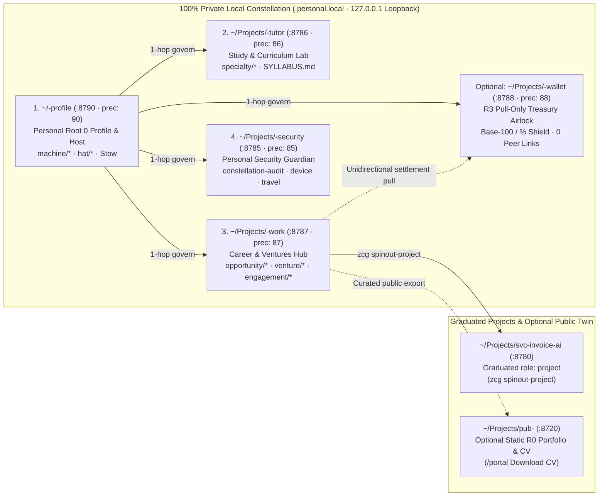
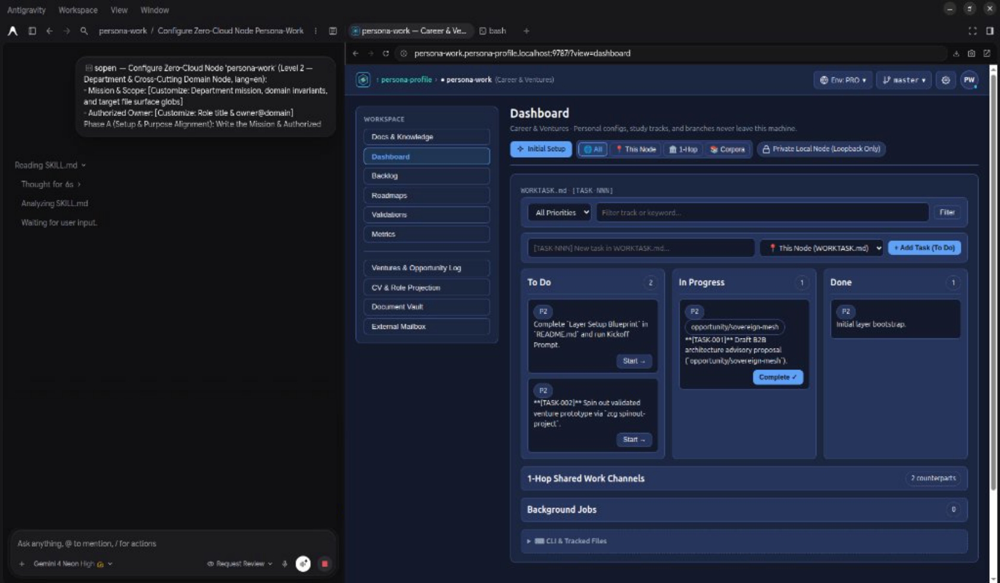
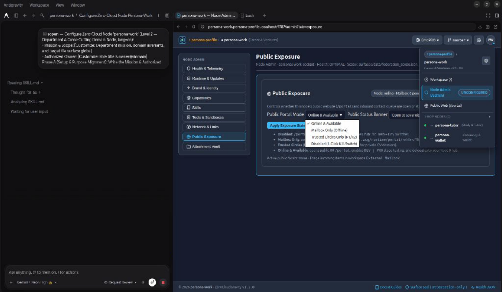
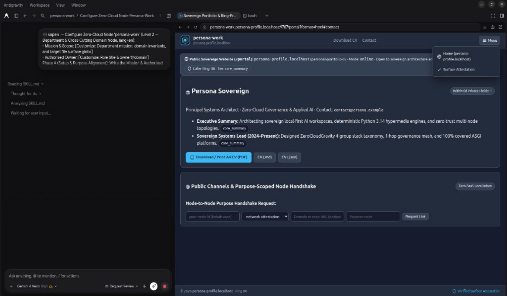
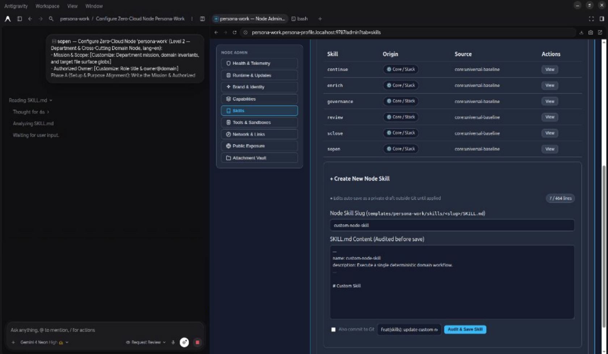
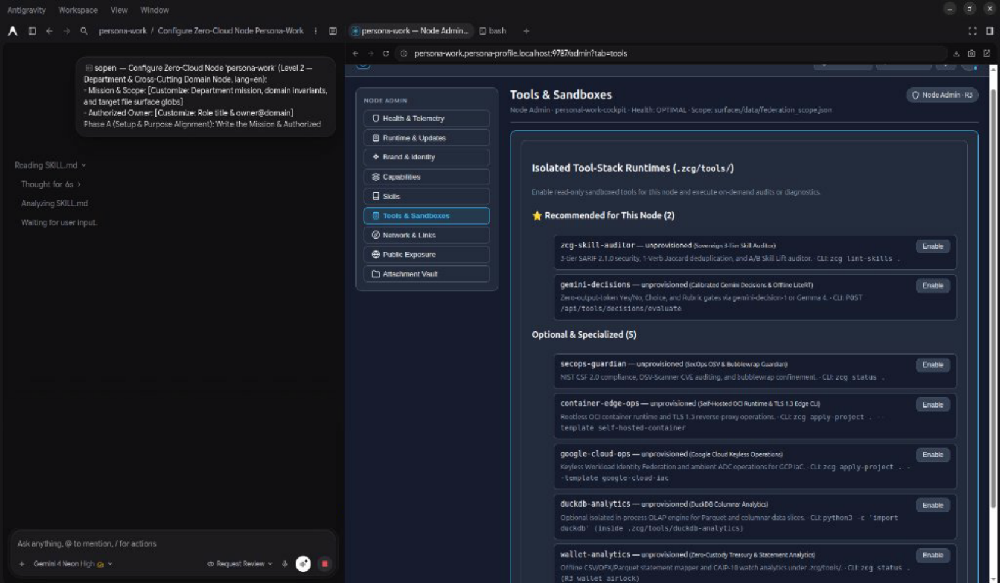
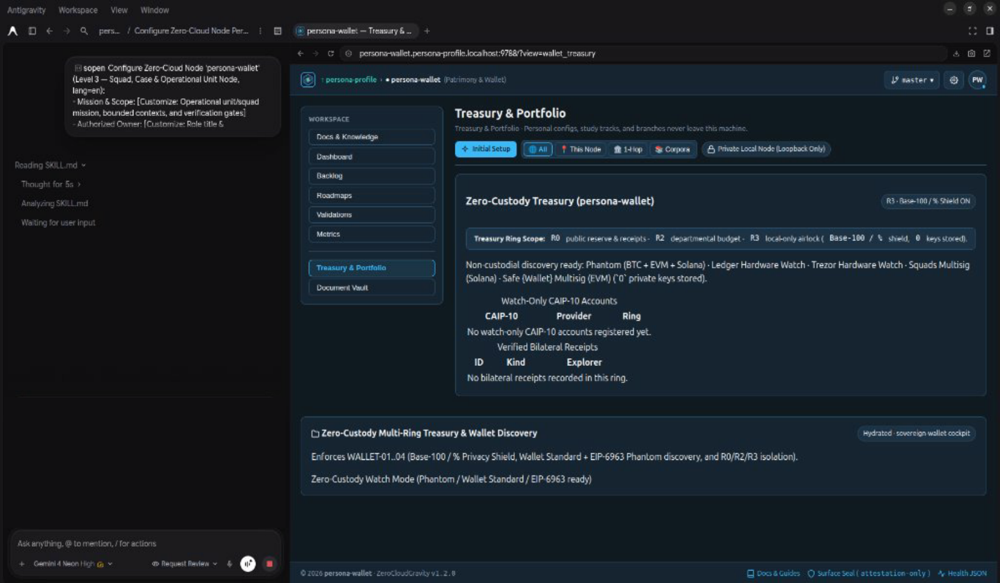

# Guide 03 — Act I (Steps 3–4): Personal Career (`<persona>-work`), Security (`<persona>-security`) & `R3` Treasury Airlock

> **Sovereign Individual Constellation Manual — Compositional Journey Step 3 of 8 (Tier 2 Progressive Disclosure)**
>
> Complete your local **Personal Sovereign Constellation** (started with `~/<persona>-profile` `:8790` in **[`Guide 01`](01_personal_workstation_and_day0_setup.md)** and `~/Projects/<persona>-tutor` `:8786` in **[`Guide 02`](02_personal_tutor_and_academic_progression.md)**) by adding **Step 3: Career & Ventures (`<persona>-work` `:8787` + `zcg spinout-project` + optional CV `/portal`)** and **Step 4: Personal Security (`<persona>-security` `:8785`) + optional `R3` Treasury Airlock (`<persona>-wallet` `:8788`)**. Next: connect shared scientific & statutory knowledge in **[`Guide 04`](04_scientific_and_public_knowledge_corpora.md)**, and link with external companies in **[`Guide 07`](07_federated_workflows_and_inter_node_links.md)**.

---

## 1. Completing the Personal Constellation (`profile -> tutor -> work -> security [+ wallet, game]`)

Four core personal pillars—plus an optional `R3` financial airlock and optional leisure/simulation node (`PERSONAL_CONSTELLATION_PILLARS = ("profile", "tutor", "work", "wallet", "security", "game")`)—give one person complete domain isolation on `127.0.0.1` (`*.localhost`) so career clients, study tracks, security runbooks, and private wealth never contaminate each other:



### 1.1. Sovereignty & Privacy Firewall Across Personal Nodes

The table below defines what stays strictly private inside each personal repository and what may cross its boundary:

| Personal Node | Role, Precedence & Port | Exposure Posture | What Stays Inside vs. What Crosses the Boundary |
| :--- | :--- | :--- | :--- |
| **`1. ~/<persona>-profile`** | `workstation`, `90`, `:8790` | `private-personal` | Identity-centric `Root 0` rules plus `machine/*` hardware profiles, `system/*` manifests, and `bash/` / `git/` Stow links never leave the host. |
| **`2. <persona>-tutor`** | `department`, `86`, `:8786` | `private-personal` | `specialty/*` tracks, `WORKVALI.md` exam logs, and mounted `sci-*` feeds stay `100%` local. |
| **`3. <persona>-work`** | `department`, `87`, `:8787` | `private-personal` | Private master CV, salary floors, and `venture/*` prototypes; only stage-projected capsules or spun-out repos leave. |
| **`4. <persona>-security`** | `domain-policy`, `85`, `:8785` | `private-personal` (`PRIVATE_SECURITY_FACET_FORBIDDEN` on `/portal`) | Constellation/device hardening (`secops-mcp-guardian` + `nist-csf-security`), backup runbooks, and `context/travel-*` feeds; never projected onto public portals. |
| **`Opt. <persona>-wallet`** | `squad`, `88`, `:8788` | `private-personal` (`R3` Airlock) | Net worth, `Base-100 / %` Privacy Shield, and tax reserves (`0` balances/keys in Git; `WALLET_EXTERNAL_LINK_BLOCKED` blocks all peer/B2B links while allowing read-only `sci-economic` / `gov-*` feeds). |
| **`Opt. <persona>-game`** | `squad`, `89`, `:8789` | `private-personal` | Optional spatial simulation & leisure sandbox (`spatial-simulation`), isolated from work and security ledgers. |
| **`Opt. pub-<persona>`** | `knowledge` mirror, `20`, `:8720` | `public-live` (`pro`) | Optional static `R0` portfolio & print-ready A4 PDF/MD/JSON **`Download CV`** mirror (`/portal`, outside epistemic `VALID_KNOWLEDGE_PREFIXES = ("gov-", "sci-", "geo-", "org-")`), keeping `~/<persona>-profile` and `wallet` `100%` offline. |

### 1.2. One-Command Day-0 Initialization (`work`, `security` & Optional `wallet` / `pub-*`)

Each pillar initializes with one command and opens its **Pending-Setup Web Studio** at `http://<node>.localhost:<port>/` before pasting into local Antigravity:

```bash
# Step 3 — Personal Career & Ventures Hub (:8787 -> http://<persona>-work.localhost:8787/):
zcg bootstrap-workspace ~/Projects/<persona>-work \
  --id <persona>-work --purpose individual-sovereign --role department --precedence 87 \
  --from-parent ~/<persona>-profile --templates universal-base,business-base,software-engineering,node-work-cockpit

# Step 4 — Personal Security Guardian (:8785 -> http://<persona>-security.localhost:8785/):
zcg bootstrap-workspace ~/Projects/<persona>-security \
  --id <persona>-security --purpose individual-sovereign --role domain-policy --precedence 85 \
  --from-parent ~/<persona>-profile --templates nist-csf-security,secops-mcp-guardian

# Optional — R3-Airlocked Personal Treasury Vault (:8788 -> http://<persona>-wallet.localhost:8788/):
zcg bootstrap-workspace ~/Projects/<persona>-wallet \
  --id <persona>-wallet --purpose individual-sovereign --role squad --precedence 88 \
  --from-parent ~/<persona>-profile --templates science-base,scientific-methodology,sovereign-wallet-cockpit
zcg link ~/Projects/<persona>-wallet --target sci-economic --relation knowledge-feed --ref https://github.com/mtwuser/sci-economic

# Optional — Public Portfolio & Downloadable CV Twin (:8720 -> http://pub-<persona>.localhost:8720/):
zcg bootstrap-workspace ~/Projects/pub-<persona> \
  --id pub-<persona> --role knowledge --precedence 20 --entity-kind individual \
  --templates universal-base,science-base,knowledge-stewardship-portal
```

---

## 2. Incubating Ventures in `<persona>-work` & Graduating via `zcg spinout-project` (`[CAP-09]`)

Inside `~/Projects/<persona>-work`, parallel Git context branches isolate distinct professional pursuits without multiplying repositories prematurely:
- **`master`**: Consolidated career ledger, `Ventures & Opportunity Log` (`crud`), and active `linked_nodes` registry.
- **`opportunity/<company-role>`**: Role-tailored case studies and interview preparation.
- **`venture/<product-slug>`**: Early-stage MVP code and `AAA` tests incubated privately before incorporation.
- **`engagement/<client-slug>`**: Scoped B2B consulting deliverables prior to client handoff.

Once a `venture/*` branch matures into a standalone product or company service, preview the graduation command inside the **Spin-Off Studio** card at `http://<persona>-work.localhost:8787/` or run `zcg spinout-project` directly:

```bash
zcg spinout-project ~/Projects/svc-invoice-ai \
  --source-dir ~/Projects/<persona>-work \
  --from-branch venture/invoice-ai \
  --id svc-invoice-ai \
  --templates science-base,software-engineering,google-cloud-iac,node-work-cockpit
```

`spinout_branch_to_project` exports clean application code while stripping parent governance state (`system/zcg-node.json`, `WORK*`, `.agents/`, `surfaces/`), bootstraps an independent `layer_role: "project"` node (`:8780`), and links `<persona>-work <-> svc-invoice-ai` automatically.



> [!NOTE]
> **Split-Screen Antigravity Agents + Career & Ventures Capture — `[CAP-09]` (`Personal Career & Ventures Hub`)**
> - **Left / Right Panes**: `persona-work` executing `/sopen` alongside `http://persona-work.persona-profile.localhost:9787/?view=dashboard`, showing `Env: PRO`, Kanban `To Do / In Progress / Done` (`opportunity/sovereign-mesh`), `Ventures & Opportunity Log`, `CV & Role Projection`, `Document Vault`, `External Mailbox`, and `1-Hop Shared Work Channels (2 counterparts)`.

### 2.1. Local CV & Public Portal Preview, Skills/Tools Studios & `R3` Wallet Airlock

Operators preview their public portfolio, A4 downloadable CV, audited Skills/Tools sandboxes, and `R3` airlocked treasury locally before publishing anything outside loopback:
- **Preview Local `/portal` & CV Synthesis**: Open **`Node Admin > Public Exposure`** (`Online & Available | Mailbox Only | Trusted Circles Only | Disabled`) and click **`Public Web (/portal)`** to inspect your live `personal-portfolio-cv` (`Download / Print A4 CV (PDF)`, `.md`, `.json`, `Withheld Private Fields`, and `Node-to-Node Handshake`).
- **Audited `Skills` & Isolated `Tools & Sandboxes`**: Inspect projected engine baseline skills (`Node Admin > Skills`), author audited node-owned `SKILL.md` playbooks with live auto-drafts, and enable isolated `.zcg/tools/` sandboxes (`zcg-skill-auditor`, `gemini-decisions`, `secops-guardian`, `duckdb-analytics`).
- **Local PDFs & Per-Document `1-Hop` Visibility**: Store private attachments outside Git under **`Node Admin > Attachment Vault`** (`Copy Doc Link`) and tag `docs/**/*.md` with `visibility: internal-r3 | network-r2 | public-r0`.











---

## 3. Personal Security Tracks (`:8785`) & Milestone 1 Compositional Takeaway

Inside `~/Projects/<persona>-security` (`http://<persona>-security.localhost:8785/`), four parallel `context/*` tracks organize personal resilience without mixing raw secrets into Git:
- **`context/constellation-audit`**: Runs `zcg workstation-audit --git-repos`, `zcg lint-skills`, and `0..100` Local Security Posture checks across all personal repos.
- **`context/device-hardening`**: Tracks disk encryption, FIDO2/SSH hardware key rotation schedules, and firewall rules in `Security Controls & Risk Register`.
- **`context/patrimony-vault`**: Zero-secret emergency recovery runbooks and SHA-256 document checksums in `Document Vault`.
- **`context/travel-jurisdiction`**: Composes read-only `gov-<iso>` + `geo-<iso>` feeds prior to international travel.

> [!TIP]
> **Compositional Milestone 1 Reached (Personal Mesh on 1 Machine $\equiv$ Multi-Device Personal Cloud)**: With `<persona>-profile (:8790)`, `<persona>-tutor (:8786)`, `<persona>-work (:8787)`, and `<persona>-security (:8785)` (+ optional `<persona>-wallet :8788` and `<persona>-game :8789`), you already operate a multi-node network on one laptop where stopping any node renders it `⚪ Offline` cleanly in sibling sidebars—making it trivial to keep `wallet` on an airgapped mini-PC while publishing `pub-<persona>` to Cloud Run later.
