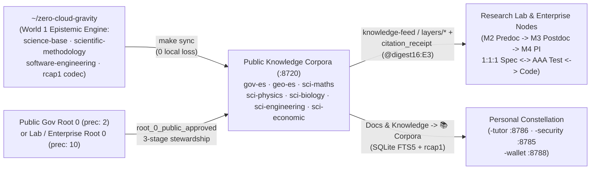
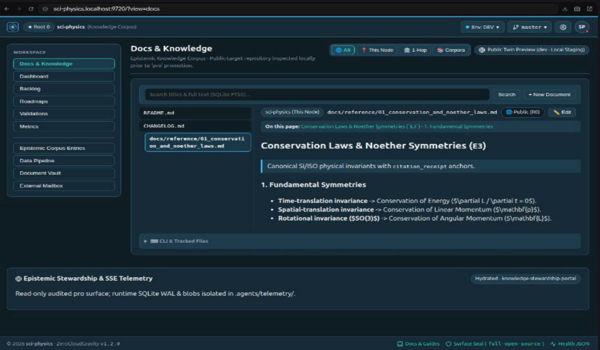
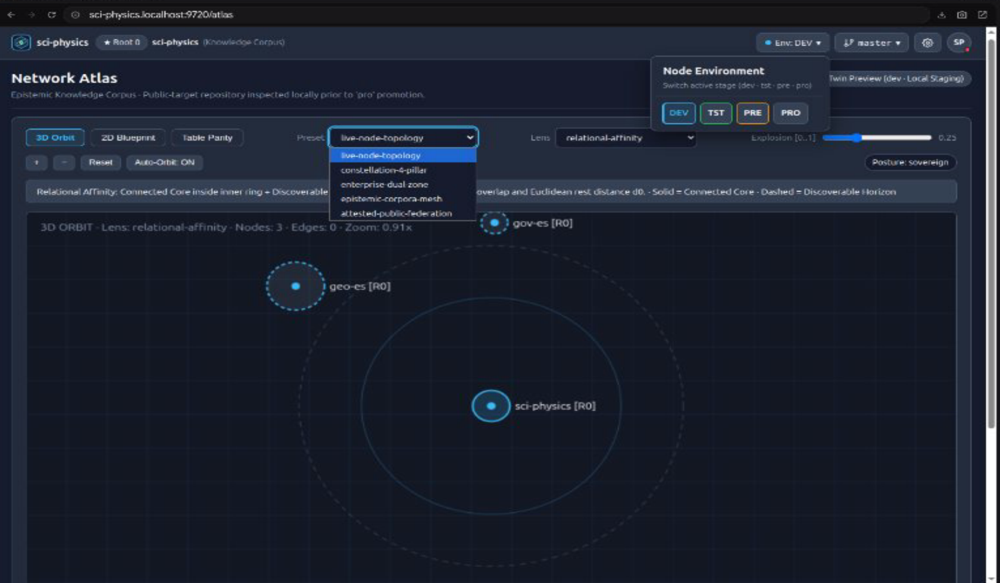

# Guide 04 — Act II (Epistemic Bridge): Scientific Research (`M2..M4`) & Public Knowledge Corpora (`gov-*`, `geo-*`, `sci-*`)

> **Researcher, Regulator & Knowledge Steward Manual — Compositional Journey Step 4 of 8 (Tier 2 Progressive Disclosure)**
>
> Bridge your Personal Constellation (**[`Guides 01–03`](01_personal_workstation_and_day0_setup.md)**) and your upcoming Enterprise Hierarchy (**[`Guides 05–06`](05_enterprise_root_and_organizational_scales.md)**) with verifiable **`E3..E0` Public & Scientific Knowledge Corpora (`gov-*`, `geo-*`, `sci-*`, `org-*`, `precedence: 20`, `:8720`)** and reproducible `M2..M4` research laboratories—achieving `93.3%–97.0%` `rcap1:L1` compaction without vector databases or cloud lock-in. For `Private <-> Public` twin topology and `rcap1` internals, see **[`Architecture 02`](../architecture/02_triadic_topology_and_twin_surfaces.md)** and **[`Architecture 05`](../architecture/05_contextual_mcp_and_capsules.md)**.

---

## 1. Day-0 Corpus Setup & Dual-World Epistemic Architecture (`Research Labs <-> Knowledge Corpora`)

Scientific modeling and statutory compliance fail when AI agents blend unverified web prose (`E0`) with enacted laws or exact physical constants (`E3`). Initialize a standalone `knowledge` corpus (or a research laboratory consuming existing corpora) with one command and open its **Day-0 Setup Studio** at `http://sci-physics.localhost:8720/`:

```bash
zcg bootstrap-workspace ~/Projects/sci-physics \
  --id sci-physics --purpose knowledge-commons \
  --templates science-base,scientific-methodology,knowledge-stewardship-portal
```



### 1.1. Dual-World Contract (`Common Epistemic Base` vs. `Research & Institutional Customization`)

The table below distinguishes what is maintained upstream by `zero-cloud-gravity` (`World 1`) from what each research group, ministry, or consortium owns (`World 2`):

| Plane | World 1 — Common Community Base (`zero-cloud-gravity`) | World 2 — Sovereign Research or Institutional Layer | Reconciliation & Verification Gate |
| :--- | :--- | :--- | :--- |
| **1. Epistemic Rules & Credibility Lattice** | [`science-base`](../../templates/human-stack/science-base/README.md) (`E3 > E2 > E1 > E0`, `1:1:1` symbiosis, `N` vs. `N ± 1` cut-points) + [`scientific-methodology`](../../templates/context-stack/scientific-methodology/README.md). | Corpus- or lab-specific invariants in `templates/<id>/rules/<id>.md` (e.g., `BIPM 2019` SI constants in `sci-physics`, `BOE` hierarchy in `gov-es`). | `make sync` upgrades `science-base` without touching `templates/<id>/*`; verified by `make diff`. |
| **2. Indexed `E3..E0` Corpus & Provenance** | `rcap1` (`L0 -> L1 -> L2 -> L3`) `zlib + HMAC-SHA256` codec, `build_citation_receipt`, `verify_epistemic_context_claims`, and `SQLite FTS5` full-text search. | Authoritative `< 465`-line Markdown files in `docs/{guides,architecture,reference}/` with `> **Summary [E3..E1]:** *...*` blockquotes and `l3_targets`. | `audit_node_drift` + `Q1..Q4` citation radar in `.agents/telemetry/citation_stats.json`. |
| **3. Computational Models & `AAA` Suites** | [`software-engineering`](../../templates/context-stack/software-engineering/README.md) (Python 3.14 `PEP 703/649/695`, `frozen=True` Functional Core, `100.00%` isolated coverage). | Domain simulation code (`src/`), laboratory datasets, and 4-quadrant Scientific `AAA` test suites (`tests/unit/`). | `make test-unit-isolated && make verify` (`0` magic numbers, exact SI units). |
| **4. Stewardship Portal (`:8720`)** | [`knowledge-stewardship-portal`](../../templates/plugin-stack/knowledge-stewardship-portal/README.md) (`Docs & Knowledge`, `Work Board`, `Epistemic Corpus Entries`, `Data Pipeline`, `Document Vault`, `Network Atlas`). | Editable `<ws>/surfaces/web/{templates,static}` overrides, `.knowledge.local` routing, and `dev -> tst -> pre -> pro` `env-gate` policies. | `make env-gate ENV=pro` $\rightarrow$ [`Architecture 04`](../architecture/04_cockpit_and_intranet_surfaces.md) |

---

## 2. Perspective `2.2` — Scientific Researcher (`M2..M4`) & UNESCO Science Trunks

Setting `domain-<specialty>:M2..M4` in `.agents/SESSION.md` switches `zcg-mcp` to `consumer_viewpoint = "professional-scientific-m3-m4"` (sorting query hits strictly by `E3 -> E2 -> E1 -> E0`):

| Researcher Stage & `Human-Stack` | Cognitive & Epistemic Focus | Daily Workflow, Verification Gates & Governance Scope |
| :--- | :--- | :--- |
| **Predoctoral (`M2`)** (`domain-physics:M2`) | Axiom grounding, dimensional homogeneity, analytical baselines prior to numerical discretization. | Mounts `layers/sci-*`, verifies `citation_receipt` digests, and writes isolated `AAA` tests for nominal and `N` vs. `N ± 1` boundaries. |
| **Postdoctoral / Senior (`M3`)** (`domain-physics:M3 \| domain-maths:M3`) | Multi-discipline coupling, stability proofs, and free-threaded (`PEP 703`) `frozen=True` Functional Core solvers. | Enforces all **4 Scientific `AAA` Quadrants** (`nominal`, `N` vs. `N ± 1`, `bipolar conservation guards` $\Delta S_{\text{univ}} \ge 0$, `outbound failures`) at `100.00%` branch coverage. |
| **PI / Lab Director (`M4`)** (`domain-physics:M4 \| hat-architect`) | Laboratory `department` governance (`precedence: 25`), reproducibility, and open-science publication gates. | Delegates work (`make delegate`), audits `Q1..Q4` citation telemetry, approves `make env-gate` promotions, and curates `E1 -> E2` corpus PRs. |

```bash
# Bootstrap a multi-corpus research laboratory node (lab-thermo :8725) & mount E3 corpora:
zcg bootstrap-workspace ~/Projects/lab-thermo \
  --id lab-thermo --role department --precedence 25 \
  --templates science-base,scientific-methodology,software-engineering,node-work-cockpit
cd ~/Projects/lab-thermo
zcg subtree register sci-physics https://github.com/mtwuser/sci-physics.git
zcg subtree register sci-maths https://github.com/mtwuser/sci-maths.git
make consult LAYER=sci-physics QUERY="2019 BIPM SI base constants"
```

---

## 3. Perspective `3.1` — Certified `7`-Corpus Registry & Stewardship Portal (`:8720`, `[CAP-04]`)

All seven canonical public corpora ship pre-registered in `DEFAULT_PUBLIC_KNOWLEDGE_REGISTRY` (`stewardship_stage: "public-community"`, `CC-BY-4.0` docs + `MIT` config) and appear automatically inside any linked node's **`Docs & Knowledge -> 📚 Reference Corpora`** tab with instant `SQLite FTS5` search:

| Public `Knowledge` ID | `knowledge_domain` & Local Host | Authoritative `E3 / E2` Baseline Scope | Certified `L1 / L3` Compaction |
| :--- | :--- | :--- | :---: |
| **`gov-es`** | `jurisdictional-normative` (`gov-es.localhost:8720`) | `CE 1978` (`Art. 1–169`, `Art. 148/149`), `LPACAP 39/2015`, `LRJSP 40/2015`, `LCSP 9/2017` thresholds & `22` `AGE` ministries. | **`97.0%`** |
| **`geo-es`** | `territorial-empirical` (`geo-es.localhost:8720`) | `NUTS-1..3`, `ISO 3166-2:ES` (`17` CCAA + `2` cities), `50` `INE CPRO` provinces, `11` islands, `ETRS89`/`REGCAN95` `UTM` & basins. | **`96.7%`** |
| **`sci-maths`** | `scientific-epistemic` (`sci-maths.localhost:8720`) | `MSC 2020`, `IEEE 754` $\varepsilon_{\text{mach}}$, Spectral/SVD definiteness, Stokes-Cartan, PDE $\Delta = B^2 - 4AC$, `CFL`/`FTCS` & `KKT`. | **`94.9%`** |
| **`sci-physics`** | `scientific-epistemic` (`sci-physics.localhost:8720`) | `IUPAP` $\beta/\text{Kn}/\text{Re}/\text{Ma}/\text{Bi}$ cut-points, `7` exact `2019 BIPM` SI constants, Noether/Maxwell, Gibbs/Carnot & Fourier/Fick. | **`95.0%`** |
| **`sci-biology`** | `scientific-epistemic` (`sci-biology.localhost:8720`) | `IUBS` bioenergetics, Michaelis-Menten & Monod washout, `[35.0 °C, 40.0 °C]` window, $a_w < 0.60$ stasis & `BSL-1..4`. | **`93.3%`** |
| **`sci-engineering`** | `scientific-epistemic` (`sci-engineering.localhost:8720`) | `V-Model` & $\text{FoS} \ge 1.50$, `IEC 61508/61511` `SIL 1..4`, `AISI 316L` $\text{PREN} \ge 24.0$, `PED` `0.50 bar(g)` & `NAMUR NE 43`. | **`96.6%`** |
| **`sci-economic`** | `scientific-epistemic` (`sci-economic.localhost:8720`) | `SNA` / `ESA` national accounts, double-entry invariants, portfolio & drawdown bounds, liquidity cut-points & DCF models (`E2`). | **`94.0%+`** |



> [!NOTE]
> **Live Browser Visual Capture — `[CAP-04]` (`Scientific Research & Public Knowledge Stewardship Portal`)**
> - Live `http://sci-physics.localhost:9720/?view=docs` displaying `Conservation Laws & Noether Symmetries (E3)` (`Public R0`), `SQLite FTS5` full-text search, `Epistemic Corpus Entries`, `Data Pipeline`, `Document Vault`, `Env: DEV` staging selector, and `Surface Seal (full-open-source)`.


