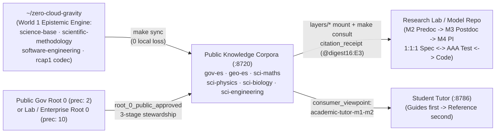
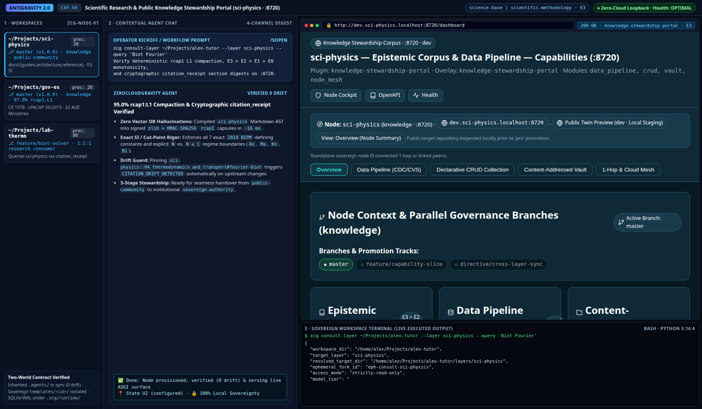

# Guide 04 — Scientific Researcher (`M2..M4`) & Public Knowledge Corpus (`gov-*`, `geo-*`, `sci-*`, `org-*`) Perspectives

> **Researcher, Regulator & Knowledge Steward Manual (Tier 2 Progressive Disclosure)**
>
> Step-by-step perspective guide detailing how **Scientific Researchers (`Predoctoral M2`, `Postdoctoral M3`, `Principal Investigator / Lab Director M4`)** and **Public Institutions / Knowledge Consortia (`gov-*`, `geo-*`, `sci-*`, `org-*`, `precedence: 20`, `:8720`)** author, verify, steward, and consume `E3..E0` knowledge without vector databases or cloud lock-in. For student `M1..M3` progression, see **[`Guide 03`](03_academic_student_perspectives.md)**; for `Private <-> Public` twin topology and `rcap1` internals, see **[`Architecture 02`](../architecture/02_triadic_topology_and_twin_surfaces.md)** and **[`Architecture 05`](../architecture/05_contextual_mcp_and_capsules.md)**.

---

## 1. Dual-World Epistemic Architecture (`Research Labs <-> Sovereign Knowledge Corpora`)

Scientific modeling and statutory governance fail when AI agents blend unverified web prose (`E0`) with enacted laws or exact physical constants (`E3`). ZeroCloudGravity separates the **reusable epistemic engine (`World 1`)** from **sovereign research laboratories and public knowledge corpora (`World 2`)**:



### 1.1. Dual-World Contract (`Common Epistemic Base` vs. `Research & Institutional Customization`)

The table below distinguishes what is maintained upstream by the `zero-cloud-gravity` community (`World 1`) from what each research group, ministry, or consortium owns (`World 2`):

| Plane | World 1 — Common Community Base (`zero-cloud-gravity`) | World 2 — Sovereign Research or Institutional Layer | Reconciliation & Verification Gate |
| :--- | :--- | :--- | :--- |
| **1. Epistemic Rules & Credibility Lattice** | [`science-base`](../../templates/human-stack/science-base/README.md) (`E3 > E2 > E1 > E0`, `1:1:1` symbiosis, `N` vs. `N ± 1` cut-points) + [`scientific-methodology`](../../templates/context-stack/scientific-methodology/README.md). | Corpus- or lab-specific invariants in `templates/<id>/rules/<id>.md` (e.g., `BIPM 2019` SI constants in `sci-physics`, `BOE` hierarchy in `gov-es`). | `make sync` upgrades `science-base` without touching `templates/<id>/*`; verified by `make diff`. |
| **2. Indexed `E3..E0` Corpus & Provenance** | `rcap1` (`L0 -> L1 -> L2 -> L3`) `zlib + HMAC-SHA256` codec, `build_citation_receipt`, and `verify_epistemic_context_claims`. | Authoritative `< 465`-line Markdown files in `docs/{guides,architecture,reference}/` with `> **Summary [E3..E1]:** *...*` blockquotes and `l3_targets`. | `audit_node_drift` + `Q1..Q4` citation radar in `.agents/telemetry/citation_stats.json`. |
| **3. Computational Models & `AAA` Suites** | [`software-engineering`](../../templates/context-stack/software-engineering/README.md) (Python 3.14 `PEP 703/649/695`, `frozen=True` Functional Core, `100.00%` isolated coverage). | Domain simulation code (`src/`), laboratory datasets, and 4-quadrant Scientific `AAA` test suites (`tests/unit/`). | `make test-unit-isolated && make verify` (`0` magic numbers, exact SI units). |
| **4. Stewardship Portal (`:8720`)** | [`knowledge-stewardship-portal`](../../templates/plugin-stack/knowledge-stewardship-portal/README.md) (`Z1..Z4` Native ASGI `DeliveryChannel`, `--zcg-*` tokens, `HTTP 286`, `data_pipeline` + `crud` + `vault`). | Editable `<ws>/surfaces/web/{templates,static}` overrides, `.knowledge.local` routing, and `dev -> tst -> pre -> pro` `env-gate` policies. | `make env-gate ENV=pro` $\rightarrow$ [`docs/architecture/04_cockpit_and_intranet_surfaces.md`](../architecture/04_cockpit_and_intranet_surfaces.md) |

---

## 2. Perspective `2.2` — Scientific Researcher Across Levels (`M2..M4`) & Specialties

Unlike general chat workflows where formulas are approximated from memory, a ZeroCloudGravity research workspace binds every theoretical claim, numerical cut-point, and simulation module to a `1:1:1` contract (`docs/architecture/<spec>.md` $\leftrightarrow$ `tests/unit/test_<mod>.py` $\leftrightarrow$ `src/<pkg>/<mod>.py`).

### 2.1. Progression Across Researcher Levels (`Predoctoral M2` $\rightarrow$ `Postdoctoral M3` $\rightarrow$ `PI / Director M4`)

Setting `domain-<specialty>:M2..M4` in `.agents/SESSION.md` switches `zcg-mcp` to `consumer_viewpoint = "professional-scientific-m3-m4"` (sorting query hits strictly by `E3 -> E2 -> E1 -> E0`) while scaling cognitive and governance responsibilities:

| Researcher Stage & `Human-Stack` | Cognitive & Epistemic Focus | Daily Workflow, Verification Gates & Governance Scope |
| :--- | :--- | :--- |
| **Predoctoral Researcher (`PhD Candidate` · `M2`)** (`domain-physics:M2`) | Literature & axiom grounding, dimensional homogeneity checks, reproducing baseline analytical solutions before numerical discretization. | Mounts `layers/sci-*`, verifies `citation_receipt` digests on primary equations, and authors isolated `AAA` unit tests covering nominal cases and exact `N` vs. `N ± 1` regime boundaries. |
| **Postdoctoral / Senior Scientist (`M3`)** (`domain-physics:M3 \| domain-maths:M3`) | Multi-discipline model coupling, numerical stability proofs, and Python 3.14 free-threaded (`PEP 703`) immutable Functional Core (`L1..L2`) solvers. | Enforces all **4 Scientific `AAA` Quadrants** (`nominal`, `N` vs. `N ± 1` cut-points, `bipolar conservation/positivity guards` such as $\Delta S_{\text{univ}} \ge 0$, and `outbound convergence/I/O failures`) at `100.00%` branch coverage. |
| **Principal Investigator / Lab Director (`M4`)** (`domain-physics:M4 \| hat-architect`) | Sovereign laboratory `department` governance (`precedence: 25`), cross-project reproducibility, and open-science publication gates. | Delegates work packages (`make delegate`), audits `.agents/telemetry/citation_stats.json` (`Q1..Q4` radar), approves `dev -> tst -> pre -> pro` `make env-gate` promotions, and curates `E1 -> E2` upstream corpus PRs. |

### 2.2. Specialty-Specific Guarantees Across UNESCO/Frascati Science Trunks

The table below illustrates how each curated `sci-*` corpus anchors quantitative invariants across scientific specialties (`CANONICAL_SCIENCE_TRUNKS` in [`Architecture 01`](../architecture/01_core_and_node_manifest.md)):

| UNESCO Trunk & Mounted Corpus | Canonical Domain Scope (`E3 / E2`) | Concrete `N` vs. `N ± 1` Cut-Points Enforced in Research Code & Tests |
| :--- | :--- | :--- |
| **`formal` — `sci-maths`** | `MSC 2020`, `IEEE 754` floating-point arithmetic, Spectral/SVD algebra, Stokes-Cartan calculus, PDEs & `KKT` optimization. | Machine epsilon $\varepsilon_{\text{mach}} = 2^{-53}$, PDE discriminant $\Delta = B^2 - 4AC$ (`< 0` elliptic, `= 0` parabolic, `> 0` hyperbolic), explicit `FTCS` `r = \alpha\Delta t/\Delta x^2 \le 1/2`, `CFL` $C \le 1$. |
| **`nature` — `sci-physics`** | `2019 BIPM` exact SI constants (`c`, `h`, `e`, `k_B`, `N_A`), Noether conservation laws, Maxwell electrodynamics, Gibbs thermodynamics & transport. | Relativistic $\beta = v/c \ge 0.10$, Knudsen $\text{Kn} > 0.01$ continuum breakdown, Reynolds $\text{Re} = 2300 / 4000$, Biot $\text{Bi} \le 0.10$ lumped capacitance, Gibbs $\Delta G_{T,P} < 0, = 0, > 0$, Carnot $\eta \le 1 - T_C/T_H$. |
| **`nature` — `sci-biology`** | `IUBS` bioenergetics, Michaelis-Menten & Monod kinetics, water activity $a_w$, `WHO` `BSL-1..4` biosafety & `RD 630/2013` flora screening. | Chemostat washout dilution $D < \mu_{\max} S_{\text{in}}/(K_s + S_{\text{in}})$, microbial stasis $a_w < 0.60$, enzymatic thermal window `[35.0 °C, 40.0 °C]`, strict `BSL-1..4` containment gates. |
| **`engineering` — `sci-engineering`** | `V-Model` systems engineering, `IEC 61508/61511` `SIL 1..4`, `AISI 316/316L` metallurgy, `PED 2014/68/EU`, `ISO 20816-3` & `NAMUR NE 43`. | Factor of Safety $\text{FoS} \ge 1.50$, pitting resistance $\text{PREN} \ge 24.0$, hygienic $R_a \le 0.80\,\mu\text{m}$, `PED` `0.50 bar(g)` & `< 40.0 °C` hatch lock, `NAMUR NE 43` `< 3.6 mA` / `> 21.0 mA` fault alarms. |

### 2.3. Initializing a Multi-Corpus Research Laboratory Node (`lab-thermo`)

The commands below bootstrap a sovereign laboratory node mounting `sci-physics` and `sci-maths` for reproducible computational research:

```bash
# 1. Bootstrap a laboratory department node with scientific + software engineering stacks:
zcg bootstrap-workspace ~/Projects/lab-thermo \
  --id lab-thermo --role department --precedence 25 \
  --templates science-base,scientific-methodology,software-engineering,node-work-cockpit

# 2. Register E3 scientific knowledge corpora as local read-only subtrees in layers/*:
cd ~/Projects/lab-thermo
zcg subtree register --id sci-physics --source ~/Projects/sci-physics
zcg subtree register --id sci-maths --source ~/Projects/sci-maths

# 3. Consult compacted E3 capsules (< 20 ms) & verify 100% isolated AAA coverage:
make consult LAYER=sci-physics
make verify
```

---

## 3. Perspective `3.1` — Public Institutions, Consortia & `Knowledge` Corpora (`:8720`)

Ministries, geographic institutes, standards bodies, and enterprise `Root 0` hubs publish authoritative knowledge as dedicated **`layer_role: "knowledge"` (`precedence: 20`)** repositories (`gov-*`, `geo-*`, `sci-*`, `org-*`).

### 3.1. Architectural Virtues Over Unstructured PDFs & Cloud Vector Databases

The table below summarizes the four structural guarantees provided by ZeroCloudGravity `knowledge` nodes:

| Capability Dimension | How `layer_role: "knowledge"` (`precedence: 20`) Works | Institutional & Engineering Virtue |
| :--- | :--- | :--- |
| **1. Deterministic `rcap1` Compaction (`0` Vector DBs)** | Markdown files (`< 465` lines, `H1..H4`, `> **Summary [E3..E1]:** *...*`) compile in $O(N)$ (`~16 ms`) into `L0` (`~88.7%` savings) and `L1` (`67%–97%` savings) `zlib + HMAC` capsules. | Zero embedding API costs, zero chunk-boundary hallucinations, and deterministic section unfolding (`L0 -> L1 -> L2 -> L3`). |
| **2. Cryptographic `citation_receipt` & Drift Detection** | Every cited rule/statute carries `<layer>::<file>#<slug>@<digest16>:<E3..E0>`. `verify_epistemic_context_claims` checks SHA-256 section digests and `E3 > E2 > E1 > E0` precedence. | Immediately flags `CITATION_DRIFT_DETECTED` when an upstream law or ISO standard changes, and blocks `EPISTEMIC_PRECEDENCE_VIOLATION` overrides. |
| **3. Three-Stage Stewardship & Sibling Isolation** | Evolves cleanly across `private-incubation` $\rightarrow$ `public-community` $\rightarrow$ `sovereign-authority` (`canonical_authority_url`), with strict sibling isolation in `~/Projects/`. | Allows open communities to curate seed atlases (`gov-es`, `sci-*`) today and hand over canonical URLs to official ministries or consortia with `0` consumer breakage. |
| **4. `Private <-> Public` Twin Boundary** | A private government (`gov-es-root`, `2`) or enterprise (`corp-alpha-root`, `10`) governs its public twin (`gov-es` or `org-alpha`, `20`) via `root_0_public_approved: true`. | Publishes enacted statutes or public API docs on `.knowledge.local` while keeping internal drafts, `corporate/ledgers/`, and HR/SecOps layers `100%` private. |

### 3.2. Certified Baseline Across the `6` Public Open-Source Knowledge Corpora (`v1.0.0`)

All six canonical public corpora ship pre-registered in `DEFAULT_PUBLIC_KNOWLEDGE_REGISTRY` (`stewardship_stage: "public-community"`, `CC-BY-4.0` docs + `MIT` config) with verified `rcap1` compaction:

| Public `Knowledge` ID | `knowledge_domain` & Cockpit Host | Authoritative `E3 / E2` Baseline Scope | Certified `L1 / L3` Compaction |
| :--- | :--- | :--- | :---: |
| **`gov-es`** | `jurisdictional-normative` (`gov-es.knowledge.local:8720`) | `CE 1978` (`Art. 1–169`, `Art. 148/149`), `LPACAP 39/2015`, `LRJSP 40/2015`, `LCSP 9/2017` thresholds & `22` `AGE` ministries (`AREA-01..07`). | **`97.0%`** |
| **`geo-es`** | `territorial-empirical` (`geo-es.knowledge.local:8720`) | `NUTS-1..3`, `ISO 3166-2:ES` (`17` CCAA + `2` autonomous cities), `50` `INE CPRO` provinces, `11` islands/cabildos/consells, `ETRS89`/`REGCAN95` `UTM` cut-points, `ES010..ES127` basins & `4` EU bioregions. | **`96.7%`** |
| **`sci-maths`** | `scientific-epistemic` (`sci-maths.knowledge.local:8720`) | `MSC 2020`, `IEEE 754` $\varepsilon_{\text{mach}}$, Spectral/SVD rank & definiteness, Stokes-Cartan, PDE $\Delta = B^2 - 4AC$, `CFL`/`FTCS` & `KKT`. | **`94.9%`** |
| **`sci-physics`** | `scientific-epistemic` (`sci-physics.knowledge.local:8720`) | `IUPAP` $\beta/\text{Kn}/\text{Re}/\text{Ma}/\text{Bi}$ cut-points, all `7` exact `2019 BIPM` SI constants, Noether/Maxwell, Gibbs/Carnot/phase rule & Fourier/Fick/Arrhenius. | **`95.0%`** |
| **`sci-biology`** | `scientific-epistemic` (`sci-biology.knowledge.local:8720`) | `IUBS` bioenergetics, Michaelis-Menten & Monod washout, `[35.0 °C, 40.0 °C]` window, $a_w < 0.60$ stasis, `BSL-1..4`, lignocellulose & `RD 630/2013` flora. | **`93.3%`** |
| **`sci-engineering`** | `scientific-epistemic` (`sci-engineering.knowledge.local:8720`) | `V-Model` & $\text{FoS} \ge 1.50$, `IEC 61508/61511` `SIL 1..4`, `AISI 316L` $\text{PREN} \ge 24.0$, `ISO 3310-1`, `PED` `0.50 bar(g)`, `ISO 20816-3` & `NAMUR NE 43` / `PT100`. | **`96.6%`** |

### 3.3. Dedicated Web View (`Knowledge Stewardship Portal :8720` · `Z1..Z4`) & Live Capture (`[CAP-04]`)

Every `knowledge` corpus provisions [`knowledge-stewardship-portal`](../../templates/plugin-stack/knowledge-stewardship-portal/README.md) (`enabled_modules: ["data_pipeline", "crud", "vault", "node_mesh"]`) on `http://dev.<id>.localhost:8720/dashboard` (`https://dev.<id>.knowledge.local`):
- **`Z1` Header & Compass**: Displays `<id> — Epistemic Corpus & Data Pipeline (:8720)` with `.zcg-compass` (`Public Twin Preview · dev Local Staging`) and `strictly-read-only-audited` production immutability.
- **`Z2` `1-Hop` Relationship Summary**: Confirms standalone sibling isolation (`0` lateral peer bleed) for `public-community` atlases (or links upward to the governing ministry/enterprise `Root 0` during `private-incubation`).
- **`Z3` Epistemic Knowledge & Curation Ledger**: Surfaces `Epistemic E3 > E2` curation collections, `Data Pipeline (CDC/CVS)`, and `Content-Addressed Vault` tabs alongside `docs/{guides,architecture,reference}/*`.
- **`Z4` Promotion Gates, Veracity & Companion**: Reports `Gate [DEV..PRO]: READY`, Source-Origin GitHub provenance, `/.well-known/zcg-attestation.json`, and `Health:OPTIMAL` telemetry.



> [!NOTE]
> **3-Pane Antigravity Visual Capture — `[CAP-04]` (`Scientific Research & Public Knowledge Stewardship Portal :8720`)**
> - **Left Pane (Workspaces)**: Curated `sci-physics` (`95.0%` `rcap1:L1`) and `gov-es` (`97.0%` `rcap1:L1`) corpora alongside consumer research workspace `lab-thermo`.
> - **Center Pane (Contextual Chat)**: `zcg consult-layer` verifying `~16 ms` deterministic `rcap1` compaction, exact `2019 BIPM` SI constants, and `CITATION_DRIFT_DETECTED` protection.
> - **Right Pane (Web View + Terminal)**: Live `http://dev.sci-physics.localhost:8720/dashboard` (`knowledge-stewardship-portal` + `Epistemic` / `Data Pipeline` cards) paired with `zcg consult-layer` JSON output.
