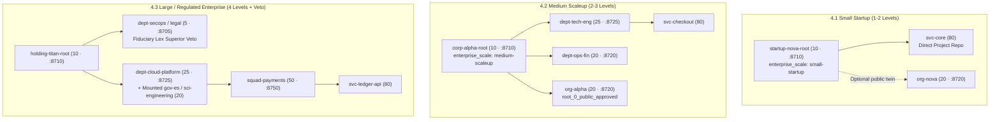
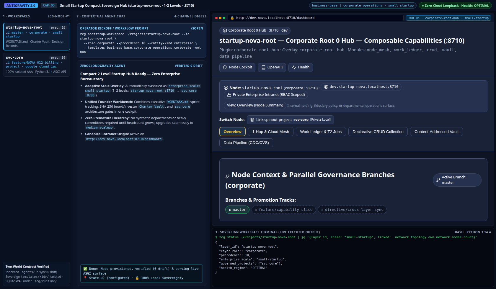
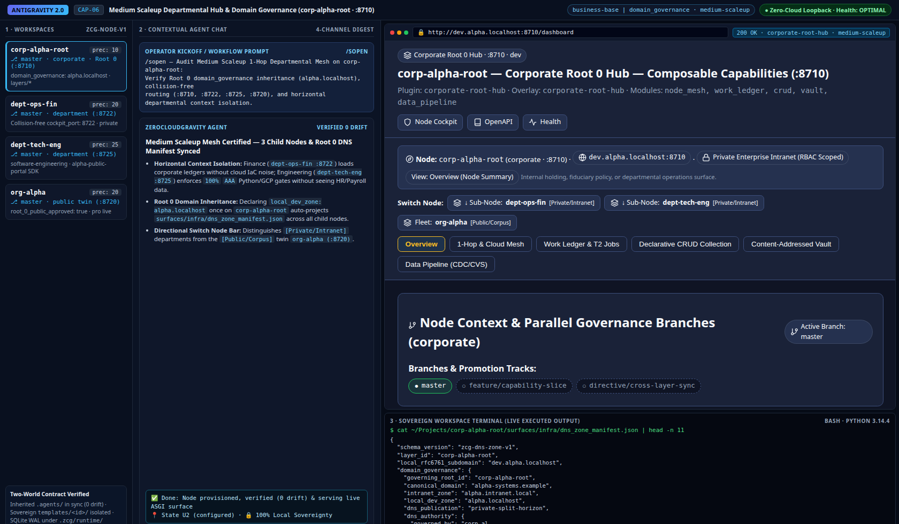
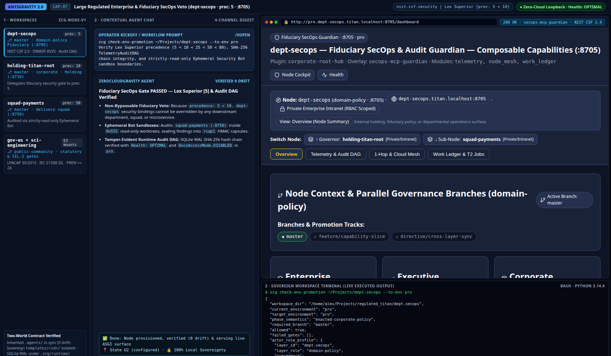

# Guide 05 — Enterprise Professional (`M2..M4`) & Company Scale (`Startup` $\rightarrow$ `Scaleup` $\rightarrow$ `Regulated Holding`) Perspectives

> **Employee, Engineering Manager & Executive Operator Manual (Tier 2 Progressive Disclosure)**
>
> Step-by-step perspective guide showing how **Enterprise Professionals (`Junior M2`, `Senior M3`, `Staff / Director M4`)** weave immutable corporate rules (`0..80`) with personal cognitive context (`85..95`), and how **Small Startups (`1–2` levels), Medium Scaleups (`2–3` levels), and Large Regulated Enterprises (`4` levels + Fiduciary Veto)** reuse the exact same fractal `ZeroCloudGravity` primitives without re-architecting. For RBAC and stage-gate contracts, see **[`Architecture 03`](../architecture/03_governance_and_work_ledger.md)** and **[`Reference 01`](../reference/01_stack_and_plugin_matrix.md)**.

---

## 1. Perspective `2.1` — Enterprise Professional Across Levels (`M2..M4`) & Specialties

In an enterprise workspace, an employee needs strict adherence to organizational security, legal, and architectural mandates (`precedence: 0..80`) while preserving their own preferred explanation depth, language (`--lang`), and workstation ergonomics (`precedence: 85..95`).

### 1.1. Dual-World Employee Weaving (`0..80` Immutable Company Law + `85..95` Personal `Human-Stack`)

The table below shows how the Dual-World Contract separates shared company governance from each professional's sovereign local ergonomics:

| Plane | Shared Organizational Lineage (`0..80`) | Sovereign Employee Customization (`85..95` & `$HOME`) | Enforcement & Reconciliation Gate |
| :--- | :--- | :--- | :--- |
| **1. Normative Rules & Security** | Inherited `.agents/rules/layer-05-dept-secops.md` + `layer-10-corp-alpha.md` + [`software-engineering`](../../templates/context-stack/software-engineering/README.md) / [`corporate-operations`](../../templates/context-stack/corporate-operations/README.md). | Global `~/.gemini/config/AGENTS.md` (`universal-base` + `~/alex-pc`) + `.agents/SESSION.md` (`domain-cloud:M3 \| bridge-legal-tech \| hat-reviewer`). | `pre_tool_guard.py` blocks direct edits to `.agents/rules/layer-*.md`; `Human-Stack` (`85..95`) never overrides `0..80` rules. |
| **2. Work Execution & Stage Gates** | `WORKROAD.md`, `WORKTASK.md` (`make task` / `make complete`), `.github/CODEOWNERS` RBAC (`owner`, `maintainer`, `validator`, `member`), and `dev -> tst -> pre -> pro` `make env-gate`. | Bounded-lot turn cadence (`1` lot/turn, `3–5` files), `--lang` interaction language, and untracked `~/.gitconfig.local` / `~/.bashrc.local` credentials. | `make sync` refreshes company rules downward; `/enrich` $\rightarrow$ `make promote` proposes reusable patterns `1-hop` upward via PR. |

### 1.2. Progression Across Professional Levels (`M2 -> M3 -> M4`) & Functional Specialties

The matrix below maps daily responsibilities and active stacks across the three primary enterprise specialties and seniority tiers:

| Specialty Track & Active Packs | `M2` — Junior / Mid Practitioner | `M3` — Senior / Staff Architect | `M4` — Functional / Engineering Director |
| :--- | :--- | :--- | :--- |
| **1. Software & Cloud Engineering** ([`software-engineering`](../../templates/context-stack/software-engineering/README.md) + [`google-cloud-iac`](../../templates/framework-stack/google-cloud-iac/README.md)) | Claims feature tickets (`make task`), pairs Python 3.14 Native ASGI / `frozen=True` Functional Core code with `100.00%` isolated `AAA` unit suites (`<= 384` lines/module). | Governs relational cluster mass ($M_{\text{cluster}} < 1,200$), `GCP-IAC-01..04` (`Cloud Run`, `GKE`, `BigQuery`, `IAM/ADC`), and `[WIRE] -> [CONSOLIDATE] -> [PRUNE]` refactors. | Owns `dept-tech-eng` (`precedence: 25`, `:8725`), delegates squad epics (`make delegate`), and signs off `pre -> pro` `make env-gate` promotions. |
| **2. Cybersecurity & Fiduciary SecOps** ([`nist-csf-security`](../../templates/framework-stack/nist-csf-security/README.md) + [`secops-mcp-guardian`](../../templates/plugin-stack/secops-mcp-guardian/README.md)) | Executes `nist-csf-audit` (`NIST-01..04`, OWASP ASVS, `PATH_CONTAINMENT_VIOLATION`) and logs findings in `WORKVALI.md`. | Designs cross-departmental `surface_bindings` (`precedence: 5`), Fixed MCP `R0..R2` rings, and `strictly-read-only` Ephemeral Security Bots. | Exercises fiduciary `make decision` (`approve \| reject \| blocked`) on `pre`/`pro` releases and escalates deadlocks via `ESCALATE_TO_ROOT`. |
| **3. Legal, Finance & Corporate Ops** ([`business-base`](../../templates/human-stack/business-base/README.md) + [`corporate-operations`](../../templates/context-stack/corporate-operations/README.md)) | Authors auditable records (`[DEPT]-[TYPE]-[YYYY]-[NNN]`) in `corporate/ledgers/` paired with SOP checklists in `corporate/sops/`. | Runs `ledger-surface-audit` verifying `1:1:1` traceability across `corporate/ledgers/` $\leftrightarrow$ `policies/sops/` $\leftrightarrow$ `surfaces/{web,forms,print}/` + `gov-*` citations. | Governs `Root 0` (`:8710`) or Finance/Legal departments, arbitrates cross-departmental consensus, and approves `org-*` public twin exports. |

---

## 2. Perspectives `4.1..4.3` — Enterprise Governance Across Company Scales (Same Fractal Structure)

ZeroCloudGravity avoids "startup tools vs. enterprise rewrite" lock-in: **every company scale uses the exact same `system/zcg-node.json` manifest, `WORK*` ledgers, `make sync|delegate|promote|env-gate` commands, and `Z1..Z4` cockpits**, adding intermediate layers only when headcount or regulatory scope demands them:



### 2.1. Perspective `4.1` — Small Enterprise / Startup (`1–2` Levels · `small-startup` · `[CAP-05]`)

A `2–15` person startup or studio needs zero departmental bureaucracy while still requiring clean `1:1:1` code quality, auditable contracts, and deterministic `dev -> tst -> pre -> pro` release gates:
- **Topology (`1–2` Levels)**: One [`corporate-root-hub`](../../templates/plugin-stack/corporate-root-hub/README.md) repository (`startup-nova-root`, `precedence: 10`, `:8710`, `enterprise_scale: "small-startup"`) governing `1..N` product repositories (`svc-core`, `precedence: 80`) directly `1-hop` below it, plus an optional `org-nova` (`20`) public documentation twin.
- **Virtues**: Founders hold `owner` RBAC in `startup-nova-root` (`corporate/ledgers/` for cap-table/vendor contracts) while developers run `zcg apply-project` on `svc-core` inheriting `science-base,software-engineering,google-cloud-iac`. When the company grows to `30+` people, inserting `dept-tech-eng` (`25`) requires only updating `--parent-dir` with zero file-format changes.

```bash
# Bootstrap a flat 2-level Startup Root 0 (:8710) + direct product repository (prec: 80):
zcg bootstrap-workspace ~/Projects/startup-nova-root \
  --id startup-nova-root --role corporate --precedence 10 --entity-kind enterprise \
  --templates business-base,corporate-operations,corporate-root-hub
zcg apply-project ~/Projects/svc-core \
  --parent-dir ~/Projects/startup-nova-root --template science-base,software-engineering,google-cloud-iac
```



> [!NOTE]
> **3-Pane Antigravity Visual Capture — `[CAP-05]` (`Small Startup Compact Hub :8710 · small-startup`)**
> - **Left / Center / Right Panes**: `startup-nova-root` + `svc-core` in Workspaces; compact 2-level bootstrap & founder sprint chat in Center; live `http://dev.nova.localhost:8710/dashboard` (`corporate-root-hub · small-startup`, `Link:spinout-project: svc-core`) in Right Pane.

### 2.2. Perspective `4.2` — Medium Enterprise / Scaleup (`2–3` Levels · `medium-scaleup` · `[CAP-06]`)

At `20–250` employees (`corp-alpha` archetype), engineering, finance/operations, and brand teams require **horizontal context isolation** so marketing prompts do not load cloud IaC rules and engineering repos do not expose internal HR/finance ledgers:
- **Topology (`2–3` Levels)**: `corp-alpha-root` (`10`, `:8710`, automatically detected as `enterprise_scale: "medium-scaleup"` once downward child departments exist) $\rightarrow$ functional departments (`dept-ops-fin` `20` `:8722`, `dept-tech-eng` `25` `:8725`, `dept-brand` `30`) + curated public twin `org-alpha` (`20`, `:8720`) $\rightarrow$ service projects (`svc-checkout`, `80`).
- **Virtues**: `1-hop` directive delegation (`make delegate` from `:8710` to `dept-tech-eng`), `Root 0` `domain_governance` inheritance (`alpha.localhost`), strict subordinate outward blocking (`can_expose_to_oss: false` unless `root_0_public_approved: true` projects curated docs to `org-alpha`), and departmental `CODEOWNERS` rosters (`owner`, `maintainer`, `validator`, `member`).

```bash
# Bootstrap Scaleup Root 0 (:8710), Public Twin (org-alpha :8720) & Engineering Dept (:8725):
zcg bootstrap-workspace ~/Projects/corp-alpha-root \
  --id corp-alpha-root --role corporate --precedence 10 --entity-kind enterprise \
  --templates business-base,corporate-operations,corporate-root-hub
zcg bootstrap-workspace ~/Projects/org-alpha \
  --id org-alpha --role knowledge --precedence 20 --parent-dir ~/Projects/corp-alpha-root \
  --templates business-base,corporate-operations,knowledge-stewardship-portal
zcg bootstrap-workspace ~/Projects/dept-tech-eng \
  --id dept-tech-eng --role department --precedence 25 --parent-dir ~/Projects/corp-alpha-root \
  --templates science-base,software-engineering,google-cloud-iac,node-work-cockpit
```



> [!NOTE]
> **3-Pane Antigravity Visual Capture — `[CAP-06]` (`Medium Scaleup Departmental Hub :8710 / :8725 · medium-scaleup`)**
> - **Left / Center / Right Panes**: `corp-alpha-root`, `dept-ops-fin (:8722)`, `dept-tech-eng (:8725)`, and `org-alpha (:8720)` in Workspaces; `domain_governance` & horizontal isolation audit in Center; live `http://dev.alpha.localhost:8710/dashboard` (`medium-scaleup`, `Switch Node` listing `[Private/Intranet]` departments vs. `[Public/Corpus]` `org-alpha`) + `dns_zone_manifest.json` in Right Pane.

### 2.3. Perspective `4.3` — Large / Regulated Enterprise (`4` Levels + Fiduciary Veto · `[CAP-07]`)

Banks, healthcare groups, industrial operators, and multi-subsidiary holdings require **non-bypassable fiduciary security/legal enforcement** plus statutory grounding (`gov-*`, `sci-engineering`):
- **Topology (`4` Levels + *Lex Superior* `precedence: 5`)**: `holding-titan-root` (`10`, `:8710`) delegates fiduciary authority to `dept-secops` / `dept-legal-ip` (`layer_role: "domain-policy"`, **`precedence: 5 < 10`**, `:8705`) alongside functional departments (`15..45`) mounting `gov-es` and `sci-engineering` (`20`), delivery squads (`squad-payments`, `50`, `:8750`), and regulated microservices (`svc-ledger-api`, `80`).
- **Virtues**: Because `5 < 10 < 25 < 50 < 80`, `dept-secops` `surface_bindings` override any conflicting downstream configuration; `secops-mcp-guardian` spawns `strictly-read-only` (`chmod 0o555`) Ephemeral Security Bots sealing HMAC `rcap1` audit digests; and unresolved cross-departmental conflicts route deterministically to `holding-titan-root` via `ESCALATE_TO_ROOT`.

```bash
# Add Fiduciary SecOps Guardian (prec: 5, :8705) & Delivery Squad (prec: 50, :8750):
zcg bootstrap-workspace ~/Projects/dept-secops \
  --id dept-secops --role domain-policy --precedence 5 --parent-dir ~/Projects/holding-titan-root \
  --templates business-base,corporate-operations,nist-csf-security,secops-mcp-guardian
zcg bootstrap-workspace ~/Projects/squad-payments \
  --id squad-payments --role squad --precedence 50 --parent-dir ~/Projects/dept-tech-eng \
  --templates science-base,software-engineering,google-cloud-iac,node-work-cockpit
```



> [!NOTE]
> **3-Pane Antigravity Visual Capture — `[CAP-07]` (`Large Regulated Enterprise & SecOps Guardian :8705 / :8710`)**
> - **Left / Center / Right Panes**: `dept-secops (prec: 5)`, `holding-titan-root (10)`, `squad-payments (50)`, and mounted `gov-es + sci-engineering` in Workspaces; *Lex Superior* (`5 < 10`) & `check-env-promotion --to-env pro` audit in Center; live `http://pro.dept-secops.titan.localhost:8705/dashboard` (`secops-mcp-guardian`) in Right Pane.
