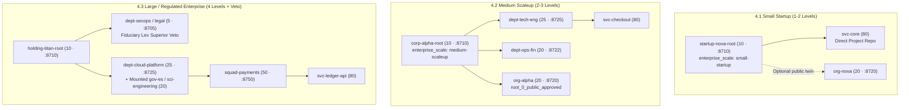
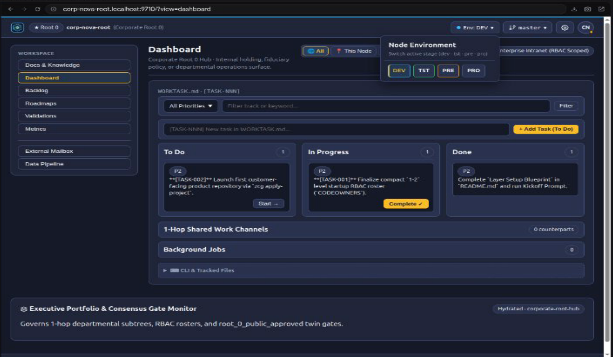
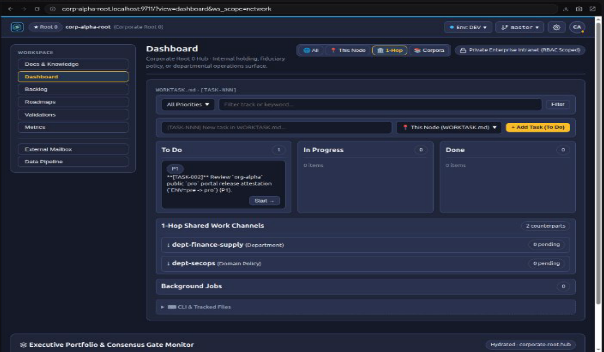
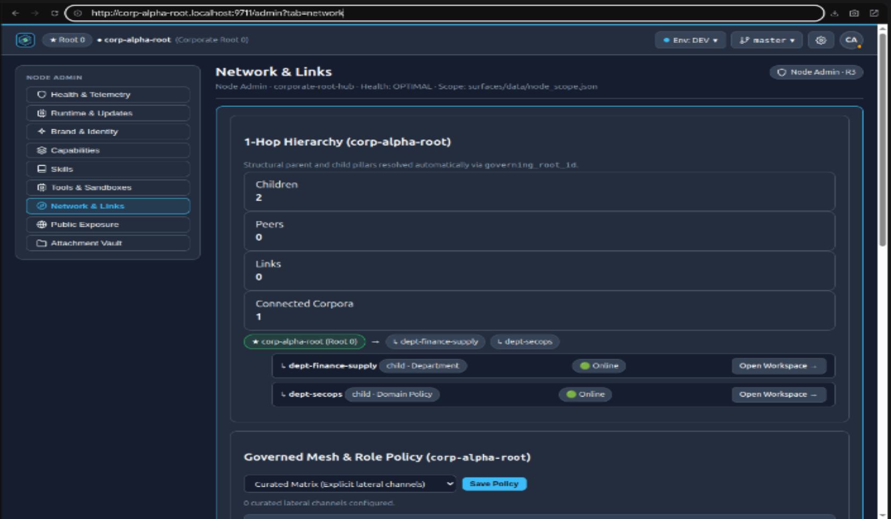
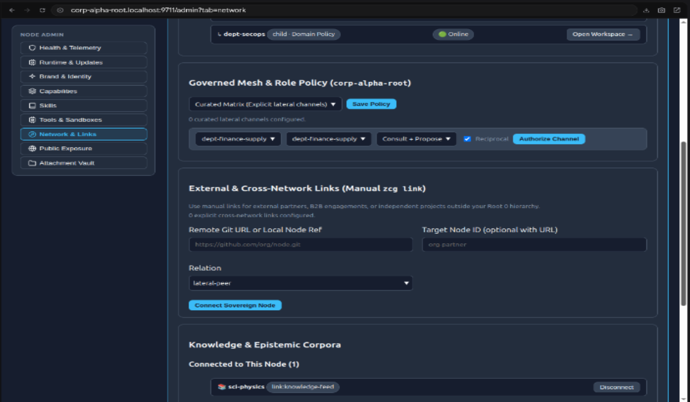
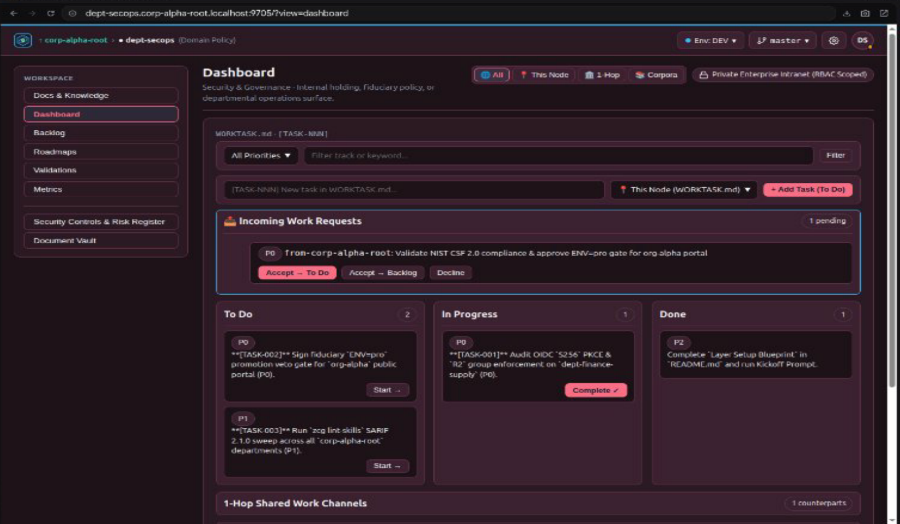
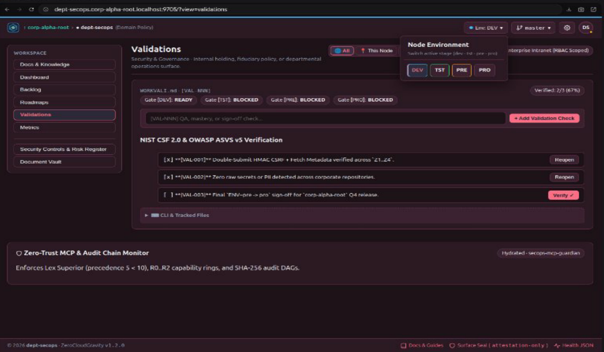

# Guide 05 — Act III (Enterprise Step 1): Corporate `Root 0` (`<corp>-root`), Capability Governance & Organizational Scales

> **Employee, Engineering Manager & Executive Manual — Compositional Journey Step 5 of 8 (Tier 2 Progressive Disclosure)**
>
> Alongside your isolated Personal Constellation (`~/<persona>-profile` & `~/Projects/<persona>-*` from **[`Guides 01–03`](01_personal_workstation_and_day0_setup.md)**) — or standalone on a managed corporate machine without any personal constellation — begin building a completely independent **Enterprise Composite Network (`~/Work/<corp>/`)** starting at **Step 1: Corporate `Root 0` (`corp-alpha-root` `:8710`)**, hierarchical `Capabilities` governance (`mandatory | optional | forbidden`), and fractal company scales (**Small Startup `1–2` levels $\rightarrow$ Medium Scaleup `2–3` levels $\rightarrow$ Regulated Holding `4` levels + Fiduciary Veto**). Next step: add a **Department, Company Project & Public `pro` Portal** in **[`Guide 06`](06_enterprise_departments_projects_and_portals.md)**.

---

## 1. Day-0 Corporate `Root 0` Setup & Dual-World Employee Weaving (`0..80` + `85..95`)

Keep enterprise `managed` repositories inside a separate directory tree (`~/Work/<org>/`) outside `~/<persona>-profile`. On a company-owned laptop, `$HOME` coupling (`workstation.conf`) is **host-agnostic**: run `zcg-sync --setup --workstation-dir ~/Work/corp-alpha/corp-alpha-root` (or a `dept-*` directory) to wire `~/.gemini/config/` and `zcg-mcp` directly without touching `~/.bashrc` or `~/.gitconfig` unless `bash/`/`git/` exist, or run `$HOME`-free standalone (`<ws>/.agents/`). Initialize your Corporate `Root 0` hub with one command and open its **Pending-Setup Web Studio** at `http://alpha.localhost:8710/`:

```bash
zcg bootstrap-workspace ~/Work/corp-alpha/corp-alpha-root \
  --id corp-alpha-root --purpose enterprise-network \
  --templates business-base,corporate-operations,corporate-root-hub
```

1. Open **`http://alpha.localhost:8710/`** in your browser, adapt the self-contained Corporate `Root 0` Kickoff Prompt (mission, `owner` emails, domain governance), and click **`Copy Prompt for Antigravity Chat`**.
2. Open `~/Work/corp-alpha/corp-alpha-root` in **Antigravity Agents** (*Projects $\rightarrow$ select `~/Work/corp-alpha/corp-alpha-root` $\rightarrow$ New Conversation*, IDE optional; or run `cd ~/Work/corp-alpha/corp-alpha-root && agy` in your terminal TUI), paste the prompt, and open the right-hand integrated browser—once Phase D marks setup `[x]`, `Workspace (/)` and `Node Admin (/admin)` (`Capabilities`, `Brand & Identity`, `Skills & Tools`, `Network & Links`) unlock live!

### 1.1. Dual-World Employee Weaving (`0..80` Company Law + `85..95` Personal `Human-Stack`)

Inside an enterprise repository, shared company governance (`0..80`) coexists cleanly with each employee's personal cognitive preferences (`85..95`) without cross-contamination:

| Plane | Shared Organizational Lineage (`0..80`) | Sovereign Employee Customization (`85..95` & `$HOME`) | Enforcement & Reconciliation Gate |
| :--- | :--- | :--- | :--- |
| **1. Normative Rules & Capabilities** | Inherited `.agents/rules/layer-05-dept-secops.md` + `layer-10-corp-alpha.md` + `capability_policy` (`mandatory \| optional \| forbidden` across child nodes). | Global `~/.gemini/config/AGENTS.md` (`universal-base` + host-coupled `~/<persona>-profile` or corporate `Root 0`) + `.agents/SESSION.md` (`domain-cloud:M3 \| bridge-legal-tech \| hat-reviewer`). | `pre_tool_guard.py` blocks direct edits to `.agents/rules/layer-*.md`; `Human-Stack` (`85..95`) never overrides `0..80` rules. |
| **2. Work Execution & Stage Gates** | `WORKROAD.md`, `WORKTASK.md` (`Work Board` Kanban + `Work Inbox`), `.github/CODEOWNERS` RBAC (`owner`, `maintainer`, `validator`, `member`), and `dev -> tst -> pre -> pro` `make env-gate`. | Bounded-lot turn cadence (`1` lot/turn, `3–5` files), `--lang` / `User Settings (/settings)` cookie lens, and untracked `~/.gitconfig-corp-alpha` identity. | `make sync` refreshes company rules downward; `/enrich` $\rightarrow$ `make promote` proposes reusable patterns `1-hop` upward via PR. |

### 1.2. Progression Across Professional Levels (`M2 -> M3 -> M4`) & Functional Specialties

The table below shows how `Human-Stack` mastery levels (`M2..M4`) map across core enterprise tracks:

| Specialty Track & Active Packs | `M2` — Junior / Mid Practitioner | `M3` — Senior / Staff Architect | `M4` — Functional / Engineering Director |
| :--- | :--- | :--- | :--- |
| **1. Software & Infrastructure** ([`software-engineering`](../../templates/context-stack/software-engineering/README.md) + [`self-hosted-container`](../../templates/tool-stack/self-hosted-container/README.md) / [`google-cloud-iac`](../../templates/tool-stack/google-cloud-iac/README.md)) | Claims tickets (`make task`), pairs Python 3.14 Native ASGI / `frozen=True` Functional Core code with `100.00%` isolated `AAA` unit suites (`<= 384` lines/module). | Governs cluster mass ($M_{\text{cluster}} < 1,200$), `OCI-EDGE-01..04` / `GCP-IAC-01..04` deployment invariants, and `[WIRE] -> [CONSOLIDATE] -> [PRUNE]` refactors. | Owns `dept-tech-eng` (`:8725`), delegates squad epics (`make delegate` / `Work Inbox`), and signs off `pre -> pro` `make env-gate`. |
| **2. Cybersecurity & Fiduciary SecOps** ([`nist-csf-security`](../../templates/context-stack/nist-csf-security/README.md) + [`secops-mcp-guardian`](../../templates/plugin-stack/secops-mcp-guardian/README.md)) | Executes `nist-csf-audit` (`NIST-01..04`, OWASP ASVS, `PATH_CONTAINMENT_VIOLATION`) and logs findings in `WORKVALI.md`. | Designs cross-departmental `surface_bindings` (`precedence: 5`), Fixed MCP `R0..R2` rings, and `strictly-read-only` Ephemeral Security Bots. | Exercises fiduciary `make decision` (`approve \| reject \| blocked`) on `pre`/`pro` releases and escalates deadlocks via `ESCALATE_TO_ROOT`. |
| **3. Legal, Finance & Corporate Ops** ([`business-base`](../../templates/human-stack/business-base/README.md) + [`corporate-operations`](../../templates/context-stack/corporate-operations/README.md)) | Authors auditable records (`[DEPT]-[TYPE]-[YYYY]-[NNN]`) in `corporate/ledgers/` paired with SOP checklists in `corporate/sops/`. | Runs `ledger-surface-audit` verifying `1:1:1` traceability across `corporate/ledgers/` $\leftrightarrow$ `policies/sops/` $\leftrightarrow$ `surfaces/` + `gov-*` citations. | Governs `Root 0` (`:8710`) or Finance/Legal departments, sets `capability_policy`, and approves `org-*` public twin exports. |

---

## 2. Perspectives `4.1..4.3` — Scaling Without Re-Architecting (`Startup -> Scaleup -> Regulated Holding`)

Every company scale uses the exact same `system/zcg-node.json` manifest, Kanban `Work Board`, `Docs & Knowledge` space, and `make sync|delegate|promote|env-gate` workflows, inserting intermediate layers only when headcount or regulatory scope requires them:



### 2.1. Perspective `4.1` — Small Startup (`1–2` Levels · `small-startup` · `[CAP-05]`)

A `2–15` person startup pairs one `corporate-root-hub` (`startup-nova-root`, `:8710`) directly with `1..N` product repositories (`svc-core`, `precedence: 80`), with zero departmental overhead:

```bash
zcg bootstrap-workspace ~/Work/nova/startup-nova-root \
  --id startup-nova-root --role corporate --precedence 10 --entity-kind enterprise \
  --templates business-base,corporate-operations,corporate-root-hub
zcg apply-project ~/Work/nova/svc-core \
  --parent-dir ~/Work/nova/startup-nova-root --template science-base,software-engineering,google-cloud-iac
```



> [!NOTE]
> **Live Browser Visual Capture — `[CAP-05]` (`Small Startup Compact Hub · small-startup`)**
> - Live `http://corp-nova-root.localhost:9710/?view=dashboard` showing the lean `1–2` level Corporate `Root 0` Kanban board, staged `Node Environment (DEV | TST | PRE | PRO)` switcher, and `Executive Portfolio & Consensus Gate Monitor`.

### 2.2. Perspective `4.2` — Medium Scaleup (`2–3` Levels · `medium-scaleup` · `[CAP-06]`)

At `20–250` employees (`corp-alpha`), functional departments (`dept-finance-supply`, `dept-secops`) isolate context horizontally while inheriting `Root 0` `domain_governance`, `1-Hop Shared Work Channels`, and `Curated Matrix` lateral channel policies:



> [!NOTE]
> **Live Browser Visual Capture — `[CAP-06]` (`Medium Scaleup Departmental Hub · 1-Hop Orchestration`)**
> - Live `http://corp-alpha-root.localhost:9711/?view=dashboard&ws_scope=network` filtered on the **`1-Hop`** workspace lens, displaying cross-departmental tasks (`org-alpha` `ENV=pre -> pro` release attestation) and expanded **`1-Hop Shared Work Channels`** (`↓ dept-finance-supply` & `↓ dept-secops`).





### 2.3. Perspective `4.3` — Large Regulated Enterprise (`4` Levels + Fiduciary Veto · `[CAP-07]`)

Regulated holdings delegate non-bypassable fiduciary authority (`precedence: 5 < 10`, `:8705`) to `dept-secops` / `dept-legal-ip` (`secops-mcp-guardian` + Ephemeral Security Bots) above functional departments (`25`), squads (`50`), and regulated services (`80`):

```bash
zcg bootstrap-workspace ~/Work/titan/dept-secops \
  --id dept-secops --role domain-policy --precedence 5 --from-parent ~/Work/titan/holding-titan-root \
  --templates business-base,corporate-operations,nist-csf-security,secops-mcp-guardian
zcg bootstrap-workspace ~/Work/titan/squad-payments \
  --id squad-payments --role squad --precedence 50 --from-parent ~/Work/titan/dept-tech-eng \
  --templates science-base,software-engineering,google-cloud-iac,node-work-cockpit
```



> [!NOTE]
> **Live Browser Visual Capture — `[CAP-07]` (`Large Regulated Enterprise & SecOps Work Inbox · prec: 5`)**
> - Live `http://dept-secops.corp-alpha-root.localhost:9705/?view=dashboard` showing the Crimson `Domain Policy` SecOps surface (`↑ corp-alpha-root > dept-secops`), live `P0` incoming cross-node delegation inside **`Incoming Work Requests`** (`Accept -> To Do | Accept -> Backlog | Decline`), `Security Controls & Risk Register`, and `1-Hop Shared Work Channels`.


