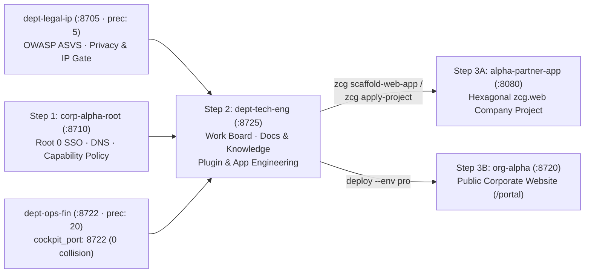
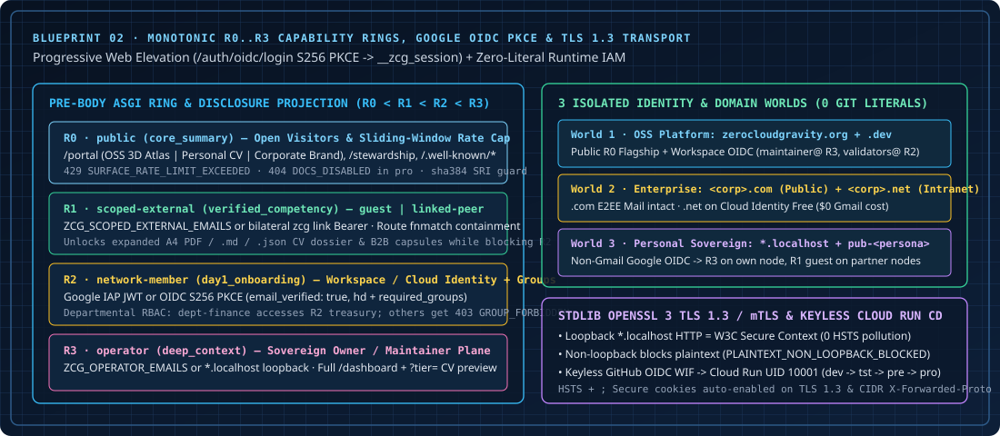
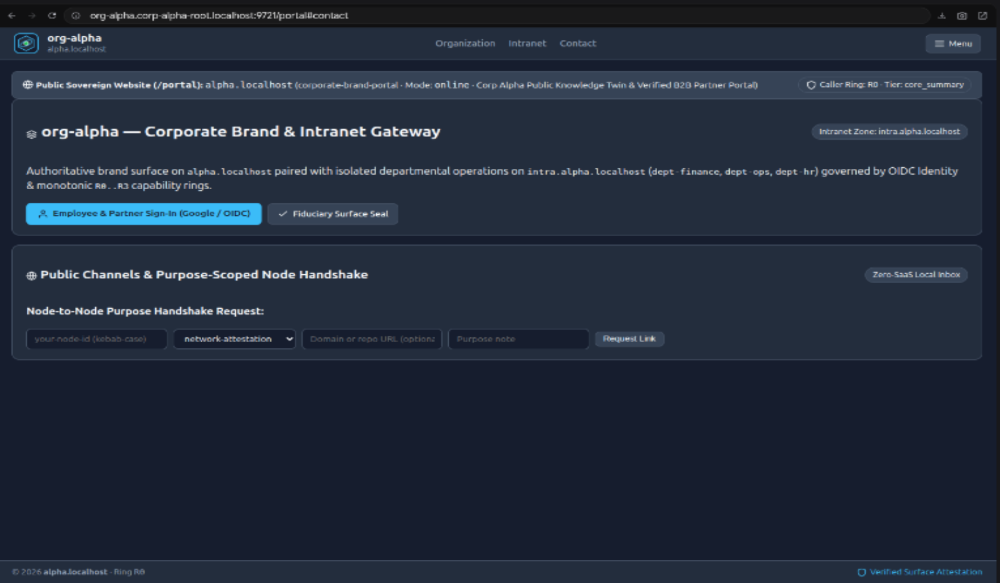

# Guide 06 — Act III (Enterprise Steps 2–3): Departments (`dept-*`), Company Projects & Public `pro` Portals (`org-*`)

> **Departmental Squad, Application Engineer & Public Portal Manual — Compositional Journey Step 6 of 8 (Tier 2 Progressive Disclosure)**
>
> Extend the Corporate `Root 0` (`~/Work/corp-alpha/corp-alpha-root` `:8710` from **[`Guide 05`](05_enterprise_root_and_organizational_scales.md)**) with **Step 2: a Functional Engineering Department (`dept-tech-eng` `:8725`)** and **Step 3: a Company Application Project (`:8780`) + Verified Public `pro` Portal (`org-alpha` `:8720`)**. Next: connect your Personal Constellation and Enterprise Hierarchy via minimal-disclosure HR/B2B links in **[`Guide 07`](07_federated_workflows_and_inter_node_links.md)**. For ASGI, security, and SDK contracts, see **[`Architecture 04`](../architecture/04_cockpit_and_intranet_surfaces.md)** and **[`Architecture 06`](../architecture/06_web_and_api_application_engine.md)**.

---

## 1. Enterprise Step 2 & Step 3: From `Root 0 (:8710)` $\rightarrow$ `Department (:8725)` $\rightarrow$ `Company Project (:8780)`

Initialize the Engineering Department (`1-hop` below `corp-alpha-root`), its public twin (`org-alpha`), and an application project (`alpha-partner-app`), completing the Browser-First Day-0 Studio on each node:

```bash
# Enterprise Step 2 — Engineering Department (:8725 -> http://dev.dept-tech-eng.alpha.localhost:8725/):
zcg bootstrap-workspace ~/Work/corp-alpha/dept-tech-eng \
  --id dept-tech-eng --role department --precedence 25 \
  --from-parent ~/Work/corp-alpha/corp-alpha-root \
  --templates science-base,software-engineering,google-cloud-iac,node-work-cockpit

# Public Corporate Twin (:8720 -> http://org-alpha.localhost:8720/):
zcg bootstrap-workspace ~/Work/corp-alpha/org-alpha \
  --id org-alpha --role knowledge --precedence 20 \
  --from-parent ~/Work/corp-alpha/corp-alpha-root \
  --templates business-base,corporate-operations,knowledge-stewardship-portal

# Enterprise Step 3 — Networked Company Web Application Project (:8080 / prec: 80):
zcg scaffold-web-app ~/Work/corp-alpha/alpha-partner-app \
  --id alpha-partner-app --parent-dir ~/Work/corp-alpha/dept-tech-eng --template software-engineering
```



### 1.1. Choosing Between `tool-stack`, Local Overlays, Custom `plugin-stack` Packs & `zcg.web` Projects

Select the cleanest architectural boundary so upstream `make sync` never conflicts with custom company code:

| Architectural Boundary | Primary Responsibility & Shell | Where Custom Files Live | Canonical Command |
| :--- | :--- | :--- | :--- |
| **1. `tool-stack` (`providers/` & `.zcg/tools/`)** | Headless CLI/MCP connectors, `bwrap` sandboxes, OCI/Cloud manifests, and OIDC presets (`0` web UI coupling). | `templates/tool-stack/<id>/` & `.zcg/tools/<id>/` | `zcg scaffold-template <id> --kind tool-stack` |
| **2. Community `plugin-stack` + Local Node Overlay** | Extend a community Reference Dashboard (`plugin_shell.html`) locally while keeping `templates/plugin-stack/*` **read-only**. | `<workspace>/surfaces/web/{routers,modules,templates,static}/` | `zcg scaffold-plugin-module node-work-cockpit <mod> --target-dir <ws>` |
| **3. Custom Departmental `plugin-stack` Pack** | Package a reusable organizational workbench or portal inside `dept-tech-eng` for downstream nodes (`org-alpha`). | `<dept>/templates/<custom-pack>/{routers,modules,web}/` | `zcg scaffold-template <pack> --kind plugin-stack && zcg scaffold-plugin-module <pack> <mod>` |
| **4. Bespoke Standalone or Networked `zcg.web` Project** | Build an independent product, brand website, or microservice directly over `zcg.web` (`base.html`, `0` `zcg.cockpit` dependency). | `<app-dir>/src/<pkg>/{domain,routers,app.py}` + `web/` | `zcg scaffold-web-app <app-dir> --id <app-id> [--standalone \| --parent-dir <node>]` |

When an internal department (`dept-ops-fin`, `precedence: 20`) shares precedence `20` with `org-alpha` (`:8720`), set `"cockpit_port": 8722` in `dept-ops-fin/system/zcg-node.json` for collision-free `*.localhost` routing.

---

## 2. Three Orthogonal Web Planes (`Workspace /`, `Node Admin /admin`, `User Settings /settings`) & Public `/portal` (`[CAP-10]`)

Every configured node cleanly separates **daily work**, **node administration**, **personal viewer ergonomics**, and **public external exposure**:

| Route & Plane | Ring Gate | Purpose & Key Capabilities |
| :--- | :---: | :--- |
| **`GET /` (`Workspace`)** *(alias `/dashboard`)* | `R2 / R3` *(or `R3` loopback)* | **Work-First Operational Home**: `Overview` (`Work & Collaboration Pulse` + active Git branches), 3-column Kanban **`Work Board`** (`Backlog -> To Do -> In Progress -> Done` + `Work Inbox` `1-Hop` channels), 3-origin **`Docs & Knowledge`** (`📍 This Node · 🏛️ Network / Parent · 📚 Corpora` with `SQLite FTS5` search & `.md` authoring), **`Network Atlas`** (interactive 2D/3D topology), and enabled domain modules. |
| **`GET /admin` (`Node Admin`)** | `R3_OPERATOR` | **8-Tab Exclusive Governance Stage (`?tab=`)**: `Health & Telemetry`, `Brand & Identity` (`web_theme` & logo upload), `Capabilities` (live zero-restart `On/Off` module toggles honoring `mandatory \| optional \| forbidden`), `Skills` (3-origin studio), `Tools & Sandboxes` (`.zcg/tools/` live inspection), `Network & Links`, `Public Exposure` (`online \| inbox-only \| members-only \| disabled`), and `Attachment Vault`. |
| **`GET/POST /settings` (`User Settings`)** | `R0..R3` | **Cross-Node Viewer Ergonomics (`0` Git Dirt)**: Interface language (`es\|en\|fr\|de\|it\|pt`), contrast (`dark`, `light`, `high-contrast`, `colorblind-safe` Okabe-Ito), font scale, and reduced motion stored in shared network cookies + `.zcg/runtime/user_prefs.json`. |
| **`GET /portal` (`Public Web`)** | `R1/R2` in `tst/pre` · `R0` in `pro` | **Public Website (`portal_shell.html`)**: Staging (`tst`/`pre`) requires OIDC sign-in so teams validate `R0..R3` permissions safely before `pro` opens anonymous `R0` access (`oss-flagship-portal`, `personal-portfolio-cv`, `corporate-brand-portal`) with `/.well-known/zcg-attestation.json` and `/docs` disabled (`404 DOCS_DISABLED`) in `pro`. |





> [!NOTE]
> **Live Browser Visual Capture — `[CAP-10]` (`Verified Public Corporate Brand Portal & Intranet Gateway`)**
> - Live `http://org-alpha.corp-alpha-root.localhost:9721/portal` displaying the `R0` public brand surface (`alpha.localhost`), isolated `Intranet Zone: intra.alpha.localhost` boundary, `Employee & Partner Sign-In (Google / OIDC)`, `Fiduciary Surface Seal`, and `Zero-SaaS Local Inbox` purpose-scoped B2B handshake form.

---

## 3. Transport Security Across the 4 Deployment Topologies (`HTTP` Loopback $\rightarrow$ `TLS 1.3` / `mTLS`)

`zcg.web` (`src/zcg/web/auth/tls.py`) transitions any node from local laptop development to dedicated servers or Cloud Run with zero code changes:

| Topology | Protocol & Certificate Strategy | Launch / Configuration Flags |
| :--- | :--- | :--- |
| **1. Sovereign Localhost (`127.0.0.1` / `*.localhost`)** | Plaintext loopback HTTP (native W3C `Secure Context` for `WebCrypto`, `Wallet Standard`, and `WebAuthn`; `0` `HSTS` pollution). | Default (`--host 127.0.0.1`). |
| **2. Managed Cloud (`Cloud Run` + `Cloud IAP`)** | Edge TLS 1.3 forwards `X-Forwarded-Proto: https` to the non-root container, activating `HSTS` and `; Secure` cookies. | `--host 0.0.0.0 --behind-tls-proxy --trusted-proxy 127.0.0.1 --trusted-proxy 169.254.0.0/16` |
| **3. On-Premise Intranet (`*.intranet.<domain>`)** | Reverse-proxy ACME or native stdlib OpenSSL 3 TLS 1.3 (`PLAINTEXT_NON_LOOPBACK_BLOCKED` blocks accidental LAN HTTP). | `--host 0.0.0.0 --tls-certfile /etc/zcg/fullchain.pem --tls-keyfile /etc/zcg/privkey.pem` |
| **4. Federated Peer / Remote `/mcp` (`mTLS`)** | Mutual TLS (`ssl.CERT_REQUIRED`) verifying client node certificates against the organizational CA. | Add `--tls-client-ca /etc/zcg/org-ca.pem` on `zcg.web.http.server` or `zcg-mcp --http-port`. |
