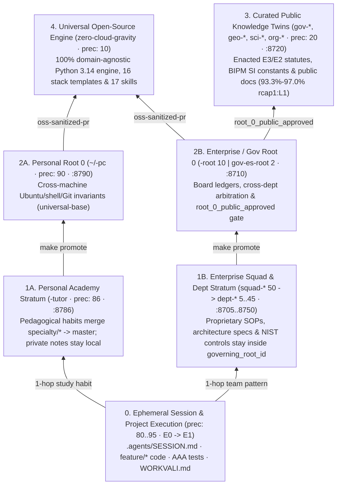
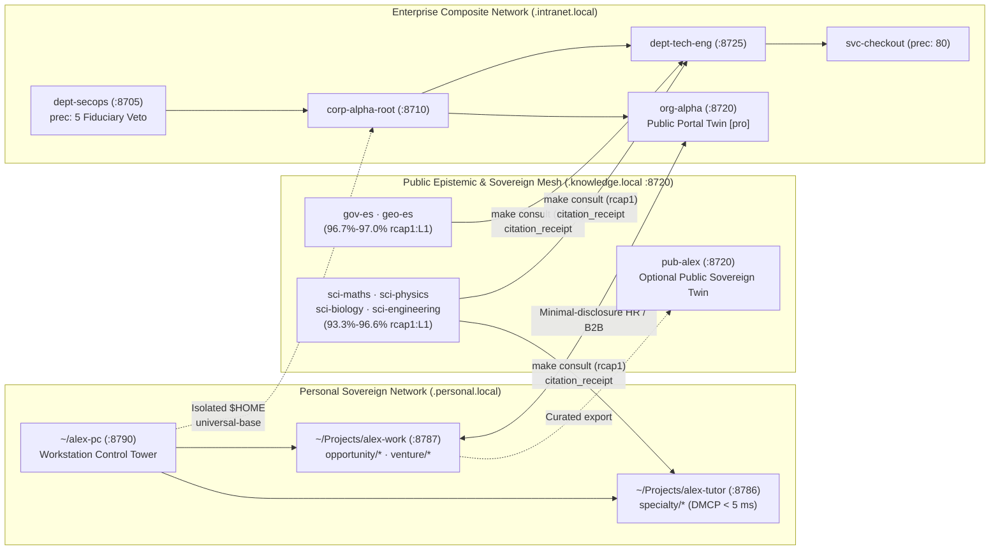
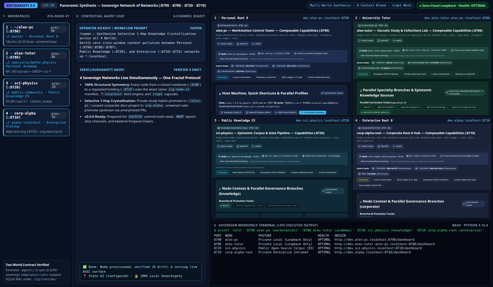

# Guide 06 — Global Synthesis: Crystallization of Knowledge & the "Network of Networks"

> **Panoramic Systems Architecture Synthesis (`Perspective 5.1` — Tier 2 Progressive Disclosure)**
>
> Unifies all operator perspectives (**[`Guide 01` Individual](01_workstation_and_global_profiles.md)**, **[`Guide 03` Academic](03_academic_student_perspectives.md)**, **[`Guide 04` Scientific & Public Knowledge](04_scientific_and_public_knowledge_perspectives.md)**, **[`Guide 05` Enterprise Scales](05_enterprise_perspectives_and_scales.md)**, **[`Guide 07` Personal Work & Spin-Outs](07_personal_work_and_b2b_links.md)**, and **[`Guide 08` Departmental Plugins & Public `pro` Portals](08_departmental_plugins_and_public_pro_surfaces.md)**) into one coherent **Network of Networks** model: showing how raw operational findings **crystallize upward `1-hop` at a time** to their rightful sovereignty boundary, how compacted `rcap1` / `DMCP` knowledge **hydrates downward and laterally on demand (`< 20 ms`)**, and how `v1.0.0` prepares the **`v2.0.0` Cryptographic Composite Node Network** horizon.

---

## 1. Selective Crystallization of Knowledge (`Session` $\rightarrow$ `Sovereign Stratum` $\rightarrow$ `Open Source`)

In conventional AI workflows, hard-won insights either vanish inside closed chat logs or get pasted indiscriminately into bloated global prompts. ZeroCloudGravity enforces **Selective `1-Hop` Crystallization (`/enrich` $\rightarrow$ `make promote`)**: every discovery rises *only* as high as its rightful legal, pedagogical, or epistemic scope allows, blocked from skipping tiers by `CROSS_TIER_PROMOTION_BYPASS` ([`Architecture 03`](../architecture/03_governance_and_work_ledger.md)):

The table below defines the exact **crystallization ceiling** for every category of knowledge:

| Knowledge Artifact Discovered in Practice | Rightful Crystallization Ceiling | Why Upward Leaks Beyond This Stratum Are Blocked |
| :--- | :--- | :--- |
| **Temporary task scratchpad or personal pace (`domain-*:M1..M4`)** | `.agents/SESSION.md` (`85..95`) | Keeps repository history clean of per-operator cognitive preferences. |
| **Subject syllabus, exam error log, or interdisciplinary proof** | `<persona>-tutor` (`specialty/*` $\rightarrow$ `master`, `86`) | Prevents academic domain rules from polluting `$HOME` (`universal-base`). |
| **Personal Ubuntu hardware packages & shell/Git ergonomics** | `~/<persona>-pc` (`machine/<host>` / `master`, `90`) | Keeps `~/.bashrc.local` secrets untracked and personal host manifests private. |
| **Proprietary company contracts, internal APIs, or SecOps gates** | `dept-*` (`5..45`) or `<corp>-root` (`10`) | `can_expose_to_oss: false` on subordinate layers blocks accidental external leaks. |
| **Enacted public laws, SI/ISO cut-points, or public product docs** | `gov-*`, `geo-*`, `sci-*`, or `org-*` (`20`, `:8720`) | Published only from curated `docs/` (`root_0_public_approved`), isolated from internal `corporate/ledgers/`. |
| **Domain-agnostic Python 3.14 / Antigravity governance primitives** | `zero-cloud-gravity` (`10`, Open Source) | Sanitized via `_RETIRED_TOKENS_RE` and verified across all `8/8` `make verify` gates. |

---

## 2. On-Demand Hydration Across the "Network of Networks" (`< 20 ms`, `0` Cloud Lock-In)

While **crystallization** moves verified abstractions upward cleanly, **hydration** pulls exact context downward and laterally on demand without exceeding Antigravity's `20,000`-token inline budget:

### 2.1. Complete `10`-Capture Visual Showcase Matrix (`[CAP-01..CAP-10]`)

Every perspective across Guides `01..08` pairs its workspace topology with a dedicated Native Python 3.14 ASGI `Z1..Z4` cockpit or public portal view (`data-zcg-surface="cockpit"`, `--zcg-*` design tokens, `.zcg-compass` orientation, `HTTP 286` poll control) captured in the canonical **3-Pane Google Antigravity Layout** (*Left: Workspaces · Center: Contextual Chat · Right: Node Web View + Terminal/Diff*):

| Capture ID | Perspective & Guide Section | Canonical `*.localhost` URL & Overlay / Scale | Embedded Screenshot Asset (`1680×980`) |
| :---: | :--- | :--- | :--- |
| **`[CAP-01]`** | `1.1` Individual `Root 0` Workstation ([`Guide 01 §6`](01_workstation_and_global_profiles.md)) | `http://dev.alex-pc.localhost:8790/dashboard` (`workstation-control-tower`) | [`cap_01_individual_workstation_control_tower.png`](../assets/screenshots/cap_01_individual_workstation_control_tower.png) |
| **`[CAP-02]`** | `1.2` School Student `M1..M2` ([`Guide 03 §2`](03_academic_student_perspectives.md)) | `http://dev.alex-tutor.alex-pc.localhost:8786/dashboard` (`school-student-m1-m2`) | [`cap_02_school_student_study_cockpit.png`](../assets/screenshots/cap_02_school_student_study_cockpit.png) |
| **`[CAP-03]`** | `1.3` University Specialties & `DMCP` ([`Guide 03 §3`](03_academic_student_perspectives.md)) | `http://dev.alex-tutor.alex-pc.localhost:8786/dashboard` (`university-specialty-m2-m3`) | [`cap_03_university_specialty_studio.png`](../assets/screenshots/cap_03_university_specialty_studio.png) |
| **`[CAP-04]`** | `2.2` Researcher & `3.1` Public `Knowledge` ([`Guide 04 §2–3`](04_scientific_and_public_knowledge_perspectives.md)) | `http://dev.sci-physics.localhost:8720/dashboard` (`knowledge-stewardship-portal`) | [`cap_04_scientific_and_public_knowledge_portal.png`](../assets/screenshots/cap_04_scientific_and_public_knowledge_portal.png) |
| **`[CAP-05]`** | `4.1` Small Startup (`1–2` Levels, [`Guide 05 §2.1`](05_enterprise_perspectives_and_scales.md)) | `http://dev.nova.localhost:8710/dashboard` (`small-startup`) | [`cap_05_small_startup_compact_hub.png`](../assets/screenshots/cap_05_small_startup_compact_hub.png) |
| **`[CAP-06]`** | `4.2` Medium Scaleup (`2–3` Levels, [`Guide 05 §2.2`](05_enterprise_perspectives_and_scales.md)) | `http://dev.alpha.localhost:8710/dashboard` (`medium-scaleup`) | [`cap_06_medium_scaleup_departmental_hub.png`](../assets/screenshots/cap_06_medium_scaleup_departmental_hub.png) |
| **`[CAP-07]`** | `4.3` Regulated Enterprise & SecOps Veto ([`Guide 05 §2.3`](05_enterprise_perspectives_and_scales.md)) | `http://pro.dept-secops.titan.localhost:8705/dashboard` (`secops-mcp-guardian`) | [`cap_07_large_regulated_enterprise_secops.png`](../assets/screenshots/cap_07_large_regulated_enterprise_secops.png) |
| **`[CAP-08]`** | `5.1` Panoramic "Network of Networks" *(this guide)* | Multi-node `:8790` + `:8786` + `:8720` + `:8710` `*.localhost` mesh | [`cap_08_network_of_networks_panoramic_synthesis.png`](../assets/screenshots/cap_08_network_of_networks_panoramic_synthesis.png) |
| **`[CAP-09]`** | `1.4` Personal Work Hub & Spin-Off Studio ([`Guide 07 §2–3`](07_personal_work_and_b2b_links.md)) | `http://dev.alex-work.alex-pc.localhost:8787/dashboard` (`personal-work-cockpit`) | [`cap_09_personal_work_and_spinout_studio.png`](../assets/screenshots/cap_09_personal_work_and_spinout_studio.png) |
| **`[CAP-10]`** | `4.4` Departmental Plugin & Public `pro` Portal ([`Guide 08 §1–2`](08_departmental_plugins_and_public_pro_surfaces.md)) | `http://org-alpha.localhost:8720/dashboard` & `/?env=pro` (`alpha-public-portal`) | [`cap_10_departmental_plugin_and_public_pro_portal.png`](../assets/screenshots/cap_10_departmental_plugin_and_public_pro_portal.png) |

> [!NOTE]
> **3-Pane Antigravity Visual Capture — `[CAP-08]` (`Panoramic Network of Networks Synthesis`)**
> - **Left Pane (Workspaces)**: Multi-world view showing Personal `Root 0` (`~/alex-pc :8790`), Personal Academy (`alex-tutor :8786`), Public `Knowledge` (`sci-physics :8720`), and Enterprise `Root 0` (`corp-alpha-root :8710`) coexisting cleanly without context bleed.
> - **Center Pane (Contextual Chat)**: Selective `1-Hop` Knowledge Crystallization & `rcap1` mesh synthesis verifying zero cross-window rule pollution across personal, public, and corporate workspaces.
> - **Right Pane (`2×2` Quad Web Views + Terminal)**: Simultaneous live `*.localhost` dashboards across `:8790`, `:8786`, `:8720`, and `:8710` paired with multi-node posture & health status.

---

## 3. Horizon `ZeroCloudGravity v2.0.0`: Cryptographic Composite Node Networks (`T_chain` + $\Delta t$)

While `v1.0.0` establishes deterministic local, Git, and `.local` intranet orchestration across Composite Node Networks, the **`v2.0.0` architectural horizon** extends the exact same triadic `Node × Layer × Network` graph to distributed cryptographic verification:
1. **Commit-Hash Chained Capability Tokens ($T_{\text{chain}}$)**: Binds inter-node and inter-plugin communications (`framework-stack`, `plugin-stack`, Ephemeral MCP translators, and native Google Workspace / Google Cloud / Antigravity SDK connectors) to `HMAC-SHA256(commit_hash_slice || tree_sha || Δt || capability_ring)` proofs of `entity_identity`, `precedence` (`0..100`), RBAC role, and `visibility_scope`.
2. **Sensitivity-Adaptive Elapsed-Time Validation ($\Delta t = t_{\text{now}} - t_{\text{commit}}$)**:
   - **Critical / Fiduciary Regime (`dept-secops`, `dept-legal-ip`, AuthZ/RBAC, Ring `W`/`R2`)**: Enforces strict tip verification ($\Delta c = 0$, minimal $\Delta t$) so fiduciary vetoes and credential revocations take effect immediately.
   - **Operational Production & Public Reference Regime (`org-*`, `sci-*`, `gov-*`, `geo-*`, Ring `R0`/`R1`)**: Applies a configurable $\Delta t$ stabilization/cooldown margin giving operators a safe reaction window for rollbacks or hotfixes before external federated networks ingest new commits, while keeping historical states inspectable in $O(\log N)$ via zero-checkout `DMCP` ([`Architecture 05`](../architecture/05_contextual_mcp_and_capsules.md)).
