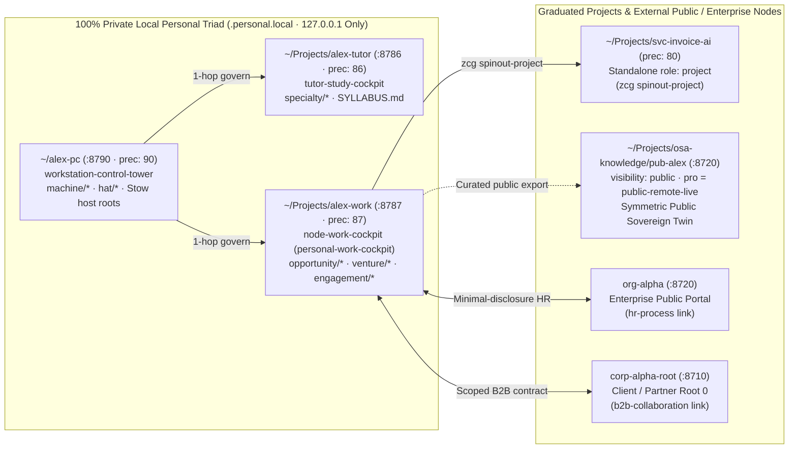
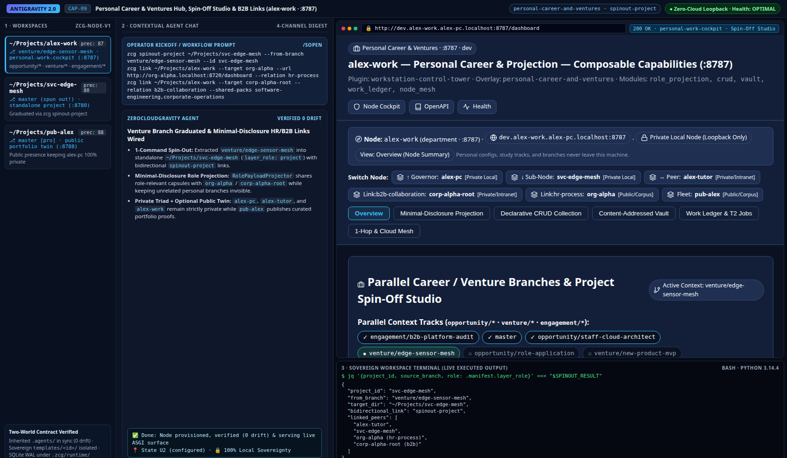

# Guide 07 — Personal Career & Ventures Hub (`<persona>-work`), `zcg spinout-project` & Declarative B2B / HR Links

> **Sovereign Individual Career, Venture Incubation & Minimal-Disclosure Collaboration Manual (Tier 2 Progressive Disclosure)**
>
> Step-by-step operator guide completing the **Personal Sovereign Triad** (**[`Guide 01` Workstation `~/<persona>-pc` `:8790`](01_workstation_and_global_profiles.md)** + **[`Guide 03` Academy `~/Projects/<persona>-tutor` `:8786`](03_academic_student_perspectives.md)** + **Career & Ventures Hub `~/Projects/<persona>-work` `:8787`**) alongside optional **Public Sovereign Twins (`pub-<persona>` `:8720`)**, branch-to-repo graduation (`zcg spinout-project`), and stage-gated HR/B2B projection (`zcg link` + `RolePayloadProjector`). For normative contracts, see **[`Architecture 01`](../architecture/01_core_and_node_manifest.md)**, **[`Architecture 03`](../architecture/03_governance_and_work_ledger.md)**, and **[`Architecture 04`](../architecture/04_cockpit_and_intranet_surfaces.md)**.

---

## 1. The Personal Sovereign Triad (`:8790` · `:8786` · `:8787`) & Optional `pub-<persona>` Public Twin

An individual professional needs a clean separation between physical host configuration, academic study tracks, private career/venture incubation, and whatever public presence they voluntarily expose to external peers. ZeroCloudGravity enforces this boundary structurally through three `127.0.0.1`-only personal nodes plus an optional public twin:



### 1.1. Privacy Firewall & Symmetric Public Participation (`pub-<persona>`)

The table below defines the exposure posture and sovereignty boundary of each personal node:

| Personal Node Archetype | Default Role, Precedence & Port | Exposure Posture (`classify_exposure_posture`) | What Stays Inside vs. What Crosses the Boundary |
| :--- | :--- | :--- | :--- |
| **`~/<persona>-pc`** (`alex-pc`) | `workstation`, `90`, `:8790` | `private-personal` (`Private Local · 127.0.0.1`) | Ubuntu `system/*` manifests, Stow host roots (`bash/`, `git/`, `antigravity/`), and `machine/*` hardware profiles never leave the host. |
| **`~/Projects/<persona>-tutor`** (`alex-tutor`) | `department`, `86`, `:8786` | `private-personal` (`Private Local · 127.0.0.1`) | `specialty/*` branches, `WORKVALI.md` exam logs, and linked `sci-*` / `gov-*` `knowledge-feed` mounts remain private. |
| **`~/Projects/<persona>-work`** (`alex-work`) | `department`, `87`, `:8787` | `private-personal` (`Private Local · 127.0.0.1`) | Private CVs, salary targets, incubated `venture/*` prototypes, and client notes stay local; only stage-projected capsules leave. |
| **`pub-<persona>`** (`pub-alex`, *optional*) | `knowledge`, `88` (or `20`), `:8720` | `public-live` (`pro = public-remote-live`) | Dedicated public portfolio, open research, or verified sovereign identity twin participating on non-preferential equal footing alongside `gov-*`, `geo-*`, `sci-*`, and `org-*` nodes. |

### 1.2. Bootstrapping `<persona>-work` (`:8787`) & Optional `pub-<persona>` (`:8720`)

Run the following CLI sequence to initialize `<persona>-work` under your personal `Root 0` (`~/alex-pc`) and optionally create a `pub-alex` public twin:

```bash
# 1. Bootstrap the private Personal Career & Ventures Hub (:8787):
zcg bootstrap-workspace ~/Projects/alex-work \
  --id alex-work --role department --precedence 87 --entity-kind individual \
  --parent-dir ~/alex-pc --templates universal-base,business-base,software-engineering,node-work-cockpit

# 2. Optional: bootstrap a dedicated Public Sovereign Twin (keeping ~/alex-pc 100% private):
zcg bootstrap-workspace ~/Projects/osa-knowledge/pub-alex \
  --id pub-alex --role knowledge --precedence 20 --entity-kind individual \
  --templates universal-base,science-base,knowledge-stewardship-portal
```

---

## 2. Parallel Context Tracks & Graduating Prototypes via `zcg spinout-project`

Inside `~/Projects/alex-work`, parallel Git branches isolate distinct professional pursuits without multiplying repositories prematurely:
- **`master`**: Consolidated career ledger, reusable engineering/consulting templates, and active `linked_nodes` registry.
- **`opportunity/<company-role>`**: Tailored role evidence, architecture case studies, and interview preparation for a specific application.
- **`venture/<product-slug>`**: Early-stage product MVP, domain model, and `AAA` test suite incubated privately before incorporation.
- **`engagement/<client-slug>`**: Scoped B2B consulting deliverables and sprint ledgers prior to client handoff.

### 2.1. Interactive Spin-Off Preview & Deterministic CLI Graduation (`layer_role: "project"`)

Once a `venture/*` or `engagement/*` branch matures into a real product or client repository, graduate it into an independent `layer_role: "project"` workspace (`precedence: 80`) either from the **Project Spin-Off Studio** card at `http://127.0.0.1:8787/dashboard` (`GET /api/modules/node-context/spinout-preview`) or directly via CLI:

```bash
# Graduate venture/invoice-ai into a standalone governed project repository:
zcg spinout-project ~/Projects/svc-invoice-ai \
  --source-dir ~/Projects/alex-work \
  --from-branch venture/invoice-ai \
  --id svc-invoice-ai \
  --templates science-base,software-engineering,google-cloud-iac,node-work-cockpit
```

`spinout_branch_to_project` exports the target Git tree cleanly while **stripping parent governance state** (`system/zcg-node.json`, `Makefile`, `WORK*`, `BACKLOG.md`, `.agents/`, `surfaces/`, `templates/`), bootstraps a fresh `zcg-node-v1` manifest (`layer_role: "project"`, `precedence: 80`), and registers a bidirectional `spinout-project` link between `alex-work` and `svc-invoice-ai`.

---

## 3. Declarative Links (`zcg link`/`unlink`) & Stage-Gated HR / B2B Projection

Rather than copying repositories into `layers/*` subtrees when collaborating across independent sovereign boundaries, `<persona>-work` uses zero-copy **declarative node links** (`system/zcg-node.json -> linked_nodes`) paired with **`RolePayloadProjector`** ([`src/zcg/platform/projection.py`](../../src/zcg/platform/projection.py)):

| Exchange Stage (`ExchangeStage`) | Declarative Link Relation | Allowed Fields Crossed | Blocked Private Fields (`0` Over-Disclosure) |
| :--- | :--- | :--- | :--- |
| **`CANDIDATE_SELECTION`** | `hr-process` $\rightarrow$ `org-alpha` (`:8720`) | `candidate_handle`, `target_role`, `verified_skills`, `portfolio_links`, `availability_window` | Government ID, tax/SSN numbers, bank IBAN, home street address, private salary floor, medical data |
| **`DAY_ONE_ONBOARDING`** | `hr-process` $\rightarrow$ `corp-alpha-root` (`:8710`) | Selection fields + `legal_full_name`, `tax_identifier`, `payroll_iban`, `emergency_contact` | Unrelated `venture/*` IP branches, other `opportunity/*` applications, personal `~/alex-pc` configs |
| **`B2B_ENGAGEMENT`** | `b2b-collaboration` $\rightarrow$ `corp-alpha-root` | `provider_entity`, `StatementOfWork` deliverables, `shared_packs` (`software-engineering`), SLA metrics | Personal payroll records, private academic `alex-tutor` notes, and third-party client ledgers |

```bash
# Link org-alpha for minimal-disclosure HR selection and corp-alpha-root for B2B delivery:
zcg link ~/Projects/alex-work --target org-alpha --url http://org-alpha.localhost:8720/dashboard --relation hr-process
zcg link ~/Projects/alex-work --target corp-alpha-root --ref ~/Projects/corp-alpha-root \
  --relation b2b-collaboration --shared-packs software-engineering,corporate-operations

# Consult public role requirements or shared B2B specs in < 20 ms without merging repos:
zcg consult-layer ~/Projects/alex-work --layer org-alpha --query "engineering role competencies"
```



> [!NOTE]
> **3-Pane Antigravity Visual Capture — `[CAP-09]` (`Personal Career & Ventures Hub :8787 · Spin-Off Studio`)**
> - **Left / Center / Right Panes**: `alex-work (:8787)`, spun-out `svc-edge-mesh (:8780)`, and public twin `pub-alex (:8788)` in Workspaces; `zcg spinout-project` & `zcg link` workflow in Center Chat; live `http://dev.alex-work.alex-pc.localhost:8787/dashboard` showing `.zcg-compass` (`Private Local Node`), directional **Switch Node** bar (`↑ Governor: alex-pc`, `↓ Sub-Node: svc-edge-mesh`, `↔ Peer: alex-tutor`, `Link:b2b-collaboration: corp-alpha-root`, `Link:hr-process: org-alpha`, `Fleet: pub-alex`), and **Project Spin-Off Studio** in Right Pane.
