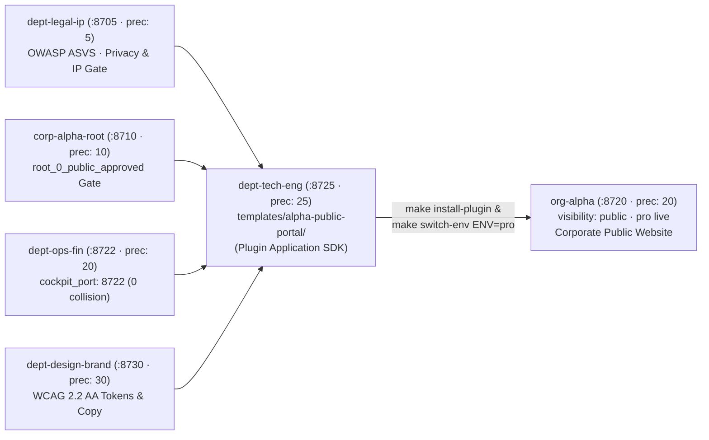
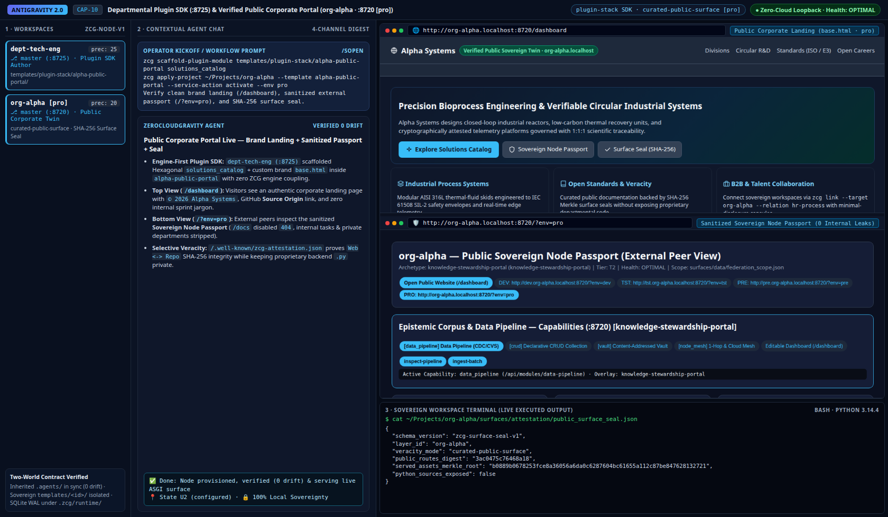

# Guide 08 — Departmental `plugin-stack` Engineering & Public `pro` Twin Portals (`org-*` & `pub-*`)

> **Departmental Squad, Brand/Legal Reviewer & Public Portal Operator Manual (Tier 2 Progressive Disclosure)**
>
> Step-by-step guide demonstrating how an engineering department (`dept-tech-eng`, `precedence: 25`, `:8725`) authors a **100% decoupled, reusable corporate `plugin-stack` web pack** honoring multi-departmental governance (`5 -> 10 -> 20 -> 25 -> 30`) and deploys it in **`pro` (`public-remote-live`)** onto a public twin (`org-alpha` `:8720` or `pub-alex` `:8720`) without polluting the `ZeroCloudGravity` engine. For ASGI, security, and SDK contracts, see **[`Architecture 04`](../architecture/04_cockpit_and_intranet_surfaces.md)**, **[`Architecture 06`](../architecture/06_web_and_api_application_engine.md)**, and **[`Reference 01`](../reference/01_stack_and_plugin_matrix.md)**.

---

## 1. Authoring Reusable Corporate `plugin-stack` Packs Inside `dept-tech-eng` (`:8725`)

Corporate portals, partner hubs, and domain workbenches belong in **sovereign `plugin-stack` packs** (`templates/<plugin-id>/`), never hardcoded inside `src/zcg/`. This keeps the Open-Source engine 100% brand-agnostic while letting any organization or individual build rich, zero-dependency Python 3.14 Native ASGI applications:



### 1.1. Scaffolding Custom Hexagonal Plugin Modules & Collision-Free Departmental Ports

1. **Collision-Free Departmental Port Override (`cockpit_port`)**: By default, `ZeroCloudGravity` assigns `8700 + precedence`. When an internal department (`dept-ops-fin`, `precedence: 20`) coexists alongside a public `knowledge` twin (`org-alpha`, `precedence: 20`, `:8720`), set `"cockpit_port": 8722` in `dept-ops-fin/system/zcg-node.json`. Both `discover_network_topology` and `build_cross_node_links` propagate `:8722` automatically across every peer's **Switch Node** bar.
2. **Scaffolding a Plugin Pack & Bounded-Context `APIRouter`**: Inside `dept-tech-eng`, create `templates/alpha-public-portal/template.json` (`stack_group: "plugin-stack"`) with editable `web/templates/{index.html,partials/overview.html}` and `web/static/css/plugin.css`, then scaffold Hexagonal backend routes:

```bash
# Scaffold a Hexagonal DomainEntity + SQLite WAL Repository + APIRouter inside the plugin pack:
zcg scaffold-plugin-module ~/Projects/corp-alpha-org/dept-tech-eng/templates/alpha-public-portal \
  partner-inquiries

# Install and promote the corporate portal onto the public twin org-alpha (:8720) in 'pro':
zcg apply-project ~/Projects/osa-knowledge/org-alpha \
  --parent-dir ~/Projects/corp-alpha-org/dept-tech-eng \
  --template alpha-public-portal --service-action deploy --env pro
```

At runtime, `load_plugin_routers` ([`src/zcg/cockpit/plugin_sdk.py`](../../src/zcg/cockpit/plugin_sdk.py)) validates path containment (`PATH_CONTAINMENT_VIOLATION`), rejects world-writable files (`UNSAFE_PLUGIN_ROUTER_PERMISSIONS`), mounts `/api/plugins/<plugin-id>/<module>`, and stores SQLite WAL state strictly under `<workspace>/.zcg/runtime/` **outside Git** so live visitor interactions never dirty the curated public repository.

---

## 2. Public `pro` Surfaces (`org-*` & `pub-*`) vs. Internal Intranet Cockpits

When a node runs in `pro` with `visibility: "public"` (`org-alpha` or `pub-alex` on `:8720`), its HTTP routes enforce a strict separation between **external public visitors**, **external peer node verification**, and **internal operator tooling**:

| HTTP Endpoint | Behavior on Public Twin in `pro` (`org-alpha :8720`) | Behavior on Internal Node in `dev` (`dept-tech-eng :8725`) | Security & UX Rationale |
| :--- | :--- | :--- | :--- |
| **`GET /dashboard`** | **Corporate Public Website Landing**: Clean brand navigation, Hero, circular process strip, division cards, and discreet footer links (`0` internal sprint jargon or `.zcg/runtime/` header clutter). | **Internal Modular Workbench**: `.zcg-compass` orientation banner, directional `.zcg-node-nav` **Switch Node** bar, archetype spotlight, and interactive `crud` / `vault` / `work-ledger` tabs. | Visitors experience an authentic institutional website; employees get a dense operational workbench. |
| **`GET /?env=pro`** *(or `/`)* | **Public Sovereign Node Passport (`External Peer View`)** (`cockpit_posture: "public-passport"`): Exposes verified public identity, `zcg link` peer commands, and `Open Public Website (/dashboard)` CTA while stripping `active_node_tasks`, private sibling `fleet_plugin_inventory`, and internal `lateral_peers`. | **Internal Sovereign Operator Cockpit (`Private / Intranet View`)** (`cockpit_posture: "internal-operator"`): Full `Z1..Z4` operator cockpit with active sprint tasks, internal `1-hop` peers, and lifecycle commands. | Prevents internal roadmap titles and private department topology from leaking on public nodes. |
| **`GET /docs`** | **`404 DOCS_DISABLED` (`severity: "INFO"`)**: Intentional OWASP ASVS production hardening (`DocsAccessMode.DISABLED`) returning an informative `user_hint` pointing visitors to `/dashboard` and `/healthz`. | **`200 OK` Zero-Build OpenAPI 3.1 HTML Explorer**: Styled route table (`Method`, `Path`, `DeliveryChannel`, `Summary`) with links to `/dashboard` and raw `/openapi.json`. | Eliminates unauthenticated API reconnaissance in production while giving developers instant local route discovery. |
| **`GET /healthz`** | **`200 OK` JSON Liveness & Telemetry Probe** (linked discreetly in the website footer). | **`200 OK` JSON Liveness & Telemetry Probe** (`OPTIMAL \| DEGRADED \| PROTECTIVE \| CRITICAL`). | Follows the Google Borg / Kubernetes / Cloud Run `"z-pages"` (`healthz`) standard so infrastructure probes never collide with `/health` business routes. |

### 2.1. Global Orientation Compass (`.zcg-compass`) & Cross-Node Switcher (`.zcg-node-nav`)

Across all `6` built-in `plugin-stack` Reference Dashboards (`workstation-control-tower`, `tutor-study-cockpit`, `node-work-cockpit`, `corporate-root-hub`, `secops-mcp-guardian`, `knowledge-stewardship-portal`), [`build_node_dashboard_enrichment`](../../src/zcg/cockpit/orientation_ui.py) provides consistent spatial awareness:
1. **Where Am I? (`.zcg-compass`)**: Displays the active `layer_id`, `layer_role`, loopback `:port`, clickable RFC 6761 `*.localhost` subdomain (`http://<env>.<node>.<net>.localhost:<port>/dashboard`), `ExposurePosture` badge (`Private Local · 127.0.0.1`, `Private Enterprise Intranet`, `Public Twin Preview`, or `Public Live Surface`), and a live `View:` indicator (`Overview (Node Summary)` $\leftrightarrow$ `<Capability> (Dedicated View)`) updated dynamically by `zcg-swap.js`.
2. **Where Am I Going? (`.zcg-node-nav`)**: Renders directional pills (`↑ Governor`, `↓ Sub-Node`, `↔ Peer`, `🔗 <relation>`, `⚡ Fleet`) tagged explicitly with target visibility (`[Private Local]`, `[Private/Intranet]`, `[Public/Corpus]`) so operators always know whether a click stays inside private intranet space or crosses into a public twin surface.

### 2.2. `Root 0` Domain & DNS Governance (`*.localhost`), Source-Origin Footer & Selective `Web <-> Repo` Veracity

Sovereign governors declare domain, DNS delegation, copyright provenance, and web veracity once at `Root 0` ([`src/zcg/cockpit/provenance.py`](../../src/zcg/cockpit/provenance.py)) without modifying `/etc/hosts` or exposing proprietary backend code:

| Governance Capability | Declarative Configuration & Runtime Artifact | Operator & Public Visitor Experience |
| :--- | :--- | :--- |
| **1. `Root 0` `domain_governance` & RFC 6761 `*.localhost`** | Declared in `corp-alpha-root/system/zcg-node.json` (`canonical_domain`, `intranet_zone`, `local_dev_zone`, `dns_authority`); materializes `surfaces/infra/dns_zone_manifest.json` (`disabled-private-loopback` on personal nodes). | Child nodes (`dept-tech-eng`, `org-alpha`) inherit the network domain automatically and resolve natively via `http://dev.dept-tech-eng.alpha.localhost:8725/dashboard` and `http://org-alpha.localhost:8720/dashboard` (`0` root edits). |
| **2. Copyright & Source-Origin Repository Footer** | `render_provenance_footer_html` normalizes SSH/HTTPS Git remotes (`https://github.com/<owner>/<repo>`) and enforces `is_public_pro` privacy filtering. | Every dashboard and cockpit footer renders `© 2026 <Entity>`, active domain, 1-click GitHub **Source Origin** link (linking *only* the public `org-*`/`pub-*` twin in `pro`), and `/.well-known/zcg-attestation.json`. |
| **3. Selective `surface_veracity_mode` (`Zero Forced Code Exposure`)** | `"full-open-source"` (`sci-*/gov-*/geo-*`), `"curated-public-surface"` (default for `org-*` / `pub-*` — backend `routers/*.py` stay private in `dept-tech-eng`), or `"attestation-only"` (`0` web code in Git). | `GET /.well-known/zcg-attestation.json` serves live SHA-256 commitments (`public_routes_digest` + `served_assets_merkle_root` matching `surfaces/attestation/public_surface_seal.json`), proving bidirectional `Web <-> Repo` legitimacy without exposing proprietary code. |



> [!NOTE]
> **3-Pane Antigravity Visual Capture — `[CAP-10]` (`Departmental Plugin Squad :8725 & Public Corporate Portal :8720 [pro]`)**
> - **Left / Center / Right Panes**: `dept-tech-eng (:8725)` + `org-alpha [pro] (:8720)` in Workspaces; `zcg scaffold-plugin-module` & `zcg apply-project --env pro` workflow in Center Chat; split live view of `http://org-alpha.localhost:8720/dashboard` (Corporate Public Website Landing) + `http://org-alpha.localhost:8720/?env=pro` (Sanitized **Public Sovereign Node Passport**) + `public_surface_seal.json` in Right Pane.
