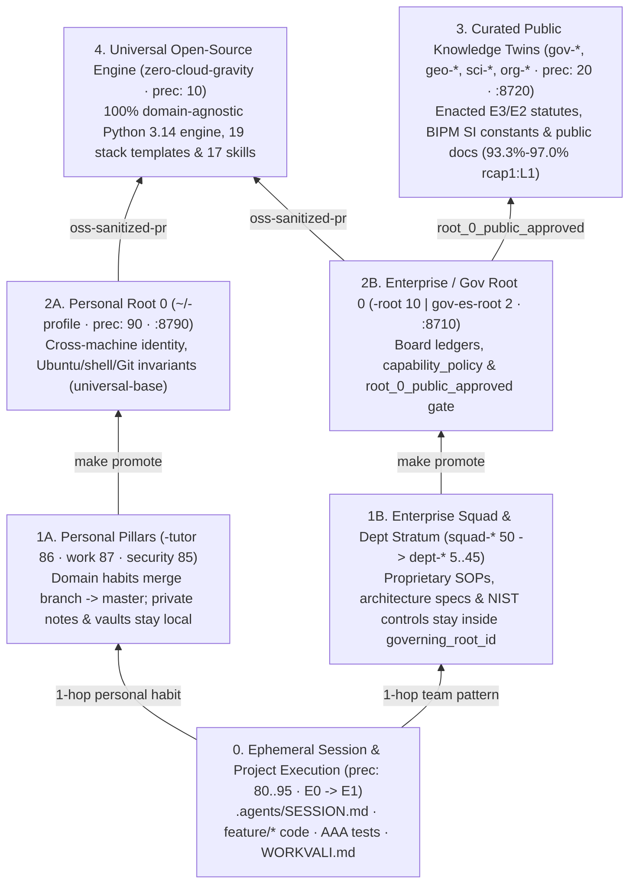
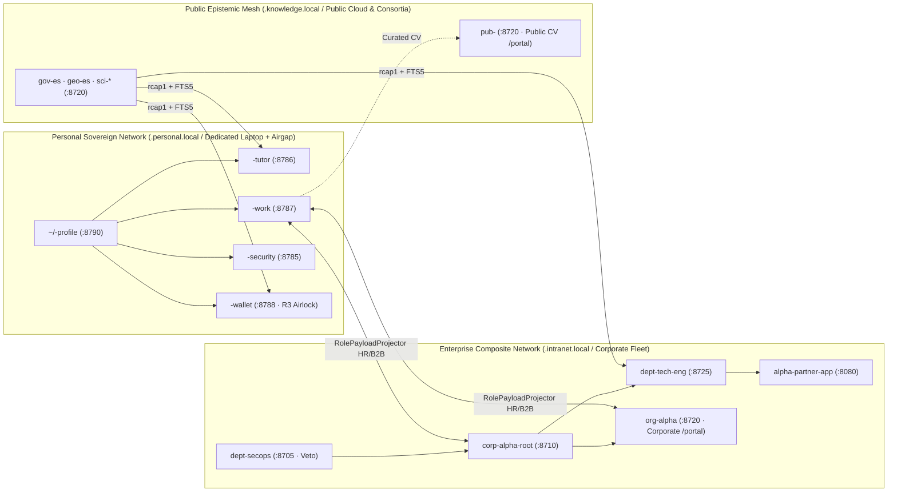
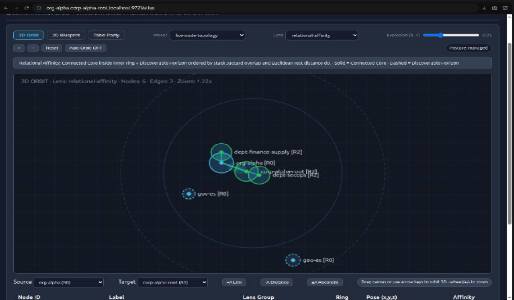
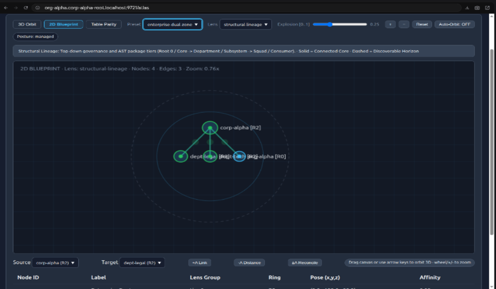
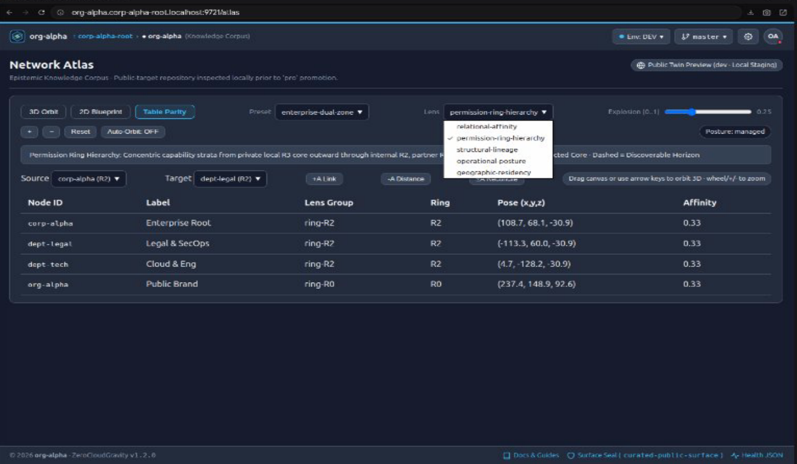

# Guide 08 — Act IV (Global Synthesis): Knowledge Crystallization, Local-to-Distributed Isomorphism & the "Network of Networks"

> **Panoramic Systems Architecture Synthesis — Compositional Journey Step 8 of 8 (Tier 2 Progressive Disclosure)**
>
> Unifies every node built across **[`Guides 01–07`](01_personal_workstation_and_day0_setup.md)**—Personal Constellation (`:8785..:8790`), Public Knowledge Corpora (`:8720`), and Enterprise Hierarchy (`:8705..:8780`)—into one coherent **Network of Networks** model: demonstrating **Selective `1-Hop` Knowledge Crystallization**, **`< 20 ms` On-Demand Hydration**, the **`1:1` Isomorphism between a Single Laptop (`*.localhost`) and Dedicated Distributed Infrastructure**, the **`10`-Capture Showcase Gallery (`[CAP-01..CAP-10]`)**, and the **`v2.0.0` Cryptographic Horizon**.

---

## 1. Selective Crystallization of Knowledge (`Session` $\rightarrow$ `Sovereign Stratum` $\rightarrow$ `Open Source`)

Rather than losing insights inside closed chat threads or dumping proprietary details into global prompts, ZeroCloudGravity enforces **Selective `1-Hop` Crystallization (`/enrich` $\rightarrow$ `make promote`)**: every discovery rises *only* to its rightful legal, pedagogical, or epistemic ceiling (`CROSS_TIER_PROMOTION_BYPASS` in [`Architecture 03`](../architecture/03_governance_and_work_ledger.md)):



The table below maps each discovered knowledge artifact to its rightful crystallization ceiling:

| Knowledge Artifact Discovered in Practice | Rightful Crystallization Ceiling | Why Upward Leaks Beyond This Stratum Are Blocked |
| :--- | :--- | :--- |
| **Temporary scratchpad or personal pace (`domain-*:M1..M4`)** | `.agents/SESSION.md` (`85..95`) & `User Settings (/settings)` | Keeps Git history clean of per-operator cognitive and visual preferences. |
| **Subject syllabus, exam log, venture prototype, or security runbook** | `<persona>-{tutor,work,security,wallet,game}` (`85..89`) | Isolates personal domains from `$HOME` (`universal-base`) and external peers. |
| **Personal Ubuntu hardware packages & shell/Git ergonomics** | `~/<persona>-profile` (`machine/<host>` / `master`, `90`) | Keeps `~/.bashrc.local` secrets untracked and personal host manifests private. |
| **Proprietary company contracts, internal APIs, or SecOps gates** | `dept-*` (`5..45`) or `<corp>-root` (`10`) | `can_expose_to_oss: false` on subordinate layers blocks accidental external leaks. |
| **Enacted public laws, SI/ISO cut-points, or public product docs** | `gov-*`, `geo-*`, `sci-*`, or `org-*` (`20`, `:8720`) | Published only from curated `docs/` (`root_0_public_approved`), isolated from `corporate/ledgers/`. |
| **Domain-agnostic Python 3.14 / Antigravity governance primitives** | `zero-cloud-gravity` (`10`, Open Source) | Sanitized via `_RETIRED_TOKENS` and verified across all `8/8` `make verify` gates. |

---

## 2. Single-Machine (`*.localhost`) $\leftrightarrow$ Dedicated Distributed Fleet Isomorphism

Because every node you built in Guides `01..07` is already an **independent Git repository, process, SQLite WAL runtime (`.zcg/runtime/`), and HTTP origin (`*.localhost:<port>`)**, moving from a single developer laptop to dedicated physical machines, airgapped vaults, departmental servers, and `scale-to-zero` cloud containers requires **zero architectural or code changes**:

| Node Built Locally in Guides `01–07` | On One Laptop (`127.0.0.1` · `*.localhost`) | Across Dedicated Real-World Infrastructure (`0` Code Rewrite) |
| :--- | :--- | :--- |
| **`~/<persona>-profile` (`:8790`) + `<persona>-{tutor,work,security,game}`** | Separate folders under `$HOME` & `~/Projects/*` bound to `127.0.0.1:8785..8790`. | Operator's encrypted Ubuntu 26.04 workstation(s) synchronized across desktop & laptop via `machine/<hostname>` + `zcg-sync`. |
| **`<persona>-wallet` (`:8788` `R3` Airlock)** | Local directory with `WALLET_EXTERNAL_LINK_BLOCKED` & `loopback-only` egress. | Dedicated airgapped / hardware-isolated personal mini-PC or offline vault pulling verified settlement digests unidirectionally. |
| **`gov-*`, `geo-*`, `sci-*` (`:8720` Corpora)** | Local clones or `layers/*` subtrees queried in `< 20 ms` via `rcap1` / `FTS5`. | Public ministry, academic consortium, or CDN-backed `scale-to-zero` containers serving signed `rcap1` capsules & `/mcp` worldwide. |
| **`corp-alpha-root` (`:8710`) & `dept-secops` (`:8705`)** | `~/Work/corp-alpha/*` with local `network_session.key` SSO on `*.alpha.localhost`. | Dedicated executive & SecOps bastion servers on `*.alpha.net` (`intranet_zone`) with TLS 1.3 / mTLS and Cloud Identity OIDC groups. |
| **`dept-tech-eng` (`:8725`) & `alpha-partner-app` (`:8080`)** | Sibling folders exchanging tasks via `Work Inbox` & `1-Hop` Kanban channels. | Independent engineering cluster / CI runners promoting `dev -> tst -> pre -> pro` (`make env-gate`) into isolated production containers. |
| **`org-alpha` & `pub-<persona>` (`:8720` `/portal`)** | Local `pro` preview (`http://org-alpha.localhost:8720/portal`). | Keyless Cloud Run `scale-to-zero` or self-hosted OCI edge (`https://alpha.com` / `https://<persona>.org`) with `/.well-known/zcg-attestation.json`. |



---

## 3. Complete `10`-Capture Visual Showcase Gallery (`[CAP-01..CAP-10]`) & Showcase Stager

Every stage of the 4-Act journey pairs its topology with a Native Python 3.14 ASGI surface (`Workspace /`, `Node Admin /admin`, `User Settings /settings`, and `Public /portal`):

| Capture ID | Compositional Stage & Guide | Canonical Local URL & Archetype | Embedded Screenshot Asset (`1680×980`) |
| :---: | :--- | :--- | :--- |
| **`[CAP-01]`** | Act I · Step 1: Personal `Root 0` Profile ([`Guide 01 §4`](01_personal_workstation_and_day0_setup.md)) | `http://<persona>-profile.localhost:8790/` (`workstation-control-tower`) | [`cap_01_individual_workstation_control_tower.png`](../assets/screenshots/cap_01_individual_workstation_control_tower.png) |
| **`[CAP-02]`** | Act I · Step 2A: School Student `M1..M2` ([`Guide 02 §2`](02_personal_tutor_and_academic_progression.md)) | `http://<persona>-tutor.localhost:8786/` (`school-student-m1-m2`) | [`cap_02_school_student_study_cockpit.png`](../assets/screenshots/cap_02_school_student_study_cockpit.png) |
| **`[CAP-03]`** | Act I · Step 2B: University Specialties & `DMCP` ([`Guide 02 §3`](02_personal_tutor_and_academic_progression.md)) | `http://<persona>-tutor.localhost:8786/` (`university-specialty-m2-m3`) | [`cap_03_university_specialty_studio.png`](../assets/screenshots/cap_03_university_specialty_studio.png) |
| **`[CAP-09]`** | Act I · Steps 3–4: Career, Spin-Offs & Security ([`Guide 03 §2`](03_personal_work_security_and_airlock_pillars.md)) | `http://<persona>-work.localhost:8787/` (`personal-work-cockpit`) | [`cap_09_personal_work_and_spinout_studio.png`](../assets/screenshots/cap_09_personal_work_and_spinout_studio.png) |
| **`[CAP-04]`** | Act II: Research & Public `Knowledge` Corpora ([`Guide 04 §3`](04_scientific_and_public_knowledge_corpora.md)) | `http://sci-physics.localhost:8720/` (`knowledge-stewardship-portal`) | [`cap_04_scientific_and_public_knowledge_portal.png`](../assets/screenshots/cap_04_scientific_and_public_knowledge_portal.png) |
| **`[CAP-05]`** | Act III · Step 1A: Small Startup (`1–2` Levels, [`Guide 05 §2.1`](05_enterprise_root_and_organizational_scales.md)) | `http://nova.localhost:8710/` (`small-startup`) | [`cap_05_small_startup_compact_hub.png`](../assets/screenshots/cap_05_small_startup_compact_hub.png) |
| **`[CAP-06]`** | Act III · Step 1B: Medium Scaleup (`2–3` Levels, [`Guide 05 §2.2`](05_enterprise_root_and_organizational_scales.md)) | `http://alpha.localhost:8710/` (`medium-scaleup`) | [`cap_06_medium_scaleup_departmental_hub.png`](../assets/screenshots/cap_06_medium_scaleup_departmental_hub.png) |
| **`[CAP-07]`** | Act III · Step 1C: Regulated Enterprise & SecOps Veto ([`Guide 05 §2.3`](05_enterprise_root_and_organizational_scales.md)) | `http://pro.dept-secops.titan.localhost:8705/` (`secops-mcp-guardian`) | [`cap_07_large_regulated_enterprise_secops.png`](../assets/screenshots/cap_07_large_regulated_enterprise_secops.png) |
| **`[CAP-10]`** | Act III · Steps 2–3: Dept SDK, Project & Public `pro` Portal ([`Guide 06 §2`](06_enterprise_departments_projects_and_portals.md)) | `http://org-alpha.localhost:8720/portal` (`alpha-public-portal`) | [`cap_10_departmental_plugin_and_public_pro_portal.png`](../assets/screenshots/cap_10_departmental_plugin_and_public_pro_portal.png) |
| **`[CAP-08]`** | Act IV: Panoramic "Network of Networks" *(this guide)* | Multi-node `:8790` + `:8786` + `:8720` + `:8710` `*.localhost` mesh | [`cap_08_network_of_networks_panoramic_synthesis.png`](../assets/screenshots/cap_08_network_of_networks_panoramic_synthesis.png) |



> [!NOTE]
> **Live Browser Visual Capture — `[CAP-08]` (`Panoramic Network Atlas 3D Orbit · Live Multi-Node Mesh`)**
> - Live `/atlas` `3D Orbit` (`relational-affinity` lens, `Explosion [0..1]` slider, `Posture: managed`) visualizing the connected sovereign core (`corp-alpha-root [R2]`, `dept-finance-supply [R2]`, `dept-secops [R2]`, `org-alpha [R0]`) with glowing membrane overlaps $V_u \cap V_v$ alongside discoverable public corpora (`gov-es [R0]`, `geo-es [R0]`).





Launch the isolated multi-world showcase (`9700 + precedence`, `0` collision with your `8700 + precedence` live nodes, plus `?setup=studio` to preview the Day-0 Setup Studio on any node) anytime via [`scripts/stage-showcase.sh`](../../scripts/stage-showcase.sh):

```bash
zcg stage-showcase --https-demo     # Provision /tmp/zcg-showcase & start 12 HTTP + TLS 1.3 + /mcp daemons
zcg stage-showcase --status         # Inspect active showcase ports, PIDs, and /healthz status
zcg stage-showcase --stop           # Stop all showcase daemons and clean /tmp/zcg-showcase
```

---

## 4. Horizon `ZeroCloudGravity v2.0.0`: Cryptographic Composite Node Networks (`T_chain` + $\Delta t$)

Building directly on `v1.2.0`'s non-cryptographic topology, `R0..R3` rings, and flow-partitioned telemetry (`WHITEPAPER.md`), **`v2.0.0`** adds distributed cryptographic proofs without altering node structure:
1. **Hybrid Post-Quantum & `Ed25519`/`X25519` Envelopes (`PublicationSeal` + `CoreInheritanceProof`)**: Binds inter-node links, E2EE P2P/`MLS` rooms, and `<iframe sandbox>` `federated-surface` plugins to verifiable commit-chain seals (`0` trust in remote self-reported `/healthz` JSON).
2. **Sensitivity-Adaptive Elapsed-Time Validation ($\Delta t = t_{\text{now}} - t_{\text{commit}}$)**: Enforces immediate tip checks ($\Delta c = 0$) on fiduciary SecOps/AuthZ regimes (`R2/R3`) while applying safe stabilization windows on public reference corpora (`R0/R1`).
