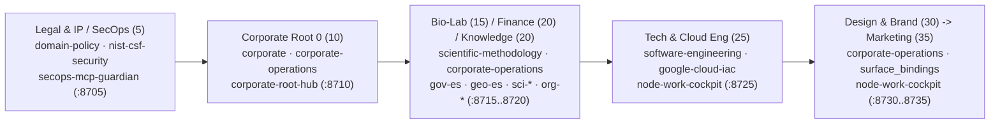

# Reference 01 — 7-Axis Taxonomy, Cross-Departmental Algebra (`0..80`), `Human-Stack` (`85..95`) & `16`-Pack Catalog

> **Normative Architecture**: [`docs/architecture/01_core_and_node_manifest.md`](../architecture/01_core_and_node_manifest.md), [`docs/architecture/02_triadic_topology_and_twin_surfaces.md`](../architecture/02_triadic_topology_and_twin_surfaces.md), and [`docs/architecture/03_governance_and_work_ledger.md`](../architecture/03_governance_and_work_ledger.md)
>
> This reference defines the **7-Axis Multidimensional Taxonomy**, the **Perspective Matrix across `Level 1..4`**, the **Cross-Departmental Contextual Algebra (`0..80`)**, the **`Human-Stack` Matrix (`85..95`)**, and the complete **`4 + 4 + 2 + 6 = 16` Declarative Template Catalog**.

---

## 1. Canonical 7-Axis Multidimensional Taxonomy (`X × Y` Orthogonal Composition)

Every concept in ZeroCloudGravity belongs to one of **7 orthogonal dimensions** (`Mandate 1` — zero flat case enums or overloaded terms):

| Axis # | Orthogonal Dimension | Question It Answers | Canonical Values (`src/zcg/core/constants.py`) | Disambiguation Rule |
| :--- | :--- | :--- | :--- | :--- |
| **Axis 1** | **Entity & Sovereignty Lineage (`entity_kind × visibility × governing_root_id`)** | *What kind of legal/organizational entity is this, is it `private` or `public`, and who is its sovereign `Root 0`?* | `public-government` (`1..4`), `enterprise` (`5..84`), `individual` (`85..95`), `open-source` (`10`); `private` \| `public`. | Never confuse `entity_kind` (*Government vs. Enterprise vs. Individual vs. OSS*) with `layer_role` (*hierarchical rank inside that entity*). |
| **Axis 2** | **Topological Class (`Node × Layer × Network`)** | *What is this repository or runtime instance functionally within the graph?* | `governance-layer` (`corporate`, `domain-policy`, `department`, `squad`), `knowledge`, `runtime-node` (`workstation`, `service-node`, `environment-cluster`), `ephemeral-sandbox` (`ephemeral-bot`), `consumer-workspace` (`project`). | A **Node** is a physical repo + work ledger + cockpit; a **Layer** is its normative `0..100` authority tier; a **Network** is its 1-hop governed subtree & mounted knowledge mesh. |
| **Axis 3** | **Deontic Precedence (`precedence: 0..100` *Lex Superior*)** | *When multiple layers bind to the same file surface, which rule wins?* | `1..2` Public Admin `Root 0` $\rightarrow$ `3..4` Public Dept $\rightarrow$ `5..9` Fiduciary `domain-policy` $\rightarrow$ `10` Corporate `Root 0` $\rightarrow$ `15` `ephemeral-bot` $\rightarrow$ `15..45` Functional `department` / `20` `knowledge` $\rightarrow$ `50` `squad` $\rightarrow$ `80` `project` $\rightarrow$ `85..95` `Human-Stack`. | Lower number = higher authority (`1 < 5 < 10 < 20 < 25 < 50 < 80 < 85`). `Human-Stack` (`85..95`) modulates pedagogical delivery without overriding `0..80` laws. |
| **Axis 4** | **Actor RBAC & Overarching Authority (`effective_role`)** | *Which human email (`git config user.email`) is acting, and what can they approve?* | `owner`, `maintainer`, `validator`, `member` (in `layer_authority.roster`) + `consumer`. `UPSTREAM_HIERARCHICAL_AUTHORITY` applies when `relationship_scope == "internal"`. | Never confuse `actor_role` (*person's RBAC permission*) with `layer_role` (*repository topological rank*). |
| **Axis 5** | **Physical Context Pillars (`Pillar A..D`) & Stack Groups** | *Where do files physically reside on disk?* | `Pillar A`: `~/.gemini/config/`; `Pillar B`: `templates/{human,context,framework,plugin}-stack/*` + `layers/*`; `Pillar C`: `<repo>/.agents/`; `Pillar D`: `docs/` & `corporate/`. | Local disk mechanisms are **Context Pillars (`Pillar A..D`)**, distinct from **Organizational Levels (`Level 1..4`)**. |
| **Axis 6** | **Inter-Layer Communication Channels (`6` Protocols)** | *How do layers and nodes exchange rules, tasks, and proofs?* | `make sync` (downward templates), `make delegate` (downward tasks), `make promote` (upward PRs), `make horizon` (1-hop radar), `make consult` (`rcap1` capsules), `make env-gate` ($N$-layer consensus). | Direct cross-layer file mutations are blocked by `pre_tool_guard.py`; all cross-layer flows use these 6 channels. |
| **Axis 7** | **Progression Scales (`L0..L3` vs. `E3..E0` vs. `M1..M4` vs. `C1..C3` vs. `dev..pro`)** | *Which scale does a shorthand code refer to?* | `L0..L3`: `rcap1` capsule resolution; `E3..E0`: epistemic credibility; `M1..M4`: `Human-Stack` domain mastery; `C1..C3`: command consciousness; `dev..pro`: deployment stages. | Reserve `L0..L3` strictly for `rcap1` capsules, `E3..E0` for epistemic grade, and `M1..M4` for human mastery. |

---

## 2. Cross-Departmental Contextual Algebra (`0..80`) & Real-World Enterprise Walkthroughs

When a business or research goal crosses specialties, ZeroCloudGravity weaves multiple departmental layers along the `0..80` *Lex Superior* order:

1. **Case A — Fiduciary SecOps & Legal Gate (`dept-legal-ip` at `precedence: 5` over `dept-tech-eng` at `25`)**: Because `5 < 10 < 25`, `.agents/rules/layer-05-dept-legal-ip.md` (`NIST-01..04` + IP/GDPR confidentiality) binds every engineering (`25`), design (`30`), and marketing (`35`) deliverable. Any code or campaign asset touching a bound surface requires `RECONCILED_FLOW` at `make env-gate ENV=pre|pro`.
2. **Case B — Multi-Departmental Marketing & Brand Intersection (`Legal 5 -> Corp 10 -> Tech 25 -> Brand 30 -> Marketing 35`)**: Mounting `layers/dept-legal-ip` and `layers/dept-design-brand` inside `dept-marketing-social` ensures that campaign automation enforces evidence-backed claims (`Record #NNN` in `corporate/ledgers/`), WCAG 2.2 AA brand tokens (`30`), and OAuth/secret safety (`25`) simultaneously.
3. **Case C — Scientific & Regulatory Closed-Loop Grounding (`dept-bio-lab` + `gov-es` + `geo-es` + `sci-biology` + `sci-engineering`)**: Mounting public/private `knowledge` nodes (`precedence: 20`) allows departmental SOPs (`corporate/sops/`) to cite exact statutory articles and physical/biological laws via `<layer>::<file>#<slug>@<digest16>:<E3..E0>` (`citation_receipt`), automatically verified against upstream drift (`CITATION_DRIFT_DETECTED`).

---

## 3. The `Human-Stack` Matrix (`85..95`): 4 Composable Facets & `M1..M4` Adaptation

A `Human-Stack` (`precedence: 85..95`) is composed of $1..N$ optional facets (`domain-<area>:M1..M4 | bridge-* | soft-* | hat-*`) across 4 contained scopes (`Scope 1` In-Chat Turn $\rightarrow$ `Scope 2` `.agents/SESSION.md` $\rightarrow$ `Scope 3` Layer `README.md` Default $\rightarrow$ `Scope 4` Workstation `hat/*` Branch):

| Mastery Level (`VALID_HUMAN_MASTERY_LEVELS`) | 1. Academic & Scientific Research (`academic-base` / `science-base`) | 2. Software & Cloud Engineering (`software-engineering` / `google-cloud-iac`) | 3. Business, Corporate, Legal & Public Admin (`business-base` / `corporate-operations`) |
| :--- | :--- | :--- | :--- |
| **`M1` — Guided Explorer / Foundations** | Step-by-step derivation of axioms, SI/ISO unit checks, Socratic checkpoints, and `academic-tutor` `practice-drill` gates (`consumer_viewpoint: academic-tutor-m1-m2`). | Explains module boundaries, `1:1:1` test structure, and architectural *why* before modifying code. | Explains P&L lines, procurement SOPs, or statutory clauses (`GDPR`, `ISO`) from first principles with guided checklists. |
| **`M2` — Autonomous Practitioner** | Standard `AAA` hypothesis verification, boundary cut-points (`N vs N±1`), and reproducible protocol execution. | Direct `AAA` test + implementation pairing, modular extraction (`<= 384` lines), and clean commit preparation. | Executes domain SOPs, contract redlines, budget models, and operational ledgers (`corporate/ledgers/`) directly. |
| **`M3` — Systems Architect / Director** | Methodological critique, multi-study meta-analysis, and publication gatekeeping (`consumer_viewpoint: professional-scientific-m3-m4`). | Relational cluster mass ($M_{\text{cluster}}$) trade-offs, C-backed stdlib optimization, and surface binding design. | Governs departmental policy, cross-squad SLAs, compliance matrices, and `make env-gate` (`tst -> pre -> pro`) sign-offs. |
| **`M4` — Principal / C-Suite Strategist** | High-density epistemic synthesis across scientific trunks with terse 4-channel proofs and `L3` frontier citations. | Cross-repository federation invariants, zero-overhead architecture, and 4-Channel Executive Digests. | Strategic capital/risk trade-offs, `ESCALATE_TO_ROOT` arbitration, and board-level 4-channel decision digests. |

---

## 4. Complete `4 + 4 + 2 + 6 = 16` Declarative Template Catalog (`zcg-template-v1`)

Every pack under `templates/<stack_group>/<name>/` ships a validated `template.json` (`schema_version: "zcg-template-v1"`), an `always_on` rule file (`rules/<name>.md`), optional skills/assets (`web/templates/` + `web/static/` on all `6` `plugin-stack` Reference Dashboards), and a dedicated `README.md`:

| Stack Group | Template ID | `extends` | Target Role | Included Skills, Rules & Runtime Assets | Pack Documentation |
| :--- | :--- | :--- | :--- | :--- | :--- |
| `human-stack` | `universal-base` | `null` | `workstation` | Universal 13-mandate cognitive, bounded-lot & commit baseline + `5` global skills (`sopen`, `continue`, `sclose`, `review`, `enrich`). | [`universal-base/README.md`](../../templates/human-stack/universal-base/README.md) |
| `human-stack` | `academic-base` | `universal-base` | `department` | Socratic mastery (`M1..M4`), anti-spoiler pedagogy, and `verify-mastery` gates (`0` global skills; pure `always_on` rule). | [`academic-base/README.md`](../../templates/human-stack/academic-base/README.md) |
| `human-stack` | `science-base` | `universal-base` | `department` | `1:1:1` traceability, SI/ISO precision, `E3..E0` credibility + `2` global skills (`architecture`, `audit`). | [`science-base/README.md`](../../templates/human-stack/science-base/README.md) |
| `human-stack` | `business-base` | `universal-base` | `corporate` | *Lex Superior* (`0..100`), RBAC accountability, Business `AAA` records + `1` global skill (`governance`). | [`business-base/README.md`](../../templates/human-stack/business-base/README.md) |
| `context-stack` | `academic-curriculum` | `academic-base` | `department` | `ACAD-01..04` curriculum rules (`SYLLABUS.md -> lessons/ -> drills/`) + `skills/academic-tutor/SKILL.md`. | [`academic-curriculum/README.md`](../../templates/context-stack/academic-curriculum/README.md) |
| `context-stack` | `scientific-methodology` | `science-base` | `squad` | `SCI-01..04` 6-trunk taxonomy, dual-ring corpora (`docs/reference/` vs. `docs/guides/`), and `citation_receipt` grounding. | [`scientific-methodology/README.md`](../../templates/context-stack/scientific-methodology/README.md) |
| `context-stack` | `software-engineering` | `science-base` | `squad` | Strict typing, `100%` isolated coverage, OWASP ASVS + `5` skills (`refactoring`, `testing`, `validation`, `release`, `oss-contribute`). | [`software-engineering/README.md`](../../templates/context-stack/software-engineering/README.md) |
| `context-stack` | `corporate-operations` | `business-base` | `department` | `CORP-OPS-01..04` hexagonal ledgers (`corporate/ledgers/` $\leftrightarrow$ `policies/sops/` $\leftrightarrow$ `surfaces/`) + `ledger-surface-audit`. | [`corporate-operations/README.md`](../../templates/context-stack/corporate-operations/README.md) |
| `framework-stack` | `nist-csf-security` | `software-engineering` | `domain-policy` | `NIST-01..04` cybersecurity controls (`GV/ID/PR/DE/RS/RC` & ISO 27001) + `skills/nist-csf-audit/SKILL.md`. | [`nist-csf-security/README.md`](../../templates/framework-stack/nist-csf-security/README.md) |
| `framework-stack` | `google-cloud-iac` | `software-engineering` | `squad` | `GCP-IAC-01..04` Google Cloud (`Cloud Run`, `GKE`, `BigQuery`, `IAM/ADC`) & Google Antigravity SDK patterns. | [`google-cloud-iac/README.md`](../../templates/framework-stack/google-cloud-iac/README.md) |
| `plugin-stack` | `workstation-control-tower` | `universal-base` | `workstation` | `:8790` `personal.local` Control Tower + `assets/service_contract.json` + `5` Ubuntu external package recipes. | [`workstation-control-tower/README.md`](../../templates/plugin-stack/workstation-control-tower/README.md) |
| `plugin-stack` | `corporate-root-hub` | `corporate-operations` | `corporate` | `:8710` `intranet.local` Holding `Root 0` Hub + `assets/service_contract.json`. | [`corporate-root-hub/README.md`](../../templates/plugin-stack/corporate-root-hub/README.md) |
| `plugin-stack` | `node-work-cockpit` | `universal-base` | `squad` | `:8720..8750` *Node Work & Sprint Ledger* Cockpit + `assets/service_contract.json`. | [`node-work-cockpit/README.md`](../../templates/plugin-stack/node-work-cockpit/README.md) |
| `plugin-stack` | `tutor-study-cockpit` | `academic-curriculum` | `department` | `:8786..8789` `M1..M4` Personal Academic Study Cockpit + `assets/service_contract.json`. | [`tutor-study-cockpit/README.md`](../../templates/plugin-stack/tutor-study-cockpit/README.md) |
| `plugin-stack` | `secops-mcp-guardian` | `nist-csf-security` | `domain-policy` | `:8705..8725` SecOps Guardian + `skills/secops-mcp-orchestration/SKILL.md` + editable `web/` + `assets/service_contract.json`. | [`secops-mcp-guardian/README.md`](../../templates/plugin-stack/secops-mcp-guardian/README.md) |
| `plugin-stack` | `knowledge-stewardship-portal` | `scientific-methodology` | `knowledge` | `:8720` `.knowledge.local` Epistemic Corpus & Data Pipeline Portal (`data_pipeline`, `crud`, `vault`, `node_mesh`) + editable `web/` + `assets/service_contract.json`. | [`knowledge-stewardship-portal/README.md`](../../templates/plugin-stack/knowledge-stewardship-portal/README.md) |
